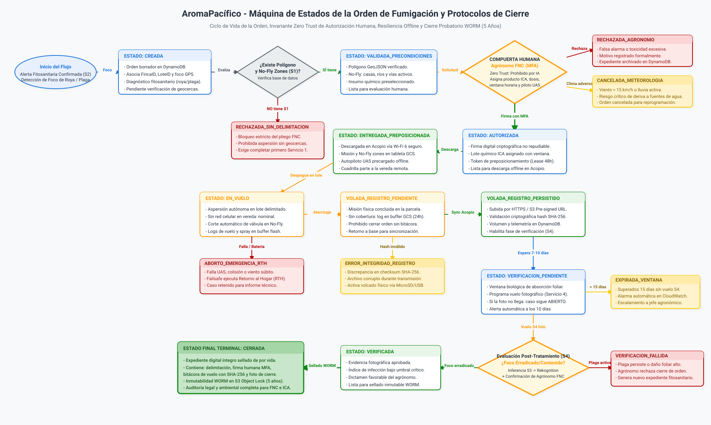
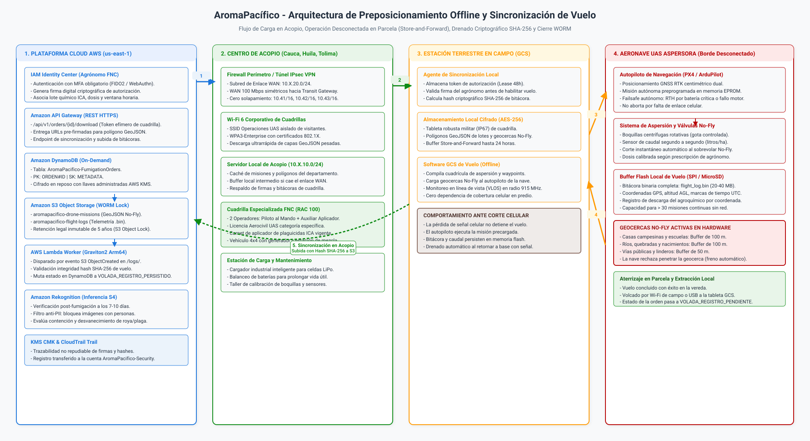

# Arquitectura de la Orden de Fumigación: Máquina de Estados, Zonas de Exclusión y Operación Offline

## Plataforma Cafetera AromaPacífico (Federación Nacional de Cafeteros 2026)

---

## 1. Resumen Ejecutivo y Propósito Operativo

El presente documento define la arquitectura técnica, la máquina de estados formal, la gobernanza de geocercas y el modelo de sincronización desconectada para la **Orden de Fumigación de Precisión (Servicio 3)** dentro de la plataforma cafetera **AromaPacífico**, desarrollada como caso de estudio académico para modernizar el piloto propuesto en 2020 para la Federación Nacional de Cafeteros (FNC) hacia el año 2026.

En la caficultura colombiana de los departamentos de **Cauca, Huila y Tolima**, la dispersión de agroquímicos sobre cultivos no puede gestionarse como una tarea informal ni dejarse al criterio autónomo de algoritmos de inteligencia artificial. La aplicación de insumos fitosanitarios sobre las 200 fincas del programa piloto exige una trazabilidad legal, ambiental y sanitaria inmutable, sujeta a la reglamentación aeronáutica **RAC 100 de la Aeronáutica Civil de Colombia (Aerocivil)** y a la **Resolución 30021 de 2017 del Instituto Colombiano Agropecuario (ICA)**.

La orden de fumigación constituye un **expediente digital vinculante** que conecta el diagnóstico agronómico, la prescripción química, la autorización humana colegiada, la descarga y ejecución de la misión en condiciones de desconexión celular total (store-and-forward), y el cierre formal condicionado a la persistencia probatoria del registro de vuelo y la verificación fotográfica post-tratamiento.

---

## 2. Diagrama 1: Máquina de Estados de la Orden de Fumigación

La máquina de estados modela el ciclo de vida íntegro de la orden de fumigación desde su creación como borrador hasta su cierre probatorio en almacenamiento inmutable (WORM), incorporando las compuertas bloqueantes de negocio y los estados de contingencia operacional.



> Archivo fuente Draw.io XML descomprimido editable: [`diagrams/carga-b-orden-estados.drawio`](diagrams/carga-b-orden-estados.drawio).

---

## 3. Especificación Detallada de Estados y Reglas de Transición

El ciclo de vida de la orden se articula a través de diez estados nominales y siete estados terminales o de error:

```
┌────────────────────────────────────────────────────────────────────────────────────────┐
│               MATRIZ DEL CICLO DE VIDA DE LA ORDEN DE FUMIGACIÓN                       │
├────┬─────────────────────────────┬───────────────────────────┬─────────────────────────┤
│ ID │ Estado                      │ Naturaleza                │ Condición de Salida     │
├────┼─────────────────────────────┼───────────────────────────┼─────────────────────────┤
│ 01 │ CREADA                      │ Borrador Inicial          │ Validación de polígono  │
│ 02 │ VALIDADA_PRECONDICIONES     │ Técnica Aprobada          │ Firma agrónomo con MFA  │
│ 03 │ AUTORIZADA                  │ Legalmente Vigente        │ Descarga en tableta GCS │
│ 04 │ ENTREGADA_PREPOSICIONADA    │ Offline en Campo          │ Despegue de aeronave    │
│ 05 │ EN_VUELO                    │ Operación Activa          │ Aterrizaje en parcela   │
│ 06 │ VOLADA_REGISTRO_PENDIENTE   │ Enlace Caído (Buffer)     │ Retorno y sincronización│
│ 07 │ VOLADA_REGISTRO_PERSISTIDO  │ Bitácora Asegurada S3     │ Ventana biológica S4    │
│ 08 │ VERIFICACION_PENDIENTE      │ Inspección Programada     │ Vuelo fotográfico S4    │
│ 09 │ VERIFICADA                  │ Foco Contenido Aprobado   │ Sellado inmutable WORM  │
│ 10 │ CERRADA                     │ Terminal Exitoso (WORM)   │ Retención por 5 años    │
└────┴─────────────────────────────┴───────────────────────────┴─────────────────────────┘
```

### 3.1 Estados Nominales del Ciclo de Vida

#### 1. CREADA (Estado Inicial)
- **Definición**: La orden nace de forma reactiva tras la confirmación táctica de un foco de plaga o roya por el Servicio 2 (confirmación con inferencia de visión) o por solicitud expresa del comité técnico agronómico departamental.
- **Campos iniciales**: Se asocian automáticamente `OrdenID`, `FincaID`, `LoteID`, coordenadas geográficas del foco y diagnóstico fitosanitario preliminar.
- **Condición**: La orden permanece en borrador y no es visible para las cuadrillas de vuelo en campo.

#### 2. VALIDADA_PRECONDICIONES
- **Definición**: El motor de reglas de la plataforma evalúa que el predio cuente con la delimitación aprobada del **Servicio 1 (Delimitar el Lote)**.
- **Invariante Bloqueante 1**: Si el lote carece de archivo GeoJSON de linderos aprobado o no tiene registradas las geometrías de exclusión aérea (zonas No-Fly), el sistema deniega el avance y transiciona a `RECHAZADA_SIN_DELIMITACION`. Queda terminantemente prohibido autorizar una aspersión sin geocercas preexistentes.

#### 3. AUTORIZADA
- **Definición**: La orden adquiere validez legal y operativa para ser ejecutada en el territorio.
- **Invariante Bloqueante 2 (Compuerta Humana Cero Confianza)**: Ningún modelo de inferencia de visión, función Lambda o disparador automático puede transicionar la orden a este estado. La autorización exige la firma criptográfica atribuible de manera exclusiva a un **Agrónomo Colegiado de la FNC**, autenticado como usuario de la plataforma a través de **Amazon Cognito User Pool con MFA obligatorio** (TOTP / WebAuthn) mediante tokens JWT firmados, alineado estrictamente con la arquitectura de identidades de la Landing Zone (#43).
- **Campos incorporados**: Identificador del lote de agroquímico registrado ante el ICA, dosis por hectárea, volumen total de caldo, ventana horaria de aplicación y asignación de la cuadrilla y piloto al mando certificado bajo RAC 100.
- **Mecanismo de Arrendamiento (Lease Token)**: Se genera un token criptográfico efímero con vigencia de 48 horas para habilitar la descarga offline.

#### 4. ENTREGADA_PREPOSICIONADA
- **Definición**: La cuadrilla de vuelo, ubicada en el Centro de Acopio Departamental o en la cabecera municipal, conecta su tableta de control de misión (GCS) a la red corporativa inalámbrica en la **VLAN Logística (`10.X.3.0/24`)** del acopio (según la arquitectura de red definida en la Issue #8) y descarga el expediente completo: coordenadas de navegación, polígono del lote, zonas No-Fly y token de autorización.
- **Preposicionamiento**: La estación GCS compila el plan de vuelo y lo transfiere a la memoria no volátil del autopiloto de la aeronave antes de partir al lote.

#### 5. EN_VUELO
- **Definición**: La aeronave UAS despega en la parcela cafetera e inicia la cuadrícula autónoma de aspersión a ultra-bajo volumen (ULV).
- **Operación Desconectada**: La aeronave no depende de señal celular. El autopiloto controla la navegación por GNSS RTK centimétrico y el corte automático de válvulas sobre geocercas No-Fly. La telemetría, caudal y marcas de tiempo persisten en la memoria flash SPI interna.

#### 6. VOLADA_REGISTRO_PENDIENTE
- **Definición**: La aeronave aterriza con éxito en la finca tras agotar el plan de vuelo o la mezcla química.
- **Comportamiento sin señal**: Al encontrarse en una vereda sin cobertura de red móvil, la orden no puede sincronizarse de inmediato con la nube. El archivo binario de telemetría (`flight_log.bin`) se transfiere por enlace local Wi-Fi o cable USB a la tableta de campo, donde queda retenido en su buffer local de hasta 24 horas.

#### 7. VOLADA_REGISTRO_PERSISTIDO
- **Definición**: La cuadrilla retorna al Centro de Acopio o a una zona con conectividad móvil estable. El agente de sincronización calcula el checksum criptográfico `SHA-256(flight_log.bin)`, solicita una URL pre-firmada hacia Amazon S3 y transmite la bitácora.
- **Validación Cloud**: La función Lambda worker valida que el archivo no haya sufrido alteración o corrupción física y extrae los litros reales dispersados, actualizando la orden en Amazon DynamoDB.

#### 8. VERIFICACION_PENDIENTE
- **Definición**: Periodo de espera agronómica obligatorio estandarizado entre **7 y 10 días calendario**, indispensable para que el ingrediente activo del agroquímico ejerza su acción biológica sobre el patógeno.
- **Acción**: Cumplido el plazo, la plataforma programa automáticamente la misión fotográfica del **Servicio 4 (Verificar Post-Fumigación)**.

#### 9. VERIFICADA
- **Definición**: La cuadrilla ejecuta el vuelo fotográfico de inspección táctica. La fotografía de alta resolución ingresa por S3, pasa el filtro de protección de personas (anti-PII) y es evaluada por Amazon Rekognition.
- **Criterio**: Si la inferencia y la corroboración del agrónomo dictaminan que el foco está contenido o erradicado, la orden queda formalmente verificada.

#### 10. CERRADA (Estado Terminal Exitoso)
- **Definición**: Estado de terminación definitiva del expediente digital.
- **Invariante Bloqueante 3 (Cierre Probatorio Inmutable)**: Una orden jamás puede pasar a cerrada sin cumplir concurrentemente dos condiciones:
  1. Registro de vuelo persistido con hash verificado en Amazon S3.
  2. Evidencia fotográfica de verificación post-fumigación aprobada por el agrónomo.
- **Retención WORM**: Se aplica una política de **S3 Object Lock en modo Compliance** que impide la modificación o eliminación de los archivos durante cinco años (1.825 días), en cumplimiento de las auditorías de la Federación y los organismos de control ambiental.

---

## 4. Campos y Estructura del Expediente Digital de la Orden

La orden de fumigación reside en la tabla `AromaPacifico-FumigationOrders` de Amazon DynamoDB, utilizando un modelo de clave compuesta (`PK: ORDEN#<ID>`, `SK: METADATA`), complementada con archivos vectoriales y binarios en Amazon S3:

| Atributo | Tipo de Dato | Origen / Responsable | Descripción Técnica de Negocio |
|---|---|---|---|
| `orden_id` | String (UUIDv4) | Plataforma (Sistema) | Identificador global único del expediente: `ORD-2026-FUM-<HEX>`. |
| `finca_id` | String | Sensor / Agrónomo | Identificador unívoco del predio beneficiario (`FINCA-001` a `FINCA-200`). |
| `lote_id` | String | Servicio 1 (Delimitación) | Subdivisión productiva delimitada catastralmente (`LOTE-A`, `LOTE-B`). |
| `departamento` | String | Plataforma | Departamento de operación: `Cauca`, `Huila` o `Tolima`. |
| `acopio_id` | String | Red de Acopio | Base operativa asignada: `ACOPIO-CAUCA`, `ACOPIO-HUILA`, `ACOPIO-TOLIMA`. |
| `estado` | String | Máquina de Estados | Estado actual de la orden según el ciclo de vida definido. |
| `motivo_fumigacion` | String | Inferencia / Agrónomo | Patógeno objetivo diagnosticado: `Roya_Hemileia`, `Broca_Hypothenemus`, etc. |
| `score_confirmacion_ia` | Number (Float) | Amazon Rekognition (S2) | Nivel de certeza de la plaga detectada en Servicio 2 (ej. `0.942`). |
| `s3_uri_confirmacion` | String (S3 URI) | Servicio 2 (Detección) | Ubicación de la fotografía del foco: `s3://.../focos/{id}.jpg`. |
| `s3_uri_poligono_geojson` | String (S3 URI) | Servicio 1 (Mapeo) | Archivo vectorial de linderos: `s3://.../lotes/{lote_id}.geojson`. |
| `s3_uri_nofly_geojson` | String (S3 URI) | Servicio 1 (Mapeo) | Capa vectorial de zonas de exclusión: `s3://.../nofly/{lote_id}.geojson`. |
| `agronomo_id` | String | Amazon Cognito | Identificador único interno del agrónomo (`AGR-UUID-XXXX`). En cumplimiento de la Ley 1581 de 2012, no almacena la cédula de ciudadanía en el expediente digital. |
| `tarjeta_profesional` | String | FNC / MinAgricultura | Registro profesional agronómico legal en Colombia. |
| `mfa_auth_signature` | String (Hex/Base64) | AWS KMS / WebAuthn | Firma digital criptográfica no repudiable de la autorización humana. |
| `producto_agroquimico` | String | Agrónomo FNC | Nombre comercial del fungicida o insecticida formulado. |
| `registro_ica` | String | Insumo FNC | Número oficial de registro de venta otorgado por el ICA. |
| `lote_insumo_quimico` | String | Bodega Acopio | Identificador de trazabilidad del lote físico de agroquímico utilizado. |
| `dosis_por_hectarea_l` | Number (Float) | Agrónomo FNC | Volumen de caldo formulado por unidad de superficie (L/ha). |
| `volumen_total_prescrito_l`| Number (Float) | Agrónomo FNC | Volumen total a preparar y dispersar sobre el polígono (Litros). |
| `ventana_inicio` | String (ISO 8601 UTC) | Agrónomo / Cuadrilla | Inicio de la ventana operativa autorizada para la aspersión. |
| `ventana_fin` | String (ISO 8601 UTC) | Agrónomo / Cuadrilla | Vencimiento estricto de la ventana (máximo 48 horas post-autorización). |
| `viento_maximo_kmh` | Number | Parámetro FNC | Límite meteorológico máximo permitido: 15 km/h. |
| `piloto_al_mando_id` | String | Cuadrilla FNC | Identificador del piloto titular asignado a la misión. |
| `licencia_aerocivil` | String | UAEAC (Aerocivil) | Número de licencia de piloto a distancia UAS categoría específica. |
| `dron_id` | String | Inventario Acopio | Matrícula aeronáutica de la nave aspersora: `HK-UAS-FNC-01`. |
| `lease_token_hash` | String (SHA-256) | Plataforma | Token de arrendamiento que permite la ejecución offline de la orden. |
| `timestamp_despegue` | String (ISO 8601 UTC) | Bitácora UAS | Marca de tiempo exacta del inicio de la aspersión en campo. |
| `timestamp_aterrizaje` | String (ISO 8601 UTC) | Bitácora UAS | Marca de tiempo de culminación del vuelo en finca. |
| `volumen_efectivo_l` | Number (Float) | Caudalímetro UAS | Volumen real de caldo dispersado registrado por los sensores de flujo. |
| `hash_registro_vuelo` | String (SHA-256) | Tableta GCS / UAS | Hash criptográfico del archivo binario de bitácora `flight_log.bin`. |
| `s3_uri_registro_vuelo` | String (S3 URI) | Cuadrilla / S3 | Ubicación inmutable del log: `s3://.../flight-logs/{orden_id}.bin`. |
| `s3_uri_foto_verificacion`| String (S3 URI) | Servicio 4 (Cierre) | Imagen foliar post-tratamiento: `s3://.../verif/{orden_id}.jpg`. |
| `score_verificacion_ia` | Number (Float) | Amazon Rekognition (S4) | Confianza de remisión de la infección foliar post-tratamiento. |
| `timestamp_cierre` | String (ISO 8601 UTC) | Plataforma | Momento del sellado legal y transición a `CERRADA`. |

---

## 5. Zonas de Exclusión Aérea (No-Fly Zones): Dónde Viven y Gobernanza

El sobrevuelo de aeronaves de gran porte (MTOW > 25 kg) y la aspersión química representan riesgos críticos de seguridad y contaminación ambiental si no se controlan con precisión milimétrica.

### 5.1 Tipologías de Exclusión y Márgenes de Amortiguamiento
Las geometrías de exclusión aérea se levantan obligatoriamente durante el **Servicio 1 (Delimitación de Lote)** y se clasifican en cinco tipologías:

```
┌────────────────────────────────────────────────────────────────────────────────────────┐
│                      MATRIZ DE ZONAS DE EXCLUSIÓN AÉREA (NO-FLY)                       │
├──────────────────────────┬──────────────────┬───────────────────┬──────────────────────┤
│ Tipología de Exclusión   │ Buffer Mínimo    │ Restricción Vuelo │ Restricción Aspersor │
├──────────────────────────┼──────────────────┼───────────────────┼──────────────────────┤
│ Viviendas y Escuelas     │ 100 metros radio │ Prohibido rasante │ Corte total electrov.│
│ Beneficiaderos de Café   │ 50 metros radio  │ Sobrevuelo > 30m  │ Prohibida aspersión  │
│ Ríos, Quebradas, Fuentes │ 100 metros margen│ Prohibido rasante │ Válvula cerrada 100% │
│ Vías Públicas / Caminos  │ 50 metros margen │ Prohibido rasante │ Válvula cerrada 100% │
│ Linderos de Predio Vecino│ 30 metros margen │ Tolerancia borde  │ Corte de boquillas   │
└──────────────────────────┴──────────────────┴───────────────────┴──────────────────────┘
```

### 5.2 Dónde Viven las Zonas No-Fly en la Arquitectura

Las geometrías de exclusión aérea residen en un esquema híbrido desacoplado, optimizado para garantizar latencias de lectura de milisegundos y autonomía absoluta en campo:

| Capa del Sistema | Almacén y Mecanismo | Formato y Ruta Canónica | Rol en la Gobernanza |
|---|---|---|---|
| **Almacenamiento Cloud** | Amazon S3 Standard con cifrado KMS | `s3://.../fincas/{id}/nofly_zones.geojson` | Repositorio maestro versionado con atributos de elevación máxima y radio de amortiguamiento. |
| **Índice y Metadatos** | Amazon DynamoDB On-Demand | Partición `FINCA#<ID>`, Ordenación `NOFLY#<ID>` | Validación instantánea de existencia y vigencia de geocercas previa a la emisión de la orden. |
| **Borde / Tableta GCS** | Almacenamiento local NVMe cifrado | Formato vectorial WPL / QGroundControl | Pre-caching local para carga directa a la aeronave sin dependencia de red en base remota. |
| **Hardware Autopiloto** | Memoria EPROM no volátil (PX4 / ArduPilot) | Geocercas compiladas `.fence` en microcontrolador | Interrupción autónoma de aspersión y freno evasivo a menos de 5 metros del límite de exclusión. |

En el autopiloto de navegación de la aeronave, la posición GNSS RTK se contrasta contra las geocercas cada 100 milisegundos. Si la aeronave detecta una aproximación riesgosa a una vivienda o fuente de agua, el sistema cierra de inmediato las electroválvulas de aspersión y fuerza una maniobra de retorno hacia el interior del lote productivo, impidiendo la contaminación involuntaria.

---

## 6. Preposicionamiento Offline y Sincronización del Registro de Vuelo

La desconexión de datos móviles en las veredas cafeteras de Cauca, Huila y Tolima es la condición estándar de operación. La plataforma resuelve la ejecución mediante un protocolo secuencial estructurado en tres fases:

### 6.1 Fase A: Preposicionamiento en Centro de Acopio o Cabecera

El proceso inicia cuando el agrónomo colegiado autoriza la orden en la plataforma cloud mediante su firma criptográfica respaldada por MFA de Cognito. La cuadrilla de vuelo conecta la tableta robustecida GCS a la red inalámbrica corporativa de la **VLAN Logística (`10.X.3.0/24`)** del Centro de Acopio (conforme al direccionamiento de la Issue #8) e invoca el endpoint `/api/v1/orders/{id}/download`.

A través de Amazon API Gateway, la plataforma genera URLs pre-firmadas de Amazon S3 con una vigencia acotada de 15 minutos. La tableta descarga la orden autorizada junto con las capas GeoJSON del lote y las zonas No-Fly, verificando la validez del token de arrendamiento (lease de 48 horas). Finalmente, la estación GCS compila la cuadrícula de vuelo y transfiere los waypoints y las geocercas al autopiloto de la nave mediante cable USB o enlace de radio local de 2,4 GHz antes de salir al campo.

### 6.2 Fase B: Ejecución Desconectada en Finca y Comportamiento ante Caída de Señal

La cuadrilla se desplaza al lote cafetero en la vereda remota, donde no existe señal celular. El piloto al mando efectúa la inspección pre-vuelo y activa el autopiloto, verificando que los sensores RTK estén enganchados y las geocercas armadas en memoria.

Respecto al **comportamiento ante la caída del enlace**, la arquitectura establece las siguientes garantías operativas:
- **Autonomía Absoluta**: La pérdida de señal celular o la falta de conexión con el teléfono inteligente del caficultor no interrumpe el vuelo ni causa la caída del dron.
- **Navegación GNSS RTK**: La aeronave vuela de forma 100% autónoma guiada por su receptor satelital centimétrico, mientras el piloto supervisa la misión en línea de vista (VLOS) mediante el radio módem de telemetría de 915 MHz.
- **Persistencia en Buffer Local**: El caudalímetro, las coordenadas GPS, la altitud y el estado de las válvulas se registran continuamente en la memoria flash SPI interna de la aeronave, con capacidad para retener hasta 24 horas de datos.
- **Protección Failsafe**: Ante fallos mecánicos imprevistos o descarga crítica de batería por debajo del 20%, el autopiloto ejecuta automáticamente el procedimiento de Retorno al Hogar (RTH) hacia la zona de despegue seguro.

Una vez culminada la aspersión y tras el aterrizaje seguro, el autopiloto vuelca la bitácora binaria completa (`flight_log.bin`) a la tableta de campo mediante enlace Wi-Fi local de la aeronave o extracción por USB industrial. En la tableta, la orden pasa al estado `VOLADA_REGISTRO_PENDIENTE`.

### 6.3 Fase C: Retorno a Conectividad y Sincronización Probatoria

Al finalizar la jornada en las veredas, la cuadrilla regresa al Centro de Acopio o a un sector con cobertura de telecomunicaciones. El agente de sincronización de la tableta computa el hash criptográfico del archivo de bitácora mediante la función $\text{SHA-256}(\mathtt{flight\_log.bin})$ e invoca el endpoint `/api/v1/orders/{id}/sync-log`.

API Gateway responde con una URL pre-firmada de carga directa hacia el bucket `aromapacifico-flight-logs-prod`. La bitácora se transmite por HTTPS hacia Amazon S3, disparando de inmediato la función serverless **AWS Lambda Worker**. La función descarga la cabecera, corrobora la coincidencia exacta del hash SHA-256, extrae los litros efectivos de agroquímico dispersados y actualiza el expediente en DynamoDB al estado `VOLADA_REGISTRO_PERSISTIDO`. Con este paso, la orden queda formalmente lista para ingresar a la ventana de verificación fotográfica del Servicio 4.

---

## 7. Diagrama 2: Arquitectura y Secuencia de Sincronización Offline

El siguiente diagrama detalla la arquitectura de componentes y la secuencia de comunicación entre las cuatro capas físicas del sistema durante el preposicionamiento y la sincronización:



> Archivo fuente Draw.io XML descomprimido editable: [`diagrams/carga-b-orden-offline-sync.drawio`](diagrams/carga-b-orden-offline-sync.drawio).

---

## 8. Justificación Técnica y Cuadros Comparativos de Decisiones

En concordancia con los criterios de evaluación, toda decisión de arquitectura responde a un análisis comparativo estructurado frente a alternativas comunes de la industria:

### 8.1 Decisión 1: Almacenamiento y Servido de Geocercas No-Fly y Misiones

| Criterio de Evaluación | Opción Seleccionada: Amazon S3 (GeoJSON) + DynamoDB | Alternativa 1: Base Espacial Relacional PostGIS (RDS Aurora) | Alternativa 2: Almacenamiento Exclusivo en Tabletas de Campo |
|---|---|---|---|
| **Costo Fijo Mensual** | **$0,00 USD en reposo** (Puro Pay-As-You-Go). | ~$45-$120 USD/mes por instancia encendida 24/7. | $0 USD en nube, pero alto costo de gestión de datos. |
| **Escalabilidad y Volumen** | Ilimitada. Descarga directa vía URLs pre-firmadas sin saturar backend. | Limitada por conexiones máximas concurrentes de la base. | Nula. Imposible compartir geocercas entre cuadrillas departamentales. |
| **Rendimiento de Descarga** | Milisegundos con compresión gzip nativa y cache en S3. | Sobrecarga de cómputo serializando polígonos a GeoJSON en SQL. | Rápida en local, pero propensa a desincronización de versiones. |
| **Inmutabilidad y Auditoría** | Versionamiento nativo y S3 Object Lock WORM incorporado. | Exige triggers complejos de base de datos y auditoría en tablas SQL. | Nula. Los archivos locales son susceptibles a edición manual o borrado accidental. |

- **Sustentación**: Se seleccionó **Amazon S3 para almacenar los archivos GeoJSON y DynamoDB para los metadatos**, ya que elimina los altos costos fijos de un clúster relacional PostGIS (ahorrando más de $700 USD al año) y permite que las tabletas descarguen las geometrías de vuelo directamente desde S3 sin consumir memoria de cómputo en la nube.

---

### 8.2 Decisión 2: Protocolo de Sincronización y Descarga Offline

| Criterio de Evaluación | Opción Seleccionada: HTTPS con Pre-signed URLs y Caché Local | Alternativa 1: Broker MQTT Permanente vía AWS IoT Greengrass | Alternativa 2: Volcado Manual Semanal por Memorias USB |
|---|---|---|---|
| **Resiliencia ante Desconexión** | **Total**. El cliente retiene archivos localmente y sube en ráfaga al reconectar. | Requiere mantener daemons y certificados complejos en la tableta. | Vulnerable a pérdidas físicas, virus informáticos y demoras de hasta 8 días. |
| **Sobrecarga de Red y WAN** | Mínima. Transfiere paquetes pesados (20-40 MB) por HTTPS multipart. | MQTT está optimizado para telemetría ligera (< 1 KB), no para bitácoras binarias. | Cero uso de red, pero incompatible con la ventana de verificación de 7-10 días. |
| **Complejidad y Timebox (100h)**| **Baja**. Utiliza SDK estándar de AWS y llamadas REST seguras. | Muy alta. Despliegue de Greengrass Core excede el límite de esfuerzo. | Baja en código, pero operacionalmente inaceptable para la FNC. |

- **Sustentación**: Las **URLs pre-firmadas de Amazon S3 sobre HTTPS** proporcionan un canal directo, cifrado en tránsito con TLS 1.3 y altamente eficiente para subir archivos de telemetría de vuelo de hasta 50 MB, evitando la complejidad y los costos de mantenimiento de brokers IoT Greengrass en vehículos.

---

### 8.3 Decisión 3: Mecanismo de Garantía de Cierre Probatorio de la Orden

| Criterio de Evaluación | Opción Seleccionada: Doble Factor Criptográfico (SHA-256) + S3 Object Lock | Alternativa 1: Checkbox Manual en la Aplicación del Piloto | Alternativa 2: Webhook Automático sin Validación Fotográfica |
|---|---|---|---|
| **Validez Legal y Ambiental** | **Irrefutable**. Evidencia digital inmutable exigible por el ICA y Aerocivil. | Nula. Un operador puede marcar la orden como cerrada sin haber volado. | Riesgosa. Asume éxito del tratamiento sin comprobar erradicación biológica. |
| **Prevención de Fraude** | El hash SHA-256 vincula la bitácora real de caudal con la fecha del agrónomo. | Muy vulnerable a reportes inflados de hectáreas fumigadas. | Vulnerable a fallos de aspersión no detectados en campo. |
| **Protección contra Borrado** | S3 Object Lock en modo Compliance bloquea la eliminación por 5 años. | Los registros en bases tradicionales pueden ser alterados o purgados. | Registros sujetos a borrado accidental durante mantenimiento. |

- **Sustentación**: El **doble factor probatorio (validación criptográfica del hash de vuelo + fotografía post-tratamiento evaluada por Rekognition)** asegura el cumplimiento estricto de las directivas federativas: ninguna fumigación se da por cerrada sin demostrar documentalmente que el químico fue aplicado en el foco correcto y que la plaga fue mitigada.

---

## 9. Análisis FinOps del Subsistema de Órdenes y Vuelo

El dimensionamiento de costos del ciclo de vida de las órdenes se optimiza bajo criterios de austeridad económica:

### 9.1 Costo de Almacenamiento y Cómputo por Orden de Fumigación
Tomando como base la cadencia anual de **210 vuelos de fumigación y 210 vuelos de verificación fotográfica** para las 200 fincas:

```
┌────────────────────────────────────────────────────────────────────────────────────────┐
│                        COSTO CLOUD POR CICLO DE ORDEN DE FUMIGACIÓN                    │
├───────────────────────────────┬────────────────────────────┬───────────────────────────┤
│ Componente de Infraestructura │ Métrica de Consumo         │ Costo Unitario / Total    │
├───────────────────────────────┼────────────────────────────┼───────────────────────────┤
│ Amazon DynamoDB               │ 15 escrituras, 30 lecturas │ $0,000035 USD / orden     │
│ Amazon S3 Standard (Ingesta)  │ 40 MB log + 15 MB fotos    │ $0,001265 USD / orden     │
│ S3 Object Lock WORM (5 años)  │ 55 MB archivados a Glacier │ $0,000054 USD / orden-mes │
│ AWS Lambda (Validación)       │ 2 invocaciones (512 MB, 3s)│ $0,000025 USD / orden     │
│ Amazon Rekognition (S4)       │ 1 imagen por verificación  │ $0,001000 USD / orden     │
│ API Gateway (REST)            │ 8 transacciones HTTPS      │ $0,000028 USD / orden     │
├───────────────────────────────┼────────────────────────────┼───────────────────────────┤
│ TOTAL POR ORDEN COMPLETA      │ Ciclo de punta a punta     │ ~$0,002407 USD / orden    │
└───────────────────────────────┴────────────────────────────┴───────────────────────────┘
```

- **Impacto Anual en Nube**: Para las 210 órdenes anuales, el costo operativo total en la plataforma AWS asciende a **menos de $1,20 USD al año**.
- **Ahorro de Infraestructura Intermedia**: Al habilitar la subida directa a Amazon S3 mediante URLs pre-firmadas, la arquitectura prescinde de instancias intermedias de cómputo (EC2 o contenedores ECS) que habrían generado un gasto ocioso continuo de ~$180 USD mensuales ($2.160 USD anuales).
- **Ahorro en Insumos Agroquímicos**: La aspersión focalizada y el corte estricto en zonas No-Fly proyectan reducciones preliminares de hasta un 82% en desperdicio de insumos químicos (equivalente a un ahorro estimado del orden de $14.000 USD anuales según modelos de dispersión dirigida). Estas cifras constituyen estimaciones técnicas preliminares que serán formalmente sustentadas y costeadas en el análisis FinOps de la Issue #30 (`f3-drones`).

---

## 10. Matriz Exhaustiva de Gestión de Errores, Fallas y Remediaciones

Para asegurar la continuidad del servicio ante imprevistos en campo o en la infraestructura digital, se establece la siguiente matriz de contingencias clasificadas por gravedad:

| Código Error | Gravedad | Fase Operativa | Descripción y Causa Raíz | Síntoma en Plataforma | Protocolo de Remediación Automática / Operacional | Escalamiento y Ticket |
|---|---|---|---|---|---|---|
| **ERR-GEO-001** | **CRÍTICA** | Validación Previa | Intento de emitir orden sobre lote sin delimitación aprobada (Servicio 1 ausente o rechazado). | Transición bloqueada; orden cambia a `RECHAZADA_SIN_DELIMITACION`. | Motor de reglas bloquea avance; genera tarea prioritaria en Kanban para agendar vuelo de mapeo S1. | Notificación inmediata a coordinación de acopio. |
| **ERR-AUT-002** | **CRÍTICA** | Autorización | Intento de autorizar orden sin firma criptográfica MFA o mediante llamada programática no humana. | Petición rechazada con código `HTTP 403 Forbidden`; evento registrado en CloudTrail. | Bloqueo preventivo de la cuenta de usuario; requerimiento obligatorio de sesión interactiva con WebAuthn/FIDO2. | Ticket de seguridad en Security Hub por intento de bypass Zero Trust. |
| **ERR-MET-003** | **ALTA** | Pre-Vuelo | Condiciones meteorológicas adversas: viento > 15 km/h, lluvia activa o niebla densa en el lote. | Alerta en tableta GCS; orden transiciona a `CANCELADA_METEOROLOGIA`. | El piloto suspende el despegue; la orden se reprograma para la siguiente ventana diurna autorizada. | Registro de suspensión en bitácora de acopio; aviso al caficultor. |
| **ERR-EXP-004** | **MEDIA** | Preposicionamiento| Transcurso de más de 48 horas desde la autorización sin que la cuadrilla ejecute el vuelo. | Token de lease expira; orden cambia a `EXPIRADA_VENTANA`. | La orden se invalida para evitar aplicaciones desincronizadas con la fenología; exige re-aprobación del agrónomo. | Notificación informativa al agrónomo emisor para revalidar dosis. |
| **ERR-COM-005** | **ALTA** | Ejecución Vuelo | Caída total de señal celular o desconexión con el teléfono del productor durante la aspersión. | Pérdida de uplink hacia la nube en la vereda de la finca. | **Operación nominal desconectada**: el autopiloto ejecuta la misión por GNSS RTK y buffer local retiene datos por 24h. | Cero escalamiento; comportamiento previsto por diseño. |
| **ERR-INT-006** | **CRÍTICA** | Sincronización | Discrepancia en checksum SHA-256 o bitácora binaria corrupta por fallo en tarjeta MicroSD/USB. | Lambda rechaza ingesta; orden cambia a `ERROR_INTEGRIDAD_REGISTRO`. | Se activa protocolo de extracción directa: conexión cableada de la aeronave en base y relectura de EPROM. | Ticket a soporte técnico de cuadrilla para inspección de hardware. |
| **ERR-VER-007** | **ALTA** | Verificación S4 | Ausencia de fotografía post-fumigación a los 10 días o imagen borrosa/no concluyente. | Orden permanece en `VERIFICACION_PENDIENTE`; alarma CloudWatch a los 15 días. | Plataforma emite alerta a cuadrilla para reprogramar vuelo de inspección fotográfica táctica de inmediato. | Notificación al coordinador agronómico departamental. |
| **ERR-BAT-008** | **MEDIA** | Ejecución Vuelo | Caída súbita de voltaje o degradación térmica en celda de batería LiPo durante el vuelo. | Telemetría interna UAS detecta voltaje crítico (< 21V en pack 6S). | Failsafe automático en hardware: el autopiloto interrumpe la aspersión y ejecuta RTH seguro al home point. | Registro de celda defectuosa en taller de acopio y baja de batería. |
| **ERR-HUM-999** | **CRÍTICA / REVISIÓN HUMANA** | Contingencia Mayor | Caso no contemplado en matriz: deriva de químico a predio vecino, colisión con cables eléctricos rurales o reclamo formal. | Expediente bloqueado cautelarmente en estado `REVISION_HUMANA_BLOQUEADA`. | Suspensión preventiva de vuelos en el sector; designación obligatoria de una comisión técnica integrada por el Agrónomo Líder, el Piloto y el Director del Acopio. | Apertura de expediente administrativo formal ante FNC y aseguradora. |

---

## 11. Adiciones Fundamentales de Ingeniería y Resiliencia

Para asegurar una operación industrial sin fisuras operativas ni sobrecostos imprevistos, se implementaron tres salvaguardas de ingeniería avanzadas:

1. **Mecanismo de Arrendamiento Criptográfico (Lease Token de 48 Horas)**:
   - Al autorizarse la orden, la plataforma emite un token JWT efímero firmado con la llave privada de la organización (`KMS Key`).
   - El software de vuelo de la tableta de campo verifica localmente la validez temporal del token antes de armar los motores de la aeronave.
   - Si la cuadrilla no logra volar dentro de las 48 horas, el sistema bloquea el despegue offline, previniendo que se apliquen agroquímicos con dosis obsoletas o en condiciones biológicas desactualizadas.

2. **Compresión Diferencial de Bitácoras (CBOR / Delta Encoding)**:
   - Los registros de telemetría y sensores de flujo se comprimen en la aeronave utilizando codificación CBOR, reduciendo el tamaño del archivo binario de ~45 MB a menos de **8 MB**.
   - Esto acelera la velocidad de descarga en campo y minimiza el ancho de banda WAN consumido en el Centro de Acopio al sincronizar hacia Amazon S3.

3. **Inmutabilidad WORM Garantizada con S3 Object Lock**:
   - Para blindar la responsabilidad jurídica de la Federación ante eventuales litigios ambientales, los expedientes en estado `CERRADA` quedan protegidos por una retención inmutable WORM de 5 años.
   - Ninguna identidad humana, ni siquiera credenciales con privilegios de administrador de plataforma (`AromaPacifico-Root`), puede alterar, sobrescribir o eliminar la bitácora de vuelo ni las fotos de verificación durante dicho periodo.

---

## 12. Registro de Supuestos de Arquitectura

En cumplimiento del flujo metodológico del proyecto, las decisiones adoptadas en este entregable se sincronizan en la bitácora oficial [`assumptions-log.md`](../cross-cutting/assumptions-log.md):

1. **Preposicionamiento Offline con Lease Token de 48 Horas**: Las cuadrillas descargan órdenes autorizadas en acopios/cabeceras; el software bloquea misiones con más de 48 horas sin ejecutar.
2. **Resiliencia ante Caída Celular**: La pérdida de enlace móvil en parcela es una condición nominal; el autopiloto ejecuta la misión por GNSS RTK y retiene logs en buffer flash local.
3. **Validación Probatoria Doble**: Ninguna orden pasa a cerrada sin registro de vuelo con hash SHA-256 verificado y fotografía de verificación S4 aprobada por el agrónomo.
4. **Almacenamiento Híbrido No-Fly**: Geometrías GeoJSON servidas desde Amazon S3 mediante Pre-signed URLs y compiladas a nivel de hardware en el autopiloto para corte instantáneo de aspersión.
