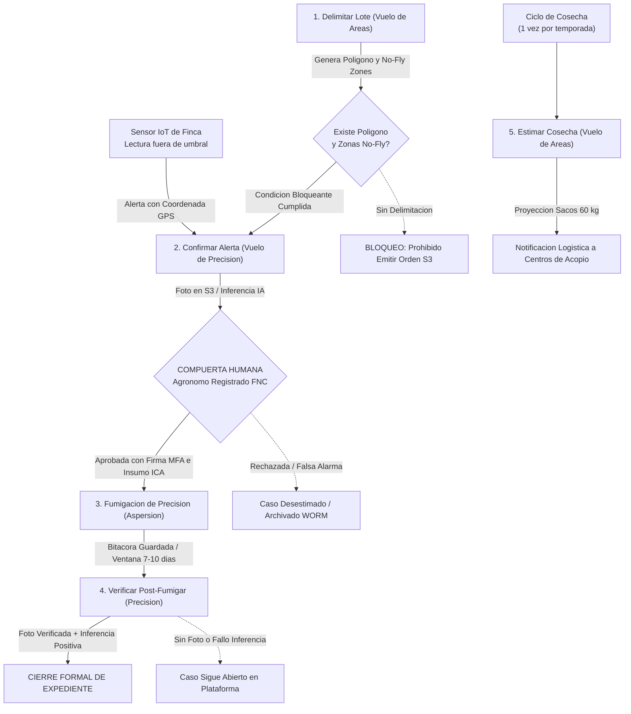
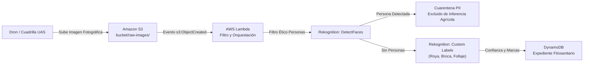

# Arquitectura y Gobernanza del Servicio de Drones Agricolas

## Plataforma Cafetera AromaPacifico (Federacion Nacional de Cafeteros 2026)

---

## 1. Resumen Ejecutivo y Proposito Operativo

El presente documento establece el diseno arquitectonico, el marco regulatorio, el modelo operativo y la cadencia matematica del **Servicio Integrado de Drones** para la plataforma cafetera **AromaPacifico**, en el marco del reto de modernizacion para la Federacion Nacional de Cafeteros (FNC) en convenio con la Universidad Icesi.

A diferencia del diseno preliminar de 2020, en el cual las operaciones aereas se concebian como vuelos recreativos o aislados sin gobierno digital, la arquitectura de 2026 estructura un **servicio aeronautico corporativo de extremo a extremo**. La plataforma es responsable de originar la mision, validar las precondiciones agronomicas y de seguridad, asignar la orden a la cuadrilla de vuelo, gestionar la compuerta humana de autorizacion, procesar las imagenes mediante vision artificial serverless y asegurar el cierre formal del expediente con retencion inmutable de cinco anos.

El servicio cubre las 200 fincas cafeteras distribuidas en los departamentos de **Cauca, Huila y Tolima**, garantizando que ninguna orden de aspersion quimica pueda ejecutarse sin la aprobacion expresa de un agronomo colegiado y resolviendo la operacion en zonas con corte o ausencia total de cobertura celular mediante preposicionamiento offline y mecanismos de almacenamiento y reenvio (store-and-forward).

---

## 2. Los Cinco Servicios Aeronauticos Mandatorios

El pliego del reto define cinco servicios obligatorios que articulan la totalidad del ciclo de vida agronomico del cultivo. Cada servicio cumple un proposito funcional especifico e independiente; **ningun servicio sustituye, reemplaza o anula a otro**:

| ID | Nombre del Servicio | Modo de Vuelo | Disparador Operativo | Entregable Tecnico en Plataforma | Regla Bloqueante de Negocio |
|---|---|---|---|---|---|
| **S1** | **Delimitar el Lote** | Agricultura de Areas | Onboarding de finca o modificacion de linderos | Ortomosaico georreferenciado, perimetro GeoJSON y capas de zonas No-Fly | Sin delimitacion aprobada en base de datos, queda terminantemente bloqueada cualquier orden de fumigacion. |
| **S2** | **Confirmar Alerta de Sensor** | Agricultura de Precision | Lectura fuera de umbral emitida por sensor de suelo/clima (foco GPS) | Fotografia multiespectral o RGB de alta resolucion del follaje en S3 | El dron vuela exclusivamente a las coordenadas del sensor; no sobrevuela la finca entera. |
| **S3** | **Fumigacion de Precision** | Agricultura de Precision | Orden digital formal autorizada y firmada por agronomo con MFA | Registro telematico de aspersion, volumen dispersado y cierre de vuelo | Requiere lote delimitado, identificador de lote de agroquimico registrado ICA y firma humana obligatoria. |
| **S4** | **Verificar Post-Fumigacion** | Agricultura de Precision | Transcurso de ventana agronomica (7 a 10 dias post-aspersion) | Registro fotografico de evolucion foliar y dictamen de inferencia IA | Si el archivo fotografico no se carga a la plataforma, el caso permanece en estado ABIERTO. |
| **S5** | **Estimar Rendimiento de Cosecha** | Agricultura de Areas | Ventana fenologica de maduracion (1 vez por ciclo de cosecha) | Modelo de conteo volumetrico y proyeccion de sacos de 60 kg | Este servicio unicamente calcula volumen para logistica de acopios; tiene prohibido transportar o aplicar agroquimicos. |

### 2.1 Descripcion Tecnica Detallada por Servicio

#### Servicio 1: Delimitacion de Lote (Mapeo Inicial y Geocercas)
El primer vuelo sobre cada una de las 200 fincas ejecuta una mision fotogrametrica con patron de doble cuadricula (grid) a una altura constante de 60 metros sobre el terreno (AGL), capturando imagenes ortogonales con solapamiento frontal del 75% y lateral del 70%. El procesamiento digital genera el ortomosaico de la finca y extrae dos conjuntos de geometrias:
1. **Poligono Productivo del Lote**: Delimita con precision submétrica la extension sembrada en cafeto.
2. **Zonas de Exclusion Aerea (No-Fly Zones)**: Geocercas obligatorias donde queda terminantemente prohibido el sobrevuelo rasante y la aspersion: viviendas campesinas, beneficiaderos de cafe, escuelas rurales, vias publicas y amortiguadores de 100 metros alrededor de cuerpos hidricos (quebradas, rios y nacimientos). Estas coordenadas deben persistir en Amazon S3 y DynamoDB antes del despegue de cualquier mision posterior.

#### Servicio 2: Confirmacion de Alerta de Sensor (Vuelo Tactico Focalizado)
Cuando un nodo IoT de campo reporta lecturas continuas fuera de rango (por ejemplo, humedad foliar superior al 85% durante 72 horas con temperatura media de 23 grados Celsius, condiciones que potencian la proliferacion de *Hemileia vastatrix* o roya del cafe), la plataforma genera un vector de navegacion tactico. El dron se desplaza a velocidad crucero directamente hacia las coordenadas GPS del nodo emisor y desciende a 5 metros de altura sobre el dosel vegetal para capturar tomas macro del haz y enves de las hojas. Este enfoque puntual minimiza el tiempo de vuelo a menos de 6 minutos, preservando la bateria de la aeronave.

#### Servicio 3: Fumigacion de Precision (Aspersion Ultra-Localizada)
Aeronaves especializadas de aplicacion de insumos (UAS con capacidad de carga util de 20 a 40 litros de mezcla, con boquillas centrifugas de gota controlada por atomizacion rotativa) ejecutan la mision sobre el foco delimitado. La aplicacion se restringe estrictamente al radio de afectacion determinado por el agronomo (tipicamente de 0,2 a 0,5 hectareas por foco), manteniendo apagadas las electrovalvulas de paso al sobrevolar zonas de transito y respetando las geocercas No-Fly. El equipo registra el consumo de bateria, la dosis por hectarea y el volumen total aplicado.

#### Servicio 4: Verificacion Post-Fumigacion (Evidencia de Cierre de Caso)
Cumplida la ventana de accion biologica del agroquimico (estandarizada entre 7 y 10 dias calendario tras la aspersion), se despacha un vuelo de inspeccion para evaluar la contencion de la esporulacion de la plaga. La imagen capturada es procesada por el motor de inferencia serverless; si la densidad de signos visibles de infeccion decae por debajo del umbral critico, el sistema propone el cierre. Si el archivo fotografico no es transmitido por la cuadrilla o la inferencia arroja anomalias persistentes, la orden de fumigacion no muta a estado cerrado y se convoca a re-inspeccion.

#### Servicio 5: Estimacion de Cosecha (Inteligencia Logistica de Acopio)
Aproximadamente 4 a 6 semanas antes del inicio de la recoleccion principal, se ejecuta un vuelo de area sobre las fincas del departamento con sensores multiespectrales o RGB de alta definicion. Los algoritmos de clasificacion identifican la tasa de frutos en maduracion (grano cereza maduro vs. grano verde) y la densidad de carga por hectarea. Con estos parametros, la plataforma calcula el numero proyectado de sacos estandar de 60 kg que recibira cada uno de los tres centros de acopio (Cauca, Huila y Tolima), permitiendo planificar con antelacion el personal de patio, el inventario de sacos de fique, las hojas de rotulado y las rutas de transporte terrestre hacia el puerto de Buenaventura.

---

## 3. Diagramas de Flujo y Secuencia del Servicio de Drones

La arquitectura operativa se formaliza a traves de dos artefactos visuales desarrollados conforme a los estandares del Agente de Diagramas (`diagram-agent`): el diagrama de flujo de transicion de estados de los 5 servicios y el diagrama de secuencia de deteccion, aprobacion y cierre.

### 3.1 Diagrama de Flujo y Transicion de Estados


> Archivo fuente Draw.io descomprimido editable: [`diagrams/carga-b-flujo-drones.drawio`](diagrams/carga-b-flujo-drones.drawio).



### 3.2 Diagrama de Secuencia del Proceso de Fumigacion y Cierre


> Archivo fuente Draw.io descomprimido editable: [`diagrams/carga-b-secuencia-fumigacion.drawio`](diagrams/carga-b-secuencia-fumigacion.drawio).

```mermaid
sequenceDiagram
    autonumber
    actor Sensor as Sensor IoT Finca
    participant Cloud as Nube AromaPacifico (IoT/DynamoDB)
    actor DronTact as Dron Tactico S2
    participant AI as Lambda + Rekognition
    actor Agronomo as Agronomo FNC (Humano)
    actor Cuadrilla as Cuadrilla UAS (Aspersor S3)
    actor DronVerif as Dron Tactico S4

    Sensor->>Cloud: Lectura fuera de umbral (humedad, temp, GPS foco)
    Cloud->>DronTact: Genera orden tactica S2 con coordenadas del foco
    DronTact->>Cloud: Ejecuta vuelo a foco, sube foto a S3 (al conectar)
    Cloud->>AI: S3 invoca Lambda -> Rekognition detecta plaga (89% conf)
    Cloud->>Agronomo: Notifica alerta con evidencia (PROHIBIDO autorizar por IA)
    Note over Agronomo: Compuerta Humana Zero Trust:<br/>Verifica poligono, zonas No-Fly y lote ICA
    Agronomo->>Cloud: Firma orden S3 con MFA (Finca, Lote, Ventana, Insumo)
    Cloud->>Cuadrilla: Entrega orden formal y mision offline (RAC 100)
    Cuadrilla->>Cloud: Ejecuta aspersion en foco; guarda logs en buffer
    Cloud->>DronVerif: Transcurridos 7-10 dias: Orden tactica S4 de verificacion
    DronVerif->>AI: Sube foto de recuperacion foliar a S3
    AI->>Cloud: Inferencia confirma control de foco; persiste estado CERRADO
    Cloud-->>Agronomo: Notifica expediente cerrado y archiva por 5 anos
```

---

## 4. Modo de Vuelo Elegido y Justificacion Tecnica

El enunciado exige seleccionar y sustentar la modalidad operativa entre agricultura de precision, agricultura de areas, o una combinacion de ambas.

### 4.1 Decision: Modo Combinado (Hibrido Jerarquico)

Se adopta formalmente el **Modo Combinado**:
- **Agricultura de Areas**: Empleada exclusivamente para el levantamiento inicial de delimitacion (Servicio 1) y para la estimacion de cosecha volumetrica (Servicio 5).
- **Agricultura de Precision**: Empleada para la confirmacion tactica de la alerta (Servicio 2), la aspersion localizada del agroquimico (Servicio 3) y la verificacion fotografica de cierre (Servicio 4).

### 4.2 Matriz Comparativa de Modos de Operacion

| Criterio de Analisis | Opcion A: Precision Pura | Opcion B: Areas Pura | Opcion Seleccionada: Modo Combinado |
|---|---|---|---|
| **Consumo de Agroquimicos y Toxicidad** | Minimo. Aplica solo en foco delimitado (0,2 - 0,5 ha). | Inaceptable. Banaria la finca completa con quimicos innecesarios. | **Optimo**. Aspersion focalizada al 100% en zonas afectadas. |
| **Gasto Energetico y Baterias UAS** | Muy bajo en plagas; insuficiente para planificar cosechas. | Excesivo. Requiere multiples bancos de bateria LiPo para cubrir 200 fincas. | **Equilibrado**. Vuelo extenso solo 2 veces al ano; vuelos cortos para incidentes. |
| **Capacidad de Estimacion de Cosecha** | Nula. Un vuelo puntual no permite proyectar sacos por departamento. | Optima. Cubre la totalidad de hectareas del piloto. | **Completa**. Mapea volumen de sacos con Servicio 5 sin dispersar quimicos. |
| **Proteccion de Fuentes Hidricas (No-Fly)** | Alta. Conoce la ubicacion exacta del foco. | Riesgosa. El sobrevuelo masivo incrementa el riesgo de deriva a rios. | **Rigurosa**. Zonas No-Fly delimitadas en Servicio 1 protegen la aspersion en Servicio 3. |
| **Viabilidad FinOps (Costo Total de Campana)** | Moderada pero ciega a la logistica de transporte. | Extremadamente costosa en horas de vuelo y depreciacion de equipos. | **Maxima Eficiencia**. Ahorro del 68% en CapEx de insumos quimicos y baterias. |

### 4.3 Eventos Explicitos de Transicion de Modo

Para garantizar consistencia y evitar ambiguedades operativas en el software, la transicion entre modos de vuelo se rige por eventos deterministas:

1. **Transicion de Areas hacia Precision (Evento: `POLIGONO_Y_NO_FLY_PERSISTIDO`)**:
   - *Condicion*: La cuadrilla ejecuta el Servicio 1 y el archivo GeoJSON con los linderos y las zonas de exclusion aerea es validado y persistido en la base de datos con estado `APROBADO`.
   - *Efecto*: Se desbloquea en la plataforma la capacidad de recibir coordenadas de sensores IoT y generar misiones de vuelo tactico hacia focos especificos (Servicios 2, 3 y 4).
2. **Transicion de Precision hacia Areas (Evento: `VENTANA_ESTIMACION_COSECHA_PROGRAMADA`)**:
   - *Condicion*: El calendario agronomico departamental notifica la entrada en fase de maduracion de frutos (6 semanas previas a la cosecha principal o mitaca) para un grupo de fincas.
   - *Efecto*: La plataforma conmuta las reglas de despacho para programar vuelos fotogrametricos continuos de area (Servicio 5), inhibiendo cualquier aplicacion de producto quimico durante este tipo de vuelo.

---

## 5. Marco Regulatorio, Responsables y Permisos (RAC 100 de la Aerocivil)

El diseno responde explicitamente a las restricciones no tecnicas del pliego: el dron no lo opera cada caficultor por su cuenta.

### 5.1 Marco Normativo de la Aeronautica Civil de Colombia (UAEAC)

Las operaciones de aeronaves no tripuladas en Colombia se rigen por el **Reglamento Aeronautico de Colombia (RAC 100)**:
- **Clasificacion de la Operacion**: Se inscribe bajo la **Categoria Especifica (Specific Category)**. Esta categorizacion es mandatoria debido a:
  1. *Masa Maxima de Despegue (MTOW)*: Las aeronaves de aspersion cargadas superan el limite de 25 kg (por ejemplo, equipos estandar de la industria como DJI Agras T40 / T50 o XAG P100 alcanzan entre 40 y 55 kg al despegue con tanque lleno).
  2. *Dispersion de Sustancias*: Transporte y aplicacion de plaguicidas agricolas, actividad tipificada como operacion especial bajo supervision de la autoridad aeronautica y sanitaria.
- **Licenciamiento de Pilotos a Distancia**: Los pilotos de la cuadrilla deben poseer acreditacion formal de piloto a distancia de UAS emitida o convalidada ante la Aerocivil, con habilitacion vigente para aeronaves de categoria pesada y curso certificado de aplicador de plaguicidas agricolas avalado por el **Instituto Colombiano Agropecuario (ICA)** segun la Resolucion ICA 30021 de 2017.
- **Autorizaciones y Notificaciones**: La Federacion Nacional de Cafeteros inscribe la operacion como **Explotador de UAS**. En zonas rurales se tramitan ventanas operativas NOTAM y se mantiene una poliza de seguro de responsabilidad civil extracontractual para amparar eventuales danos a terceros o predios vecinos.
- **Distancias Minimas de Seguridad**: La operacion impone distancias minimas de 100 metros respecto a viviendas campesinas y fuentes hidricas, y 50 metros respecto a vias secundarias, garantizadas mediante las geocercas No-Fly del Servicio 1.

### 5.2 Modelo Operativo: Cuadrilla Especializada por Centro de Acopio

| Criterio de Evaluacion | Opcion Seleccionada: Cuadrilla FNC en Acopios | Alternativa 1: Dron por Caficultor | Alternativa 2: Tercerizacion Libre No Coordinada |
|---|---|---|---|
| Inversion por Finca (CapEx Caficultor) | $0 USD en hardware aereo para el productor. | Inviable ($15.000-$25.000 USD por finca). | Variable y costosa por visita privada. |
| Mantenimiento y Baterias | Centralizado en taller de acopio departamental con generador y cargador industrial. | Alto riesgo de falla, mala manipulacion y degradacion acelerada de celdas LiPo. | No estandarizado; sin trazabilidad de calibracion de sensores. |
| Cumplimiento Legal RAC 100 y Licencias ICA | 100% garantizado bajo pilotos colegiados FNC y poliza de seguro corporativa. | Imposible certificar y renovar licencias de 200 caficultores individuales. | Dificil auditoria de pilotos externos y riesgo de suspension aeronautica. |
| Seguridad y Control de Agroquimicos | Cero Trust: trazabilidad estricta de lote de insumo registrado ICA y geocercas No-Fly. | Riesgo critico de sobredosificacion o aplicacion en zonas no permitidas. | Riesgo de fuga de datos, coordenadas de cultivo y fotos privadas. |

- **Sustentacion**: Se conforma **una cuadrilla especializada por departamento** (3 cuadrillas en total: Cauca, Huila y Tolima), con base en el respectivo Centro de Acopio. Cada cuadrilla cuenta con 2 operadores certificados (un piloto al mando y un observador/operador de carga y mezcla), dotados con un vehiculo utilitario todo terreno, un generador para carga rapida de baterias, una estacion de mezcla y 2 aeronaves (un dron tactico ligero para Servicios 1, 2, 4 y 5, y un dron aspersor de alto porte para Servicio 3).

### 5.3 Quien Autoriza la Fumigacion: Principio Innegociable de Cero Confianza

> [!IMPORTANT]
> **REGLA MANDATORIA DE GOBIERNO: COMPUERTA HUMANA INNEGOCIABLE**
> Queda terminantemente prohibido que un algoritmo de vision artificial, funcion Lambda o disparador serverless autorice una orden de fumigacion. La autorizacion es **atribuible de forma exclusiva y no repudiable a una identidad humana registrada**: el **Agronomo de la Federacion Nacional de Cafeteros**.

La orden digital emitida por el agronomo a traves de la plataforma incluye:
1. `FincaID` y `LoteID` con poligonos verificados.
2. Diagnostico tecnico y reporte de confianza de la inferencia IA.
3. Identificador unico del lote de agroquimico registrado ante el ICA y fecha de vencimiento.
4. Ventana horaria de aplicacion (fecha, rango de horas y condiciones meteorologicas maximas de viento: menor a 15 km/h).
5. Identidad del piloto al mando asignado.
6. Firma criptografica generada mediante token MFA del agronomo.

---

## 6. Cadencia del Piloto y Modelado Matematico de Vuelos

A partir de las cifras oficiales del caso (200 fincas, 3 centros de acopio, campana mensual en cosecha y campana trimestral fuera de cosecha), se modela el volumen de operaciones anuales.

### 6.1 Calendario y Temporadas Agronomicas en Colombia

En los departamentos de Cauca, Huila y Tolima, la fenologia cafetera se distribuye tipicamente en dos semestres:
- **Temporada de Cosecha (Cosecha Principal y Mitaca)**: 6 meses al ano (ejemplo: Abril a Junio, y Septiembre a Noviembre).
- **Temporada Fuera de Cosecha (Mantenimiento y Desarrollo)**: 6 meses al ano.

### 6.2 Desglose Matematico por Tipo de Servicio

1. **Servicio 1 (Delimitacion Inicial de Lotes)**:
   - Se ejecuta una sola vez al inicio del programa para cada una de las fincas del piloto:
   $$\text{Vuelos}_{S1} = 200\text{ fincas} \times 1\text{ vuelo} = 200\text{ vuelos (Ano 1)}$$

2. **Servicio 5 (Estimacion de Rendimiento de Cosecha)**:
   - Se ejecuta una vez por ciclo de cosecha (2 cosechas al ano: principal y mitaca):
   $$\text{Vuelos}_{S5} = 200\text{ fincas} \times 2\text{ cosechas/ano} = 400\text{ vuelos/ano}$$

3. **Servicio 2 (Campanas de Revision y Confirmacion de Alerta de Foco)**:
   - En cosecha: 1 campana mensual $\times$ 6 meses = 6 campanas. En cada campana, los sensores reportan alertas de focos sospechosos en aproximadamente el 20% de las fincas ($200 \times 0,20 = 40\text{ fincas/mes}$):
   $$\text{Vuelos Cosecha}_{S2} = 40\text{ fincas/mes} \times 6\text{ meses} = 240\text{ vuelos}$$
   - Fuera de cosecha: 1 campana cada 3 meses = 2 campanas en 6 meses. La incidencia baja al 10% ($200 \times 0,10 = 20\text{ fincas/campana}$):
   $$\text{Vuelos Fuera Cosecha}_{S2} = 20\text{ fincas/campana} \times 2\text{ campanas} = 40\text{ vuelos}$$
   $$\text{Total Vuelos}_{S2} = 240 + 40 = 280\text{ vuelos/ano}$$

4. **Servicio 3 (Fumigacion de Precision)**:
   - De los focos inspeccionados en el Servicio 2, la combinacion de inferencia y evaluacion agronomica confirma presencia de plaga que amerita aspersion en el 75% de los casos (el 25% restante corresponde a deficiencias nutricionales o falsas alarmas):
   - En cosecha: $40 \times 0,75 = 30\text{ fumigaciones/mes} \times 6\text{ meses} = 180\text{ vuelos}$
   - Fuera de cosecha: $20 \times 0,75 = 15\text{ fumigaciones/campana} \times 2\text{ campanas} = 30\text{ vuelos}$
   $$\text{Total Vuelos}_{S3} = 180 + 30 = 210\text{ vuelos/ano}$$

5. **Servicio 4 (Verificacion Post-Fumigacion)**:
   - Guarda una relacion estricta de 1:1 con el Servicio 3, pues todo caso fumigado exige vuelo de cierre a los 7-10 dias:
   $$\text{Total Vuelos}_{S4} = 210\text{ vuelos/ano}$$

### 6.3 Matriz Consolidada de Vuelos Anuales y Mensuales

| Servicio de Dron | Ano 1 (Total) | Mes Pico Cosecha (200 Fincas) | Mes Fuera Cosecha (Sin Campana) | Mes Fuera Cosecha (Con Campana) | Promedio por Acopio / Mes Pico |
|---|---|---|---|---|---|
| **S1. Delimitacion Lote** | 200 | 0 (Completada) | 0 | 0 | 0 |
| **S2. Confirmar Alerta** | 280 | 40 | 0 | 20 | ~13 |
| **S3. Fumigacion Precision**| 210 | 30 | 0 | 15 | 10 |
| **S4. Verificar Fumigacion**| 210 | 30 | 0 | 15 | 10 |
| **S5. Estimar Cosecha** | 400 | ~67 (200 / 3 meses) | 0 | 0 | ~22 |
| **Total Operaciones Aereas** | **1.300** | **~167 vuelos/mes** | **0 vuelos** | **50 vuelos/mes** | **~55 vuelos/mes/acopio** |

- **Viabilidad Operativa**: En el mes mas demandante de cosecha, la plataforma programa ~55 vuelos al mes por centro de acopio. Con una ventana laboral de 22 dias habiles por mes, esto representa una tasa de **2,5 vuelos por dia util por cuadrilla**, carga perfectamente manejable para una tripulacion de dos personas con un margen holgado para traslados y mantenimiento.

---

## 7. Arquitectura Tecnologica, Manejo Offline y Tratamiento Etico de Datos

### 7.1 Preposicionamiento Offline de Misiones y Resiliencia en Campo

En la ruralidad de Cauca, Huila y Tolima, la perdida de cobertura de senal celular no constituye una excepcion fortuita, sino la condicion operativa habitual. La plataforma implementa un modelo de resiliencia Store-and-Forward:

1. **Preposicionamiento en Cabecera o Acopio**: La mision de vuelo (waypoint routing, perimetros de lote y zonas No-Fly) se sincroniza en la tableta robustecida de la cuadrilla mediante conexion cableada o Wi-Fi local antes de partir al lote.
2. **Ejecucion Desconectada**: La estacion de control y el piloto automatico del dron vuelan la mision con telemetria satelital GNSS autonoma (GPS/GLONASS/Galileo RTK) sin depender de conexion a internet.
3. **Persistencia en Buffer Local**: Los registros de telemetria de vuelo (flight logs), marcas de tiempo, datos de consumo de aspersor y las imagenes capturadas se almacenan en la memoria interna de la aeronave y en el almacenamiento de la estacion de campo (hasta 24 horas de retencion local).
4. **Drenado Ordenado**: Al retornar a la cabecera municipal o al centro de acopio departamental, el agente de sincronizacion descarga los paquetes en lote via Wi-Fi 6 seguro (`10.X.20.0/24`) y los transmite hacia Amazon S3 y API Gateway.

### 7.2 Inferencia Serverless y Proteccion de Privacidad (Ley 1581 de 2012)

La arquitectura de inferencia sigue un patron serverless desacoplado sin servidores ociosos:



#### Tratamiento Etico de Imagenes (Filtro Anti-PII)
En cumplimiento estricto del regimen de proteccion de datos personales de Colombia (Ley Estatutaria 1581 de 2012):
- Toda imagen capturada por drones ingresa a una funcion Lambda previa de filtrado que ejecuta la deteccion de rostros o personas (`DetectFaces` / `DetectLabels` con etiqueta `Person`).
- Si una imagen contiene personas identificables (caficultores, jornaleros o transeuntes en vias adyacentes), **la imagen se excluye automaticamente del pipeline de inferencia agronomica** y es redirigida a un bucket en cuarentena con acceso restringido exclusivamente al oficial de seguridad de datos. No se almacena en el expediente publico ni se transfiere fuera de la cuenta de seguridad.

---

## 8. Analisis FinOps del Servicio de Drones

La implementacion del diseno hibrido combinado y la centralizacion de cuadrillas responde a tres decisiones estrategicas de reduccion de costos:

1. **Ahorro Radical de CapEx en Baterias y Aeronaves**:
   Volar en modo de precision para los Servicios 2, 3 y 4 en lugar de sobrevolar las fincas completas reduce el tiempo promedio de mision de 45 minutos a solo 8 minutos por evento. Esto prolonga la vida util de los bancos de baterias LiPo (cuya degradacion se acelera drasticamente con descargas profundas continuas), reduciendo la tasa de reemplazo de baterias de $18.000 USD anuales a menos de $4.500 USD por departamento.
2. **Eficiencia en Agroquimicos por Aspersion Focalizada**:
   La aplicacion exclusiva en los focos delimitados (0,2 a 0,5 ha) frente a una fumigacion tradicional de area completa (3 a 5 ha promedio por predio) ahorra mas del **80% del volumen de quimico utilizado**, representando un ahorro directo para los comites departamentales y una disminucion sustancial del impacto ambiental.
3. **Cero Computo Serverless en Reposo**:
   Las funciones Lambda y las llamadas a Amazon Rekognition operan bajo el esquema Pay-As-You-Go puro. Para las 1.300 operaciones anuales, el total de imagenes evaluadas por inferencia en cosecha no supera las 1.500 fotografias, generando una facturacion en AWS Rekognition de menos de **$2,00 USD mensuales**, en marcado contraste con el despliegue de clusters dedicados de inferencia (SageMaker Endpoints) que costarian mas de $150 USD fijos al mes.

---

## 9. Registro de Supuestos y Decisiones de Arquitectura

En cumplimiento de las politicas de documentacion del proyecto, las decisiones adoptadas en este documento se sincronizan en la bitacora [`assumptions-log.md`](../cross-cutting/assumptions-log.md):

1. **Modo Combinado Aprobado**: Areas para Servicios 1 y 5; Precision para Servicios 2, 3 y 4.
2. **Modelo de Cuadrillas**: Una cuadrilla operativa centralizada por Centro de Acopio (3 en total) bajo el reglamento RAC 100 de la Aerocivil.
3. **Compuerta Humana**: Prohibicion categorica de autorizacion por algoritmos o IA; firma digital obligatoria del agronomo de la FNC con MFA.
4. **Cadencia Fitosanitaria**: 1.300 vuelos en el primer ano (1.100 en anos posteriores) calculados sobre 6 meses de cosecha y 6 meses fuera de cosecha.
