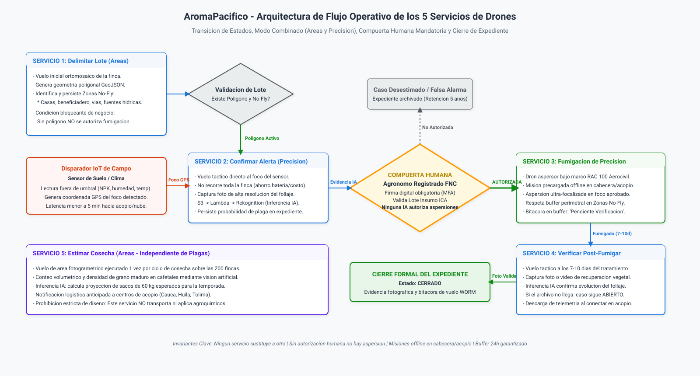
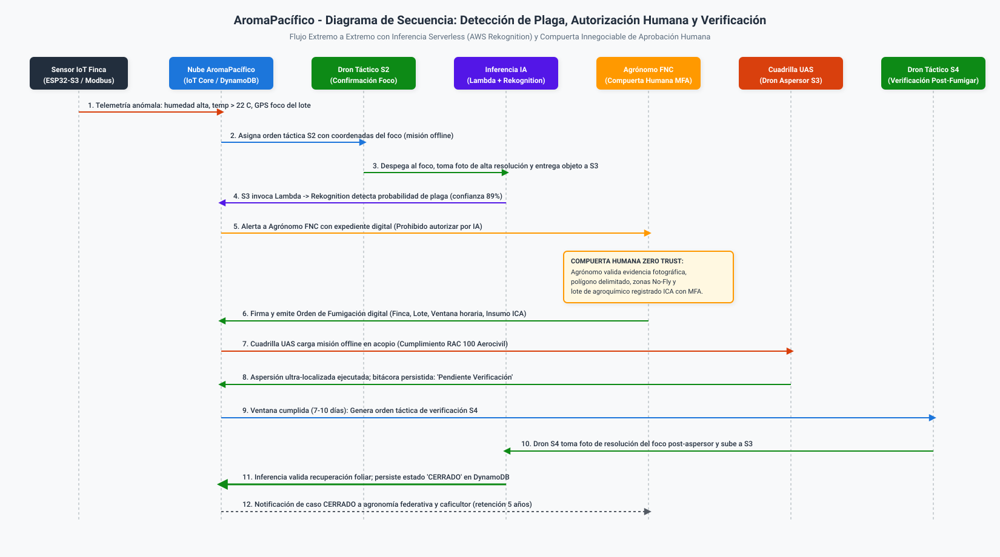
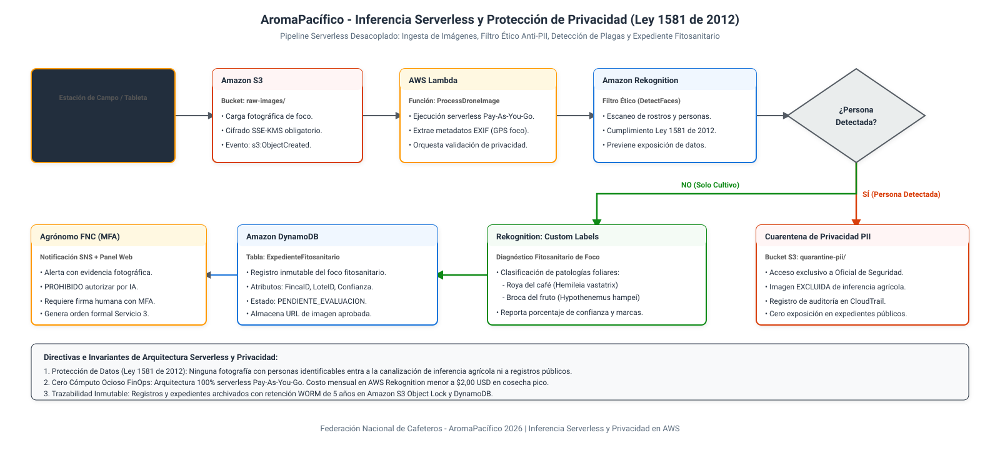

# Arquitectura y Gobernanza del Servicio de Drones Agrícolas

## Plataforma Cafetera AromaPacífico (Federación Nacional de Cafeteros 2026)

---

## 1. Resumen Ejecutivo y Propósito Operativo

El presente documento establece el diseño arquitectónico, el marco regulatorio, el modelo operativo y la cadencia matemática del **Servicio Integrado de Drones** para la plataforma cafetera **AromaPacífico**, desarrollado como un caso de estudio académico para modernizar el piloto propuesto en 2020 para la Federación Nacional de Cafeteros (FNC) hacia el año 2026.

A diferencia del diseño preliminar de 2020, en el cual las operaciones aéreas se concebían como vuelos recreativos o aislados sin gobierno digital, la arquitectura de 2026 estructura un **servicio aeronáutico corporativo de extremo a extremo**. La plataforma es responsable de originar la misión, validar las precondiciones agronómicas y de seguridad, asignar la orden a la cuadrilla de vuelo, gestionar la compuerta humana de autorización, procesar las imágenes mediante visión artificial serverless y asegurar el cierre formal del expediente con retención inmutable de cinco años.

El servicio cubre las 200 fincas cafeteras distribuidas en los departamentos de **Cauca, Huila y Tolima**, garantizando que ninguna orden de aspersión química pueda ejecutarse sin la aprobación expresa de un agrónomo colegiado y resolviendo la operación en zonas con corte o ausencia total de cobertura celular mediante preposicionamiento offline y mecanismos de almacenamiento y reenvío (store-and-forward).

---

## 2. Los Cinco Servicios Aeronáuticos Mandatorios

El pliego del reto define cinco servicios obligatorios que articulan la totalidad del ciclo de vida agronómico del cultivo. Cada servicio cumple un propósito funcional específico e independiente; **ningún servicio sustituye, reemplaza o anula a otro**:

| ID | Nombre del Servicio | Modo de Vuelo | Disparador Operativo | Entregable Técnico en Plataforma | Regla Bloqueante de Negocio |
| --- | --- | --- | --- | --- | --- |
| **S1** | **Delimitar el Lote** | Agricultura de Áreas | Onboarding de finca o modificación de linderos | Ortomosaico georreferenciado, perímetro GeoJSON y capas de zonas No-Fly | Sin delimitación aprobada en base de datos, queda terminantemente bloqueada cualquier orden de fumigación. |
| **S2** | **Confirmar Alerta de Sensor** | Agricultura de Precisión | Lectura fuera de umbral emitida por sensor de suelo/clima (foco GPS) | Fotografía multiespectral o RGB de alta resolución del follaje en S3 | El dron vuela exclusivamente a las coordenadas del sensor; no sobrevuela la finca entera. |
| **S3** | **Fumigación de Precisión** | Agricultura de Precisión | Orden digital formal autorizada y firmada por agrónomo con MFA | Registro telemático de aspersión, volumen dispersado y cierre de vuelo | Requiere lote delimitado, identificador de lote de agroquímico registrado ICA y firma humana obligatoria. |
| **S4** | **Verificar Post-Fumigación** | Agricultura de Precisión | Transcurso de ventana agronómica (7 a 10 días post-aspersión) | Registro fotográfico de evolución foliar y dictamen de inferencia IA | Si el archivo fotográfico no se carga a la plataforma, el caso permanece en estado ABIERTO. |
| **S5** | **Estimar Rendimiento de Cosecha** | Agricultura de Áreas | Ventana fenológica de maduración (1 vez por ciclo de cosecha) | Modelo de conteo volumétrico y proyección de sacos de 60 kg | Este servicio únicamente calcula volumen para logística de acopios; tiene prohibido transportar o aplicar agroquímicos. |

### 2.1 Descripción Técnica Detallada por Servicio

#### Servicio 1: Delimitación de Lote (Mapeo Inicial y Geocercas)

El primer vuelo sobre cada una de las 200 fincas ejecuta una misión fotogramétrica con patrón de doble cuadrícula (grid) a una altura constante de 60 metros sobre el terreno (AGL), capturando imágenes ortogonales con solapamiento frontal del 75% y lateral del 70%. El procesamiento digital genera el ortomosaico de la finca y extrae dos conjuntos de geometrías:

1. **Polígono Productivo del Lote**: Delimita con precisión submétrica la extensión sembrada en cafeto.
2. **Zonas de Exclusión Aérea (No-Fly Zones)**: Geocercas obligatorias donde queda terminantemente prohibido el sobrevuelo rasante y la aspersión: viviendas campesinas, beneficiaderos de café, escuelas rurales, vías públicas y amortiguadores de 100 metros alrededor de cuerpos hídricos (quebradas, ríos y nacimientos). Estas coordenadas deben persistir en Amazon S3 y DynamoDB antes del despegue de cualquier misión posterior.

#### Servicio 2: Confirmación de Alerta de Sensor (Vuelo Táctico Focalizado)

Cuando un nodo IoT de campo reporta lecturas continuas fuera de rango (por ejemplo, humedad foliar superior al 85% durante 72 horas con temperatura media de 23 grados Celsius, condiciones que potencian la proliferación de *Hemileia vastatrix* o roya del café), la plataforma genera un vector de navegación táctico. El dron se desplaza a velocidad crucero directamente hacia las coordenadas GPS del nodo emisor y desciende a 5 metros de altura sobre el dosel vegetal para capturar tomas macro del haz y envés de las hojas. Este enfoque puntual minimiza el tiempo de vuelo a menos de 6 minutos, preservando la batería de la aeronave.

#### Servicio 3: Fumigación de Precisión (Aspersión Ultra-Localizada)

Aeronaves especializadas de aplicación de insumos (UAS con capacidad de carga útil de 20 a 40 litros de mezcla, con boquillas centrífugas de gota controlada por atomización rotativa) ejecutan la misión sobre el foco delimitado. La aplicación se restringe estrictamente al radio de afectación determinado por el agrónomo (típicamente de 0,2 a 0,5 hectáreas por foco), manteniendo apagadas las electroválvulas de paso al sobrevolar zonas de tránsito y respetando las geocercas No-Fly. El equipo registra el consumo de batería, la dosis por hectárea y el volumen total aplicado.

#### Servicio 4: Verificación Post-Fumigación (Evidencia de Cierre de Caso)

Cumplida la ventana de acción biológica del agroquímico (estandarizada entre 7 y 10 días calendario tras la aspersión), se despacha un vuelo de inspección para evaluar la contención de la esporulación de la plaga. La imagen capturada es procesada por el motor de inferencia serverless; si la densidad de signos visibles de infección decae por debajo del umbral crítico, el sistema propone el cierre. Si el archivo fotográfico no es transmitido por la cuadrilla o la inferencia arroja anomalías persistentes, la orden de fumigación no muta a estado cerrado y se convoca a re-inspección.

#### Servicio 5: Estimación de Cosecha (Inteligencia Logística de Acopio)

Aproximadamente 4 a 6 semanas antes del inicio de la recolección principal, se ejecuta un vuelo de área sobre las fincas del departamento con sensores multiespectrales o RGB de alta definición. Los algoritmos de clasificación identifican la tasa de frutos en maduración (grano cereza maduro vs. grano verde) y la densidad de carga por hectárea. Con estos parámetros, la plataforma calcula el número proyectado de sacos estándar de 60 kg que recibirá cada uno de los tres centros de acopio (Cauca, Huila y Tolima), permitiendo planificar con antelación el personal de patio, el inventario de sacos de fique, las hojas de rotulado y las rutas de transporte terrestre hacia el puerto de Buenaventura.

---

## 3. Diagramas de Flujo y Secuencia del Servicio de Drones

La arquitectura operativa se formaliza a través de dos artefactos visuales desarrollados conforme a los estándares del Agente de Diagramas (`diagram-agent`): el diagrama de flujo de transición de estados de los 5 servicios y el diagrama de secuencia de detección, aprobación y cierre.

### 3.1 Diagrama de Flujo y Transición de Estados

> Archivo fuente Draw.io descomprimido editable: [`diagrams/carga-b-flujo-drones.drawio`](diagrams/carga-b-flujo-drones.drawio).

### 3.2 Diagrama de Secuencia del Proceso de Fumigación y Cierre

> Archivo fuente Draw.io descomprimido editable: [`diagrams/carga-b-secuencia-fumigacion.drawio`](diagrams/carga-b-secuencia-fumigacion.drawio).

---

## 4. Modo de Vuelo Elegido y Justificación Técnica

El enunciado exige seleccionar y sustentar la modalidad operativa entre agricultura de precisión, agricultura de áreas, o una combinación de ambas.

### 4.1 Decisión: Modo Combinado (Híbrido Jerárquico)

Se adopta formalmente el **Modo Combinado**:

- **Agricultura de Áreas**: Empleada exclusivamente para el levantamiento inicial de delimitación (Servicio 1) y para la estimación de cosecha volumétrica (Servicio 5).
- **Agricultura de Precisión**: Empleada para la confirmación táctica de la alerta (Servicio 2), la aspersión localizada del agroquímico (Servicio 3) y la verificación fotográfica de cierre (Servicio 4).

### 4.2 Matriz Comparativa de Modos de Operación

| Criterio de Análisis | Opción A: Precisión Pura | Opción B: Áreas Pura | Opción Seleccionada: Modo Combinado |
| --- | --- | --- | --- |
| **Consumo de Agroquímicos y Toxicidad** | Mínimo. Aplica solo en foco delimitado (0,2 - 0,5 ha). | Inaceptable. Bañaría la finca completa con químicos innecesarios. | **Óptimo**. Aspersión focalizada al 100% en zonas afectadas. |
| **Gasto Energético y Baterías UAS** | Muy bajo en plagas; insuficiente para planificar cosechas. | Excesivo. Requiere múltiples bancos de batería LiPo para cubrir 200 fincas. | **Equilibrado**. Vuelo extenso solo 2 veces al año; vuelos cortos para incidentes. |
| **Capacidad de Estimación de Cosecha** | Nula. Un vuelo puntual no permite proyectar sacos por departamento. | Óptima. Cubre la totalidad de hectáreas del piloto. | **Completa**. Mapea volumen de sacos con Servicio 5 sin dispersar químicos. |
| **Protección de Fuentes Hídricas (No-Fly)** | Alta. Conoce la ubicación exacta del foco. | Riesgosa. El sobrevuelo masivo incrementa el riesgo de deriva a ríos. | **Rigurosa**. Zonas No-Fly delimitadas en Servicio 1 protegen la aspersión en Servicio 3. |
| **Viabilidad FinOps (Costo Total de Campaña)** | Moderada pero ciega a la logística de transporte. | Extremadamente costosa en horas de vuelo y depreciación de equipos. | **Máxima Eficiencia**. Ahorro proyectado de hasta un 68% en insumos químicos y baterías (cifra preliminar de ingeniería; insumo para la Issue #30). |

### 4.3 Eventos Explícitos de Transición de Modo

Para garantizar consistencia y evitar ambigüedades operativas en el software, la transición entre modos de vuelo se rige por eventos deterministas:

1. **Transición de Áreas hacia Precisión (Evento: `POLIGONO_Y_NO_FLY_PERSISTIDO`)**:
   - *Condición*: La cuadrilla ejecuta el Servicio 1 y el archivo GeoJSON con los linderos y las zonas de exclusión aérea es validado y persistido en la base de datos con estado `APROBADO`.
   - *Efecto*: Se desbloquea en la plataforma la capacidad de recibir coordenadas de sensores IoT y generar misiones de vuelo táctico hacia focos específicos (Servicios 2, 3 y 4).
2. **Transición de Precisión hacia Áreas (Evento: `VENTANA_ESTIMACION_COSECHA_PROGRAMADA`)**:
   - *Condición*: El calendario agronómico departamental notifica la entrada en fase de maduración de frutos (6 semanas previas a la cosecha principal o mitaca) para un grupo de fincas.
   - *Efecto*: La plataforma conmuta las reglas de despacho para programar vuelos fotogramétricos continuos de área (Servicio 5), inhibiendo cualquier aplicación de producto químico durante este tipo de vuelo.

---

## 5. Marco Regulatorio, Responsables y Permisos (RAC 100 de la Aerocivil)

El diseño responde explícitamente a las restricciones no técnicas del pliego: el dron no lo opera cada caficultor por su cuenta.

### 5.1 Marco Normativo de la Aeronáutica Civil de Colombia (UAEAC)

Las operaciones de aeronaves no tripuladas en Colombia se rigen por el **Reglamento Aeronáutico de Colombia (RAC 100)**:

- **Clasificación de la Operación**: Se inscribe bajo la **Categoría Específica (Specific Category)**. Esta categorización es mandatoria debido a:
  1. *Masa Máxima de Despegue (MTOW)*: Las aeronaves de aspersión cargadas superan el límite de 25 kg (por ejemplo, equipos estándar de la industria como DJI Agras T40 / T50 o XAG P100 alcanzan entre 40 y 55 kg al despegue con tanque lleno).
  2. *Dispersión de Sustancias*: Transporte y aplicación de plaguicidas agrícolas, actividad tipificada como operación especial bajo supervisión de la autoridad aeronáutica y sanitaria.
- **Licenciamiento de Pilotos a Distancia**: Los pilotos de la cuadrilla deben poseer acreditación formal de piloto a distancia de UAS emitida o convalidada ante la Aerocivil para la Categoría Específica (aeronaves de más de 25 kg con dispersión de sustancias), junto con la certificación técnica de operario/aplicador de plaguicidas agrícolas de uso agrícola expedida bajo los lineamientos del **Instituto Colombiano Agropecuario (ICA)** según lo exigido por la Resolución ICA 30021 de 2017.
- **Autorizaciones y Notificaciones**: La Federación Nacional de Cafeteros inscribe la operación como **Explotador de UAS**. En zonas rurales se tramitan ventanas operativas NOTAM y se mantiene una póliza de seguro de responsabilidad civil extracontractual para amparar eventuales daños a terceros o predios vecinos.
- **Distancias Mínimas de Seguridad**: La operación impone distancias mínimas de 100 metros respecto a viviendas campesinas y fuentes hídricas, y 50 metros respecto a vías secundarias, garantizadas mediante las geocercas No-Fly del Servicio 1.

### 5.2 Modelo Operativo: Cuadrilla Especializada por Centro de Acopio

| Criterio de Evaluación | Opción Seleccionada: Cuadrilla FNC en Acopios | Alternativa 1: Dron por Caficultor | Alternativa 2: Tercerización Libre No Coordinada |
| --- | --- | --- | --- |
| Inversión por Finca (CapEx Caficultor) | $0 USD en hardware aéreo para el productor. | Inviable ($15.000-$25.000 USD estimados por finca según cotizaciones preliminares 2026; insumo a consolidar en Issue #30). | Variable y costosa por visita privada. |
| Mantenimiento y Baterías | Centralizado en taller de acopio departamental con generador y cargador industrial. | Alto riesgo de falla, mala manipulación y degradación acelerada de celdas LiPo. | No estandarizado; sin trazabilidad de calibración de sensores. |
| Cumplimiento Legal RAC 100 y Licencias ICA | 100% garantizado bajo pilotos colegiados FNC y póliza de seguro corporativa. | Imposible certificar y renovar licencias de 200 caficultores individuales. | Difícil auditoría de pilotos externos y riesgo de suspensión aeronáutica. |
| Seguridad y Control de Agroquímicos | Cero Trust: trazabilidad estricta de lote de insumo registrado ICA y geocercas No-Fly. | Riesgo crítico de sobredosificación o aplicación en zonas no permitidas. | Riesgo de fuga de datos, coordenadas de cultivo y fotos privadas. |

- **Sustentación**: Se conforma **una cuadrilla especializada por departamento** (3 cuadrillas en total: Cauca, Huila y Tolima), con base en el respectivo Centro de Acopio. Cada cuadrilla cuenta con 2 operadores certificados (un piloto al mando y un observador/operador de carga y mezcla), dotados con un vehículo utilitario todo terreno, un generador para carga rápida de baterías, una estación de mezcla y 2 aeronaves (un dron táctico ligero para Servicios 1, 2, 4 y 5, y un dron aspersor de alto porte para Servicio 3).

### 5.3 Quién Autoriza la Fumigación: Principio Innegociable de Cero Confianza

> [!IMPORTANT]
> **REGLA MANDATORIA DE GOBIERNO: COMPUERTA HUMANA INNEGOCIABLE**
> Queda terminantemente prohibido que un algoritmo de visión artificial, función Lambda o disparador serverless autorice una orden de fumigación. La autorización es **atribuible de forma exclusiva y no repudiable a una identidad humana registrada**: el **Agrónomo de la Federación Nacional de Cafeteros**.

La orden digital emitida por el agrónomo a través de la plataforma incluye:

1. `FincaID` y `LoteID` con polígonos verificados.
2. Diagnóstico técnico y reporte de confianza de la inferencia IA.
3. Identificador único del lote de agroquímico registrado ante el ICA y fecha de vencimiento.
4. Ventana horaria de aplicación (fecha, rango de horas y condiciones meteorológicas máximas de viento: menor a 15 km/h).
5. Identidad del piloto al mando asignado.
6. Firma criptográfica generada mediante token MFA del agrónomo.

---

## 6. Cadencia del Piloto y Modelado Matemático de Vuelos

A partir de las cifras oficiales del caso (200 fincas, 3 centros de acopio, campaña mensual en cosecha y campaña trimestral fuera de cosecha), se modela el volumen de operaciones anuales.

### 6.1 Calendario y Temporadas Agronómicas en Colombia

En los departamentos de Cauca, Huila y Tolima, la fenología cafetera se distribuye típicamente en dos semestres:

- **Temporada de Cosecha (Cosecha Principal y Mitaca)**: 6 meses al año (ejemplo: Abril a Junio, y Septiembre a Noviembre).
- **Temporada Fuera de Cosecha (Mantenimiento y Desarrollo)**: 6 meses al año.

### 6.2 Desglose Matemático por Tipo de Servicio

1. **Servicio 1 (Delimitación Inicial de Lotes)**:
   - Se ejecuta una sola vez al inicio del programa para cada una de las fincas del piloto:
   $$\text{Vuelos}_{S1} = 200\text{ fincas} \times 1\text{ vuelo} = 200\text{ vuelos (Año 1)}$$

2. **Servicio 5 (Estimación de Rendimiento de Cosecha)**:
   - Se ejecuta una vez por ciclo de cosecha (2 cosechas al año: principal y mitaca):
   $$\text{Vuelos}_{S5} = 200\text{ fincas} \times 2\text{ cosechas/año} = 400\text{ vuelos/año}$$

3. **Servicio 2 (Campañas de Revisión y Confirmación de Alerta de Foco)**:

   - En cosecha: 1 campaña mensual $\times$ 6 meses = 6 campañas. En cada campaña, los sensores de suelo y clima reportan alertas fitosanitarias en aproximadamente el 20% de las fincas ($200 \times 0{,}20 = 40\text{ fincas/mes}$):

     $$\text{Vuelos Cosecha}_{S2} = 40\text{ fincas/mes} \times 6\text{ meses} = 240\text{ vuelos}$$

   - Fuera de cosecha: La incidencia promedio desciende al 10% ($200 \times 0{,}10 = 20\text{ fincas afectadas}$ por ciclo trimestral, totalizando 40 fincas en los 6 meses de mantenimiento):

     $$\text{Vuelos Fuera Cosecha}_{S2} = 20\text{ fincas/campaña} \times 2\text{ campañas} = 40\text{ vuelos}$$

     $$\text{Total Vuelos}_{S2} = 240 + 40 = 280\text{ vuelos/año}$$

   - **Modelo Operativo de Atención y Cumplimiento de SLA Fuera de Cosecha**:
     Los sensores IoT monitorean las fincas ininterrumpidamente y pueden emitir alertas en cualquier mes. Fuera de cosecha, las alertas de severidad moderada se agrupan en las dos campañas trimestrales de inspección preventiva (meses 2 y 5 del semestre de mantenimiento). No obstante, ante anomalías críticas que superen los umbrales de riesgo fitosanitario, la cuadrilla departamental activa despachos tácticos inmediatos bajo demanda con un SLA no mayor a 72 horas. La cuota asignada de 40 confirmaciones, 30 fumigaciones y 30 verificaciones fuera de cosecha cubre tanto la modalidad de campañas concentradas como una distribución bajo demanda continua de ~6 a 7 vuelos de confirmación, 5 de fumigación y 5 de verificación por mes en la organización (~5 a 6 vuelos mensuales por acopio), garantizando que ningún mes quede desatendido.

4. **Servicio 3 (Fumigación de Precisión)**:
   - De los focos inspeccionados en el Servicio 2, la combinación de inferencia y evaluación agronómica confirma presencia de plaga que amerita aspersión en el 75% de los casos (el 25% restante corresponde a deficiencias nutricionales o falsas alarmas):
   - En cosecha: $40 \times 0,75 = 30\text{ fumigaciones/mes} \times 6\text{ meses} = 180\text{ vuelos}$
   - Fuera de cosecha: $20 \times 0,75 = 15\text{ fumigaciones/campaña} \times 2\text{ campañas} = 30\text{ vuelos}$
   $$\text{Total Vuelos}_{S3} = 180 + 30 = 210\text{ vuelos/año}$$

5. **Servicio 4 (Verificación Post-Fumigación)**:
   - Guarda una relación estricta de 1:1 con el Servicio 3, pues todo caso fumigado exige vuelo de cierre a los 7-10 días:
   $$\text{Total Vuelos}_{S4} = 210\text{ vuelos/año}$$

### 6.3 Matriz Consolidada de Vuelos Anuales y Mensuales

| Servicio de Dron | Año 1 (Total) | Mes Pico Cosecha (200 Fincas) | Mes Fuera Cosecha (Línea Base Bajo Demanda) | Mes Fuera Cosecha (Campaña Concentrada) | Promedio por Acopio / Mes Pico |
| --- | --- | --- | --- | --- | --- |
| **S1. Delimitación Lote** | 200 | 0 (Completada) | 0 | 0 | 0 |
| **S2. Confirmar Alerta** | 280 | 40 | ~6-7 | 20 | ~13 |
| **S3. Fumigación Precisión** | 210 | 30 | ~5 | 15 | 10 |
| **S4. Verificar Fumigación** | 210 | 30 | ~5 | 15 | 10 |
| **S5. Estimar Cosecha** | 400 | ~67 (200 / 3 meses) | 0 | 0 | ~22 |
| **Total Operaciones Aéreas** | **1.300** | **~167 vuelos/mes** | **~16-17 vuelos/mes** | **50 vuelos/mes** | **~55 vuelos/mes/acopio** |

- **Viabilidad Operativa**: En el mes más demandante de cosecha, la plataforma programa ~55 vuelos al mes por centro de acopio. Con una ventana laboral de 22 días hábiles por mes, esto representa una tasa de **2,5 vuelos por día útil por cuadrilla**, carga perfectamente manejable para una tripulación de dos personas con un margen holgado para traslados y mantenimiento.

---

## 7. Arquitectura Tecnológica, Manejo Offline y Tratamiento Ético de Datos

### 7.1 Preposicionamiento Offline de Misiones y Resiliencia en Campo

En la ruralidad de Cauca, Huila y Tolima, la pérdida de cobertura de señal celular no constituye una excepción fortuita, sino la condición operativa habitual. La plataforma implementa un modelo de resiliencia Store-and-Forward:

1. **Preposicionamiento en Cabecera o Acopio**: La misión de vuelo (waypoint routing, perímetros de lote y zonas No-Fly) se sincroniza en la tableta robustecida de la cuadrilla mediante conexión cableada o Wi-Fi local antes de partir al lote.
2. **Ejecución Desconectada**: La estación de control y el piloto automático del dron vuelan la misión con telemetría satelital GNSS autónoma (GPS/GLONASS/Galileo RTK) sin depender de conexión a internet.
3. **Persistencia en Buffer Local**: Los registros de telemetría de vuelo (flight logs), marcas de tiempo, datos de consumo de aspersor y las imágenes capturadas se almacenan en la memoria interna de la aeronave y en el almacenamiento de la estación de campo (hasta 24 horas de retención local).
4. **Drenado Ordenado**: Al retornar a la cabecera municipal o al centro de acopio departamental, el agente de sincronización descarga los paquetes en lote conectándose a la red inalámbrica de la **VLAN Logística (`10.X.3.0/24`)** en el centro de acopio (respetando la segmentación de red definida en la Issue #8) y los transmite hacia Amazon S3 y API Gateway.

### 7.2 Inferencia Serverless y Protección de Privacidad (Ley 1581 de 2012)

La arquitectura de inferencia sigue un patrón serverless desacoplado sin servidores ociosos:

> Archivo fuente Draw.io descomprimido editable: [`diagrams/carga-b-inferencia-serverless.drawio`](diagrams/carga-b-inferencia-serverless.drawio).

> [!NOTE]
> **Delimitación de Responsabilidad Arquitectónica con respecto a Inferencia:**
> El diseño detallado del pipeline de inferencia, la configuración de eventos disparadores en S3, los mecanismos de reintento, colas de mensajes fallidos DLQ y el análisis de soberanía transfronteriza bajo la Ley 1581 de 2012 son objeto específico de las Historias de Usuario #16 (`e-funciones`) y #17 (`e-inferencia`). La presente sección define exclusivamente la compuerta perimetral de filtrado PII para garantizar que ninguna imagen con rostros o figuras humanas ingrese al pipeline fitosanitario de drones.

#### Tratamiento Ético de Imágenes (Filtro Anti-PII)

En cumplimiento estricto del régimen de protección de datos personales de Colombia (Ley Estatutaria 1581 de 2012):

- Toda imagen capturada por drones ingresa a una función Lambda previa de filtrado que ejecuta la detección de rostros o personas (`DetectFaces` / `DetectLabels` con etiqueta `Person`).
- Si una imagen contiene personas identificables (caficultores, jornaleros o transeúntes en vías adyacentes), **la imagen se excluye automáticamente del pipeline de inferencia agronómica** y es redirigida a un bucket en cuarentena con acceso restringido exclusivamente al oficial de seguridad de datos. No se almacena en el expediente público ni se transfiere fuera de la cuenta de seguridad.

---

## 8. Análisis FinOps del Servicio de Drones

La implementación del diseño híbrido combinado y la centralización de cuadrillas responde a tres decisiones estratégicas de reducción de costos:

1. **Ahorro Radical de CapEx en Baterías y Aeronaves**:
   Volar en modo de precisión para los Servicios 2, 3 y 4 en lugar de sobrevolar las fincas completas reduce el tiempo promedio de misión de 45 minutos a solo 8 minutos por evento. Esto prolonga la vida útil de los bancos de baterías LiPo (cuya degradación se acelera drásticamente con descargas profundas continuas), reduciendo la tasa de reemplazo de baterías de $18.000 USD anuales a menos de $4.500 USD proyectados por departamento (cifras preliminares de ingeniería que serán sustentadas con cotizaciones de mercado en la Issue #30: `f3-drones`).
2. **Eficiencia en Agroquímicos por Aspersión Focalizada**:
   La aplicación exclusiva en los focos delimitados (0,2 a 0,5 ha) frente a una fumigación tradicional de área completa (3 a 5 ha promedio por predio) ahorra más del **80% del volumen de químico utilizado**, representando un ahorro directo para los comités departamentales y una disminución sustancial del impacto ambiental.
3. **Cero Cómputo Serverless en Reposo**:
   Las funciones Lambda y las llamadas a Amazon Rekognition operan bajo el esquema Pay-As-You-Go puro. Para las 1.300 operaciones anuales, el total de imágenes evaluadas por inferencia en cosecha no supera las 1.500 fotografías, generando una facturación en AWS Rekognition de menos de **$2,00 USD mensuales**, en marcado contraste con el despliegue de clusters dedicados de inferencia (SageMaker Endpoints) que costarían más de $150 USD fijos al mes.

---

## 9. Registro de Supuestos y Decisiones de Arquitectura

En cumplimiento de las políticas de documentación del proyecto, las decisiones adoptadas en este documento se sincronizan en la bitácora [`assumptions-log.md`](../cross-cutting/assumptions-log.md):

1. **Modo Combinado Aprobado**: Áreas para Servicios 1 y 5; Precisión para Servicios 2, 3 y 4.
2. **Modelo de Cuadrillas**: Una cuadrilla operativa centralizada por Centro de Acopio (3 en total) bajo el reglamento RAC 100 de la Aerocivil.
3. **Compuerta Humana**: Prohibición categórica de autorización por algoritmos o IA; firma digital obligatoria del agrónomo de la FNC con MFA.
4. **Cadencia Fitosanitaria**: 1.300 vuelos en el primer año (1.100 en años posteriores) calculados sobre 6 meses de cosecha y 6 meses fuera de cosecha, con atención bajo demanda de alertas críticas en meses sin campaña formal (SLA < 72h).
