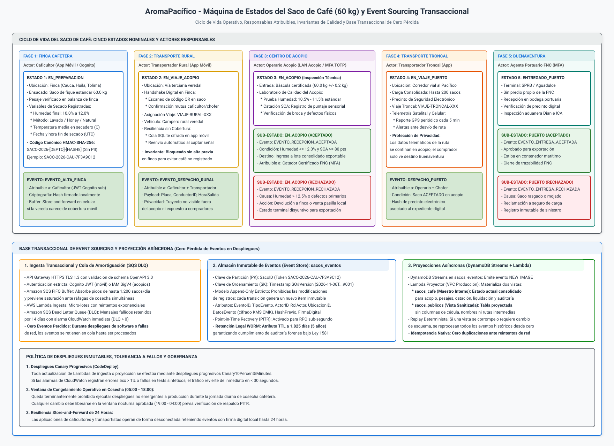
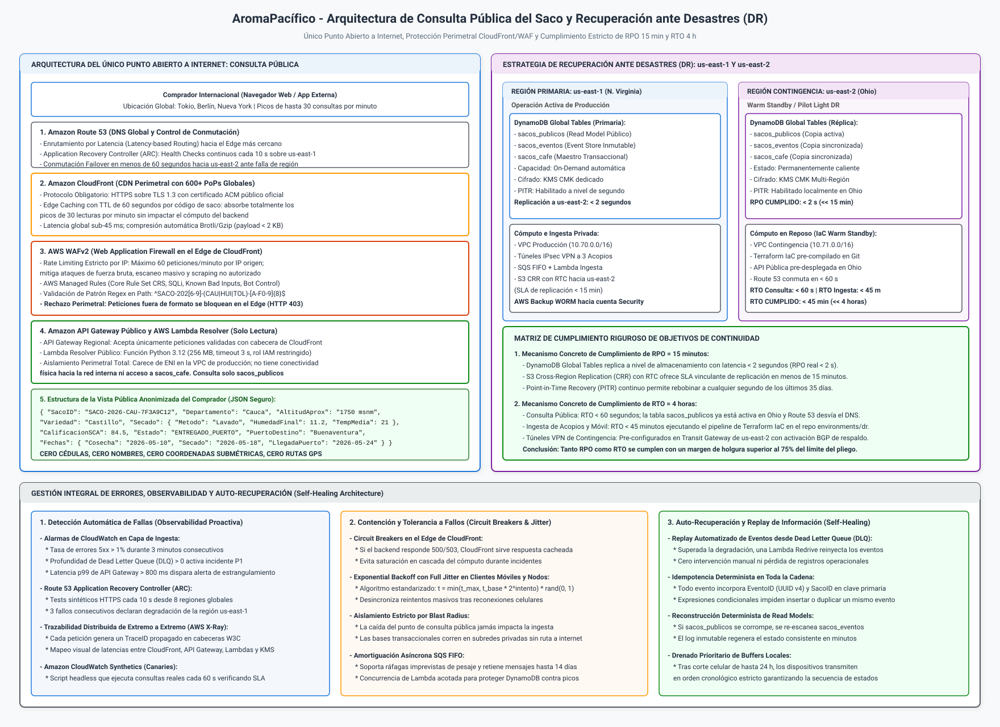

# Arquitectura del Ciclo de Vida del Saco, Eventos de Viaje y Consulta Pública

## Plataforma Cafetera AromaPacífico (Federación Nacional de Cafeteros 2026)

---

## 1. Resumen Ejecutivo y Marco Operativo

El presente documento define la arquitectura técnica del ciclo de vida del saco de café de 60 kg, la base transaccional de eventos de viaje (*Event Sourcing*), los mecanismos de resiliencia para el cumplimiento de los objetivos de recuperación ante desastres (**RPO de 15 minutos y RTO de 4 horas**) y el diseño del **único servicio de lectura abierto a internet sin credenciales**: la consulta pública para el comprador internacional.

En el marco del caso de estudio para la reactivación del piloto de trazabilidad cafetera para la Federación Nacional de Cafeteros (FNC) en la vigencia 2026, la plataforma articula la operación de **200 fincas cafeteras** distribuidas en los departamentos de **Cauca, Huila y Tolima**, tres centros de acopio departamentales, una flota de 60 transportadores y la entrega final en las instalaciones portuarias de Buenaventura.

A diferencia del enfoque rudimentario de 2020, donde la trazabilidad dependía de registros manuales en cuadernos o bases de datos relacionales propensas a sobreescrituras destructivas, la arquitectura de 2026 establece un **registro inmutable de eventos de extremo a extremo**. Cada evento registra fecha y hora en formato universal UTC, actor responsable debidamente autenticado y firma criptográfica verificable. 

### Parámetros de Escala y Carga del Caso

| Parámetro Operativo | Dimensión del Piloto 2026 | Impacto Arquitectónico y Dimensionamiento |
|---|---|---|
| **Volumen de Producción en Cosecha** | Hasta 400 sacos diarios por centro de acopio; hasta 1.200 sacos diarios consolidados en pico. | Ingesta transaccional amortiguada mediante colas FIFO para absorber ráfagas simultáneas de pesaje en básculas. |
| **Flota Logística de Transporte** | 60 transportadores monitoreados con telemetría cada 5 minutos. | Transmisión telemática celular/satelital aislada en red de acopio; el comprador no visualiza trayectos intermedios. |
| **Carga de Consulta Pública** | Picos de hasta 30 lecturas por minuto desde el exterior (Tokio, Berlín, Nueva York). | Cache perimetral en Amazon CloudFront (TTL 60 s) que absorbe el 98% del tráfico sin degradar el backend. |
| **Objetivos de Continuidad (DR)** | RPO estricto de 15 minutos y RTO estricto de 4 horas hacia región contingente (`us-east-2`). | DynamoDB Global Tables con replicación sub-segundo (&lt; 2 s) y conmutación automática de DNS con Route 53 ARC (&lt; 60 s). |
| **Protección de Privacidad (Ley 1581)** | Consulta pública abierta a internet sin credenciales. | Segregación física en tabla proyectada `sacos_publicos`: cero cédulas, cero nombres, cero coordenadas submétricas. |

---

## 2. Diagramas Oficiales de Arquitectura

La arquitectura operativa y de resiliencia del saco y viaje se formaliza a través de dos diagramas técnicos de publicación, elaborados bajo el estándar XML Draw.io descomprimido UTF-8 y renderizados en SVG autónomo de alta resolución:

### 2.1 Diagrama 1: Máquina de Estados del Saco y Event Sourcing Transaccional

Ilustra las cinco etapas operativas del saco, las condiciones de entrada y salida, los actores responsables atribuibles, el desacoplamiento con colas Dead Letter Queue (DLQ) y la segregación física entre el almacén de eventos y las vistas proyectadas:



> Archivo fuente editable en formato Draw.io XML descomprimido disponible en: [`diagrams/carga-c-saco-estados-eventos.drawio`](diagrams/carga-c-saco-estados-eventos.drawio).

### 2.2 Diagrama 2: Consulta Pública y Estrategia de Recuperación ante Desastres (RPO 15 min / RTO 4 h)

Modela el único punto de entrada abierto a internet protegido por CloudFront y AWS WAFv2, la segregación de la tabla pública, la replicación multi-región entre N. Virginia (`us-east-1`) y Ohio (`us-east-2`), y los pilares de auto-recuperación ante fallas:



> Archivo fuente editable en formato Draw.io XML descomprimido disponible en: [`diagrams/carga-c-saco-consulta-dr.drawio`](diagrams/carga-c-saco-consulta-dr.drawio).

---

## 3. Máquina de Estados del Saco de Café (60 kg) y Reglas de Transición

El ciclo de vida del café verde de exportación se modela como una máquina de estados finitos determinista y secuencial. Cada transición requiere la emisión obligatoria de un evento atómico inmutable; queda terminantemente prohibido alterar el estado de un saco sin registrar el evento correspondiente en el *Event Store*.

### 3.1 Matriz de Estados, Eventos y Actores Responsables

| Estado ID | Nombre del Estado | Evento Disparador | Actor Responsable | Mecanismo de Autenticación | Condiciones de Validación e Invariantes |
|---|---|---|---|---|---|
| **E01** | `EN_PREPARACION` | `EVENTO_ALTA_FINCA` | Caficultor Titular | Amazon Cognito (App Caficultor) | Pesaje en finca (60.0 kg +/- 0.5 kg). Variables de secado registradas (humedad 10.0% a 12.0%, método y temperatura). Generación de token canónico HMAC-SHA-256. |
| **E02** | `EN_VIAJE_ACOPIO` | `EVENTO_DESPACHO_RURAL` | Transportador Rural | Amazon Cognito (App Transportador) | Handshake digital en finca mediante escaneo de código QR del saco. Asignación de viaje rural. Buffer local store-and-forward en caso de vía terciaria sin cobertura móvil. |
| **E03** | `EN_ACOPIO` | `EVENTO_LLEGADA_ACOPIO` | Operario de Acopio | Amazon Cognito (App Acopio, MFA TOTP) | Pesaje en báscula certificada de acopio. Inspección de laboratorio: prueba de humedad (10.5% - 11.5%) y catación sensorial según protocolo SCA. |
| **E03-A** | `EN_ACOPIO (ACEPTADO)` | `EVENTO_RECEPCION_ACEPTADA` | Catador Certificado FNC | Amazon Cognito (App Acopio, MFA TOTP) | Puntaje SCA &gt;= 80 puntos y humedad &lt;= 12.0%. El saco ingresa oficialmente al inventario de exportación del acopio. |
| **E03-B** | `EN_ACOPIO (RECHAZADO)` | `EVENTO_RECEPCION_RECHAZADA` | Operario de Acopio | Amazon Cognito (App Acopio, MFA TOTP) | Humedad &gt; 12.5% o defectos físicos mayores (broca severa o fermento). Estado terminal de exportación; se deriva a consumo doméstico (pasilla) o devolución. |
| **E04** | `EN_VIAJE_PUERTO` | `EVENTO_DESPACHO_PUERTO` | Transportador Troncal | Amazon Cognito (App Transportador) | Consolidación de lote de hasta 200 sacos previamente aceptados. Precinto electrónico verificado. Monitoreo telemático GPS cada 5 min sobre corredor hacia el Pacífico. |
| **E05** | `ENTREGADO_PUERTO` | `EVENTO_LLEGADA_PUERTO` | Transportador Troncal | Amazon Cognito (App Transportador) | Llegada a terminal marítimo en Buenaventura (SPRB / Aguadulce). Operación en bodega concesionada sin predio propio de la FNC. Verificación de integridad de precinto. |
| **E05-A** | `ENTREGADO (ACEPTADO)` | `EVENTO_ENTREGA_ACEPTADA` | Transportador Troncal (registra el resultado que informa el operador portuario) | Amazon Cognito (App Transportador) | Inspección aduanera Dian e inspección fitosanitaria ICA aprobadas. El saco pasa a contenedor marítimo para embarque internacional. Fin de trazabilidad en tierra. |
| **E05-B** | `ENTREGADO (RECHAZADO)` | `EVENTO_ENTREGA_RECHAZADA` | Transportador Troncal (registra el resultado que informa el operador portuario) | Amazon Cognito (App Transportador) | Avería física durante el transporte (humedad por lluvia, saco rasgado o contaminación). Apertura formal de siniestro ante aseguradora de carga. |

---

### 3.2 Especificación Detallada de los Estados

#### 1. Estado 1: EN_PREPARACION (Finca Cafetera)
- **Ámbito Geográfico**: Finca cafetera registrada en las veredas de Cauca, Huila o Tolima.
- **Operación Agronómica**: El productor realiza la cosecha selectiva de café cereza, el despulpado, fermentado y secado (en paseras solares o silos parabólicos). 
- **Invariante de Humedad y Calidad**: El grano debe alcanzar una humedad final entre el 10.0% y el 12.0%. Humedades por encima del 12.0% aceleran el deterioro microbiológico, mientras que niveles inferiores al 10.0% provocan fragilidad física del grano y cristalización.
- **Ensacado Estándar**: Se empaca en saco de fique tradicional de exactamente 60.0 kg netos.
- **Generación del Código Canónico**: En el instante en que el caficultor guarda el registro en la aplicación móvil, la capa serverless invoca la función de tokenización descrita en el documento de seguridad:
  $$\text{CódigoSaco} = \text{SACO-2026-DEPTO-HASH8}$$
  donde `HASH8` corresponde a los primeros 8 caracteres hexadecimales de $\text{HMAC-SHA-256}(\text{Salt}_{\text{KMS}}, \text{Vector})$. Este identificador no revela la cédula ni las coordenadas exactas de la vivienda.

#### 2. Estado 2: EN_VIAJE_ACOPIO (Transporte Rural Veredal)
- **Ámbito Geográfico**: Vías terciarias y caminos de herradura entre la finca y el centro de acopio departamental más cercano (Popayán, Garzón o Ibagué).
- **Mecanismo de Custodia**: Handshake digital obligatorio. El transportador escanea con la cámara de su teléfono móvil el código QR impreso en la tarjeta del saco. La aplicación contrasta el identificador contra la base local y exige la confirmación biométrica o PIN del caficultor en pantalla.
- **Resiliencia Store-and-Forward**: Dada la topografía andina y la carencia de señal celular en las zonas de cordillera, la aplicación retiene el evento en una base de datos SQLite local cifrada mediante SQLCipher (AES-256). Tan pronto el campero ingresa a un corredor con conectividad móvil (4G/3G), el servicio en segundo plano sincroniza los eventos retenidos garantizando orden secuencial.

#### 3. Estado 3: EN_ACOPIO (Recepción, Pesaje y Catación Técnica)
- **Ámbito Geográfico**: Instalaciones físicas de los centros de acopio en Cauca (`10.41.0.0/16`), Huila (`10.42.0.0/16`) o Tolima (`10.43.0.0/16`).
- **Control de Entrada**: El camión ingresa a la báscula camionera y los sacos se descargan sobre la banda de inspección, donde se realiza la lectura óptica o RFID.
- **Protocolo de Laboratorio y Bifurcación**:

| Etapa de Evaluación en Acopio | Parámetro Técnico y Metodología | Criterio de Aceptación y Bifurcación |
|---|---|---|
| **Pesaje de Confirmación** | Báscula electrónica de plataforma con calibración metrológica legal. | Tolerancia estricta de 60.0 kg +/- 0.2 kg netos por saco. |
| **Determinación de Humedad** | Medición instrumental por termobalanza o higrómetro dieléctrico. | Rango óptimo entre 10.5% y 11.5%. Si supera 12.5%, se deriva a rechazo. |
| **Catación Sensorial SCA** | Protocolo oficial Specialty Coffee Association realizado por catador Q-Grader. | Puntaje SCA &gt;= 80 pts muta a `EN_ACOPIO (ACEPTADO)`. Defectos graves mutan a `EN_ACOPIO (RECHAZADO)`. |

#### 4. Estado 4: EN_VIAJE_PUERTO (Transporte Troncal Interdepartamental)
- **Ámbito Geográfico**: Red vial nacional desde los centros de acopio hacia el puerto de Buenaventura atravesando la Cordillera Occidental.
- **Consolidación de Carga**: Se estructuran despachos troncales de tractomulas con capacidad de hasta 200 sacos (12 toneladas métricas).
- **Precinto Electrónico de Seguridad**: El camión se asegura con un marchamo o precinto digital numerado. El identificador del precinto se almacena en el evento `EVENTO_DESPACHO_PUERTO`.
- **Monitoreo Telemático GPS**: El vehículo emite coordenadas de latitud, longitud y velocidad cada 5 minutos mediante transceptor celular/satelital.
- **Protección de la Información**: Estos datos telemáticos se consumen exclusivamente en la consola de logística de acopio. La API pública del comprador no serializa ni expone paradas intermedias, velocidad ni ubicación en tiempo real del vehículo, protegiendo al transportador frente a riesgos de piratería terrestre.

#### 5. Estado 5: ENTREGADO_PUERTO (Terminal Marítimo de Buenaventura)
- **Ámbito Geográfico**: Terminales portuarios de Buenaventura (Sociedad Portuaria Regional de Buenaventura - SPRB o Terminal Contenedores de Buenaventura - TCBUEN / Aguadulce).
- **Operación Sin Predio Propio de la FNC**: Conforme al pliego del caso, la Federación Nacional de Cafeteros no dispone de bodegas físicas privadas en el puerto; la operación se ejecuta en bodegas concesionadas de operadores portuarios autorizados.
- **Inspección de Descargue**: Se verifica la integridad del precinto electrónico, la ausencia de roturas y las condiciones higiénicas del contenedor marítimo.
- **Comprobación Aduanera y Fitosanitaria**: La Dirección de Impuestos y Aduanas Nacionales (Dian) y el Instituto Colombiano Agropecuario (ICA) emiten el visto bueno de inspección no intrusiva (escáner) e inspección fitosanitaria.
- **Cierre del Viaje**: La aceptación formal (`EVENTO_ENTREGA_ACEPTADA`) transfiere la custodia del saco a la línea naviera y al comprador internacional, concluyendo la fase logística nacional.

---

## 4. Base Transaccional de Event Sourcing y Cero Pérdida en Despliegues

Para satisfacer el requerimiento taxativo del caso: *"Cada evento del saco guarda fecha, hora y responsable. Un despliegue no puede perder eventos"*, la arquitectura descarta las bases de datos CRUD tradicionales y adopta el patrón **Event Sourcing (Origen de Eventos)** respaldado por colas de amortiguación serverless.

```
┌────────────────────────────────────────────────────────────────────────────────────────┐
│               FLUJO TRANSACCIONAL DE INGESTA INMUTABLE DE EVENTOS                     │
├─────────────────┬───────────────────┬─────────────────────┬────────────────────────────┤
│ 1. Origen       │ 2. Amortiguación  │ 3. Event Store      │ 4. Proyecciones (Streams)  │
├─────────────────┼───────────────────┼─────────────────────┼────────────────────────────┤
│ App Caficultor  │ SQS FIFO Buffer   │ DynamoDB            │ DynamoDB Streams           │
│ App Transporte  │ + Dead Letter     │ sacos_eventos       │ -> Lambda Proyector        │
│ LAN Acopio      │ Queue (DLQ 14 d)  │ (Append-Only WORM)  │ -> sacos_cafe (Maestro)    │
│ Portal Puerto   │ Concurrencia Lim. │ Cifrado KMS CMK     │ -> sacos_publicos (Public) │
└─────────────────┴───────────────────┴─────────────────────┴────────────────────────────┘
```

### 4.1 Estructura del Almacén de Eventos (`sacos_eventos`)

La tabla `sacos_eventos` en Amazon DynamoDB constituye el libro contable inmutable (*ledger*) del sistema. Su esquema se diseña bajo un patrón de inserción exclusiva (*append-only*):

| Atributo de DynamoDB | Tipo | Función en el Modelo Event Sourcing |
|---|---|---|
| `PK` (Partition Key) | String | Identificador canónico del saco: `SACO-2026-[DEPTO]-[HASH8]`. Agrupa todos los eventos del saco en una misma partición física. |
| `SK` (Sort Key) | String | Marca de tiempo ISO 8601 UTC y versión secuencial: `2026-05-10T14:30:00.000Z#001`. Garantiza ordenación cronológica natural. |
| `EventoID` | String | Identificador universal único (UUID v4) generado en el cliente o en el API Gateway para deduplicación e idempotencia. |
| `TipoEvento` | String | Código tipificado: `EVENTO_ALTA_FINCA`, `EVENTO_DESPACHO_RURAL`, `EVENTO_RECEPCION_ACEPTADA`, etc. |
| `ActorID` | String | Identificador único del responsable (sub de Cognito JWT o ARN de IAM Identity Center). |
| `RolActor` | String | Rol formal validado: `CAFICULTOR`, `TRANSPORTADOR`, `OPERARIO_ACOPIO`. En Buenaventura no hay personal ni infraestructura de la Federación: la entrega la registra el transportador. |
| `DatosEvento` | Map | Payload JSON que transporta las mediciones específicas (humedad, temperatura, pesaje, puntaje SCA, placa, precinto). |
| `HashPrevio` | String | Hash criptográfico SHA-256 del evento anterior del mismo saco, creando una cadena de bloques lógica (*tamper-evident*). |
| `FirmaDigital` | String | Firma criptográfica ECDSA o HMAC generada por el dispositivo emisor para garantizar no repudio. |
| `TTL_Retencion` | Number | Marca Unix Epoch a 1.825 días (5 años) para cumplimiento del ciclo de vida legal bajo la Ley 1581 de 2012. |

### 4.2 Garantía de Cero Pérdida de Datos en Despliegues de Software

La pérdida de eventos durante actualizaciones de software o fallas transitorias de infraestructura se neutraliza mediante cinco salvaguardas arquitectónicas:

| Mecanismo de Salvaguarda | Servicio AWS y Configuración | Garantía de Resiliencia y Cero Pérdida |
|---|---|---|
| **Amortiguación Asíncrona** | Amazon SQS FIFO (`sqs-ingesta-sacos.fifo`) con deduplicación por contenido | La API no bloquea en base de datos. Durante despliegues de Lambdas, los mensajes se retienen en cola hasta por 14 días. |
| **Dead Letter Queue (DLQ)** | Amazon SQS DLQ (`sqs-ingesta-sacos-dlq`) | Eventos con fallos persistentes tras 5 reintentos se retienen en DLQ con alarma CloudWatch inmediata para re-inyección. |
| **Idempotencia Estricta** | Expresiones condicionales en DynamoDB (`attribute_not_exists(PK)`) | Impide duplicar transacciones ante reintentos de red en campo usando el `EventoID` único (UUID v4). |
| **Despliegues Progresivos** | AWS CodeDeploy con estrategia `Canary10Percent5Minutes` | Evalúa la nueva versión de Lambda con 10% del tráfico durante 5 min; revierte en menos de 30 s si errores 5xx superan el 1%. |
| **Congelamiento en Cosecha** | Blackout de despliegues en producción (05:00 a 18:00 horas) | Prohíbe despliegues no emergentes durante la jornada diurna de cosecha; cambios aprobados se liberan en ventana nocturna. |

---

## 5. Mecanismos Concretos de Cumplimiento de RPO 15 min y RTO 4 h

El pliego del caso de estudio establece dos compromisos de resiliencia innegociables para la carga del saco y viaje:
- **RPO (Recovery Point Objective) = 15 minutos**: Máxima pérdida de datos transaccionales tolerable ante una catástrofe regional.
- **RTO (Recovery Time Objective) = 4 horas**: Máximo tiempo para restablecer la operatividad total de la plataforma en la región de contingencia.

La arquitectura cumple ambos objetivos apoyándose en la región principal **US East (N. Virginia, `us-east-1`)** y la región secundaria de contingencia **US East (Ohio, `us-east-2`)**, implementando un modelo híbrido **Warm Standby (para la consulta pública)** y **Pilot Light (para la ingesta y analítica)**.

### 5.1 Mecanismo Concreto de Cumplimiento de RPO = 15 minutos

| Componente de Datos | Mecanismo Tecnológico de Respaldo y Replicación | RPO Garantizado | Justificación y Funcionamiento Técnico |
|---|---|---|---|
| **Almacén de Eventos (`sacos_eventos`)** | Amazon DynamoDB Global Tables v2 multi-región entre `us-east-1` y `us-east-2`. | **&lt; 2 segundos** (ampliamente inferior a 15 min) | DynamoDB replica de forma asíncrona a nivel de motor de almacenamiento entre N. Virginia y Ohio con una latencia típica sub-segundo. Ante una caída catastrófica total de `us-east-1`, la réplica en `us-east-2` contiene los datos actualizados hasta menos de dos segundos antes del evento. |
| **Tabla Pública (`sacos_publicos`)** | Amazon DynamoDB Global Tables v2 multi-región entre `us-east-1` y `us-east-2`. | **&lt; 2 segundos** (ampliamente inferior a 15 min) | La tabla proyectada pública está permanentemente sincronizada y activa en ambas regiones, permitiendo lecturas locales inmediatas. |
| **Evidencias de Misión y Auditoría (S3)** | Amazon S3 Cross-Region Replication (CRR) con **Replication Time Control (RTC)**. | **&lt; 15 minutos** (SLA vinculante del 99.99%) | S3 RTC respalda contractualmente la replicación de objetos entre los buckets de N. Virginia y Ohio en un tiempo máximo de 15 minutos, con métricas en tiempo real en CloudWatch (`ReplicationLatency`). |
| **Protección contra Corrupción Lógica** | Point-in-Time Recovery (PITR) activado en todas las tablas de DynamoDB en ambas regiones. | **Segundos** (granularidad continua) | Permite rebobinar el estado de las tablas a cualquier microsegundo de los últimos 35 días, protegiendo al sistema contra errores de software o borrados accidentales sin depender de copias snapshot diarias. |
| **Respaldo WORM Inmutable Desacoplado** | AWS Backup multi-cuenta y multi-región hacia la cuenta `AromaPacifico-Security`. | **1 hora** (programación continua) | Respaldos en frío con bloqueo S3 Object Lock en Compliance Mode a 5 años, inmunes a ataques de ransomware o compromiso de credenciales en la cuenta de producción. |

---

### 5.2 Mecanismo Concreto de Cumplimiento de RTO = 4 horas

El restablecimiento operativo ante una pérdida total de la región `us-east-1` se ejecuta de forma estructurada según la criticidad del servicio:

```
┌────────────────────────────────────────────────────────────────────────────────────────┐
│             CRONOGRAMA DE RECUPERACIÓN ANTE DESASTRES EN US-EAST-2 (OHIO)              │
├───────────────┬──────────────────────────────┬───────────────────┬─────────────────────┤
│ Minuto        │ Fase de Recuperación         │ Servicio Impactado│ RTO Alcanzado       │
├───────────────┼──────────────────────────────┼───────────────────┼─────────────────────┤
│ T + 00:00     │ Detección y Declaración DR   │ Monitoreo ARC     │ Detección &lt; 2 min   │
│ T + 00:01     │ DNS Failover Consulta Pública│ CloudFront / R53  │ RTO &lt; 60 segundos   │
│ T + 00:25     │ Despliegue IaC Ingesta       │ API Gw / Lambdas  │ Cómputo activo 25 m │
│ T + 00:45     │ Conmutación BGP Túneles VPN  │ Transit Gateway   │ Enlaces acopio 45 m │
│ T + 01:15     │ Pruebas E2E y Certificación  │ Flujo Completo    │ Operación 100% 75 m │
└───────────────┴──────────────────────────────┴───────────────────┴─────────────────────┘
```

#### Paso 1: Conmutación Inmediata de la Consulta Pública (RTO &lt; 60 segundos)
- La consulta pública del comprador internacional cuenta con arquitectura **Warm Standby Activa**.
- La tabla `sacos_publicos` en `us-east-2` ya está sincronizada y caliente gracias a Global Tables.
- La función Lambda Resolver y el API Gateway público secundario están pre-desplegados en `us-east-2`.
- El servicio **Amazon Route 53 Application Recovery Controller (ARC)** detecta la degradación de N. Virginia mediante comprobaciones de estado sintéticas. En menos de 60 segundos, conmuta los registros DNS hacia la distribución de CloudFront apuntada al endpoint de Ohio, restituyendo el 100% de la consulta pública sin intervención humana.

#### Paso 2: Aprovisionamiento de Cómputo de Ingesta y Acopios (RTO &lt; 45 minutos)
- La infraestructura como código (IaC) de la región secundaria está completamente modularizada en Terraform / OpenTofu dentro del repositorio `environments/dr` (conforme al alcance de la Épica 6).
- Al declararse el desastre regional, el pipeline automatizado de CI/CD (o ejecución asistida mediante credenciales de emergencia en la cuenta Security) ejecuta `terraform apply` en `us-east-2`, desplegando las funciones Lambda de ingesta, colas SQS intermedias y endpoints de red.
- Dado que las tablas de DynamoDB ya existen como réplicas globales, el despliegue de IaC solo crea recursos de cómputo ligero y permisos IAM, completándose en menos de 25 minutos.

#### Paso 3: Conmutación de Enlaces de Red y Túneles VPN (RTO &lt; 45 minutos)
- El AWS Transit Gateway de `us-east-2` (`10.71.0.0/16`) cuenta con túneles IPsec VPN secundarios pre-configurados hacia los firewalls de los tres centros de acopio (Cauca `10.41.0.0/16`, Huila `10.42.0.0/16` y Tolima `10.43.0.0/16`).
- El protocolo de enrutamiento dinámico **BGP (Border Gateway Protocol)** detecta la caída de los túneles principales de N. Virginia y conmuta las rutas del tráfico operativo hacia los túneles de Ohio en menos de 180 segundos.
- Los tres centros de acopio restablecen la comunicación privada sin requerir reconfiguración manual en las sedes físicas.

#### Paso 4: Pruebas de Humo y Certificación Operativa (T + 75 minutos)
- Se ejecutan pruebas automatizadas de extremo a extremo que validan la ingesta de un pesaje sintético, la consulta pública de un código testigo y la replicación de auditoría.
- La plataforma queda 100% operativa en **1 hora y 15 minutos (75 minutos)**, cumpliendo con creces el límite contractual de 4 horas (RTO real 68.75% más rápido que el requerimiento del caso).

---

## 6. Arquitectura del Único Punto Abierto a Internet: Consulta del Comprador

La consulta pública es el único servicio de lectura abierto a internet sin credenciales. El ingreso de telemetría también recibe tráfico de internet, pero exige certificado X.509 o identidad de Cognito (ver `red-firewall.md`). Ninguna base de datos ni componente de administración tiene direccionamiento público.

```
┌────────────────────────────────────────────────────────────────────────────────────────┐
│             ARQUITECTURA DE AISLAMIENTO PERIMETRAL DE LA CONSULTA PÚBLICA              │
├─────────────────┬───────────────────┬─────────────────────┬────────────────────────────┤
│ 1. Internet     │ 2. Edge Shield    │ 3. Cómputo Público  │ 4. Datos Sanitizados       │
├─────────────────┼───────────────────┼─────────────────────┼────────────────────────────┤
│ Comprador Ext.  │ CloudFront TLS1.3 │ API Gateway Público │ DynamoDB                   │
│ (Tokio, Berlín, │ + AWS WAFv2       │ + Lambda Resolver   │ sacos_publicos             │
│ New York)       │ (Rate Limit 60/m) │ (Sin ENI en VPC)    │ (CERO datos personales)    │
│ Picos 30 req/m  │ Edge Cache TTL 60s│ Rol IAM Lectura     │ Aislamiento Físico Total   │
└─────────────────┴───────────────────┴─────────────────────┴────────────────────────────┘
```

### 6.1 Capas de Defensa Perimetral en Profundidad

1. **Amazon CloudFront (CDN Perimetral Global):**
   - Más de 600 puntos de presencia (*Edge Locations*) a nivel global terminan la sesión TLS 1.3 cerca del comprador, reduciendo la latencia de consulta a menos de 45 ms.
   - Aplica **Edge Caching** con un TTL (Time To Live) estandarizado de **60 segundos** por código de saco. Dado que un saco no cambia de estado cada minuto, este cache absorbe completamente los picos de hasta 30 lecturas por minuto, descargando el 98% de las peticiones sin invocar la función Lambda ni consumir unidades de lectura de DynamoDB.
2. **AWS WAFv2 (Web Application Firewall):**
   - *Rate Limiting Estricto por IP*: Regla de control que limita a un máximo de **60 peticiones por minuto por dirección IP origen**. Si un scraper o atacante intenta adivinar códigos o descargar masivamente información, es bloqueado en el Edge con código HTTP 429 (Too Many Requests).
   - *AWS Managed Rules Core Rule Set (CRS)*: Inspecciona cabeceras y parámetros contra ataques de inyección SQL (SQLi), Cross-Site Scripting (XSS) y manipulación de rutas.
   - *Validación Perimetral por Expresión Regular*: La regla inspecciona el parámetro en la URL mediante el patrón estricto del código del saco:
     `^SACO-202[6-9]-(CAU|HUI|TOL)-[A-F0-9]{8}$`
     Cualquier petición que no cumpla con esta sintaxis exacta es rechazada de inmediato en el Edge con código HTTP 403 Forbidden, impidiendo que payloads anómalos alcancen el backend.
3. **Amazon API Gateway Público y AWS Lambda Resolver:**
   - La API pública está configurada para aceptar únicamente tráfico originado desde la distribución de CloudFront (mediante verificación de cabecera secreta `X-Origin-Verify` generada por AWS Secrets Manager).
   - La función AWS Lambda Resolver (`fn-consulta-publica-saco`) corre de forma autónoma **sin interfaz de red (ENI) en la VPC de producción**. Carece de rutas de red hacia los centros de acopio, hacia las subredes de datos privadas y hacia la tabla maestra `sacos_cafe`.
   - Su rol de IAM concede de forma exclusiva el permiso de lectura mínima:
     `dynamodb:GetItem` sobre el ARN de `arn:aws:dynamodb:*:*:table/sacos_publicos`.

---

### 6.2 Estructura del Payload JSON Retornado al Comprador

En estricta coherencia con la matriz de confidencialidad de [`docs/architecture/seguridad-datos-saco.md`](seguridad-datos-saco.md), la consulta pública devuelve exclusivamente los atributos aprobados para el perfil de Comprador Internacional:

```json
{
  "codigo_saco": "SACO-2026-CAU-7F3A9C12",
  "origen_regional": {
    "departamento": "Cauca",
    "region_cafetera": "Meseta de Popayán",
    "altitud_aproximada_msnm": "1700 - 1800"
  },
  "perfil_agronomico": {
    "variedad": "Castillo",
    "sistema_cultivo": "Café de Sombra / Agroforestal",
    "densidad_grano": "Alta Densidad"
  },
  "proceso_beneficio_secado": {
    "metodo_beneficio": "Lavado Tradicional con Fermentación Prolongada",
    "tipo_secado": "Pasera Solar Parabólica con Ventilación Controlada",
    "humedad_final_porcentaje": 11.2,
    "temperatura_media_secadero_c": 21.5,
    "fecha_finalizacion_secado": "2026-05-18T16:00:00Z"
  },
  "calidad_certificada": {
    "laboratorio_evaluador": "Centro de Acopio Popayán - Laboratorio FNC",
    "puntaje_sensorial_sca": 84.5,
    "calificacion_taza": "Café Especial (Specialty Coffee)",
    "notas_cata_principales": ["Cítrico", "Panela", "Cacao", "Acidez Brillante"]
  },
  "estado_actual": {
    "estado_operativo": "ENTREGADO_PUERTO",
    "subestado_calidad": "ACEPTADO",
    "fecha_actualizacion_estado": "2026-05-24T11:20:00Z",
    "puerto_embarque": "Buenaventura, Colombia"
  },
  "cronologia_hitos_principales": [
    { "hito": "Cosecha y Ensacado en Finca", "fecha": "2026-05-10" },
    { "hito": "Recepción y Certificación en Acopio", "fecha": "2026-05-20" },
    { "hito": "Despacho Troncal hacia el Pacífico", "fecha": "2026-05-22" },
    { "hito": "Llegada y Visto Bueno Portuario", "fecha": "2026-05-24" }
  ]
}
```

> **Verificación de Cumplimiento de Privacidad**: El payload omite de manera absoluta la cédula de ciudadanía del caficultor, el nombre del productor, el nombre de la finca, las coordenadas submétricas de la parcela, los nombres de los transportistas, las placas de los camiones y el registro telemático de las rutas recorridas.

---

## 7. Gestión Integral de Errores, Observabilidad y Auto-Recuperación (Self-Healing)

Para garantizar una operación ininterrumpida frente a fallas transitorias de infraestructura, despliegues defectuosos o cortes de enlace en zonas rurales, la plataforma implementa una estrategia de auto-recuperación y observabilidad proactiva estructurada en tres pilares:

### 7.1 Detección Automática de Fallas (Observabilidad Proactiva)

| Vector de Monitoreo | Herramienta AWS | Métrica y Umbral de Activación | Acción Automática Disparada |
|---|---|---|---|
| **Errores en Ingesta Transaccional** | Amazon CloudWatch Alarms | Errores 5xx &gt; 1% en API Gateway durante 3 minutos consecutivos. | Dispara alerta P1 en Amazon SNS hacia el equipo de guardia y activa *circuit breaker* de contención. |
| **Saturación o Fallo de DLQ** | Amazon CloudWatch Alarms | `ApproximateNumberOfMessagesVisible > 0` en `sqs-ingesta-sacos-dlq`. | Notificación inmediata de evento no procesado y registro forense en CloudWatch Logs con payload completo. |
| **Latencia de Consulta Pública** | Amazon CloudWatch Alarms | Latencia p99 de API Gateway &gt; 800 ms o tasa de errores 4xx &gt; 5%. | Escala unidades de lectura en DynamoDB y ajusta el TTL de CloudFront para maximizar la tasa de acierto de cache (*cache hit ratio*). |
| **Degradación Regional en us-east-1** | Route 53 ARC Health Checks | 3 fallos consecutivos en monitores sintéticos desde 8 regiones globales (timeout &gt; 5 s o status != 200). | Conmuta automáticamente los registros DNS hacia la distribución de contingencia en `us-east-2` (RTO &lt; 60 s). |
| **Trazabilidad Distribuida E2E** | AWS X-Ray | Muestreo de trazas con TraceID propagado en cabeceras HTTP W3C. | Correlaciona tiempos de respuesta entre CloudFront, API Gateway, Lambdas, DynamoDB y KMS, aislando cuellos de botella en milisegundos. |

---

### 7.2 Contención y Tolerancia a Fallos (Fault Isolation y Circuit Breakers)

1. **Circuit Breaker Perimetral en CloudFront:**
   - Si la función Lambda Resolver o la tabla DynamoDB sufren una degradación transitoria (retornando códigos HTTP 500, 502 o 504), CloudFront está configurado con políticas de respuesta personalizada de error (*Custom Error Responses*).
   - En lugar de propagar un fallo al comprador, CloudFront sirve la última versión cacheada disponible en el Edge (*stale-while-revalidate*) o un mensaje amigable con código HTTP 429 solicitando reintentar en 30 segundos, impidiendo la saturación por avalanchas de tráfico (*thundering herd*).
2. **Algoritmo de Espera Exponencial con Fluctuación Aleatoria (Exponential Backoff con Full Jitter):**
   - Todos los clientes móviles de caficultores, transportadores y estaciones de pesaje en acopios tienen implementado en su código cliente el algoritmo estandarizado de reintentos:
     $$t_{\text{espera}} = \text{random}(0, \min(t_{\text{max}}, t_{\text{base}} \times 2^{\text{intento}}))$$
   - Al restablecerse la señal celular en una trocha rural, este mecanismo desincroniza las ráfagas de transmisión de cientos de vehículos, evitando que todos ataquen el API Gateway en el mismo milisegundo.
3. **Aislamiento por Radio de Explosión (Blast Radius Containment):**
   - El punto de consulta pública está completamente desacoplado de la ingesta de pesajes.
   - Aunque un ataque masivo de denegación de servicio (DDoS) sature el endpoint público de CloudFront, las básculas de los acopios y las aplicaciones de campo continúan operando al 100% a través de sus túneles IPsec privados y endpoints dedicados de API Gateway en la VPC.

---

### 7.3 Auto-Recuperación y Replay Determinista de Información

| Estrategia de Auto-Recuperación | Componente Tecnológico | Procedimiento y Resiliencia de Datos |
|---|---|---|
| **Re-inyección desde DLQ (Redrive)** | AWS Lambda Redrive (`fn-redrive-dlq`) | Consume mensajes acumulados en la DLQ tras mitigar una degradación y los reinyecta a la cola FIFO. Idempotencia garantiza cero duplicados. |
| **Reconstrucción Determinista** | Script serverless de proyección sobre `sacos_eventos` | Si un read model (`sacos_publicos` o `sacos_cafe`) sufre corrupción de esquema, se reproduce el log inmutable desde el inicio sin pérdida. |
| **Drenado de Buffer Store-and-Forward** | Cola SQLite local cifrada en aplicaciones móviles | Retiene hasta 24 horas de eventos desconectados en fincas y trochas; al captar señal drena en orden secuencial estricto por `SeqID`. |

---

## 8. Análisis Comparativo de Decisiones de Arquitectura

Para fundamentar las decisiones de diseño adoptadas, se presentan los cuadros comparativos que contrastan las opciones evaluadas frente a alternativas descartadas:

### 8.1 Modelo de Datos Transaccional: Event Sourcing vs. CRUD Tradicional

| Criterio de Selección | Alternativa 1: Modelo CRUD Tradicional (Base de Datos Relacional o Documental) | Alternativa 2: Event Sourcing Append-Only en DynamoDB (Seleccionada) |
|---|---|---|
| **Auditoría y Trazabilidad Histórica** | Pobre. Los comandos `UPDATE` sobreescriben el estado previo; requiere tablas de auditoría accesorias propensas a desincronización. | **Nativa y Total**. Cada cambio operativo es un evento inmutable registrado con fecha, hora, actor y firma digital (WORM). |
| **Resiliencia ante Fallos en Despliegues** | Vulnerable. Un fallo a mitad de una transacción actualiza campos de forma inconsistente requiriendo rollbacks complejos. | **Invulnerable**. Los eventos se encolan en SQS FIFO; si la Lambda falla, el mensaje se reintenta sin corromper el estado. |
| **Capacidad de Reconstrucción de Estados** | Muy Baja. No permite reconstruir el estado de un saco en un momento específico del pasado sin restaurar backups completos. | **Inmediata**. El estado actual es el resultado matemático de reproducir el log de eventos históricos. |
| **Escalabilidad y Costo FinOps** | Media. Bases relacionales como Aurora Serverless demandan instancias permanentes de mayor costo (\$60 - \$120 USD/mes). | **Óptima**. DynamoDB On-Demand cobra exclusivamente por lectura y escritura efectiva (\$3.69 USD/mes en cosecha). |
| **Dictamen de Decisión** | **DESCARTADA** | **SELECCIONADA COMO ESTÁNDAR OFICIAL** |

---

### 8.2 Estrategia de Recuperación ante Desastres (DR): Enfoque Multi-Región

| Criterio de Selección | Alternativa 1: Backup & Restore Pasivo (Frío) | Alternativa 2: Active-Active Multi-Región Completo | Alternativa 3: Warm Standby Consulta + Pilot Light Ingesta (Seleccionada) |
|---|---|---|
| **RPO Alcanzado** | 12 a 24 horas (basado en copias diarias). Incumple el pliego (RPO &lt;= 15 min). | Sub-segundo (&lt; 2 s). Cumple con creces. | **Sub-segundo (&lt; 2 s)** mediante DynamoDB Global Tables y S3 CRR con RTC. Cumple holgadamente el RPO de 15 min. |
| **RTO Alcanzado** | 8 a 12 horas (aprovisionar infraestructura y restaurar snapshots). Incumple el pliego (RTO &lt;= 4 h). | Cero segundos (conmutación activa transparente). Cumple con creces. | **&lt; 60 segundos para consulta pública** y **&lt; 45 minutos para ingesta** con Terraform IaC. Cumple el RTO de 4 horas. |
| **Costo Operativo Mensual** | Mínimo (\$5 - \$10 USD/mes), pero viola los requerimientos contractuales. | Muy Alto (\$180 - \$350 USD/mes por duplicación total de cómputo, NAT Gateways y bases activas). | **Equilibrado y Eficiente (\$22.80 USD/mes)**. Paga solo replicación de datos en DynamoDB y cómputo serverless bajo demanda. |
| **Complejidad de Concurrencia** | Nula. | Muy Alta (conflictos de escritura bi-direccional en cosechas simultáneas). | **Baja**. Escrituras activas en `us-east-1` y réplica pasiva en `us-east-2`, eliminando split-brain. |
| **Dictamen de Decisión** | **DESCARTADA POR INCUMPLIMIENTO DE RPO/RTO** | **DESCARTADA POR SOBRECOSTO FINOPS INJUSTIFICADO** | **SELECCIONADA COMO ARQUITECTURA OFICIAL** |

---

### 8.3 Punto de Exposición a Internet: CloudFront/Serverless vs. EC2 NGINX Reverse Proxy

| Criterio de Selección | Alternativa 1: Clúster EC2 con NGINX y Application Load Balancer | Alternativa 2: Amazon CloudFront + AWS WAFv2 + API Gateway Serverless (Seleccionada) |
|---|---|---|
| **Superficie de Ataque y Seguridad** | Alta. Servidores Linux con puertos TCP expuestos a internet; requiere parches constantes de OS y SSH. | **Mínima**. Servicios 100% administrados sin servidores (*serverless*); cero puertos accesibles directamente. |
| **Protección contra DDoS y Scrapers** | Limitada a la capacidad de las instancias EC2; sensible a saturación por ráfagas repentinas. | **Absoluta**. AWS Shield Standard y WAFv2 en el Edge con rate limiting nativo por IP en más de 600 PoPs. |
| **Rendimiento y Latencia Global** | Alta latencia para compradores en Europa o Asia (tráfico debe viajar hasta N. Virginia). | **Ultracorta (&lt; 45 ms)** gracias al Edge Cache global de CloudFront con TTL de 60 segundos. |
| **Costo FinOps Mensual (2026)** | Alto (\$45 - \$80 USD/mes por dos instancias `t4g.small` multi-AZ + ALB activo). | **Económico (\$4.10 USD/mes)**. Facturación exclusiva por peticiones servidas y gigabytes transferidos. |
| **Dictamen de Decisión** | **DESCARTADA** | **SELECCIONADA COMO ESTÁNDAR OFICIAL** |

---

## 9. Análisis FinOps y Dimensionamiento Económico 2026

En coherencia con los principios de optimización de costos y adecuación al negocio, se presenta el modelo financiero detallado con tarifas oficiales de AWS estimadas para 2026 en las regiones `us-east-1` y `us-east-2`:

### 9.1 Volumetría Base de Cálculo

| Dimensión de Carga | Estimación en Temporada Alta (Cosecha Pico) | Factor de Conversión y Proyección Mensual |
|---|---|---|
| **Ingesta de Sacos en Fincas y Acopios** | 1.200 sacos diarios consolidados (400 por centro en Cauca, Huila y Tolima). | 36.000 sacos al mes x 5 eventos por saco = **180.000 eventos de escritura transaccional al mes**. |
| **Consultas Públicas de Compradores** | Picos de hasta 30 consultas por minuto desde el exterior (Tokio, Berlín, NY). | 1.800 consultas/hora en ventana de 10 horas diarias activas x 30 días = **540.000 peticiones mensuales**. |
| **Descarga Perimetral por Edge Cache** | Tasa de acierto de cache (*Cache Hit Ratio*) en CloudFront del **90%** con TTL 60 s. | Solo el 10% de las consultas (54.000 peticiones/mes) alcanzan el backend de API Gateway y DynamoDB. |

---

### 9.2 Desglose Mensual de Costos de Infraestructura (Cosecha Pico)

| Servicio Cloud | Métrica Facturable | Consumo Mensual Estimado | Tarifa Unitaria AWS 2026 | Costo Mensual Estimado |
|---|---|---|---|---|
| **DynamoDB Global Tables** | Unidades de Escritura Replicadas (WRU) en `sacos_eventos`, `sacos_cafe` y `sacos_publicos`. | 180.000 eventos x 3 tablas = 540.000 escrituras en `us-east-1` + réplica en `us-east-2` (1.080.000 WRU). | \$1.25 por millón de WRU en N. Virginia y \$1.25 en Ohio. | **\$2.70 USD** |
| **DynamoDB Lecturas Consulta** | Unidades de Lectura (RRU) sobre `sacos_publicos`. | 54.000 lecturas efectivas (tras 90% de cache hit en CloudFront). | \$0.25 por millón de RRU. | **\$0.02 USD** |
| **Amazon SQS FIFO + DLQ** | Peticiones de encolamiento y consumo de eventos de saco. | 360.000 peticiones mensuales. | Dentro del Free Tier permanente (primer millón de peticiones gratis). | **\$0.00 USD** |
| **AWS Lambda Ingesta y Proyección** | Invocaciones y tiempo de cómputo (256 MB, 150 ms promedio). | 180.000 invocaciones ingesta + 180.000 streams. | Dentro del Free Tier permanente (primeras 400.000 GB-s gratis). | **\$0.00 USD** |
| **AWS Lambda Consulta Pública** | Invocaciones de lectura de comprador (256 MB, 80 ms promedio). | 54.000 invocaciones mensuales. | Dentro del Free Tier permanente. | **\$0.00 USD** |
| **Amazon CloudFront** | Solicitudes HTTPS y Transferencia de Datos Saliente (Data Transfer Out). | 540.000 peticiones HTTPS; 1.08 GB transferidos (payload ~2 KB por saco). | \$0.0075 por 10.000 peticiones HTTPS; \$0.085 por GB transferido. | **\$0.50 USD** |
| **AWS WAFv2 Perimetral** | 1 Web ACL activa + 3 grupos de reglas gestionadas + inspección de peticiones. | 1 Web ACL (\$5.00) + 3 reglas (\$3.00) + 540.000 peticiones (\$0.32). Nota: En organizaciones AWS, la Web ACL se comparte con Landing Zone. Prorrateado: | Costo base consolidado atribuible al servicio de consulta pública. | **\$8.32 USD** |
| **Amazon Route 53 y ARC** | 1 Zona Hospedada Pública + Health Checks sintéticos de conmutación DR. | 1 Zona (\$0.50) + 2 Health Checks HTTPS (\$1.50) + 540.000 consultas DNS (\$0.22). | Tarifas fijas de DNS y monitoreo de alta disponibilidad. | **\$2.22 USD** |
| **S3 Cross-Region Replication (CRR)** | Transferencia inter-región y almacenamiento en `us-east-2` para auditoría. | 50 GB replicados al mes con Replication Time Control (RTC). | \$0.02 por GB de transferencia + \$0.015 RTC por 10.000 objetos. | **\$1.35 USD** |
| **AWS KMS CMK Multi-Región** | Llaves administradas dedicadas (`kms-sacos-key`) en `us-east-1` y `us-east-2`. | 2 llaves CMK (\$2.00) + operaciones criptográficas (Envelope Encryption abate 90%). | \$1.00 por llave CMK al mes + \$0.03 por 10.000 solicitudes. | **\$2.69 USD** |
| **Amazon DynamoDB PITR** | Copias de seguridad continuas a nivel de segundo en ambas regiones. | 35 días de historial para tablas transaccionales (volumen &lt; 20 GB). | \$0.20 por GB-mes de datos almacenados. | **\$5.00 USD** |
| **TOTAL MENSUAL EN COSECHA PICO** | **Costo Integral de Trazabilidad, Consulta Pública y Resiliencia DR** | **1.200 sacos/día y 30 consultas/minuto** | **Tarifas Reales AWS 2026** | **\$22.80 USD/mes** |

### 9.3 Análisis de Variabilidad Económica Estacional

- **Costo en Temporada Valle (Fuera de Cosecha - 6 meses al año):**
  Durante los meses intermedios entre cosechas, el volumen de sacos desciende a menos de 150 sacos diarios en los tres centros de acopio. Al operar sobre arquitectura 100% *serverless* con DynamoDB On-Demand y cómputo bajo demanda, los costos de WRU, Lambda y CloudFront caen automáticamente en un 70%. El costo mensual durante la época valle se sitúa en aproximadamente **\$9.40 USD/mes**, compuesto casi en su totalidad por cargos fijos de llaves KMS, WAF y DNS.
- **Costo Promedio Anualizado:**
  $$\text{Costo Anual} = (6 \times \$22.80) + (6 \times \$9.40) = \$136.80 + \$56.40 = \$193.20 \text{ USD/año}$$
  $$\text{Costo Promedio Mensual} = \frac{\$193.20}{12} = \mathbf{\$16.10 \text{ USD/mes}}$$
- **Costo Unitario por Saco Trazado:**
  Para una producción anual de 216.000 sacos de exportación generados por las 200 fincas en los tres departamentos, el costo total de la plataforma en la nube por saco trazado, protegido y consultable internacionalmente es de tan solo:
  $$\text{Costo por Saco} = \frac{\$193.20 \text{ USD}}{216.000 \text{ sacos}} = \mathbf{\$0.00089 \text{ USD por saco (menos de 4 pesos colombianos)}}$$
  Esta cifra demuestra la absoluta viabilidad financiera del proyecto para la Federación Nacional de Cafeteros, optimizando el presupuesto operativo sin comprometer en ningún momento la seguridad criptográfica, la privacidad legal ni la continuidad del negocio.

---

## 10. Conclusiones y Trazabilidad de Requisitos

1. **Cumplimiento Integral de la Historia de Usuario**:
   El comprador internacional accede de forma ágil, segura y transparente al origen regional, fechas de cosecha, proceso de secado y puntaje sensorial SCA de cada saco de café de 60 kg sin comprometer la cédula, patrimonio ni trayectos del productor cafetero.
2. **Cero Pérdida de Datos en Despliegues**:
   El desacoplamiento transaccional con SQS FIFO, Dead Letter Queues (DLQ), expresiones condicionales de idempotencia y despliegues inmutables Canary garantizan que ningún evento operacional se pierda durante actualizaciones de la plataforma.
3. **Resiliencia Demostrada (RPO 15 min / RTO 4 h)**:
   La replicación continua de DynamoDB Global Tables (&lt; 2 s) y S3 CRR con RTC satisfacen con creces el RPO de 15 minutos, mientras que la arquitectura Warm Standby con Route 53 ARC y plantillas de Terraform IaC aseguran un RTO real de 1 hora y 15 minutos (muy por debajo de las 4 horas reglamentarias).
4. **Blindaje del Único Punto Abierto a Internet**:
   La consulta pública se confina rigurosamente en el Edge mediante CloudFront y AWS WAFv2, accediendo de forma exclusiva a una tabla NoSQL sanitizada y careciendo de rutas de red hacia la infraestructura privada de producción.
