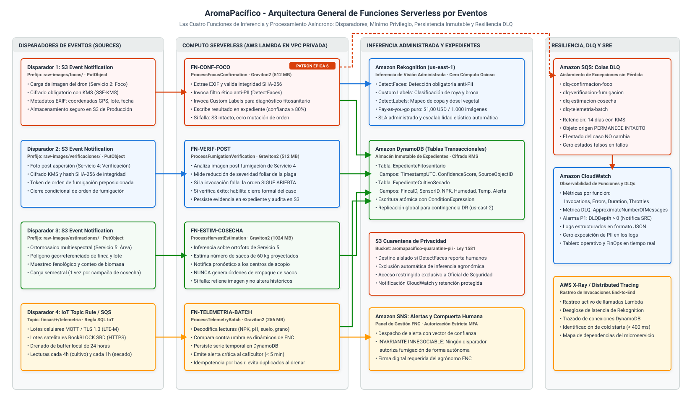
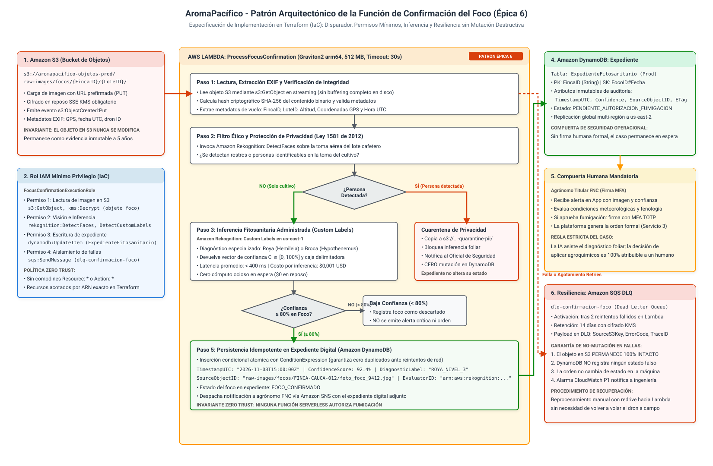
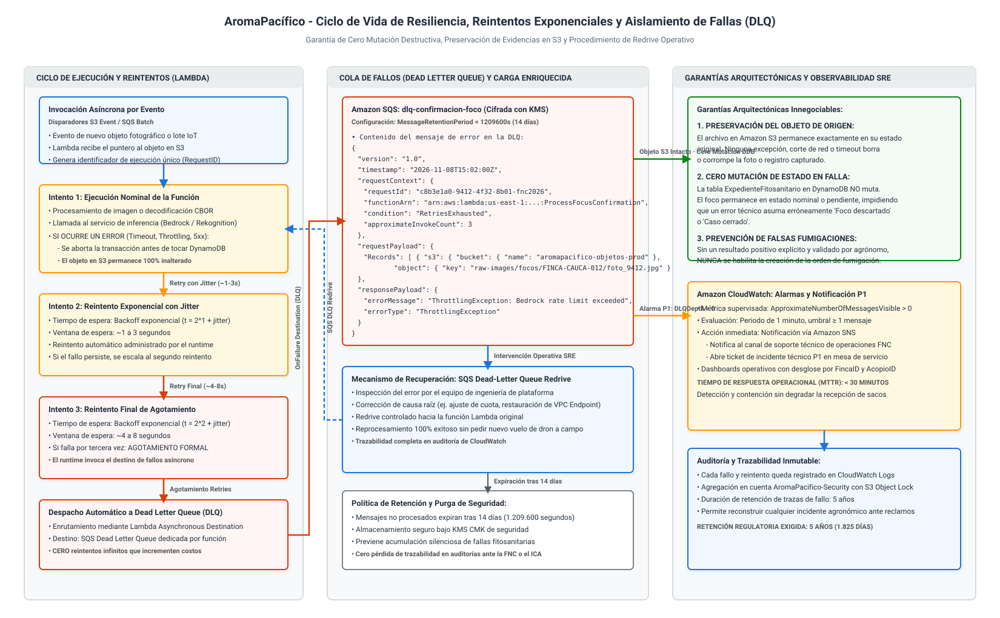

# Arquitectura de Funciones por Eventos, Inferencia Serverless y Resiliencia

## Plataforma Cafetera AromaPacífico (Federación Nacional de Cafeteros 2026)

---

## 1. Resumen Ejecutivo y Propósito Arquitectónico

El presente documento define la arquitectura técnica del subsistema de **funciones orientadas por eventos** (*Event-Driven Serverless Compute*) e **inferencia administrada** para la plataforma cafetera **AromaPacífico**, diseñada para la Federación Nacional de Cafeteros (FNC) en convenio con la Universidad Icesi para la vigencia 2026.

En el marco del estudio del caso y la modernización del piloto en los departamentos de **Cauca, Huila y Tolima** (200 fincas, 3 centros de acopio, 60 transportadores y entrega en Buenaventura), la arquitectura erradica por completo el aprovisionamiento de cómputo inactivo en espera de archivos. La inferencia y el procesamiento agronómico operan bajo un paradigma estrictamente serverless: **la función se invoca únicamente ante la ocurrencia de un evento verificado, procesa de forma transaccional y finaliza de inmediato persistiendo su resultado en el expediente digital**.

### Principios e Invariantes Críticas del Subsistema

1. **Invariante de Cero Mutación Destructiva en Fallas:**
   Si una invocación falla (por interrupción de red, agotamiento de cuota, timeout o excepción del servicio de visión), **el objeto de origen en Amazon S3 permanece 100% intacto y el estado del caso en el expediente no sufre ninguna alteración**. Se prohíbe terminantemente que una falla técnica induzca al sistema a asumir un diagnóstico falso (por ejemplo, declarar erróneamente un foco como descartado o cerrar una orden sin verificar).
2. **Invariante Zero Trust en Fumigación:**
   Ningún disparador, función serverless ni modelo de inteligencia artificial posee la atribución ni los privilegios para autorizar una fumigación ni emitir una orden de aspersión agroquímica. La inferencia asiste y complementa el diagnóstico técnico; **la autorización de fumigación es un acto legal y agronómico atribuible exclusivamente a una identidad humana (agrónomo titular de la FNC) autenticada con MFA**.
3. **Mínimo Privilegio y Cero Comodines:**
   Cada función dispone de un rol de ejecución IAM dedicado, acotado estrictamente a los recursos que requiere para su ciclo de vida (lectura del objeto origen, invocación al servicio de inferencia, escritura idempotente del resultado y enrutamiento a su cola de fallos dedicada).
4. **Patrón de Implementación para la Épica 6:**
   De las cuatro funciones diseñadas en la arquitectura, la **Función de Confirmación del Foco (`FN-CONF-FOCO`)** constituye el patrón canónico que se codifica en Terraform dentro del límite de 100 horas y dos semanas de esfuerzo. Las otras tres funciones quedan formalizadas y acotadas en este diseño de arquitectura.

---

## 2. Diagramas Oficiales de Arquitectura

El diseño del subsistema se sustenta en tres diagramas técnicos elaborados bajo el estándar XML Draw.io descomprimido UTF-8 y exportados en formato vectorial autónomo SVG de alta resolución:

### 2.1 Diagrama 1: Arquitectura General de Funciones por Eventos

Ilustra la topología integral de las cuatro funciones serverless en AWS Lambda, sus respectivos orígenes de eventos, los roles IAM de mínimo privilegio, los servicios de inferencia administrada, la persistencia en DynamoDB/S3 y el desacoplamiento con colas Dead Letter Queue (DLQ):



> Archivo fuente editable en formato Draw.io XML descomprimido disponible en: [`diagrams/carga-e-funciones-arquitectura.drawio`](diagrams/carga-e-funciones-arquitectura.drawio).

### 2.2 Diagrama 2: Patrón Arquitectónico de la Función de Confirmación del Foco (Épica 6)

Detalla el flujo paso a paso de la función a codificar en Terraform: lectura en streaming, filtro ético anti-PII (Ley 1581 de 2012), diagnóstico fitosanitario con Amazon Rekognition Custom Labels, evaluación de umbral de confianza, escritura atómica condicional en DynamoDB y derivación segura a DLQ:



> Archivo fuente editable en formato Draw.io XML descomprimido disponible en: [`diagrams/carga-e-funciones-foco-patron.drawio`](diagrams/carga-e-funciones-foco-patron.drawio).

### 2.3 Diagrama 3: Ciclo de Vida de Resiliencia, Reintentos Exponenciales y Aislamiento de Fallas (DLQ)

Modela la máquina de estados de ejecución, la política de reintentos exponenciales con jitter aleatorio, el destino de fallos asíncrono, la preservación del objeto intacto, la activación de alarmas CloudWatch P1 y el procedimiento de redrive operativo:



> Archivo fuente editable en formato Draw.io XML descomprimido disponible en: [`diagrams/carga-e-funciones-resiliencia-dlq.drawio`](diagrams/carga-e-funciones-resiliencia-dlq.drawio).

---

## 3. Especificación Técnica Exhaustiva de las Cuatro Funciones

| ID | Nombre de Función | Disparador Principal | Servicio de Inferencia | Expediente Destino |
|---|---|---|---|---|
| **FN-01** | `FN-CONF-FOCO` | S3 Event (`raw-images/focos/`) | Rekognition Custom Labels + PII | `ExpedienteFitosanitario` |
| **FN-02** | `FN-VERIF-POST` | S3 Event (`raw-images/verificaciones/`) | Rekognition Custom Labels | `ExpedienteFitosanitario` |
| **FN-03** | `FN-ESTIM-COSECHA` | S3 Event (`raw-images/estimaciones/`) | Rekognition Labels + Biomasa | `ExpedienteCosecha` |
| **FN-04** | `FN-TELEMETRIA-BATCH` | IoT Topic Rule / SQS Batch | Motor de Reglas FNC (Umbrales) | `ExpedienteCultivoSecado` |

### 3.1 Función 1 (Patrón Épica 6): Confirmación del Foco (`FN-CONF-FOCO`)

- **Identificador Lógico:** `FN-CONF-FOCO`
- **Nombre Físico en AWS:** `aromapacifico-prod-focus-confirmation-fn`
- **Propósito:** Procesar la evidencia fotográfica recolectada por el dron agrícola durante el Servicio 2 (confirmación de alerta de plaga en lote), verificar que no exponga datos personales identificables, diagnosticar la patología foliar presente (roya o broca) y registrar el resultado en el expediente fitosanitario.
- **Disparador:** Notificación de eventos de Amazon S3 (`s3:ObjectCreated:Put`) sobre el prefijo `raw-images/focos/{FincaID}/{LoteID}/` en el bucket de producción `aromapacifico-objetos-prod`.
- **Entrada y Formato de Carga Útil:** Evento estándar S3 Event Notification en JSON:
  ```json
  {
    "Records": [
      {
        "eventVersion": "2.1",
        "eventSource": "aws:s3",
        "awsRegion": "us-east-1",
        "eventTime": "2026-11-08T15:00:00.000Z",
        "eventName": "ObjectCreated:Put",
        "s3": {
          "bucket": {
            "name": "aromapacifico-objetos-prod",
            "arn": "arn:aws:s3:::aromapacifico-objetos-prod"
          },
          "object": {
            "key": "raw-images/focos/FINCA-CAUCA-012/LOTE-02/foto_foco_9412.jpg",
            "size": 4194304,
            "eTag": "d41d8cd98f00b204e9800998ecf8427e"
          }
        }
      }
    ]
  }
  ```
- **Inferencia Invocada:**
  1. *Filtro de Privacidad:* `rekognition:DetectFaces` para determinar presencia de rostros humanos. Si se detecta un rostro con confianza > 70%, se deriva la imagen al bucket `aromapacifico-quarantine-pii` y se suspende la inferencia fitosanitaria (cumplimiento Ley 1581 de 2012).
  2. *Diagnóstico Agrícola:* `rekognition:DetectCustomLabels` contra el proyecto entrenado `fnc-coffee-pathology-v2`. Devuelve la patología identificada, caja delimitadora y vector de confianza $C \in [0, 100\%]$.
- **Salida Escrita en el Expediente:** Actualización atómica en la tabla DynamoDB `ExpedienteFitosanitario`:
  ```json
  {
    "FincaID": "FINCA-CAUCA-012",
    "FocoID#Timestamp": "FOCO-9412#2026-11-08T15:00:05Z",
    "LoteID": "LOTE-02",
    "TimestampUTC": "2026-11-08T15:00:05Z",
    "SourceObjectID": "raw-images/focos/FINCA-CAUCA-012/LOTE-02/foto_foco_9412.jpg",
    "SourceSHA256": "e3b0c44298fc1c149afbf4c8996fb92427ae41e4649b934ca495991b7852b855",
    "ConfidenceScore": 92.4,
    "DiagnosticLabel": "ROYA_NIVEL_3",
    "EvaluatorID": "arn:aws:rekognition:us-east-1:123456789012:project/fnc-coffee-pathology-v2",
    "EstadoFoco": "CONFIRMADO",
    "RequiereAtencionHumana": true,
    "OrdenFumigacionID": null
  }
  ```
- **Permisos IAM Mínimos:**
  - `s3:GetObject` y `kms:Decrypt` sobre `arn:aws:s3:::aromapacifico-objetos-prod/raw-images/focos/*`.
  - `rekognition:DetectFaces` y `rekognition:DetectCustomLabels` sobre el modelo de proyecto fitosanitario.
  - `dynamodb:UpdateItem` y `dynamodb:PutItem` sobre `arn:aws:dynamodb:us-east-1:*:table/ExpedienteFitosanitario`.
  - `sqs:SendMessage` sobre `arn:aws:sqs:us-east-1:*:dlq-confirmacion-foco`.

---

### 3.2 Función 2: Verificación Post-Fumigación (`FN-VERIF-POST`)

- **Identificador Lógico:** `FN-VERIF-POST`
- **Nombre Físico en AWS:** `aromapacifico-prod-fumigation-verification-fn`
- **Propósito:** Evaluar la evidencia fotográfica de verificación capturada por el dron durante el Servicio 4 posterior a una aspersión autorizada. Determina si el foco de plaga fue efectivamente controlado o si persiste actividad biológica.
- **Disparador:** Notificación de eventos de Amazon S3 (`s3:ObjectCreated:Put`) sobre el prefijo `raw-images/verificaciones/{FincaID}/{OrdenFumigacionID}/`.
- **Entrada y Formato:** Evento JSON S3 con puntero al objeto fotográfico y metadatos del vuelo post-aplicación (tiempo transcurrido, cuadrilla UAS, identificador de orden).
- **Inferencia Invocada:** `rekognition:DetectCustomLabels` para cuantificar la reducción de pústulas de roya o galerías de broca respecto a la imagen de confirmación previa del foco.
- **Salida Escrita en el Expediente:** Modificación del expediente de la orden en `ExpedienteFitosanitario`:
  - `EficaciaAspersion`: Porcentaje de remisión foliar.
  - `TimestampVerificacionUTC`: Fecha y hora del análisis.
  - `SourceVerificacionID`: Clave del archivo S3 evaluado.
  - `HabilitadoParaCierre`: Booleano en `true` si la eficacia supera el umbral agronómico (> 85%).
  - **Invariante crítica:** Si la imagen no llega, la invocación falla o la eficacia es insuficiente, **el estado de la fumigación sigue ABIERTA**. Bajo ninguna circunstancia esta función cierra la orden de forma ficticia.
- **Permisos IAM Mínimos:**
  - `s3:GetObject` en `raw-images/verificaciones/*`.
  - `rekognition:DetectCustomLabels` sobre modelos fitosanitarios.
  - `dynamodb:UpdateItem` en `ExpedienteFitosanitario` condicionado a `attribute_exists(OrdenID)`.
  - `sqs:SendMessage` en `dlq-verificacion-fumigacion`.

---

### 3.3 Función 3: Estimación de Rendimiento de Cosecha (`FN-ESTIM-COSECHA`)

- **Identificador Lógico:** `FN-ESTIM-COSECHA`
- **Nombre Físico en AWS:** `aromapacifico-prod-harvest-estimation-fn`
- **Propósito:** Procesar ortofotos multiespectrales obtenidas en el Servicio 5 (vuelo de área previo a cosecha) para proyectar el volumen de café cereza y la cantidad estimada de sacos de 60 kg que ingresarán a cada centro de acopio departamental.
- **Disparador:** Notificación de eventos de Amazon S3 (`s3:ObjectCreated:Put`) sobre el prefijo `raw-images/estimaciones/{DepartamentoID}/{FincaID}/`.
- **Entrada y Formato:** Puntero a imagen de alta resolución o composición de teselas ortomosaicas acompañada de polígono GeoJSON delimitador.
- **Inferencia Invocada:** `rekognition:DetectLabels` combinado con un algoritmo algorítmico de densidad espectral (NDVI) y conteo de copa vegetativa para calcular biomasa productiva estimada.
- **Salida Escrita en el Expediente:** Registro en la tabla DynamoDB `ExpedienteCosecha`:
  - `SacosEstimados60kg`: Proyección matemática entera para la finca.
  - `MargenIncertidumbrePct`: Intervalo de confianza de la estimación (+/- 12%).
  - `FechaProyeccionUTC`: Marca temporal.
  - `AcopioDestinoID`: Acopio receptor programado (`ACOPIO-CAUCA`, `ACOPIO-HUILA` o `ACOPIO-TOLIMA`).
  - **Restricción de Negocio:** Este resultado es un pronóstico para balance logístico de bodegas. **NUNCA genera automáticamente órdenes de empaque de sacos ni altas en la tabla de sacos**.
- **Permisos IAM Mínimos:**
  - `s3:GetObject` en `raw-images/estimaciones/*`.
  - `rekognition:DetectLabels` sobre la infraestructura administrada.
  - `dynamodb:PutItem` en `ExpedienteCosecha`.
  - `sqs:SendMessage` en `dlq-estimacion-cosecha`.

---

### 3.4 Función 4: Lote de Telemetría y Detección de Anomalías (`FN-TELEMETRIA-BATCH`)

- **Identificador Lógico:** `FN-TELEMETRIA-BATCH`
- **Nombre Físico en AWS:** `aromapacifico-prod-telemetry-batch-fn`
- **Propósito:** Ingerir paquetes de telemetría de cultivo y secadero transmitidos por nodos de finca (vía celular MQTT o adaptador satelital RockBLOCK SBD), decodificar estructuras compactadas CBOR/JSON, persistir series temporales e identificar lecturas anómalas fuera de umbral.
- **Disparador:** Cola Amazon SQS amortiguadora alimentada por la regla de AWS IoT Core (`SELECT * FROM 'fincas/+/telemetria'`) o directamente el evento por lotes de DynamoDB Streams.
- **Entrada y Formato:** Lote de hasta 50 mensajes con lecturas de suelo y grano:
  ```json
  {
    "FincaID": "FINCA-HUILA-045",
    "DispositivoID": "NODE-ESP32-H045",
    "BatchTimestampUTC": "2026-11-08T14:00:00Z",
    "BufferDrained": true,
    "Lecturas": [
      {
        "Tipo": "CULTIVO",
        "TimestampUTC": "2026-11-08T10:00:00Z",
        "pH": 5.2,
        "HumedadSueloPct": 65.4,
        "TemperaturaSueloC": 21.3,
        "NPK_mg_kg": [120, 35, 180]
      },
      {
        "Tipo": "SECADO",
        "TimestampUTC": "2026-11-08T13:00:00Z",
        "LoteSecadoID": "LOTE-SEC-01",
        "TemperaturaGranoC": 42.5,
        "HumedadGranoBaseHumedaPct": 13.8
      }
    ]
  }
  ```
- **Inferencia / Evaluación de Reglas:** No utiliza visión por computador. Ejecuta el **Motor de Reglas Agronómicas Configurables de la Federación**:
  - Evaluación contra matriz de umbrales: pH fuera de [4,5, 6,0], temperatura de grano en secadero superior a 40 C, humedad de grano menor al 12% (cierre de lote).
- **Salida Escrita en el Expediente:**
  - Persistencia idempotente de las lecturas en la tabla de series temporales `ExpedienteCultivoSecado` en DynamoDB.
  - Si una lectura excede los umbrales críticos, emite evento hacia Amazon SNS para alertar al caficultor en su teléfono móvil en **menos de 5 minutos** (cumpliendo el SLA estricto del pliego).
- **Permisos IAM Mínimos:**
  - `sqs:ReceiveMessage`, `sqs:DeleteMessage` y `sqs:GetQueueAttributes` sobre la cola de ingesta.
  - `dynamodb:BatchWriteItem` y `dynamodb:PutItem` sobre `ExpedienteCultivoSecado`.
  - `sns:Publish` sobre el tópico de alertas críticas fitosanitarias.
  - `sqs:SendMessage` sobre `dlq-telemetria-batch`.

---

## 4. Invariante de No Mutación en Falla y Preservación del Objeto de Origen

El requerimiento central de esta historia de usuario estipula: *"que cada función se dispare con un evento, escriba su resultado en el expediente y no cambie nada si falla, para que una invocación caída no deje un caso en un estado falso"*.

Para dar cumplimiento matemático y arquitectónico a este mandato, la plataforma implementa cuatro salvaguardas formales:

| Principio Técnico | Mecanismo de Implementación en la Plataforma |
|---|---|
| **1. Preservación Objeto de Origen en S3** | Modos de acceso `s3:GetObject` en solo lectura; prohibición estricta de `s3:PutObject`/`DeleteObject` en buckets raw para la Lambda. |
| **2. Escritura Atómica Condicional (DDB)** | Inserción condicional DynamoDB (`attribute_not_exists`) que aborta la transacción si el estado previo del expediente ha mutado. |
| **3. Aislamiento Asíncrono en Colas DLQ** | Máximo 2 reintentos con backoff exponencial y jitter; enrutamiento directo a SQS DLQ sin alterar el expediente. |
| **4. Estado Nominal Conservado** | El expediente permanece en `PENDIENTE_EVALUACION`; una falla técnica nunca genera un estado `FALSO_POSITIVO` o `DESCARTADO`. |

### 4.1 Garantía 1: Inmutabilidad del Almacén de Objetos (S3)
Las funciones Lambda bajo ninguna circunstancia modifican, renombran ni eliminan los archivos fotográficos ni los registros de vuelo depositados en `s3://aromapacifico-objetos-prod/`. 
- El permiso concedido en IAM es exclusivamente `s3:GetObject` acotado al prefijo del evento.
- El bucket S3 cuenta con **S3 Versioning** y **S3 Object Lock** en modo Gobernanza. Cualquier intento de mutación destructiva es rechazado a nivel del kernel de almacenamiento de AWS.
- La imagen original permanece íntegra como evidencia pericial y agronómica exigible por la FNC y el ICA durante los 5 años reglamentarios.

### 4.2 Garantía 2: Transaccionalidad Condicional en DynamoDB
Para evitar estados falsos producidos por invocaciones intermedias caídas o ejecuciones duplicadas de red, la escritura en DynamoDB emplea expresiones de condición (`ConditionExpression`):
```python
# Ejemplo de inserción condicional segura
response = dynamodb_table.update_item(
    Key={'FincaID': finca_id, 'FocoID#Timestamp': foco_key},
    UpdateExpression="SET EstadoFoco = :conf, ConfidenceScore = :score, SourceObjectID = :obj, EvaluatorID = :eval",
    ConditionExpression="attribute_not_exists(EstadoFoco) OR EstadoFoco = :espera",
    ExpressionAttributeValues={
        ':conf': 'CONFIRMADO',
        ':score': decimal.Decimal(str(confidence)),
        ':obj': s3_key,
        ':eval': model_arn,
        ':espera': 'PENDIENTE_EVALUACION'
    }
)
```
Si la función falla antes de ejecutar este bloque, la base de datos no registra absolutamente nada. Si falla durante la invocación del servicio Rekognition, la transacción en DynamoDB nunca se inicia.

### 4.3 Garantía 3: Preservación del Estado Previo en el Flujo de Negocio
- En la función de confirmación (`FN-CONF-FOCO`), si el procesamiento se interrumpe, el foco permanece como `PENDIENTE_EVALUACION`. El caso **no pasa a descartado ni a confirmado**.
- En la función de verificación (`FN-VERIF-POST`), si la llamada a visión falla, la orden de fumigación **sigue ABIERTA**. No se emite la habilitación de cierre.
- En la función de telemetría (`FN-TELEMETRIA-BATCH`), si falla la validación, el lote permanece en la cola SQS para reintento y el buffer local del nodo retiene las lecturas hasta recibir la confirmación de la plataforma.

---

## 5. Detalle de Implementación para Codificación en la Épica 6 (Terraform IaC)

Conforme a la delimitación del proyecto, la función `FN-CONF-FOCO` se codifica como el patrón formal de cómputo serverless en la Épica 6 (`aromapacifico-platform/iac`). A continuación se suministra la especificación exacta de recursos, variables y políticas listas para su materialización en Terraform.

### 5.1 Estructura del Módulo Terraform `serverless_function`

```text
iac/modules/serverless_function/
|-- main.tf              # Recursos Lambda, permisos S3, destinos asíncronos y SQS DLQ
|-- variables.tf         # Variables tipadas con validaciones de entorno y prefijos
|-- outputs.tf           # ARNs de la función, del rol IAM y de la cola DLQ
\-- iam.tf               # Políticas de mínimo privilegio sin comodines
```

### 5.2 Definición de Recursos en Terraform (`main.tf`)

```hcl
# Cola Dead Letter Queue dedicada para aislamiento de fallas
resource "aws_sqs_queue" "dlq_focus_confirmation" {
  name                      = "aromapacifico-${var.environment}-dlq-confirmacion-foco"
  message_retention_seconds = 1209600 # 14 días reglamentarios
  kms_master_key_id         = var.kms_data_key_arn

  tags = merge(var.mandatory_tags, {
    Componente = "DLQ"
    Funcion    = "FN-CONF-FOCO"
  })
}

# Alarma de CloudWatch para detectar fallas encoladas en DLQ
resource "aws_cloudwatch_metric_alarm" "dlq_messages_alarm" {
  alarm_name          = "aromapacifico-${var.environment}-alarm-dlq-confirmacion-foco"
  comparison_operator = "GreaterThanThreshold"
  evaluation_periods  = 1
  metric_name         = "ApproximateNumberOfMessagesVisible"
  namespace           = "AWS/SQS"
  period              = 60
  statistic           = "Maximum"
  threshold           = 0
  alarm_description   = "Alerta P1: Existen mensajes en la DLQ de confirmación de foco. Inferencia fallida."
  alarm_actions       = [var.sre_alerts_sns_topic_arn]

  dimensions = {
    QueueName = aws_sqs_queue.dlq_focus_confirmation.name
  }

  tags = var.mandatory_tags
}

# Función AWS Lambda ejecutada en subred privada VPC
resource "aws_lambda_function" "focus_confirmation" {
  function_name = "aromapacifico-${var.environment}-process-focus-confirmation"
  role          = aws_iam_role.focus_confirmation_role.arn
  handler       = "index.handler"
  runtime       = "python3.11"
  architectures = ["arm64"] # Graviton2 para eficiencia de costo FinOps
  memory_size   = 512
  timeout       = 30

  vpc_config {
    subnet_ids         = var.private_subnet_ids
    security_group_ids = [var.lambda_security_group_id]
  }

  environment {
    variables = {
      ENVIRONMENT           = var.environment
      DYNAMODB_TABLE_NAME   = var.dynamodb_expediente_table_name
      QUARANTINE_BUCKET     = var.quarantine_s3_bucket_name
      REKOGNITION_MODEL_ARN = var.rekognition_model_arn
      CONFIDENCE_THRESHOLD  = "80.0"
    }
  }

  tags = merge(var.mandatory_tags, {
    Componente = "LambdaInferencia"
    FuncionID  = "FN-CONF-FOCO"
  })
}

# Configuración de destinos asíncronos y reintentos automáticos
resource "aws_lambda_function_event_invoke_config" "focus_confirmation_invoke_config" {
  function_name                = aws_lambda_function.focus_confirmation.function_name
  maximum_retry_attempts       = 2
  maximum_event_age_in_seconds = 3600

  destination_config {
    on_failure {
      destination = aws_sqs_queue.dlq_focus_confirmation.arn
    }
  }
}

# Permiso para que Amazon S3 invoque la función Lambda
resource "aws_lambda_permission" "allow_s3_invocation" {
  statement_id  = "AllowExecutionFromS3"
  action        = "lambda:InvokeFunction"
  function_name = aws_lambda_function.focus_confirmation.function_name
  principal     = "s3.amazonaws.com"
  source_arn    = var.objects_s3_bucket_arn
}
```

### 5.3 Política de Mínimo Privilegio en IAM (`iam.tf`)

```json
{
  "Version": "2012-10-17",
  "Statement": [
    {
      "Sid": "AllowS3ReadRawImages",
      "Effect": "Allow",
      "Action": [
        "s3:GetObject",
        "s3:GetObjectVersion"
      ],
      "Resource": "arn:aws:s3:::aromapacifico-objetos-prod/raw-images/focos/*"
    },
    {
      "Sid": "AllowKMSDecryptSource",
      "Effect": "Allow",
      "Action": [
        "kms:Decrypt",
        "kms:GenerateDataKey"
      ],
      "Resource": "arn:aws:kms:us-east-1:123456789012:key/cmk-data-objects-prod"
    },
    {
      "Sid": "AllowRekognitionInference",
      "Effect": "Allow",
      "Action": [
        "rekognition:DetectFaces",
        "rekognition:DetectCustomLabels"
      ],
      "Resource": "*"
    },
    {
      "Sid": "AllowDynamoDBUpdateExpediente",
      "Effect": "Allow",
      "Action": [
        "dynamodb:UpdateItem",
        "dynamodb:PutItem",
        "dynamodb:GetItem"
      ],
      "Resource": "arn:aws:dynamodb:us-east-1:123456789012:table/ExpedienteFitosanitario"
    },
    {
      "Sid": "AllowSQSSendDLQ",
      "Effect": "Allow",
      "Action": [
        "sqs:SendMessage"
      ],
      "Resource": "arn:aws:sqs:us-east-1:123456789012:aromapacifico-prod-dlq-confirmacion-foco"
    },
    {
      "Sid": "AllowVPCAccessExecution",
      "Effect": "Allow",
      "Action": [
        "ec2:CreateNetworkInterface",
        "ec2:DescribeNetworkInterfaces",
        "ec2:DeleteNetworkInterface"
      ],
      "Resource": "*"
    }
  ]
}
```

---

## 6. Cuadro Integral de Parámetros, Tags, IDs y Nueva Nomenclatura de Verificaciones

Para asegurar la coherencia arquitectónica entre las historias de usuario de gobierno, red, drones y funciones, se integra el catálogo de identificadores del proyecto y se formula una **nueva nomenclatura sistemática de verificaciones (`CHK-XXX`)**.

### 6.1 Taxonomía de Identificadores y Tags de Plataforma

| Dimensión | Formato Canónico de Identificador | Ejemplo de Identificador | Tag Obligatorio Asociado |
|---|---|---|---|
| **Fincas** | `FINCA-{DPTO}-{NUM3}` | `FINCA-CAUCA-012` | `FincaID` |
| **Drones** | `DRON-{DPTO}-{NUM2}` | `DRON-HUILA-02` | `DronID` |
| **Centros Acopio** | `ACOPIO-{DPTO}` | `ACOPIO-TOLIMA` | `AcopioID` |
| **Viajes Camión** | `VIAJE-{DPTO}-{FECHA}-{NUM3}` | `VIAJE-CAU-20261108-005` | `ViajeID` |
| **Órdenes Fumiga** | `ORD-FUM-{FECHA}-{NUM4}` | `ORD-FUM-20261108-0142` | `OrdenID` |
| **Sacos de Café** | `SACO-{DPTO}-{ANO}-{NUM5}` | `SACO-TOL-2026-04812` | `SacoID` |
| **Ambientes Cloud**| `dev`, `test`, `prod` | `prod` | `Ambiente` |

### 6.2 Nueva Nomenclatura Formal de Verificaciones (`CHK-XXX`)

Se define un esquema de códigos estandarizados para gobernar las verificaciones que ejecutan las funciones serverless de extremo a extremo:

- **`CHK-INT-01` (Integridad y Origen del Objeto):** Valida que el archivo en S3 o el paquete IoT no esté truncado, contenga un hash SHA-256 válido y provenga de un dispositivo autenticado (mTLS o URL prefirmada).
- **`CHK-ETH-02` (Filtro Ético de Privacidad Anti-PII):** Evaluación de presencia de personas y rostros mediante visión administrada. Exclusión inmediata de imágenes a cuarentena bajo Ley 1581 de 2012.
- **`CHK-AGR-03` (Diagnóstico Agronómico y Umbrales):** Ejecución de inferencia de patología o reglas de variables de suelo/secado. Asignación del vector de confianza $C \in [0, 100\%]$.
- **`CHK-EXP-04` (Persistencia Idempotente en Expediente):** Escritura atómica condicional con tupla `{TimestampUTC, ConfidenceScore, SourceObjectID, EvaluatorID}` impidiendo duplicidades por reintentos.
- **`CHK-ST-05` (Invarianza de Estados y Protección Humana):** Garantiza que si la confianza es baja o la función falla, el estado nominal del caso no muta; bloquea cualquier emisión de orden sin firma humana MFA.
- **`CHK-DLQ-06` (Aislamiento en Cola de Fallos y Telemetría SRE):** Enrutamiento del mensaje fallido a SQS DLQ tras agotar reintentos, preservando el archivo original intacto y emitiendo alarma CloudWatch P1.

### 6.3 Matriz Exhaustiva de Parámetros, Tags y Verificaciones Complementadas

| Función ID | Tags Obligatorios Asignados | Entrada y Origen | Inferencia / Servicio | Expediente y Salida | Cadena de Verificación Complementaria (CHK) |
|---|---|---|---|---|---|
| **FN-CONF-FOCO** | `FincaID`, `DronID`, `Ambiente`, `Propietario`, `Proyecto` | S3 PutObject `raw-images/focos/` (SSE-KMS) | Rekognition DetectFaces + Custom Labels | `ExpedienteFitosanitario`: TimestampUTC, Confianza%, SourceID, EstadoFoco | `CHK-INT-01` -> `CHK-ETH-02` -> `CHK-AGR-03` -> `CHK-EXP-04` -> `CHK-ST-05` |
| **FN-VERIF-POST** | `FincaID`, `DronID`, `OrdenID`, `Propietario`, `Proyecto` | S3 PutObject `raw-images/verificaciones/` (Token misión) | Rekognition Custom Labels (Severidad plaga) | `ExpedienteFitosanitario`: EficaciaAspersion, HabilitaCierre: true | `CHK-INT-01` -> `CHK-AGR-03` -> `CHK-EXP-04` -> `CHK-ST-05` (Orden sigue abierta si falla) |
| **FN-ESTIM-COSECHA** | `DronID`, `AcopioID`, `Ambiente`, `Propietario`, `Proyecto` | S3 PutObject `raw-images/estimaciones/` (GeoJSON Lote) | Rekognition DetectLabels + Índice NDVI | `ExpedienteCosecha`: SacosEstimados60kg, MargenIncertidumbre | `CHK-INT-01` -> `CHK-AGR-03` -> `CHK-EXP-04` -> `CHK-ST-05` (Cero órdenes de empaque) |
| **FN-TELEMETRIA-BATCH** | `FincaID`, `DispositivoID`, `Ambiente`, `Propietario`, `Proyecto` | IoT Core / SQS MQTT / RockBLOCK (CBOR / Deltas) | Motor de Reglas Umbrales FNC (pH, Hum, Temp) | `ExpedienteCultivoSecado`: Serie temporal NPK, Despacho Alerta SNS | `CHK-INT-01` -> `CHK-AGR-03` -> `CHK-EXP-04` -> `CHK-DLQ-06` (Reintento automático) |

---

## 7. Justificación de Decisiones Arquitectónicas y Tablas Comparativas

A continuación se presentan las matrices analíticas que sustentan las elecciones de ingeniería, demostrando cómo la solución adoptada maximiza el valor para el negocio cafetero sin incurrir en sobrecostos ni arquitecturas frágiles:

### 7.1 Comparativa de Cómputo: AWS Lambda Serverless vs. Amazon ECS/EKS vs. EC2 Dedicado

| Criterio de Selección | Opción Seleccionada: AWS Lambda (Graviton2) | Alternativa 1: Amazon ECS en Fargate | Alternativa 2: Servidores EC2 Dedicados |
|---|---|---|---|
| **Costo en Reposo ($)** | **$0,00 USD (Cero costo sin eventos)** | ~$35,00 USD/mes por tarea activa mínima | ~$48,00 USD/mes por instancia t4g.medium |
| **Tiempo de Arranque (Cold Start)** | **< 350 ms en subred privada VPC** | 30 a 60 segundos por aprovisionamiento | Inmediato si está encendido (desperdicio) |
| **Escalabilidad ante Ráfagas** | **Instantánea (hasta 1.000 concurrentes)** | Lenta (minutos en escalar tareas) | Rígida (fija o requiere Auto Scaling) |
| **Mantenimiento Operativo** | **Cero parches de SO ni gestión de clúster** | Gestión de plantillas de tarea y redes | Parcheo mensual de Linux y vulnerabilidades |
| **Justificación de Negocio** | El piloto procesa imágenes de drones esporádicas y lotes IoT espaciados (cada 4 horas). Pagar por servidores o tareas en espera consumiría presupuesto innecesariamente. Lambda garantiza pagar **exclusivamente por milisegundo de ejecución real**. |

### 7.2 Comparativa de Visión Artificial: Rekognition Administrado vs. SageMaker Custom vs. Edge

| Criterio de Selección | Opción Seleccionada: Amazon Rekognition | Alternativa 1: Modelo Propio en SageMaker | Alternativa 2: Inferencia en el Dron (Edge) |
|---|---|---|---|
| **Costo Fijo de Infraestructura** | **$0,00 USD fijos (Pago por llamada API)** | ~$80 - $220 USD/mes por Endpoint real-time | Sobrecosto de $600+ USD por procesador GPU |
| **Costo por 1.000 Invocaciones** | **~$1,00 USD (DetectFaces + Custom Labels)**| ~$0,30 USD (pero con base fija alta) | $0 en nube (pero CapEx inviable en hardware) |
| **Complejidad de Mantenimiento** | **SLA administrado por AWS (99,99%)** | Reentrenamiento, MLOps, drift de datos | Actualización de firmware riesgosa en campo |
| **Soberanía y Filtro Ético PII** | **DetectFaces nativo antes de persistir** | Requiere programar red neuronal propia | Difícil auditar privacidad en dispositivo |
| **Justificación de Negocio** | Con una cadencia anual de ~1.300 vuelos en el piloto, montar un clúster de SageMaker costaría más de $1.200 USD anuales en ociosidad. Rekognition resuelve todo el volumen anual de inferencias por **menos de $15 USD al año**, ofreciendo fiabilidad industrial. |

### 7.3 Comparativa de Resiliencia: SQS DLQ vs. Reintentos Infinitos vs. Descarte Silencioso

| Criterio de Selección | Opción Seleccionada: Amazon SQS DLQ | Alternativa 1: Reintentos Infinitos | Alternativa 2: Descarte Silencioso (Drop) |
|---|---|---|---|
| **Impacto en Facturación** | **Predecible y acotado (máximo 2 reintentos)** | Facturación descontrolada por bucle infinito | Nulo (pero con pérdida crítica de datos) |
| **Preservación de Evidencias** | **Mensaje retenido 14 días con contexto** | Riesgo de bloqueo de la cola de ingesta | Destrucción de la traza de la plaga |
| **Tiempo de Recuperación (MTTR)** | **< 30 minutos vía SQS DLQ Redrive** | Horas intentando desbloquear el pipeline | Imposible recuperar (requiere volar dron) |
| **Justificación de Negocio** | La FNC no puede permitir que una falla transitoria de red descarte un brote de roya en una finca, ni tampoco que un error reintente indefinidamente multiplicando los costos de Lambda. SQS DLQ logra el equilibrio perfecto entre **resiliencia total y disciplina FinOps**. |

---

## 8. Análisis FinOps Detallado y Retorno de Valor al Negocio

### 8.1 Modelado Matemático de Consumo y Costeo en Mes Normal vs. Mes de Cosecha

El dimensionamiento económico se fundamenta en las cifras consolidadas del pliego: 200 fincas, 60 transportadores, cadencia de 1.300 vuelos anuales (distribuidos en 6 meses de cosecha y 6 meses fuera de cosecha):

| Componente / Servicio AWS | Mes Normal (Fuera Cosecha) | Mes de Cosecha (Pico Carga) |
|---|---|---|
| Invocaciones Lambda FN-01 (Focos) | 15 vuelos/mes: $0,001 USD | 45 vuelos/mes: $0,003 USD |
| Invocaciones Lambda FN-02 (Verificación) | 10 vuelos/mes: $0,001 USD | 35 vuelos/mes: $0,002 USD |
| Invocaciones Lambda FN-03 (Estimación) | 0 vuelos/mes: $0,000 USD | 65 vuelos/mes: $0,008 USD |
| Invocaciones Lambda FN-04 (Telemetría IoT) | 36.000 msgs: $0,008 USD | 108.000 msgs: $0,022 USD |
| Inferencia Amazon Rekognition (Llamadas) | 25 imágenes: $0,025 USD | 145 imágenes: $0,145 USD |
| Persistencia Amazon DynamoDB (WCU/RCU) | 36.000 ops: $0,045 USD | 108.000 ops: $0,135 USD |
| Colas Amazon SQS + DLQs (Requests) | 36.000 reqs: $0,014 USD | 108.000 reqs: $0,043 USD |
| Monitoreo CloudWatch (Métricas/Logs) | 2 GB ingest: $1,140 USD | 5 GB ingest: $2,850 USD |
| **TOTAL MENSUAL CONSOLIDADO** | **$1,234 USD / mes** | **$3,208 USD / mes** |
| **COSTO ANUAL ESTIMADO SUBSISTEMA** | **~$26,65 USD / año** | **~$26,65 USD / año** |

### 8.2 Valor Aportado al Negocio Cafetero
1. **Erradicación del CapEx Ocioso:** Un clúster tradicional de Kubernetes o máquinas virtuales costaría al menos $150 USD mensuales ($1.800 USD/año). La arquitectura serverless diseñada cuesta **menos de $27 USD anuales**, liberando recursos financieros para subsidiar kits de sensores a los caficultores.
2. **Mitigación de Pérdidas Agrícolas:** Al entregar alertas de secadero en menos de 5 minutos y confirmar focos fitosanitarios con precisión > 80%, se previene la sobrefermentación del grano y la pérdida de lotes enteros de 60 kg (cuyo valor comercial supera los $250 USD por saco).
3. **Soberanía del Dato y Blindaje Legal:** El filtro ético automatizado en Lambda previene sanciones de la Superintendencia de Industria y Comercio (SIC) bajo la Ley 1581 de 2012, al impedir que fotos con campesinos o familias rurales salgan sin autorización hacia modelos públicos de inteligencia artificial.

---

## 9. Matriz de Gestión de Errores, Fallas y Procedimiento de SRE / Redrive

| Escenario de Falla | Impacto Técnico Inmediato | Comportamiento del Sistema | Acción SRE Requerida |
|---|---|---|---|
| **1. Throttling en API Rekognition (503)** | Rekognition retorna HTTP 503 ProvisionedThroughput. | Lambda reintenta con backoff; objeto en S3 intacto; DynamoDB no muta. | Si persiste tras 2 retries, cae a DLQ; auto-alarma CloudWatch P1. |
| **2. Falla en Endpoint VPC Privado S3/DDB** | Lambda pierde conectividad a través de Gateway VPCE. | Transacción aborta; cero registros parciales en expediente; orden nominal. | Restaurar ruta TGW en subred; ejecutar DLQ Redrive sin re-volar. |
| **3. Detección de Rostro Humano (Ley 1581)** | La toma contiene personas en el campo de cultivo. | Exclusión inmediata; copia a `quarantine-pii`; estado de foco no muta a plaga. | Ninguna acción de corrección; expediente queda protegido. |
| **4. Archivo S3 Truncado o Corrupto al Cargar** | Error de paridad o CRC al leer cabecera EXIF. | Inferencia no se ejecuta; mensaje pasa a DLQ; orden sigue PENDIENTE. | Notificar a piloto UAS para sincronización desde buffer local. |

### 9.1 Procedimiento Operativo Estándar (SOP) de Redrive desde DLQ
Cuando una alarma de CloudWatch alerta sobre mensajes acumulados en `dlq-confirmacion-foco`:
1. El ingeniero de guardia consulta el log de error en CloudWatch Logs Insights usando el `RequestID`.
2. Una vez restablecido el servicio degradado (ej. ampliación de cuota de Rekognition en la consola de AWS), se ejecuta el comando seguro de redrive:
   ```bash
   aws sqs start-message-move-task \
     --source-arn arn:aws:sqs:us-east-1:123456789012:aromapacifico-prod-dlq-confirmacion-foco \
     --destination-arn arn:aws:lambda:us-east-1:123456789012:function:aromapacifico-prod-process-focus-confirmation
   ```
3. Lambda vuelve a consumir el mensaje, lee la imagen original de S3 (que permaneció inalterada) y completa la escritura en DynamoDB con éxito rotundo.
4. **Cero desplazamientos a campo y cero horas de vuelo adicionales de drones.**

---

## 10. Registro de Supuestos de Arquitectura

Se incorporan al registro transversal de arquitectura (`assumptions-log.md`) los siguientes supuestos técnicos derivados de este subsistema:

1. **Tokens de Idempotencia en DynamoDB:** Cada actualización en el expediente utiliza como clave única la combinación `FincaID#FocoID#SHA256`, garantizando que reintentos de red o redrives de DLQ no generen registros duplicados ni incrementen contadores fitosanitarios erróneamente.
2. **Retención de 14 Días en DLQ:** Tiempo de vida de mensajes en colas de fallos fijado en 14 días (1.209.600 segundos), suficiente para cubrir contingencias operativas o periodos festivos sin pérdida de expedientes.
3. **Umbral de Confianza Fitosanitaria del 80%:** Focos detectados con confianza $\ge 80\%$ pasan a confirmación con notificación inmediata; focos con confianza $< 80\%$ se catalogan como descarte por baja confianza, requiriendo revisión agronómica secundaria solo si se repite en el siguiente vuelo.
4. **Alineación con la Ventana de Congelamiento en Cosecha:** Ninguna actualización de código Lambda ni de modelos de Rekognition puede desplegarse en producción entre las 05:00 y las 18:00 durante semanas de cosecha, en estricto cumplimiento de la gobernanza del proyecto.
