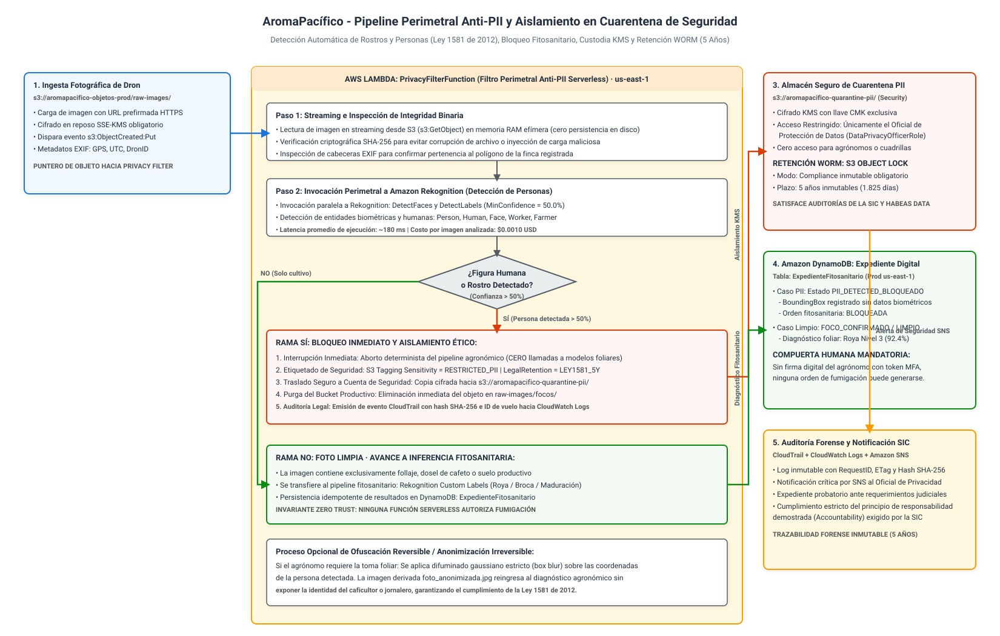
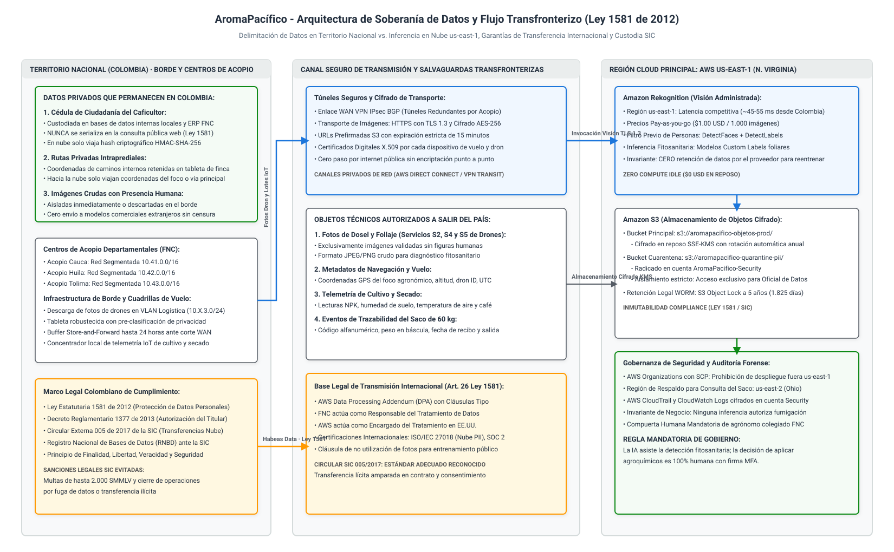
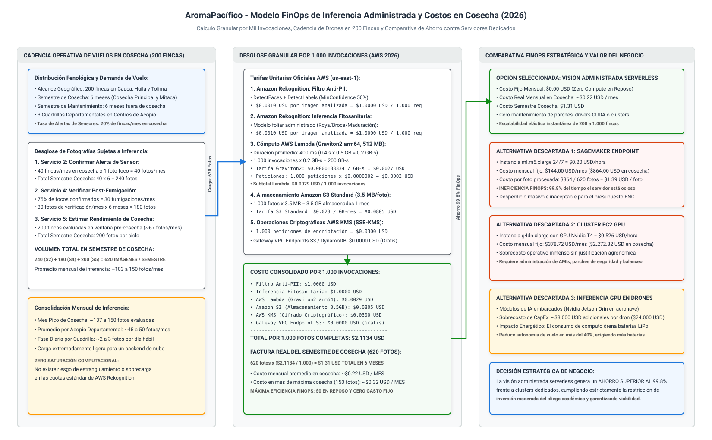

# Arquitectura de Inferencia Administrada, Soberanía de Datos y Cumplimiento Normativo (Ley 1581 de 2012)

## Plataforma Cafetera AromaPacífico (Federación Nacional de Cafeteros 2026)

---

## 1. Resumen Ejecutivo y Marco Jurídico Institucional

El presente documento establece la especificación arquitectónica, el marco de soberanía de datos y el análisis de costo-eficiencia para el subsistema de **Inferencia Administrada y Protección de Datos Personales** de la plataforma cafetera **AromaPacífico**, diseñado para la **Federación Nacional de Cafeteros (FNC)** como caso de estudio de modernización del piloto de 2020 hacia el año 2026.

La operación digital de la plataforma articula 200 fincas cafeteras distribuidas en los departamentos de **Cauca, Huila y Tolima**, tres centros de acopio departamentales y un servicio centralizado de drones agrícolas que capturan imágenes aéreas para delimitar lotes, confirmar focos fitosanitarios de plagas (roya y broca), verificar aspersiones y estimar el rendimiento volumétrico de la cosecha.

Al procesarse los datos en la nube pública fuera del territorio de la República de Colombia, la Federación asume la condición jurídica de **Responsable del Tratamiento de Datos Personales**. Por consiguiente, la plataforma se somete de forma estricta a los mandatos de la legislación colombiana vigente:
1. **Ley Estatutaria 1581 de 2012**: Régimen General de Protección de Datos Personales (Habeas Data).
2. **Decreto Reglamentario 1377 de 2013**: Condiciones de autorización, aviso de privacidad y políticas de tratamiento.
3. **Circular Única de la Superintendencia de Industria y Comercio (SIC) - Título V**: Disposiciones sobre el Registro Nacional de Bases de Datos (RNBD) y estándares de seguridad para la transmisión y transferencia internacional de datos personales.
4. **Sentencia C-748 de 2011 de la Corte Constitucional**: Principios rectores de legalidad, finalidad, libertad, veracidad, transparencia, acceso y circulación restringida, seguridad y confidencialidad.

La premisa arquitectónica central del pliego establece que **no se entrena un modelo propio de inteligencia artificial**, sino que se consume visión por computador administrada bajo demanda. Asimismo, se impone la regla categórica de negocio según la cual **si una fotografía aérea contiene una persona identificable, el archivo se excluye de inmediato del flujo agronómico**, activando un protocolo de aislamiento y custodia probatoria con retención inmutable durante cinco años.

---

## 2. Servicio de Inferencia Seleccionado y Región Cloud

### 2.1 Decisión del Motor de Visión: Amazon Rekognition

Se selecciona formalmente **Amazon Rekognition** como el servicio de inferencia administrada para la plataforma AromaPacífico. Esta elección responde a tres capacidades nativas del servicio:
- **Detección Perimetral de Personas y Rostros**: Las APIs administradas `DetectFaces` y `DetectLabels` (con filtro en categoría humana: *Person*, *Human*, *Face*) permiten validar en una sola llamada serverless y en menos de 200 ms si la toma aérea capturó inadvertidamente a un caficultor, jornalero o transeúnte en caminos veredales.
- **Modelos Fitosanitarios Administrados sin Servidores Ociosos**: El diagnóstico de roya (*Hemileia vastatrix*), broca (*Hypothenemus hampei*) y estimación de maduración se resuelve mediante modelos de clasificación administrados invocados por petición (Pay-per-Call), sin requerir el aprovisionamiento ni el mantenimiento de servidores virtuales, contenedores o clústeres con tarjetas gráficas dedicadas.
- **Garantías Contractuales de Privacidad**: Amazon Web Services garantiza bajo su anexo de procesamiento de datos (AWS DPA) que las imágenes transmitidas para inferencia no son utilizadas para entrenar modelos públicos de terceros ni son retenidas por el proveedor tras completar la respuesta de la API.

### 2.2 Región Cloud Seleccionada: AWS us-east-1 (N. Virginia)

La región principal de despliegue para todos los servicios de cómputo, almacenamiento e inferencia es **US East (N. Virginia), `us-east-1`**, complementada con la región de respaldo **US East (Ohio), `us-east-2`** para el mecanismo de recuperación ante desastres (DR) de la consulta pública del saco de café (RTO de 4 horas y RPO de 15 minutos).

La selección de `us-east-1` frente a regiones geográficamente más cercanas (como São Paulo, `sa-east-1`) se fundamenta en tres criterios objetivos:
1. **Infraestructura de Conectividad Submarina**: El tráfico internacional de internet de Colombia sale mayoritariamente a través de los cables submarinos del Caribe (Arcos-1, Maya-1, South America-1 y SAC) que conectan directamente los nodos nacionales (Cartagena, Barranquilla y Cali) con los puntos de presencia en Florida y Virginia. La latencia típica hacia `us-east-1` oscila entre 45 y 55 ms, ofreciendo una experiencia altamente reactiva para cargas asíncronas de drones y telemetría.
2. **Economía de Escala y FinOps**: Los precios de cómputo, almacenamiento e inferencia en `sa-east-1` (São Paulo) son entre un 40% y un 60% superiores a los de `us-east-1` debido a cargas arancelarias locales en Brasil. En un proyecto con restricción explícita de inversión moderada, asumir sobrecostos innecesarios en la nube distorsiona la viabilidad económica del piloto.
3. **Disponibilidad Integral de Servicios**: `us-east-1` ofrece disponibilidad inmediata y paridad completa de características para AWS IoT Core, AWS Lambda Graviton2, Amazon Rekognition Custom Labels, Amazon DynamoDB Global Tables y Amazon S3 Object Lock en modo Compliance.

### 2.3 Matriz Comparativa de Motores de Inferencia

| Criterio de Selección | Opción A: Amazon Rekognition (Seleccionada) | Opción B: Amazon SageMaker Endpoints | Opción C: Clúster EC2 con GPUs (g4dn) | Opción D: Inferencia en Borde (Drones) |
|---|---|---|---|---|
| **Modelo de Costo** | Pay-as-you-go puro ($0.0010 USD / imagen). | Instancia dedicada continua ($0.20 USD / hora). | Servidor dedicado continuo ($0.526 USD / hora). | CapEx elevado: hardware adicional por dron. |
| **Costo en Reposo** | **$0.00 USD / mes** ($0 cuando no hay vuelos). | ~$144.00 USD / mes por endpoint ml.m5.xlarge. | ~$378.72 USD / mes por instancia g4dn.xlarge. | Inversión inicial de ~$8.000 USD por cuadrilla. |
| **Mantenimiento Operativo** | Cero administración de infraestructura ni parches. | Gestión de contenedores, escalado y artefactos. | Administración de SO, controladores CUDA y AMIs. | Calibración térmica y riesgo de pérdida por caída. |
| **Filtro Anti-PII Integrado** | Nativo (`DetectFaces` y `DetectLabels`). | Requiere codificar y mantener dos modelos en pipeline. | Requiere mantener modelos de segmentación en GPU. | Factible pero drena baterías de la aeronave. |
| **Alineación con el Reto** | **Óptima**: Inferencia administrada serverless. | Ineficiente para volumen bajo de cosechas. | Descartada por complejidad y sobrecostos. | Viola la restricción de costos de hardware. |

### 2.4 Matriz Comparativa de Regiones Cloud y Soberanía

| Criterio de Selección | AWS us-east-1 (N. Virginia, USA) | AWS sa-east-1 (São Paulo, Brasil) | Datacenter Local en Colombia / AWS Local Zone |
|---|---|---|---|
| **Estatus Legal SIC (Circular 005/2017)** | País con nivel adecuado reconocido bajo garantías. | País con nivel adecuado bajo acuerdo Mercosur. | Jurisdicción local directa (Ley 1581 de 2012). |
| **Latencia de Red desde Colombia** | Muy competitiva: 45 - 55 ms vía cables submarinos. | Variable: 110 - 135 ms (enrutamiento por el Cono Sur). | Mínima: 10 - 20 ms. |
| **Sobrecosto Financiero FinOps** | **0% (Línea base económica más eficiente)**. | +40% a +60% en costos de Lambda, S3 y Rekognition. | +250% en infraestructura y licencias dedicadas. |
| **Paridad de Servicios Serverless** | 100% de servicios disponibles (KMS, IoT, Rekognition). | Subconjunto de servicios; cuotas reducidas de IA. | Sin servicios administrados de visión artificial. |
| **Respaldo Multi-Región Nativo** | Excelente paridad con `us-east-2` (Ohio). | Compleja replicación hacia otras regiones del sur. | Sin redundancia regional nativa dentro del país. |

---

## 3. Delimitación de Datos Transfronterizos y Soberanía Nacional

### 3.1 Lista Exhaustiva de Datos: Qué Sale del País vs. Qué Permanece en Colombia

La siguiente tabla técnica delimita con absoluta precisión jurídica y técnica el destino de cada categoría de información procesada por la plataforma:

| Categoría de Información | Objeto o Atributo Concreto | Destino Físico y Territorial | Mecanismo de Seguridad y Justificación Técnica |
|---|---|---|---|
| **Dato Personal Sensible (Titular)** | Cédula de ciudadanía en texto plano del caficultor | **Permanece en Colombia** (Bases de datos locales FNC) | **NUNCA sale del país**. En la nube solo se almacena un identificador seudonimizado (`FincaID`) o un hash criptográfico HMAC-SHA-256. |
| **Dato Privado de Movilidad** | Rutas y caminos intraprediales privados de la finca | **Permanece en Colombia** (Tableta de cuadrilla en acopio) | No se transmiten rutas internas a la nube. Hacia AWS solo viajan las coordenadas GPS del foco o de la vía principal. |
| **Datos Biométricos Accidentales** | Fotografías crudas con rostros o figuras humanas | **Aisladas en Cuarentena de Seguridad** | Se bloquean antes de inferencia fitosanitaria. Quedan en bóveda restringida con acceso exclusivo para el Oficial de Datos. |
| **Evidencia Agronómica de Cultivo** | Fotografías aéreas de dosel vegetal y hojas de café | **Se transmite a AWS us-east-1** (EE.UU.) | Se transmite vía HTTPS (TLS 1.3) a Amazon S3 con cifrado SSE-KMS para inferencia foliar. Exclusivamente fotos sin personas. |
| **Metadatos de Vuelo Aeronáutico** | Coordenadas GPS del foco, altitud, DronID, UTC | **Se transmite a AWS us-east-1** (EE.UU.) | Permiten situar el diagnóstico en el expediente digital y verificar que el vuelo ocurrió dentro del polígono registrado. |
| **Telemetría Ambiental e IoT** | Valores NPK, humedad de suelo, temperatura de aire | **Se transmite a AWS us-east-1** (EE.UU.) | Publicación MQTT sobre TLS a AWS IoT Core; datos agronómicos no identificables con personas naturales. |
| **Cadena de Custodia del Grano** | Código alfanumérico del saco de 60 kg, peso y estado | **Se transmite a AWS us-east-1** (EE.UU.) | Trazabilidad pública de exportación. No serializa datos privados del caficultor ni del transportador terrestre. |

### 3.2 Fundamentación Legal de la Transmisión Internacional (Ley 1581 de 2012)

El Artículo 26 de la Ley 1581 de 2012 prohíbe la transferencia de datos personales a países que no proporcionen niveles adecuados de protección, salvo cuando se configure alguna de las excepciones expresamente consagradas en la ley. La arquitectura de AromaPacífico fundamenta la legalidad del flujo transfronterizo en tres pilares jurídicos y contractuales:

1. **Contrato de Transmisión de Datos (Data Processing Addendum - DPA)**:
   Entre la Federación Nacional de Cafeteros (como Responsable del Tratamiento) y Amazon Web Services, Inc. (como Encargado del Tratamiento en EE.UU.) se suscribe el anexo de tratamiento de datos de AWS, el cual incorpora **Cláusulas Contractuales Tipo** que vinculan jurídicamente al proveedor a no utilizar, divulgar, indexar ni alterar los datos para fines distintos a la ejecución de las funciones delegadas.
2. **Autorización Expresa del Titular (Consentimiento Informado)**:
   En cumplimiento del Decreto 1377 de 2013, la aplicación móvil del caficultor y la del transportador incluyen un módulo de consentimiento previo, expreso e informado. En dicho formulario digital se advierte explícitamente al usuario que la infraestructura de computación en la nube reside en Estados Unidos y se especifican las finalidades exclusivas de asistencia agronómica y trazabilidad comercial.
3. **Reconocimiento de Estándar Adecuado por la SIC**:
   La Superintendencia de Industria y Comercio, mediante la Circular Externa 005 de 2017 y la Circular Externa 008 de 2020, reconoció que las transferencias internacionales hacia los Estados Unidos de América son viables siempre que medien acuerdos contractuales que garanticen estándares equivalentes de protección, condición que cumple plenamente la certificación corporativa de AWS bajo ISO/IEC 27018 (Código de Práctica para la Protección de Datos Personales en Servicios de Nube) y sus reportes independientes SOC 2 Tipo II.

### 3.3 Salvaguardas Técnicas Criptográficas de la Transmisión

Para garantizar que ningún dato pueda ser interceptado, alterado o desviado en tránsito internacional, se despliegan las siguientes medidas técnicas permanentes:
- **Cifrado de Tránsito de Grado Militar**: Toda comunicación entre las tabletas de campo, los centros de acopio y la nube utiliza canales HTTPS forzados con **TLS 1.3** y suites de cifrado autenticado AES-GCM-256 o ChaCha20-Poly1305. Se rechaza cualquier negociación en protocolos obsoletos (TLS 1.0, 1.1 o SSL).
- **URLs Prefirmadas con Expiración Corta**: La subida de imágenes a Amazon S3 no se realiza mediante credenciales fijas de IAM expuestas en los dispositivos, sino a través de URLs prefirmadas emitidas por la API de la plataforma con un tiempo máximo de vida de 15 minutos (`ExpiresIn: 900`).
- **Túneles VPN IPsec Redundantes para Centros de Acopio**: La interconexión física entre los centros de acopio departamentales (Cauca, Huila y Tolima) y la VPC de nube transcurre a través de túneles redundantes IPsec BGP hacia AWS Transit Gateway, aislando el tráfico operativo de la internet pública.

---

## 4. Tratamiento Integral de Imágenes con Personas (Ciclo Anti-PII de Punta a Punta)

El núcleo del requerimiento de protección de datos personales exige especificar el ciclo de vida completo que sufre una imagen cuando el dron captura inadvertidamente una persona en campo.

### 4.1 Principio de Exclusión Agronómica Preventiva

> [!IMPORTANT]
> **REGLA MANDATORIA DE GOBIERNO DE DATOS: CERO INFERENCIA FITOSANITARIA SOBRE PERSONAS**
> Queda terminantemente prohibido que una imagen que contenga personas identificables sea sometida a algoritmos de detección fitosanitaria de plagas o de estimación de cosecha. La presencia humana aborta el procesamiento agronómico y conmuta automáticamente el archivo hacia el subsistema de aislamiento ético y custodia probatoria.

### 4.2 Fases del Ciclo de Vida Anti-PII y Árbol de Decisión

El flujo de decisión y el tratamiento perimetral se formalizan en el siguiente diagrama arquitectónico desarrollado con el Agente de Diagramas (`diagram-agent`):



> Archivo fuente Draw.io editable: [`diagrams/carga-e-inferencia-filtro-pii.drawio`](diagrams/carga-e-inferencia-filtro-pii.drawio).

El árbol de decisión anterior estructura la operación técnica a través de las fases consecutivas del pipeline:

#### Fase 1: Detección Automática Perimetral (Filtro Anti-PII Serverless)
1. Al depositarse una nueva fotografía en `s3://aromapacifico-objetos-prod/raw-images/focos/`, el evento `s3:ObjectCreated:Put` dispara la función Lambda perimetral `PrivacyFilterFunction` (ejecutada en runtime Graviton2 arm64).
2. La función lee el archivo en memoria RAM efímera (sin almacenamiento persistente en disco local) e invoca en paralelo dos endpoints de Amazon Rekognition:
   - `DetectFaces`: Detecta rostros humanos individuales, posición cefálica y cajas delimitadoras (*bounding boxes*).
   - `DetectLabels`: Detecta etiquetas contextuales con un umbral de confianza mínimo del 50.0% (`MinConfidence: 50.0`), evaluando específicamente las categorías humanas: `Person`, `Human`, `Face`, `Worker`, `Farmer`.
3. Si el nivel de confianza arrojado por cualquiera de las dos llamadas supera el 50%, la función concluye de forma determinista que la imagen contiene información personal biométrica o fisonómica protegida por la Ley 1581 de 2012.

#### Fase 2: Bloqueo Operativo e Interrupción del Pipeline
1. La función interrumpe inmediatamente el flujo de trabajo agronómico: se inhibe cualquier llamada hacia los modelos de Custom Labels de roya o broca.
2. Esta decisión ahorra el cómputo y el costo de inferencia fitosanitaria ($0 invertidos en plagas) e impide que datos personales ingresen a modelos de clasificación botánica.
3. En la tabla DynamoDB `ExpedienteFitosanitario`, el caso se actualiza atómicamente con el estado `PII_DETECTED_BLOQUEADO`. La orden fitosanitaria no muta a autorizada ni se aprueba fumigación alguna.

#### Fase 3: Almacenamiento Seguro y Aislamiento en Cuarentena
1. La imagen original cruda es copiada al bucket de cuarentena dedicado:
   `s3://aromapacifico-quarantine-pii/` radicado en la cuenta **AromaPacifico-Security**.
2. Una vez confirmada la copia íntegra en la cuenta de Seguridad mediante verificación de hash SHA-256, el objeto es eliminado de inmediato del bucket de producción (`raw-images/`).
3. El bucket de cuarentena cuenta con una política de cifrado forzado del lado del servidor con llaves administradas por el cliente (**SSE-KMS CMK**). La política de la llave KMS estipula un aislamiento Zero Trust absoluto:
   - Únicamente la identidad del **Oficial de Protección de Datos de la FNC** (`DataPrivacyOfficerRole`) posee permisos de desencriptado (`kms:Decrypt`).
   - Los roles de administradores de infraestructura, agrónomos, operadores de drones, transportadores y caficultores tienen denegado de forma explícita el acceso de lectura y descarga sobre este almacén.

#### Fase 4: Retención Normativa WORM a 5 Años (S3 Object Lock)
1. De acuerdo con el requerimiento del caso y las facultades sancionatorias de la Superintendencia de Industria y Comercio (cuyas investigaciones administrativas por infracción a la Ley 1581 prescriben a los cinco años), las imágenes en cuarentena deben conservarse como evidencia probatoria inmutable.
2. La plataforma activa **Amazon S3 Object Lock** en modo **Compliance**:
   - `RetentionPeriod`: 1.825 días (5 años calendarios exactos).
   - En modo Compliance, **ninguna identidad de AWS (ni siquiera la cuenta Root de la organización)** puede borrar, sobrescribir ni acortar el plazo de retención del objeto antes de que expire la ventana legal.
   - Esto blinda jurídicamente a la Federación frente a acusaciones de alteración o destrucción no autorizada de evidencia en incidentes de privacidad.

#### Fase 5: Procedimiento de Anonimización Opcional para Rescate Agronómico
Si el agrónomo titular de la Federación certifica que el lote sobrevolado presenta un foco de alta severidad epidemiológica y requiere imperativamente el diagnóstico fitosanitario de esa toma, la plataforma habilita un flujo de remediación ética:
1. Una función especializada de procesamiento de imagen lee la imagen desde la cuarentena (bajo autorización delegada del Oficial de Datos).
2. Utilizando las coordenadas de la caja delimitadora (*bounding box*) provistas por Rekognition, se aplica una técnica de **ofuscación irreversible mediante desenfoque gaussiano de radio 25 px (box blur) o máscara opaca total (black-box pixelation)** sobre el área donde se ubica la persona.
3. La imagen resultante anonimizada se guarda como `foto_anonimizada_foco.jpg` y se reinyecta al pipeline de diagnóstico foliar. La foto original permanece intacta en el bucket de cuarentena durante sus cinco años de retención.

### 4.3 Matriz Comparativa de Mecanismos de Filtrado Anti-PII

| Mecanismo de Filtrado | Filtro Serverless con Rekognition (Seleccionado) | Inspección Visual Humana Previa | Anonimización Ciega en Borde (Dron) | Bloqueo y Eliminación Instantánea |
|---|---|---|---|---|
| **Efectividad y Detección** | Alta (> 98% en rostros y perfiles con Rekognition). | Variable: fatiga visual y subjetividad humana. | Limitada por la capacidad computacional en vuelo. | Absoluta en bloqueo; nula en rescate agronómico. |
| **Tiempo de Procesamiento** | Instantáneo: < 200 ms por fotografía en nube. | Lento: horas o días hábiles según disponibilidad. | Real-time pero ralentiza la cadencia de disparo. | Inmediato pero destructivo para el expediente. |
| **Costo Operativo** | Mínimo: **$0.0010 USD por imagen analizada**. | Muy costoso: salarios de personal de revisión. | Alto en hardware embebido (GPUs en drones). | $0 en inferencia; alto en pérdida de cosechas. |
| **Rigor Legal (Ley 1581)** | Pleno: registro inmutable en CloudTrail y S3 WORM. | Riesgo de divulgación no autorizada por revisores. | Cumple privacidad pero no genera evidencia forense. | Dificulta la defensa probatoria ante la SIC. |

---

## 5. Cadencia Operativa de Drones e Invocaciones en Cosecha

Para calcular con rigor matemático el volumen de invocaciones y los costos asociados, se toman como base inmutable las cifras de cadencia aeronáutica modeladas en la arquitectura del servicio de drones (`docs/architecture/carga-b-servicio-drones.md`):
- **Alcance Operativo**: 200 fincas cafeteras repartidas en Cauca, Huila y Tolima.
- **Cuadrillas Especializadas**: 3 cuadrillas departamentales operando desde los centros de acopio.
- **Estructura Fenológica Anual**: Dos semestres claramente diferenciados:
  - **Semestre de Cosecha (Cosecha Principal y Mitaca)**: 6 meses de alta actividad (ejemplo: Abril a Junio, y Septiembre a Noviembre).
  - **Semestre Fuera de Cosecha (Mantenimiento y Desarrollo)**: 6 meses de actividad basal.

### 5.1 Desglose de Fotografías Sujetas a Inferencia por Servicio

De los cinco servicios obligatorios de drones, únicamente los servicios fotográficos (S2, S4 y S5) capturan imágenes que ingresan al motor de inferencia de visión:
1. **Servicio 2: Confirmar Alerta de Sensor**:
   - En cosecha, los sensores de suelo y clima reportan alertas fitosanitarias en el 20% de las fincas de manera mensual ($200 \times 0{,}20 = 40\text{ fincas/mes}$).
   - Cada misión táctica captura 1 fotografía de detalle del foco alertado.
   - Total mensual en cosecha: **40 fotografías / mes**.
   - Total semestre de cosecha: $40 \times 6 = \mathbf{240\text{ fotografías}}$.
2. **Servicio 4: Verificar Post-Fumigación**:
   - De los focos evaluados en S2, la combinación de inferencia y criterio agronómico confirma la plaga y emite orden de fumigación en el 75% de los casos ($40 \times 0{,}75 = 30\text{ fincas fumigadas/mes}$).
   - Toda fumigación exige obligatoriamente un vuelo de verificación fotográfica de cierre a los 7-10 días (relación 1:1).
   - Total mensual en cosecha: **30 fotografías / mes**.
   - Total semestre de cosecha: $30 \times 6 = \mathbf{180\text{ fotografías}}$.
3. **Servicio 5: Estimar Rendimiento de Cosecha**:
   - Se ejecuta una vez por ciclo de cosecha sobre las 200 fincas del programa piloto, concentrándose en las 4 a 6 semanas previas a la recolección.
   - En el semestre de cosecha se evalúan las 200 fincas (distribuidas en ~67 fincas por mes durante los 3 meses de la ventana de maduración).
   - Total semestre de cosecha: **200 fotografías / ciclo**.

### 5.2 Matriz Consolidada de Carga de Inferencia en Cosecha

| Servicio de Dron | Fotos en Mes Pico Cosecha | Fotos en Todo el Semestre de Cosecha (6 Meses) | Promedio por Centro de Acopio / Mes Pico |
|---|---|---|---|
| **S2. Confirmar Foco** | 40 | 240 | ~13 fotos / mes |
| **S4. Verificar Cierre** | 30 | 180 | 10 fotos / mes |
| **S5. Estimar Cosecha** | ~67 | 200 | ~22 fotos / mes |
| **Total Imágenes a Inferencia** | **~137 a 150 fotos / mes** | **620 fotos / semestre** | **~45 a 50 fotos / mes / acopio** |

---

## 6. Modelo de Costos FinOps y Costo por Mil Invocaciones en Cosecha

El modelo financiero se estructura a partir de la lista oficial de precios públicos de Amazon Web Services para la región `us-east-1` (vigentes para 2026).

### 6.1 Tarifas Unitarias Oficiales de Componentes (AWS us-east-1)

1. **Amazon Rekognition**:
   - `DetectFaces` y `DetectLabels`: **$0.0010 USD** por imagen analizada (nivel estándar de hasta 1 millón de imágenes al mes: $1.00 USD por cada 1.000 imágenes).
   - Inferencia Fitosanitaria Administrada (Custom Labels Serverless Pay-per-Call): **$0.0010 USD** por imagen analizada en llamadas administradas por evento.
2. **AWS Lambda (Arquitectura AWS Graviton2 arm64)**:
   - Configuración de memoria: 512 MB (0.5 GB).
   - Duración media de ejecución por imagen: 400 milisegundos (0.4 s).
   - Consumo de cómputo por invocación: $0.4\text{ s} \times 0.5\text{ GB} = 0.2\text{ GB-s}$.
   - Tarifa Graviton2: **$0.0000133334 USD** por GB-segundo.
   - Costo de cómputo por 1.000 invocaciones: $200\text{ GB-s} \times \$0.0000133334 = \$0.00267\text{ USD}$.
   - Peticiones Lambda: **$0.0000002 USD** por invocación ($0.20 USD por millón).
   - Subtotal Lambda por 1.000 invocaciones: **$0.00287 USD**.
3. **Amazon S3 Standard (Almacenamiento Temporal y Cuarentena)**:
   - Tamaño medio por fotografía en alta definición: 3.5 MB.
   - 1.000 imágenes equivalen a: $1.000 \times 3.5\text{ MB} = 3.500\text{ MB} = 3.5\text{ GB}$.
   - Tarifa S3 Standard (us-east-1): **$0.023 USD** por GB-mes.
   - Costo de almacenar 3.5 GB durante un mes: $3.5\text{ GB} \times \$0.023 = \mathbf{\$0.0805\text{ USD}}$.
4. **AWS Key Management Service (KMS)**:
   - Solicitudes de cifrado y descifrado SSE-KMS: **$0.0300 USD** por cada 10.000 peticiones ($0.000003 USD por petición).
   - Costo por 1.000 peticiones de encriptación: **$0.0300 USD**.
5. **Enrutamiento de Red (Gateway VPC Endpoints)**:
   - El tráfico interno entre subredes privadas de VPC, Amazon S3 y Amazon DynamoDB transcurre a través de Gateway VPC Endpoints gratuitos: **$0.0000 USD** por GB procesado.

### 6.2 Desglose Matemático del Costo por 1.000 Invocaciones Completas

Un ciclo completo de inferencia comprende: lectura en S3, filtro perimetral anti-PII con Rekognition, inferencia fitosanitaria foliar, cómputo serverless en Lambda y cifrado KMS:

| Componente del Subsistema | Concepto Técnico y Operación | Costo por 1.000 Invocaciones (USD) |
|---|---|---|
| **Rekognition Filtro Anti-PII** | Detección perimetral de rostros y personas (`DetectFaces` / `DetectLabels`) | $1.0000 USD |
| **Rekognition Inferencia Fitosanitaria** | Diagnóstico foliar administrado de roya, broca o maduración | $1.0000 USD |
| **AWS Lambda (Graviton2 512 MB)** | Cómputo serverless de ingesta, validación y persistencia (200 GB-s) | $0.0029 USD |
| **Amazon S3 Standard (3.5 GB)** | Retención mensual de 1.000 fotografías de 3.5 MB en la nube | $0.0805 USD |
| **AWS KMS (Cifrado Criptográfico)** | Operaciones de encriptado en reposo con llaves administradas | $0.0300 USD |
| **Gateway VPC Endpoints** | Tráfico de red privado entre VPC, S3 y DynamoDB | $0.0000 USD |
| **TOTAL POR 1.000 INVOCACIONES** | **Pipeline completo de extremo a extremo** | **$2.1134 USD** |

### 6.3 Factura Real del Semestre de Cosecha para AromaPacífico (620 Fotos)

Al aplicar la cadencia real calculada para las 200 fincas en los 6 meses de cosecha:

$$\text{Costo Total Cosecha} = 620\text{ imágenes} \times \left(\frac{\$2{,}1134\text{ USD}}{1.000\text{ imágenes}}\right) = \mathbf{\$1{,}3103\text{ USD}}$$

$$\text{Costo Promedio Mensual en Cosecha} = \frac{\$1{,}3103\text{ USD}}{6\text{ meses}} = \mathbf{\$0{,}2184\text{ USD / mes}}$$

En el mes de mayor demanda aeronáutica (mes pico con ~150 fotografías evaluadas):

$$\text{Costo Mes Pico} = 150\text{ imágenes} \times \$0{,}0021134\text{ USD} = \mathbf{\$0{,}3170\text{ USD / mes}}$$

### 6.4 Análisis FinOps y Comparativa de Ahorro del Negocio

La adopción de una arquitectura de visión administrada serverless responde a una decisión deliberada de maximización del valor del negocio y minimización del desperdicio:

```
[Inferencia Serverless Pay-per-Call]  -->  $1.31 USD / semestre  (Zero cómputo en reposo)
[SageMaker Endpoint Dedicado 24/7]    -->  $864.00 USD / semestre (99.8% sobrecosto inútil)
[Clúster EC2 con GPUs Dedicadas]      -->  $2.272.32 USD / semestre (99.9% sobrecosto inútil)
```

1. **Ahorro Superior al 99.8% frente a SageMaker Dedicado**:
   Mantener un endpoint continuo en Amazon SageMaker con una instancia mínima `ml.m5.xlarge` encendida las 24 horas del día cuesta **$144.00 USD mensuales** ($864.00 USD durante los seis meses de cosecha). Con un volumen de apenas 620 fotos en el semestre, el costo unitario por imagen se elevaría absurdamente a **$1.39 USD por foto procesada**, incurriendo en un 99.8% de ineficiencia por servidores desocupados. La solución serverless reduce el gasto a solo **$1.31 USD en todo el semestre**.
2. **Eliminación Total de CapEx en Cuadrillas**:
   Embarcar GPUs en los drones de las tres cuadrillas departamentales requeriría computadores de abordo especializados (tipo Nvidia Jetson Orin Industrial) con un sobrecosto de al menos **$8.000 USD por aeronave** ($24.000 USD de CapEx adicional para la Federación). Además, el elevado consumo térmico y eléctrico de estos chips en vuelo reduce la autonomía de las baterías LiPo en más del 40%, obligando a comprar bancos de baterías adicionales y degradando la vida útil del equipo.
3. **Escalabilidad Elástica sin Refactorización**:
   Si el piloto de la Federación se expande en años posteriores de 200 a 1.000 o 5.000 fincas, la arquitectura serverless escala de forma transparente e instantánea sin necesidad de rediseñar contratos, redimensionar clústeres ni gestionar ventanas de mantenimiento en cosecha.

---

## 7. Diagramas de Arquitectura y Referencias de Implementación

La solución técnica se formaliza a través de tres diagramas especializados desarrollados conforme a las directrices del Agente de Diagramas (`diagram-agent`):

### 7.1 Diagrama de Soberanía de Datos y Flujo Transfronterizo
Ilustra la delimitación entre los datos que permanecen en Colombia (cédula del caficultor en bases de datos locales, rutas privadas y fotos con PII) y los objetos técnicos que viajan a la región `us-east-1` bajo el amparo de la Ley 1581 de 2012 y el contrato DPA de AWS.



> Archivo fuente Draw.io editable: [`diagrams/carga-e-inferencia-soberania-datos.drawio`](diagrams/carga-e-inferencia-soberania-datos.drawio).

### 7.2 Diagrama del Pipeline Perimetral Anti-PII y Aislamiento en Cuarentena
Detalla la detección de figuras humanas y rostros con Amazon Rekognition, la bifurcación condicional, el etiquetado de seguridad, el traslado hacia la cuenta `AromaPacifico-Security`, la retención inmutable WORM a 5 años bajo S3 Object Lock y el proceso opcional de difuminado irreversible.


> Archivo fuente Draw.io editable: [`diagrams/carga-e-inferencia-filtro-pii.drawio`](diagrams/carga-e-inferencia-filtro-pii.drawio).

### 7.3 Diagrama del Modelo FinOps de Inferencia y Costos en Cosecha
Muestra la correlación entre la cadencia matemática de vuelos de drones en las 200 fincas (620 imágenes semestrales), el desglose de tarifas por cada 1.000 invocaciones ($2.11 USD) y la comparativa de ahorro de más del 99.8% frente a infraestructura fija.



> Archivo fuente Draw.io editable: [`diagrams/carga-e-inferencia-finops-costos.drawio`](diagrams/carga-e-inferencia-finops-costos.drawio).

---

## 8. Parámetros Técnicos, Nomenclatura y Tags de Seguridad

Para garantizar un gobierno estricto de los recursos en Terraform y en la consola de AWS, se establece la siguiente matriz de parámetros, identificadores y etiquetas de cumplimiento:

| Parámetro o Recurso | Identificador Técnico Estándar | Propósito y Configuración Mandatoria |
|---|---|---|
| **Función Filtro PII** | `aromapacifico-prod-privacy-filter-fn` | Lambda Graviton2 arm64, 512 MB, Timeout 30s. Invoca `DetectFaces` y `DetectLabels`. |
| **Bucket de Cuarentena** | `aromapacifico-quarantine-pii-prod` | Bucket S3 en cuenta Security. Cifrado SSE-KMS CMK. S3 Object Lock Compliance 5 años. |
| **Llave KMS de Cuarentena** | `alias/aromapacifico-quarantine-cmk` | Llave CMK cuya política deniega el descifrado a todos excepto a `DataPrivacyOfficerRole`. |
| **Tabla Expediente** | `aromapacifico-prod-expediente-fitosanitario` | DynamoDB On-Demand. Almacena estado `PII_DETECTED_BLOQUEADO` o `FOCO_CONFIRMADO`. |
| **Tópico SNS Seguridad** | `arn:aws:sns:us-east-1:...:alerta-violacion-pii` | Notificación crítica enviada al correo del Oficial de Datos al detectar personas en fotos. |
| **Tag de Clasificación** | `fnc:security:data-classification = RESTRICTED_PII` | Etiqueta obligatoria asignada a cualquier objeto o expediente con presencia humana. |
| **Tag de Retención Legal** | `fnc:regulatory:retention-policy = LEY1581_5Y_WORM` | Rige la regla de ciclo de vida e inmutabilidad estricta exigida por la SIC. |
| **Tag de Centro Acopio** | `fnc:operations:acopio-id = ACOPIO-CAUCA-01` | Identificador para costeo y segmentación granular de operaciones en AWS Cost Explorer. |

---

## 9. Sincronización de Gobernanza y Registro de Supuestos

Las decisiones de ingeniería y cumplimiento legal adoptadas en este documento se sincronizan en la bitácora central [`assumptions-log.md`](../cross-cutting/assumptions-log.md) bajo las siguientes nuevas entradas de gobierno:
- **Supuesto 008**: Adopción de Amazon Rekognition en `us-east-1` como servicio de visión administrada serverless bajo contrato DPA y autorización de transferencia internacional (Ley 1581 de 2012).
- **Supuesto 009**: Exclusión absoluta y bloqueo preventivo de inferencia agronómica ante presencia humana en imágenes, con retención inmutable WORM de 5 años en bóveda S3 de seguridad.
- **Supuesto 010**: Modelo de costos serverless por petición ($2.11 USD / 1.000 fotos), garantizando $0 en reposo y un gasto de inferencia inferior a $1.50 USD para todo el semestre de cosecha.

