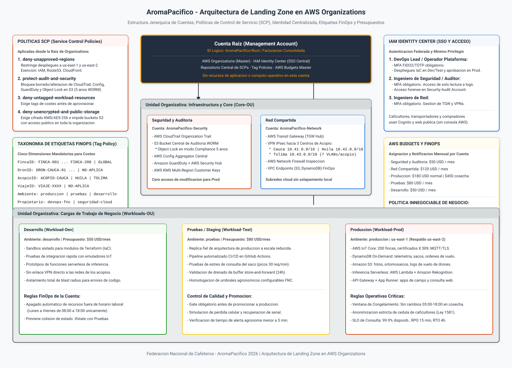
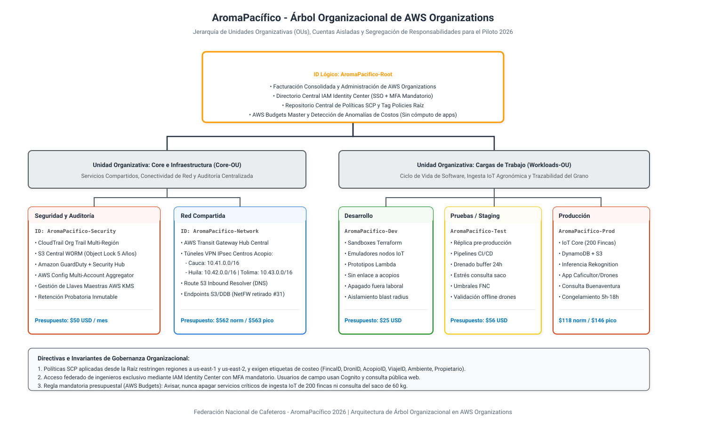
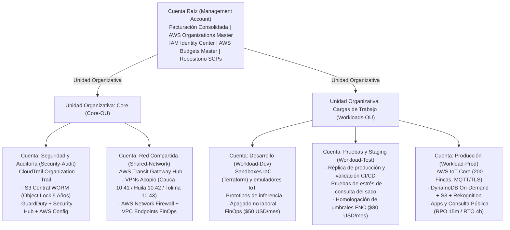

# Arquitectura de Gobierno Cloud y Landing Zone en AWS

## Plataforma Cafetera AromaPacífico (Federación Nacional de Cafeteros 2026)

---

## 1. Resumen Ejecutivo y Propósito Arquitectónico

El presente documento define la arquitectura de gobierno de nube y la estructura de la **Landing Zone** para la plataforma cafetera **AromaPacífico**, proyecto impulsado por la Federación Nacional de Cafeteros (FNC) en convenio académico con la Universidad Icesi para la vigencia 2026.

En el diseño original formulado en el año 2020 no existía una estrategia formal de gobierno cloud; los componentes residían de manera teórica en un espacio homogéneo sin segregación de responsabilidades ni control centralizado. Para el despliegue del piloto en los departamentos de **Cauca, Huila y Tolima** (abarcando 200 fincas, 3 centros de acopio, 60 transportadores y la entrega en el puerto de Buenaventura), se adopta una arquitectura multicuenta basada en **AWS Organizations**.

La solución garantiza la aplicación inmutable de políticas de seguridad desde la raíz, la segregación criptográfica y perimetral de ambientes, el control estricto de accesos humanos con autenticación multifactor (MFA), la trazabilidad financiera granular mediante etiquetas obligatorias (FinOps) y la continuidad ininterrumpida de las operaciones críticas de ingesta y consulta pública.

---

## 2. Diagrama de la Arquitectura de Landing Zone

La representación visual de la Landing Zone ilustra la jerarquía de cuentas, la distribución de Unidades Organizativas (OUs), las políticas de control aplicadas desde la raíz, la gestión centralizada de identidades y el esquema de asignación presupuestal.

### 2.1 Vista Gráfica de la Landing Zone



> Fuente editable en formato Draw.io XML descomprimido disponible en: [`diagrams/gobierno-landing-zone.drawio`](diagrams/gobierno-landing-zone.drawio).

### 2.2 Representación Gráfica y Estructural del Árbol Organizacional

A continuación se presenta el diagrama canónico del árbol organizacional de cuentas y unidades organizativas, estructurado de forma jerárquica con el estándar de Draw.io y exportado en SVG autónomo:



> Fuente editable en formato Draw.io XML descomprimido disponible en: [`diagrams/arbol-organizacional.drawio`](diagrams/arbol-organizacional.drawio).



---

## 3. Jerarquía de Unidades Organizativas y Cuentas AWS

Para evitar que los dominios críticos compartan el mismo entorno operativo y prevenir que un incidente en desarrollo comprometa la telemetría o la seguridad del grano, se establece una separación formal en cinco cuentas distribuidas en dos Unidades Organizativas principales, más la cuenta de gestión:

| Nivel Jerárquico | Cuenta / OU | ID Lógico de Cuenta | Propósito Operativo y Cargas Asignadas |
| --- | --- | --- | --- |
| Raíz (Root) | Management Account | `AromaPacifico-Root` | Facturación consolidada, gobernanza de AWS Organizations, despliegue de SCPs raíz, directorio IAM Identity Center y AWS Budgets Master. Prohibido desplegar recursos de cómputo o aplicaciones operativas. |
| OU Core | Seguridad y Auditoría | `AromaPacifico-Security` | Centralización de registros de auditoría inmutables (CloudTrail, VPC Flow Logs, logs de IoT Core), agregación de AWS Config, detección de amenazas con Amazon GuardDuty y gestión de llaves maestras KMS. |
| OU Core | Red Compartida | `AromaPacifico-Network` | Concentración del AWS Transit Gateway, terminación de túneles IPsec VPN hacia los centros de acopio (10.41.0.0/16, 10.42.0.0/16, 10.43.0.0/16), AWS Network Firewall e inspección centralizada, y VPC Endpoints privados para servicios AWS. |
| OU Workloads | Desarrollo | `AromaPacifico-Dev` | Prototipado rápido de módulos de infraestructura en Terraform, pruebas unitarias de funciones serverless y simulación de telemetría con nodos emulados. |
| OU Workloads | Pruebas / Staging | `AromaPacifico-Test` | Entorno de homologación previa a despliegue productivo. Pruebas de carga de la consulta pública del saco (30 transacciones por minuto), drenado de buffer de 24 horas y validación de umbrales federativos. |
| OU Workloads | Producción | `AromaPacifico-Prod` | Entorno productivo principal en la región `us-east-1` (con capacidad de contingencia en `us-east-2` para consulta pública). Ingesta de 200 fincas con AWS IoT Core, persistencia en DynamoDB, fotos en S3, inferencia con Rekognition y APIs de consulta. |

### Justificación Técnica y FinOps de la Cuenta de Desarrollo Separada

El enunciado oficial exige como mínimo segregar seguridad, red, producción y pruebas. La inclusión de una cuenta dedicada de **Desarrollo (`Workload-Dev`)** independiente de la cuenta de **Pruebas (`Workload-Test`)** se justifica en tres principios fundamentales de ingeniería:

1. **Aislamiento del Radio de Impacto (Blast Radius) y Colisión de Estados IaC**:
   La Épica 6 del proyecto demanda codificar módulos en Terraform bajo un límite de 100 horas. Si los desarrolladores comparten la cuenta de pruebas para prototipar código, los bloqueos en el estado remoto de Terraform (`.tfstate`) y la creación temporal de recursos colisionarían con los pipelines automatizados de integración continua de Staging, que deben ejecutar pruebas reproducibles y deterministas.
2. **Homologación Fidedigna en Pruebas**:
   La cuenta de Pruebas debe mantener paridad estricta de configuración, políticas IAM y red con la cuenta de Producción para validar que el drenado de buffer de 24 horas y los picos de 30 consultas por minuto operen de forma idéntica a campo. En Desarrollo, los ingenieros requieren libertades acotadas para depurar y refactorizar componentes.
3. **Optimización Presupuestal y FinOps (Apagado Fuera de Horario Laboral)**:
   Al estar aislada, sobre la cuenta de Desarrollo se aplica una política automatizada de suspensión de recursos fuera de la jornada laboral (Lunes a Viernes de 08:00 a 18:00), eliminando costos nocturnos y de fin de semana. Esto permite mantener su consumo mensual por debajo de $50 USD. La cuenta de Pruebas, por el contrario, debe quedar habilitada 24/7 para pruebas continuas de ingesta nocturna de fincas (lecturas de suelo cada 4 horas).

---

## 4. Políticas de Control de Servicio (SCPs)

Las políticas de control de servicio (Service Control Policies) constituyen barreras de protección preventivas aplicadas a nivel de la organización. Ningún usuario, ni siquiera el usuario `root` de una cuenta miembro, puede eludir una denegación explícita declarada en una SCP.

Se configuran e implementan cuatro políticas mandatorias:

### 4.1 SCP 1: Restricción de Regiones Geográficas Permitidas (`deny-unapproved-regions`)

Garantiza que ningún recurso pueda ser creado fuera de la región primaria (`us-east-1`, N. Virginia) y la región de contingencia para la consulta del saco (`us-east-2`, Ohio). Se eximen únicamente los servicios globales de AWS cuya operación reside centralizadamente.

```json
{
  "Version": "2012-10-17",
  "Statement": [
    {
      "Sid": "DenyAllOutsideAllowedRegions",
      "Effect": "Deny",
      "NotAction": [
        "iam:*",
        "organizations:*",
        "route53:*",
        "route53domains:*",
        "cloudfront:*",
        "wafv2:*",
        "shield:*",
        "support:*",
        "budgets:*",
        "ce:*",
        "artifact:*",
        "health:*"
      ],
      "Resource": "*",
      "Condition": {
        "StringNotEquals": {
          "aws:RequestedRegion": [
            "us-east-1",
            "us-east-2"
          ]
        }
      }
    }
  ]
}
```

- **Justificación Técnica y FinOps**: Previene despliegues involuntarios en regiones de alto costo relativo (por ejemplo, São Paulo `sa-east-1`, cuyo costo por vCPU y por mensaje en IoT Core llega a ser 60% superior). Asimismo, asegura que la latencia de tránsito hacia Colombia se mantenga optimizada a través de los enlaces submarinos del Caribe hacia Miami y Virginia.

### 4.2 SCP 2: Protección Inmutable de Auditoría y Seguridad (`protect-audit-and-security`)

Impide que cualquier operador o proceso modifique o deshabilite los mecanismos de auditoría y monitoreo de seguridad en las cuentas de la organización, garantizando el cumplimiento de los cinco años de retención probatoria exigidos por el pliego del reto.

```json
{
  "Version": "2012-10-17",
  "Statement": [
    {
      "Sid": "DenyAlteringAuditInfrastructure",
      "Effect": "Deny",
      "Action": [
        "cloudtrail:DeleteTrail",
        "cloudtrail:StopLogging",
        "cloudtrail:UpdateTrail",
        "config:DeleteConfigRule",
        "config:DeleteConfigurationRecorder",
        "config:StopConfigurationRecorder",
        "guardduty:DeleteDetector",
        "guardduty:DisassociateFromMasterAccount",
        "guardduty:StopMonitoringMembers",
        "securityhub:DeleteHub",
        "securityhub:DisableSecurityHub"
      ],
      "Resource": "*"
    },
    {
      "Sid": "DenyBypassingObjectLock",
      "Effect": "Deny",
      "Action": [
        "s3:BypassGovernanceRetention",
        "s3:DeleteObject",
        "s3:DeleteObjectVersion",
        "s3:PutBucketObjectLockConfiguration"
      ],
      "Resource": [
        "arn:aws:s3:::aromapacifico-audit-logs-*",
        "arn:aws:s3:::aromapacifico-audit-logs-*/*"
      ]
    }
  ]
}
```

- **Justificación Técnica y Legal**: El registro inmutable WORM (Write Once, Read Many) asegura que ante discrepancias en la calidad de un lote de café, disputas en pesajes en Buenaventura o incidentes derivados de misiones de drones, la evidencia digital sea irrefutable y no pueda ser alterada por credenciales administrativas vulneradas.

### 4.3 SCP 3: Denegación de Recursos sin Etiquetas Obligatorias (`deny-untagged-workload-resources`)

Bloquea de forma preventiva la creación de recursos de cómputo, red, base de datos y almacenamiento si no se declaran explícitamente las claves de etiquetado mandatorias para el costeo y la operación del negocio.

```json
{
  "Version": "2012-10-17",
  "Statement": [
    {
      "Sid": "DenyResourceCreationWithoutMandatoryTags",
      "Effect": "Deny",
      "Action": [
        "ec2:RunInstances",
        "ec2:CreateVolume",
        "ec2:CreateVpc",
        "ec2:CreateSubnet",
        "s3:CreateBucket",
        "dynamodb:CreateTable",
        "lambda:CreateFunction",
        "iot:CreateThing"
      ],
      "Resource": "*",
      "Condition": {
        "Null": {
          "aws:RequestTag/FincaID": "true",
          "aws:RequestTag/DronID": "true",
          "aws:RequestTag/AcopioID": "true",
          "aws:RequestTag/ViajeID": "true",
          "aws:RequestTag/Ambiente": "true",
          "aws:RequestTag/Propietario": "true"
        }
      }
    }
  ]
}
```

- **Justificación Técnica y FinOps**: Garantiza que no exista ningún recurso "huérfano" en la factura de AWS. Cada centavo de dólar facturado puede atribuirse de inmediato a una finca, dron, centro de acopio, viaje o ambiente dentro de los tableros analíticos de AWS Cost Explorer.

### 4.4 SCP 4: Cifrado Mandatorio y Bloqueo de Almacenamiento Público (`deny-unencrypted-and-public-storage`)

Protege la soberanía del dato y el cumplimiento de la Ley Estatutaria 1581 de 2012 (Protección de Datos Personales de Colombia), impidiendo que la información agronómica, personal o fotográfica quede expuesta en texto claro o con accesos no autenticados en internet.

```json
{
  "Version": "2012-10-17",
  "Statement": [
    {
      "Sid": "DenyUnencryptedObjectUploads",
      "Effect": "Deny",
      "Action": "s3:PutObject",
      "Resource": "*",
      "Condition": {
        "Null": {
          "s3:x-amz-server-side-encryption": "true"
        }
      }
    },
    {
      "Sid": "DenyDisablingS3PublicAccessBlock",
      "Effect": "Deny",
      "Action": [
        "s3:DeleteAccountPublicAccessBlock",
        "s3:PutAccountPublicAccessBlock"
      ],
      "Resource": "*"
    }
  ]
}
```

- **Justificación Técnica**: Evita filtraciones de cédulas de caficultores enmascaradas en la consulta pública o de imágenes capturadas por drones en predios privados.

---

## 5. Taxonomía y Política de Etiquetas FinOps (Tag Policy)

Para alimentar con precisión el costeo desagregado por componentes que exige el reto, se establece una política de etiquetas formal a nivel de la organización.

### 5.1 Matriz de Dimensiones de Etiquetado

| Clave de Etiqueta (Tag Key) | Tipo de Dato | Descripción de Negocio | Valores Permitidos / Patrón de Validación |
| --- | --- | --- | --- |
| `FincaID` | String | Identificador único de la finca cafetera asociada | `FINCA-001` a `FINCA-200` o `GLOBAL` para recursos compartidos |
| `DronID` | String | Identificador de la aeronave o misión específica | `DRON-CAUCA-01`, `DRON-HUILA-01`, `DRON-TOLIMA-01` o `NO-APLICA` |
| `AcopioID` | String | Centro de acopio departamental que procesa el flujo | `ACOPIO-CAUCA`, `ACOPIO-HUILA`, `ACOPIO-TOLIMA` o `MULTICENTRO` |
| `ViajeID` | String | Código de seguimiento logístico en carretera | `VIAJE-[0-9]{4}` o `NO-APLICA` (recursos fijos) |
| `Ambiente` | String | Entorno del ciclo de vida del software | `produccion`, `pruebas`, `desarrollo`, `compartido` |
| `Propietario` | String | Equipo técnico custodio de la infraestructura | `devops-fnc`, `seguridad-cloud`, `datos-agronomicos` |
| `Proyecto` | String | Nombre corporativo del proyecto | Constante inmutable: `AromaPacifico` |

### 5.2 Mecanismo de Control en AWS Organizations

A través de **AWS Tag Policies**, la organización valida que las etiquetas declaradas cumplan estrictamente con las mayúsculas, minúsculas y patrones autorizados. Estas etiquetas se activan como **Cost Allocation Tags** en la consola de facturación de la cuenta de gestión (`AromaPacifico-Root`), habilitando reportes detallados en AWS Cost and Usage Report (CUR) y consultas analíticas en Amazon Athena.

---

## 6. Acceso de Personas con AWS IAM Identity Center (AWS SSO)

La administración y operación de la plataforma en la nube sigue el principio de Cero Confianza y Mínimo Privilegio. La autenticación humana se centraliza en **AWS IAM Identity Center** configurado en la cuenta de gestión, erradicando por completo el uso de usuarios locales IAM con llaves de acceso estáticas (`AKIA...`).

### 6.1 Matriz de Acceso y Conjuntos de Permisos (Permission Sets)

| Perfil de Ingeniería | Canal de Autenticación | Factor de Autenticación | Cuentas Asignadas | Permission Set / Privilegios Asignados |
| --- | --- | --- | --- | --- |
| **DevOps Lead / Operador Plataforma** | IAM Identity Center | MFA Obligatorio (FIDO2 / WebAuthn) | `AromaPacifico-Dev`, `AromaPacifico-Test`, `AromaPacifico-Prod` | Administración de IaC (Terraform) y canalizaciones en Dev/Test. En Prod, despliegue restringido mediante pipelines CI/CD y acceso solo de lectura/diagnóstico para incidentes. |
| **Ingeniero de Seguridad / Auditor** | IAM Identity Center | MFA Obligatorio (FIDO2 / WebAuthn) | `AromaPacifico-Security` (Primaria), Lectura en resto | Solo lectura e inspección forense de logs en S3, CloudTrail y agregadores de AWS Config. Sin permisos de mutación de recursos. |
| **Ingeniero de Redes y Conectividad** | IAM Identity Center | MFA Obligatorio (FIDO2 / WebAuthn) | `AromaPacifico-Network` | Administración de Transit Gateway, túneles VPN IPsec con centros de acopio y reglas de AWS Network Firewall. |

### 6.2 Delimitación de Usuarios Finales (Sin Acceso a Consola AWS)

Es una decisión de arquitectura crítica destacar que los perfiles operativos de campo no interactúan con la consola de gestión de AWS:

- **Caficultores y Transportadores**: Se autentican a nivel de aplicación móvil mediante **Amazon Cognito User Pools** expuesto a través de API Gateway, utilizando tokens JWT efímeros. No poseen identidades IAM en la plataforma cloud.
- **Operarios de Centros de Acopio**: Interactúan a través de la aplicación web local del acopio, autenticándose vía Cognito con MFA mandatorio para registrar sacos e imprimir rótulos.
- **Compradores Internacionales**: Acceden a través de un portal web público serverless de solo lectura para la consulta de trazabilidad del saco, sin requerir credenciales de infraestructura.

---

## 7. Presupuestos y Política de Disponibilidad (AWS Budgets & FinOps)

### 7.1 Distribución de Presupuestos Mensuales por Cuenta

Para controlar el gasto operativo del piloto bajo criterios de moderación financiera, se establecen presupuestos mensuales con base en cotizaciones actualizadas a 2026:

| Cuenta AWS | Presupuesto Mensual Estimado | Principales Componentes de Gasto Cubiertos |
| --- | --- | --- |
| `AromaPacifico-Security` | **$50 USD** | Ingesta y almacenamiento en S3 Standard/Glacier de CloudTrail Organization Trail, VPC Flow Logs y reglas de AWS Config. |
| `AromaPacifico-Network` | **$120 USD** | Horas activas de AWS Transit Gateway, túneles VPN IPsec hacia Cauca, Huila y Tolima, y VPC Endpoints privados. |
| `AromaPacifico-Prod` | **$180 USD** (Mes normal)<br>**$450 USD** (Mes de cosecha pico) | AWS IoT Core (telemetría de 200 fincas y drones), DynamoDB On-Demand, invocaciones Lambda, Amazon Rekognition para confirmación de plagas y egreso de datos para consulta web. |
| `AromaPacifico-Test` | **$80 USD** | Réplica acotada de infraestructura para homologación continua, pruebas de carga y validaciones de firmware. |
| `AromaPacifico-Dev` | **$50 USD** | Cómputo efímero de desarrollo con horario laboral controlado y bancos de prueba de Terraform. |
| **Total Estimado Organización** | **$480 USD** (Mes normal)<br>**$750 USD** (Mes de cosecha) | Presupuesto consolidado del piloto dentro del margen financiero federativo. |

### 7.2 Umbrales de Alerta Progresivos

Cada cuenta cuenta con tres niveles de alerta configurados en **AWS Budgets**, despachando notificaciones inmediatas a través de Amazon SNS a canales dedicados de soporte y correo electrónico:

1. **Umbral Preventivo (80% del presupuesto)**: Notificación informativa al equipo DevOps y FinOps para seguimiento de tendencia mensual.
2. **Umbral de Advertencia (100% del presupuesto)**: Alerta formal de saturación con apertura automática de ticket de revisión técnica de costos.
3. **Umbral Crítico (120% del presupuesto o desviación anómala detectada por AWS Cost Anomaly Detection)**: Convocatoria prioritaria a revisión de arquitectura para evaluar posibles fugas de recursos o ataques de denegación de servicio.

### 7.3 Política Innegociable de Disponibilidad: Avisar, Nunca Apagar

En la operación agronómica y logística de la Federación Nacional de Cafeteros aplica una regla inmutable de negocio:

> [!IMPORTANT]
> **REGLA MANDATORIA DE OPERACIÓN: AVISAR, NUNCA APAGAR**
> Ante la superación de cualquier umbral presupuestal (incluso por encima del 120%), **está terminantemente prohibido suspender, apagar o estrangular los servicios de ingesta de telemetría IoT de las 200 fincas o el portal de consulta pública del saco**.

**Sustentación Técnica y Operativa**:

- La interrupción de la ingesta de telemetría impediría capturar alertas tempranas de humedad y temperatura en los lotes de secado, conllevando al riesgo inminente de fermentación o pérdida irreparable de cientos de sacos de café de alta calidad.
- El bloqueo de la consulta pública de sacos violaría el compromiso de trazabilidad con compradores en Buenaventura y en el exterior, afectando la reputación comercial del café colombiano.
- Acción correctiva permitida: En la cuenta de **Desarrollo**, ante una alerta crítica, se autoriza la ejecución de scripts que destruyan recursos ociosos no productivos (ej. instancias de prueba huérfanas). En **Producción** y **Red**, la remediación de sobrecostos se realiza exclusivamente mediante auditoría analítica y optimización de políticas, manteniendo la continuidad del servicio en todo momento.

---

## 8. Justificación de Decisiones Arquitectónicas y Alternativas Descartadas

A continuación se sustenta formalmente por qué la arquitectura adoptada es superior a las alternativas comunes del mercado, respaldada mediante matrices comparativas:

### 8.1 Landing Zone: AWS Organizations con Terraform vs. AWS Control Tower vs. Cuenta Única

| Criterio de Evaluación | Opción Seleccionada: AWS Organizations + IaC | Alternativa 1: AWS Control Tower | Alternativa 2: Cuenta Única Mono-Ambiente |
| --- | --- | --- | --- |
| Control Granular y Transparencia en Código | Máximo. Todo el gobierno se declara en Terraform de forma modular y auditable. | Bajo. Despliega recursos no visibles ni parametrizables fácilmente. | Mínimo. Todo convive en un único espacio sin barreras reales. |
| Complejidad y Timebox (Límite de 100 Horas) | Totalmente compatible con el límite de 100h / 2 semanas de la Épica 6. | Alta sobrecarga. Requiere resolver dependencias opacas del servicio. | Inviable en seguridad. No cumple los 7 puntos del pliego oficial. |
| Costo Fijo Mensual en Infraestructura | $0 USD en reposo. Servicios de gobierno nativos sin sobretasa. | ~$150-$280 USD fijos en Config aggregators y logs redundantes. | $0 USD pero con alto riesgo de colisión y gasto incontrolado. |
| Aislamiento de Radio de Impacto de Seguridad | Absoluto. Cuentas con límites criptográficos y de red separados. | Absoluto. Cuentas segregadas. | Nulo. Una falla, vulnerabilidad o fuga en desarrollo impacta todo. |

- **Sustentación**: Se eligió **AWS Organizations orquestado nativamente con Terraform** porque elimina los altos costos fijos que induce AWS Control Tower (el cual activa múltiples grabadores de configuración redundantes incompatibles con la restricción de presupuesto moderado) y se ajusta estrictamente al timebox de desarrollo de 100 horas.

### 8.2 Optimización de Tráfico FinOps: VPC Endpoints Centralizados vs. NAT Gateways por Cuenta

| Enfoque Evaluado | Opción Seleccionada: Gateway/Interface Endpoints en Shared-Network | Alternativa 1: NAT Gateway en cada Cuenta y VPC | Alternativa 2: Salida Pública con IPs Elásticas Directas |
| --- | --- | --- | --- |
| Costo por Tráfico de Telemetría e Imágenes | $0 USD/GB para S3 y DynamoDB vía Gateway Endpoints. Cero costo de procesamiento NAT. | $0,045 USD/GB + $0,045 USD/hora/NAT (~$135 USD/mes/NAT). | $0,00 USD pero exige exponer subredes a internet pública. |
| Seguridad y Privacidad (Ley 1581 de 2012) | Tráfico no abandona la red troncal privada de AWS. | Tráfico sale hacia internet pública de AWS. | Crítica vulnerabilidad de exposición de IPs y datos en claro. |

- **Sustentación**: Los paquetes de telemetría y las imágenes pesadas capturadas por drones transitan directamente desde Lambda hacia DynamoDB y S3 mediante **Gateway VPC Endpoints gratuitos**, evitando el procesamiento tarifado por gigabyte de los NAT Gateways tradicionales y ahorrando más de $180 USD mensuales en la cuenta de producción.

---

## 9. Registro de Decisiones y Supuestos de Gobierno

En cumplimiento del flujo metodológico del proyecto, las decisiones técnicas adoptadas en este entregable se registran en la bitácora de supuestos [`assumptions-log.md`](../cross-cutting/assumptions-log.md):

1. **Estructura Multicuenta**: Adopción de cinco cuentas (`Root`, `Security-Audit`, `Shared-Network`, `Workload-Prod`, `Workload-Test`, `Workload-Dev`) distribuidas en dos OUs (`Core-OU` y `Workloads-OU`).
2. **Regiones Restringidas**: Confinamiento operativo a `us-east-1` (principal) y `us-east-2` (contingencia) validado mediante la SCP `deny-unapproved-regions`.
3. **Resiliencia Operativa**: Imposición de la regla "Avisar, Nunca Apagar" en la configuración de alertas de AWS Budgets para salvaguardar la ingesta del grano de café.
4. **Gobierno de Etiquetas**: Aprobación de las cinco dimensiones técnicas (`FincaID`, `DronID`, `AcopioID`, `ViajeID`, `Ambiente`) complementadas con `Propietario` y `Proyecto`.
