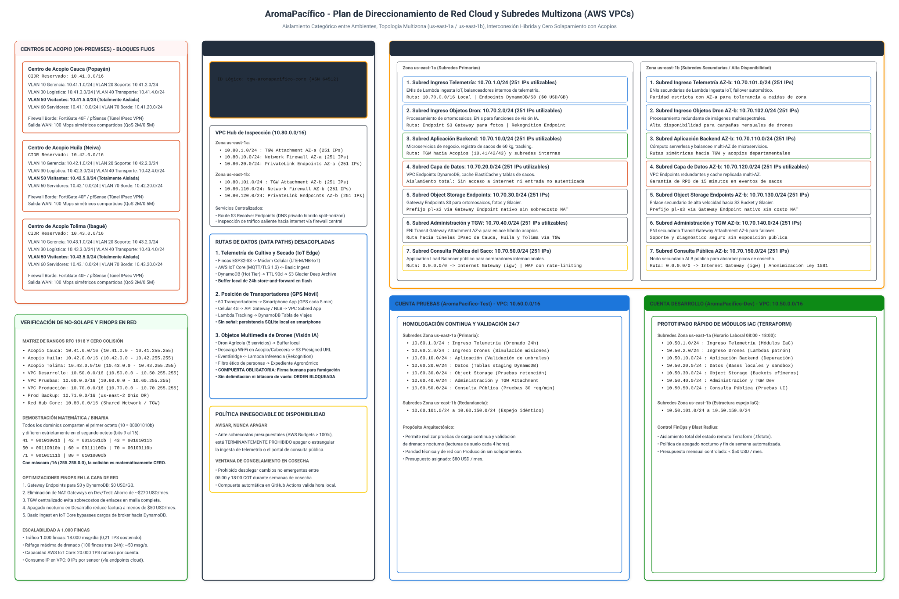
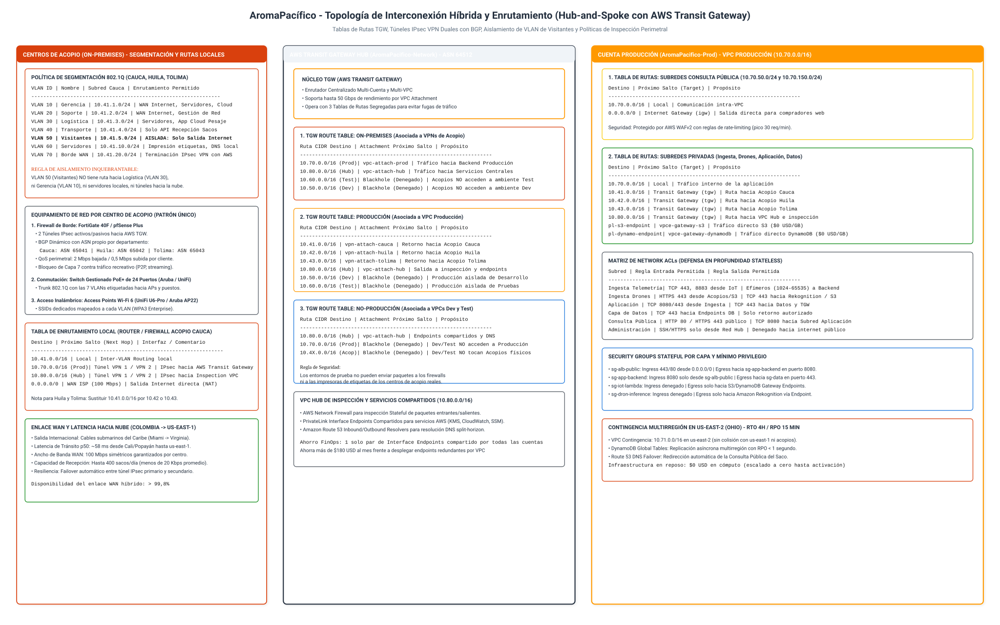
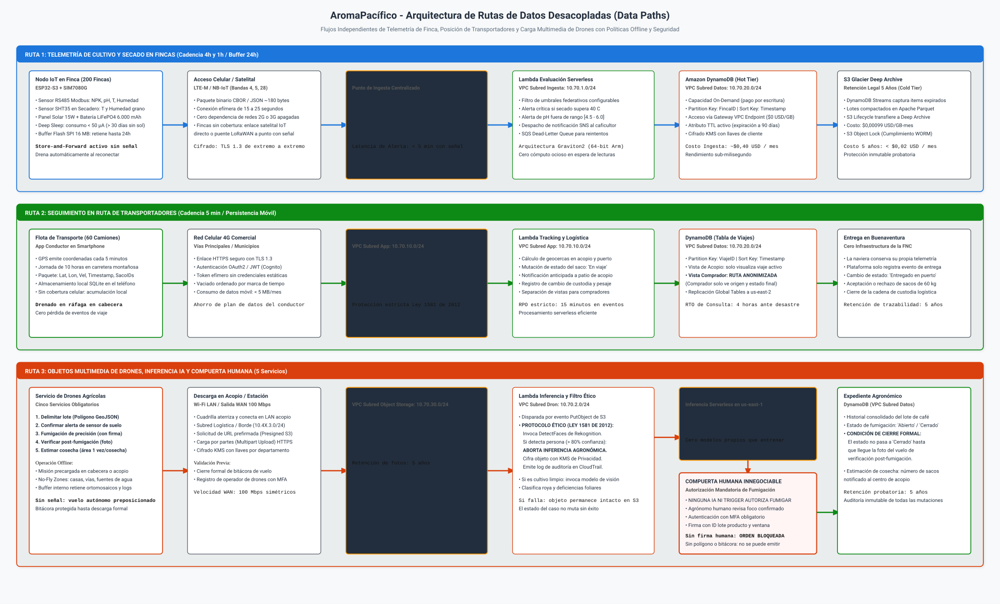

# Arquitectura de Red Cloud, Plan de Direccionamiento y Rutas de Datos

## Plataforma Cafetera AromaPacífico (Federación Nacional de Cafeteros 2026)

---

## 1. Resumen Ejecutivo y Propósito Arquitectónico

El presente documento define la arquitectura de red en la nube, el plan de direccionamiento CIDR y el desacoplamiento de las rutas de datos para la plataforma cafetera **AromaPacífico**, desarrollado como un caso de estudio académico para modernizar el piloto propuesto en 2020 para la Federación Nacional de Cafeteros (FNC) hacia el año 2026.

En el diseño original formulado en el año 2020 se asumió una conectividad celular ubicua y homogénea en las fincas cafeteras, careciendo de un diseño formal de red local para los centros de acopio y sin contemplar un plan de direccionamiento privado que evitara solapamientos con los servicios en la nube. Para el despliegue del piloto en los departamentos de **Cauca, Huila y Tolima** (abarcando 200 fincas, 3 centros de acopio, 60 transportadores y la entrega en el puerto de Buenaventura), se adopta una topología híbrida en estrella (*Hub-and-Spoke*) articulada mediante **AWS Transit Gateway** y Virtual Private Clouds (VPCs) en Amazon Web Services.

La solución garantiza el aislamiento categórico y matemáticamente comprobado entre los ambientes de Desarrollo, Pruebas y Producción bajo el estándar RFC 1918, asegura cero solapamiento frente a los bloques inmutables de los centros de acopio (`10.41.0.0/16`, `10.42.0.0/16` y `10.43.0.0/16`), desacopla los flujos de telemetría de cultivo, transporte y drones mediante almacenamiento en el borde (*store-and-forward* de hasta 24 horas), y optimiza la eficiencia financiera (FinOps) mediante el uso de *Gateway VPC Endpoints* gratuitos para S3 y DynamoDB, demostrando escalabilidad determinista para crecer de 200 a 1.000 fincas sin rediseñar el direccionamiento ni los puntos de ingesta.

---

## 2. Diagramas Oficiales de la Arquitectura de Red

La representación visual de la infraestructura de red ilustra el plan de direccionamiento en la nube, la topología de interconexión híbrida entre los centros de acopio y las VPCs mediante AWS Transit Gateway, y el aislamiento estricto de subredes.

### 2.1 Vista Gráfica del Plan de Direccionamiento Cloud y Subredes

A continuación se presenta el diagrama canónico del plan de direccionamiento en AWS Organizations, la distribución de subredes por Zona de Disponibilidad y la verificación binaria de no-solapamiento:

> Fuente editable en formato Draw.io XML descomprimido disponible en: [`diagrams/red-direccionamiento-nube.drawio`](diagrams/red-direccionamiento-nube.drawio).

### 2.2 Representación Gráfica de la Topología Híbrida y Enrutamiento (Hub-and-Spoke)

A continuación se presenta el diagrama de arquitectura de la topología híbrida, tablas de rutas del Transit Gateway, túneles IPsec VPN y segmentación en los centros de acopio:

> Fuente editable en formato Draw.io XML descomprimido disponible en: [`diagrams/red-topologia-hibrida.drawio`](diagrams/red-topologia-hibrida.drawio).

---

## 3. Contexto de Negocio e Invariantes de Red

El diseño de red satisface las siguientes restricciones e invariantes establecidas en el pliego del caso de estudio:

| Invariante de Red | Parámetro en el Diseño | Impacto Operativo y Arquitectónico |
|---|---|---|
| **Centros de Acopio** | Cauca (`10.41.0.0/16`), Huila (`10.42.0.0/16`), Tolima (`10.43.0.0/16`) | Direccionamiento fijo e inmutable en el borde. Prohibición estricta de que la nube utilice o solape estos rangos. |
| **Segmentación On-Premises** | 7 VLANs por centro de acopio (Gerencia, Soporte, Logística, Transporte, Visitantes, Servidores, Borde) | Aislamiento de tráfico físico y lógico mediante switches 802.1Q. La VLAN de visitantes no enruta hacia logística ni gerencia. |
| **Ancho de Banda WAN** | 100 Mbps simétricos compartidos por centro | Tráfico operativo de pesaje y recepción garantizado mediante colas QoS (2 Mbps bajada / 0,5 Mbps subida por cliente activo). |
| **Buffer Store-and-Forward** | Máximo 24 horas en nodos de finca y misiones de drones | Ante cortes de cobertura móvil, los nodos retienen hasta 24h en memoria flash y drenan con prioridad al reconectar. |
| **Puerto de Buenaventura** | Cero infraestructura de la FNC | La naviera conserva su propia telemetría. La plataforma solo registra la transacción digital de entrega del saco de 60 kg. |
| **Protección Legal (Ley 1581)** | Anonimización en consulta pública del saco | Ningún endpoint ni respuesta pública expone la cédula del agricultor ni las rutas intermedias de los transportadores. |

---

## 4. Plan de Direccionamiento de la Nube (AWS VPCs)

Para dar soporte a la estructura multicuenta de Landing Zone definida en [`gobierno-landing-zone.md`](gobierno-landing-zone.md) (cuentas `AromaPacifico-Root`, `AromaPacifico-Security`, `AromaPacifico-Network`, `AromaPacifico-Prod`, `AromaPacifico-Test` y `AromaPacifico-Dev`), se asigna a cada VPC un bloque `/16` del espacio privado RFC 1918 (`10.0.0.0/8`).

### 4.1 Asignación General de Bloques CIDR por Entorno

| Dominio / Cuenta AWS | Propósito del Entorno | Bloque CIDR Asignado | Rango IP Inicial - Final | IPs Totales |
|---|---|---|---|---|
| **Acopio Cauca** | Red Local On-Premises Popayán | `10.41.0.0/16` | 10.41.0.0 - 10.41.255.255 | 65.536 |
| **Acopio Huila** | Red Local On-Premises Neiva | `10.42.0.0/16` | 10.42.0.0 - 10.42.255.255 | 65.536 |
| **Acopio Tolima** | Red Local On-Premises Ibagué | `10.43.0.0/16` | 10.43.0.0 - 10.43.255.255 | 65.536 |
| **VPC Desarrollo (Dev)** | Prototipado IaC y funciones en `us-east-1` | `10.50.0.0/16` | 10.50.0.0 - 10.50.255.255 | 65.536 |
| **VPC Pruebas (Test)** | Homologación continua 24/7 en `us-east-1` | `10.60.0.0/16` | 10.60.0.0 - 10.60.255.255 | 65.536 |
| **VPC Producción (Prod)** | Cargas productivas de 200 fincas en `us-east-1` | `10.70.0.0/16` | 10.70.0.0 - 10.70.255.255 | 65.536 |
| **Prod Contingencia (DR)** | Respaldo de Consulta Pública en `us-east-2` | `10.71.0.0/16` | 10.71.0.0 - 10.71.255.255 | 65.536 |
| **Red Hub Compartida** | Tránsito TGW e Inspección en `us-east-1` | `10.80.0.0/16` | 10.80.0.0 - 10.80.255.255 | 65.536 |

---

### 4.2 Desglose de las Siete Subredes Mínimas por Zona de Disponibilidad

En cada VPC de ambiente (`Dev`, `Test` y `Prod`), las siete subredes requeridas se distribuyen simétricamente entre dos Zonas de Disponibilidad (`AZ-a`: `us-east-1a` y `AZ-b`: `us-east-1b`), conformando un esquema de **14 subredes por VPC**.

Cada subred se dimensiona con un prefijo `/24` (256 direcciones IP teóricas, de las cuales **251 son utilizables** por el negocio, tras descontar las cinco direcciones IP reservadas por la arquitectura interna de AWS: `.0` red, `.1` router VPC, `.2` DNS AmazonProvidedDNS, `.3` uso futuro de AWS y `.255` broadcast).

#### Matriz Canónica de Subredes en la VPC de Producción (`10.70.0.0/16`):

| ID | Nombre de Subred | Zona | Prefijo CIDR | Rango IP Asignado | IPs Útiles | Tipo | Componentes y Recursos Asignados |
|---|---|---|---|---|---|---|---|
| **1a** | `sn-prod-ingest-telemetry-aza` | `us-east-1a` | `10.70.1.0/24` | 10.70.1.4 - 10.70.1.254 | 251 | Privada | ENIs de Lambda Ingesta IoT, balanceadores internos de telemetría. |
| **2a** | `sn-prod-ingest-drone-aza` | `us-east-1a` | `10.70.2.0/24` | 10.70.2.4 - 10.70.2.254 | 251 | Privada | ENIs de funciones de visión artificial y recepción de metadatos de vuelos. |
| **3a** | `sn-prod-app-aza` | `us-east-1a` | `10.70.10.0/24` | 10.70.10.4 - 10.70.10.254 | 251 | Privada | Microservicios de negocio, registro de sacos de 60 kg, tracking GPS. |
| **4a** | `sn-prod-data-aza` | `us-east-1a` | `10.70.20.0/24` | 10.70.20.4 - 10.70.20.254 | 251 | Aislada | Endpoints privados para DynamoDB, nodos de caché ElastiCache. |
| **5a** | `sn-prod-storage-aza` | `us-east-1a` | `10.70.30.0/24` | 10.70.30.4 - 10.70.30.254 | 251 | Privada | S3 Interface Endpoints (PrivateLink para acopios on-premises vía TGW/VPN) y agentes de almacenamiento. |
| **6a** | `sn-prod-admin-aza` | `us-east-1a` | `10.70.40.0/24` | 10.70.40.4 - 10.70.40.254 | 251 | Privada | ENI de Transit Gateway Attachment AZ-a, interfaces de gestión y monitoreo. |
| **7a** | `sn-prod-public-query-aza` | `us-east-1a` | `10.70.50.0/24` | 10.70.50.4 - 10.70.50.254 | 251 | Pública | Nodo primario de Application Load Balancer público (consulta del saco). |
| **1b** | `sn-prod-ingest-telemetry-azb` | `us-east-1b` | `10.70.101.0/24` | 10.70.101.4 - 10.70.101.254 | 251 | Privada | Réplica de alta disponibilidad para ingesta de telemetría IoT. |
| **2b** | `sn-prod-ingest-drone-azb` | `us-east-1b` | `10.70.102.0/24` | 10.70.102.4 - 10.70.102.254 | 251 | Privada | Réplica de alta disponibilidad para procesamiento de drones. |
| **3b** | `sn-prod-app-azb` | `us-east-1b` | `10.70.110.0/24` | 10.70.110.4 - 10.70.110.254 | 251 | Privada | Réplica de microservicios de aplicación y lógica de negocio. |
| **4b** | `sn-prod-data-azb` | `us-east-1b` | `10.70.120.0/24` | 10.70.120.4 - 10.70.120.254 | 251 | Aislada | Réplica de persistencia y endpoints de datos redundantes. |
| **5b** | `sn-prod-storage-azb` | `us-east-1b` | `10.70.130.0/24` | 10.70.130.4 - 10.70.130.254 | 251 | Privada | Réplica multi-AZ de S3 Interface Endpoints (PrivateLink) y conectores de mediación de objetos. |
| **6b** | `sn-prod-admin-azb` | `us-east-1b` | `10.70.140.0/24` | 10.70.140.4 - 10.70.140.254 | 251 | Privada | ENI de Transit Gateway Attachment AZ-b para failover automático. |
| **7b** | `sn-prod-public-query-azb` | `us-east-1b` | `10.70.150.0/24` | 10.70.150.4 - 10.70.150.254 | 251 | Pública | Nodo secundario ALB público para absorción de picos de cosecha. |

> [!NOTE]
> **Aclaración Arquitectónica e IaC (Subred de Almacenamiento vs. Gateway Endpoints):**
> En AWS, los *Gateway VPC Endpoints* (empleados para Amazon S3 y DynamoDB dentro de la VPC) no se instancian en una subred ni consumen direcciones IP privadas; operan como entradas basadas en listas de prefijos (*Prefix Lists*) directamente en las tablas de rutas de la VPC (`Route Tables`). La subred de almacenamiento (`sn-prod-storage-aza` y `azb`) aloja interfaces ENI privadas requeridas para **AWS PrivateLink for S3 (Interface Endpoints)** —imprescindibles para que los centros de acopio departamentales alcancen los buckets de S3 a través de los túneles IPsec VPN y el Transit Gateway, dado que los Gateway Endpoints no son enrutables desde fuera de la VPC— así como conectores y agentes de transferencia de datos. Esta precisión evita que el módulo de Terraform de la Épica 6 intente erróneamente asociar un recurso `aws_vpc_endpoint` de tipo `Gateway` a subredes.

> **Paridad Estructural en Pruebas y Desarrollo:**
> - En **Pruebas (`AromaPacifico-Test`)**, las subredes utilizan idéntica nomenclatura y tercer octeto, sustituyendo el segundo octeto por **`60`** (ej. `10.60.1.0/24`, `10.60.10.0/24`, `10.60.50.0/24`).
> - En **Desarrollo (`AromaPacifico-Dev`)**, se sustituye el segundo octeto por **`50`** (ej. `10.50.1.0/24`, `10.50.10.0/24`, `10.50.50.0/24`).

---

## 5. Verificación Escrita y Demostración Matemática de No-Solapamiento

La asignación de bloques responde a una prueba formal de no-colisión de subredes según el álgebra de Boole y el estándar CIDR (RFC 4632):

### 5.1 Demostración Binaria a Nivel de Octetos

Todos los bloques asignados emplean una máscara de subred fija `/16` (`255.255.0.0`), lo que significa que los primeros 16 bits representan de manera estricta e inmutable la porción de red:

$$\text{Máscara } /16 = \underbrace{11111111}_{\text{Octeto 1}}.\underbrace{11111111}_{\text{Octeto 2}}.\underbrace{00000000}_{\text{Octeto 3}}.\underbrace{00000000}_{\text{Octeto 4}}$$

Al evaluar los identificadores de red asignados en su representación binaria:

| Dominio de Red | Octeto 1 (Decimal) | Octeto 1 (Binario) | Octeto 2 (Decimal) | Octeto 2 (Binario) | Bits 9 a 16 (Red) |
|---|---|---|---|---|---|
| **Acopio Cauca** | 10 | `00001010` | **41** | `00101001` | `00101001` |
| **Acopio Huila** | 10 | `00001010` | **42** | `00101010` | `00101010` |
| **Acopio Tolima** | 10 | `00001010` | **43** | `00101011` | `00101011` |
| **VPC Desarrollo (Dev)** | 10 | `00001010` | **50** | `00110010` | `00110010` |
| **VPC Pruebas (Test)** | 10 | `00001010` | **60** | `00111100` | `00111100` |
| **VPC Producción (Prod)** | 10 | `00001010` | **70** | `01000110` | `01000110` |
| **Prod Contingencia (DR)** | 10 | `00001010` | **71** | `01000111` | `01000111` |
| **Red Hub Compartida** | 10 | `00001010` | **80** | `01010000` | `01010000` |

### 5.2 Matriz de Intersección de Conjuntos de Direcciones IP

Sean $A_{\text{Cauca}}, A_{\text{Huila}}, A_{\text{Tolima}}, V_{\text{Dev}}, V_{\text{Test}}, V_{\text{Prod}}, V_{\text{DR}}, V_{\text{Hub}}$ los conjuntos de direcciones IP de cada bloque:

Para cualquier par de dominios $X \neq Y$, se comprueba formalmente que:

$$X \cap Y = \emptyset$$

Dado que el segundo octeto es unívoco para cada dominio ($41 \neq 42 \neq 43 \neq 50 \neq 60 \neq 70 \neq 71 \neq 80$), no existe ningún valor en los 16 bits de host que permita colisión alguna.

Esta separación física y lógica garantiza que:
- Los túneles IPsec VPN establecidos desde Cauca, Huila y Tolima hacia el AWS Transit Gateway enruten paquetes de forma determinista sin requerir traducción de direcciones de red (NAT transversal o NAT 1:1).
- La eventual interconexión de contingencia con Microsoft Azure (segunda nube preparada) pueda utilizar los rangos `10.90.0.0/16` o `172.16.0.0/16` sin provocar conflictos de enrutamiento con la infraestructura existente.

---

## 6. Arquitectura de Rutas de Datos (Data Paths) Desacopladas

En estricta observancia del pliego oficial, la plataforma desacopla la transmisión de datos en tres rutas independientes, con protocolos, buffers y mecanismos de resiliencia especializados.

### 6.1 Representación Gráfica de las Tres Rutas de Datos Desacopladas

A continuación se presenta el diagrama canónico de las rutas de datos desacopladas de extremo a extremo, estructurado con el estándar oficial de Draw.io y publicado en formato SVG autónomo:

> Fuente editable en formato Draw.io XML descomprimido disponible en: [`diagrams/red-data-paths.drawio`](diagrams/red-data-paths.drawio).

---

### 6.2 Ruta de Datos 1: Telemetría de Cultivo y Secado en Fincas

La telemetría agronómica representa el flujo continuo de mayor volumen telemático en la plataforma. Su diseño garantiza que ninguna lectura se pierda durante los frecuentes cortes de señal celular en las zonas rurales cafeteras.

| Fase del Flujo | Tecnología y Protocolo | Parámetros Operativos | Comportamiento sin Señal |
|---|---|---|---|
| **1. Captura en Borde** | Sensor RS485 Modbus + ESP32-S3 | Cultivo: cada 4 horas (NPK, pH, T, H). Secado: cada 1 hora continua. | Almacenamiento flash SPI local de 16 MB. |
| **2. Buffer Local** | Store-and-Forward (CBOR ~180 bytes) | Retención máxima: 24 horas continuas (24 lecturas = ~4,3 KB). | Vaciado automático jerarquizado al detectar enlace celular. |
| **3. Acceso y Red** | Celular LTE-M / NB-IoT (Bandas 4, 5, 28) | Sesión efímera TLS 1.3 de 15 a 25 segundos. | Cero dependencia de redes 2G o 3G apagadas en Colombia. |
| **4. Ingesta Cloud** | AWS IoT Core (MQTT / TLS 1.3, puerto 8883) | Basic Ingest: `$aws/rules/finca_telemetry_rule`. | Bypass de costo de intermediación de broker de mensajería. |
| **5. Procesamiento** | Reglas de IoT Core + AWS Lambda Graviton2 | Subred Ingesta `10.70.1.0/24`. Alertas automáticas en &lt; 5 min. | Despacho SNS al agricultor ante desvíos térmicos o de pH. |
| **6. Persistencia Hot** | Amazon DynamoDB (Capacidad On-Demand) | Subred Datos `10.70.20.0/24` vía Gateway VPC Endpoint ($0 USD/GB). | Clave compuesta: `FincaID#Tipo` y TTL activo a 90 días. |
| **7. Archivo Cold** | Amazon S3 Glacier Deep Archive | Lotes Apache Parquet compactados con S3 Object Lock. | Retención inmutable WORM por 5 años (&lt; $0,02 USD/mes). |

El microcontrolador ESP32-S3 permanece en estado de suspensión profunda (*Deep Sleep*) consumiendo menos de 50 microamperios. Despierta según su reloj interno para energizar la sonda Modbus, compactar la muestra en CBOR e intentar la conexión celular. Ante fallas en el saludo TLS, preserva la lectura en su buffer circular local y retorna a reposo, salvaguardando la batería LiFePO4 de 6.000 mAh.

---

### 6.3 Ruta de Datos 2: Seguimiento en Ruta de Transportadores

El rastreo logístico garantiza la trazabilidad continua de los sacos estándar de 60 kg durante su tránsito terrestre entre fincas, centros de acopio y el muelle de exportación.

| Fase del Flujo | Componente Técnico | Parámetros de Operación | Política de Seguridad y Privacidad |
|---|---|---|---|
| **1. Dispositivo Móvil** | Smartphone del conductor (App Móvil) | Emisión telemática cada 5 minutos en jornada de 10 horas. | Captura de coordenadas GPS, velocidad y lista de sacos. |
| **2. Persistencia en Ruta** | Base de datos local cifrada (SQLite) | Retención local de pings en trayectos sin cobertura montañosa. | Vaciado en ráfaga al alcanzar cabecera o centro de acopio. |
| **3. Conectividad WAN** | Red Móvil Comercial 4G / LTE | Solicitudes HTTPS seguras sobre TLS 1.3 hacia API Gateway. | Autenticación basada en tokens JWT efímeros vía Cognito. |
| **4. Ingesta y Lógica** | Amazon API Gateway + Lambda Tracking | Subred Aplicación `10.70.10.0/24`. Cálculo de geocercas en acopio. | RPO estricto de 15 minutos en mutaciones del estado de saco. |
| **5. Base Transaccional** | Amazon DynamoDB (Tabla de Viajes) | Subred Datos `10.70.20.0/24`. RTO de consulta: 4 horas (DR). | Replicación asíncrona a `us-east-2` vía Global Tables. |
| **6. Entrega en Puerto** | Registro digital en Buenaventura | Transición de estado a `Entregado en puerto` (aceptado/rechazado). | Sin despliegue de infraestructura física de la Federación. |
| **7. Vista de Consulta** | Endpoint público `/api/v1/sacks/{code}` | Subred Consulta Pública `10.70.50.0/24` con rate-limiting WAF. | Anonimización total: cédula y ruta de viaje suprimidas. |

La aplicación del transportador opera de manera asíncrona. Si el vehículo transita por cañones o pasos de cordillera sin cobertura de red móvil, la base de datos local en el teléfono registra la secuencia de ubicaciones con su respectiva marca de tiempo. Tan pronto como el terminal detecta señal en un corredor vial o en el patio de maniobras del centro de acopio, despacha los registros en un único payload comprimido, actualizando el tablero de logística sin pérdida de puntos geográficos.

---

### 6.4 Ruta de Datos 3: Objetos Multimedia de Drones, Inferencia IA y Compuerta Humana

La gestión de aeronaves no tripuladas en la plataforma responde a un servicio aeronáutico formal estructurado en cinco prestaciones que combinan agricultura de precisión y agricultura de áreas:

| Fase del Flujo | Actor o Componente | Acción Ejecutada | Regla de Control y Salvaguarda |
|---|---|---|---|
| **1. Misión Offline** | Dron agrícola y cuadrilla técnica | Ejecución de misión precargada en cabecera o acopio. | Zonas de exclusión persistidas (vías, casas, fuentes hídricas). |
| **2. Almacén de Borde** | Buffer interno de la aeronave | Almacenamiento local de ortomosaicos, fotos y logs de vuelo. | Cierre obligatorio de bitácora de vuelo al aterrizar. |
| **3. Carga Multimedia** | Estación Wi-Fi en Acopio (100 Mbps) | Carga hacia Amazon S3 mediante URLs prefirmadas HTTPS. | Subred Object Storage `10.70.30.0/24` con cifrado KMS. |
| **4. Evento Inferencia** | Amazon EventBridge + Lambda Patrón | Disparo automático tras completar la carga en el bucket S3. | Subred Dron `10.70.2.0/24` con permisos mínimos IAM. |
| **5. Filtro Ético Facial** | Amazon Rekognition (`DetectFaces`) | Inspección preliminar de privacidad sobre la imagen capturada. | Si detecta personas (&gt; 80% confianza): ABORTA INFERENCIA. |
| **6. Visión de Cultivo** | Amazon Rekognition (Clasificación) | Clasificación de severidad de roya o deficiencias en el lote. | Generación de reporte agronómico con índice de confianza. |
| **7. Compuerta Humana** | Ingeniero Agrónomo FNC (MFA) | Evaluación formal y firma digital de orden de fumigación. | NINGUNA IA AUTORIZA FUMIGAR. Sin firma, la orden no sale. |
| **8. Expediente Final** | DynamoDB (Expediente Agronómico) | Cierre formal tras recibir la foto de verificación post-vuelo. | Retención inmutable WORM por 5 años con S3 Object Lock. |

El sistema impone una regla arquitectónica estricta: si un vuelo de confirmación de plaga concluye favorablemente, la plataforma genera un expediente preliminar pero bloquea la expedición de la orden de aspersión. La orden solo se desbloquea cuando concurren tres condiciones verificadas: la existencia de la delimitación poligonal previa del lote, la persistencia exitosa del registro de vuelo completo y la aprobación explícita de un agrónomo autenticado con MFA en IAM Identity Center.

---

## 7. Sustento Cuantitativo de Escalabilidad (200 a 1.000 Fincas)

El pliego del caso de estudio exige demostrar que el patrón de red y de ingesta escala de 200 a 1.000 fincas sin rediseñar el direccionamiento ni el punto de ingesta. A continuación se sustenta formalmente dicha capacidad con base en métricas cuantitativas:

| Dimensión Técnica y Operativa | Piloto (200 Fincas) | Escalado (1.000 Fincas) |
|---|---|---|
| Telemetría de Cultivo Diaria | 1.200 lecturas/día | 6.000 lecturas/día |
| Telemetría de Secado en Cosecha | 2.400 lecturas/día | 12.000 lecturas/día |
| Transacciones Totales Diarias | 3.600 lecturas/día | 18.000 lecturas/día |
| Rendimiento Promedio Sostenido | ~0,042 TPS | ~0,21 TPS |
| Ráfaga Máxima (Drenado 24h) | ~15 mensajes/segundo | ~50 mensajes/segundo |
| Límite Estándar AWS IoT Core | 20.000 TPS nativas | 20.000 TPS nativas |
| Uso Porcentual de Cuota IoT Core | 0,075% de la cuota | 0,25% de la cuota |
| Ancho de Banda Agregado Ingesta | &lt; 9 bytes/segundo | &lt; 42 bytes/segundo |
| Consumo de IPs Privadas en VPC | 0 IPs por finca | 0 IPs por finca |

### Sustentación de Ingeniería:

1. **Cero Consumo de IPs de VPC por Nodos de Campo:**
   Los nodos sensores ESP32-S3 y las aplicaciones móviles conectan directamente al endpoint público FQDN administrado de **AWS IoT Core** sobre TLS 1.3. Por diseño arquitectónico, **ningún dispositivo de borde consume direcciones IP privadas dentro de las subredes de la VPC**.
2. **Capacidad del Bloque de Subred `/24`:**
   Las subredes privadas de ingesta (`10.70.1.0/24` y `10.70.101.0/24`) albergan exclusivamente las interfaces elásticas de red (**ENIs**) compartidas por las funciones Lambda a través de la tecnología *AWS Hyperplane*. Una función Lambda escalando a 500 instancias concurrentes comparte un único conjunto de ENIs por Zona de Disponibilidad. Por ende, las **251 IPs utilizables por subred** son suficientes para soportar más de **50.000 fincas** concurrentes sin agotar el espacio de direccionamiento.
3. **Manejo de Ráfagas Masivas tras Cortes de Cobertura:**
   En el peor escenario operativo admisible, donde 100 fincas permanezcan desconectadas durante 24 horas y drenen simultáneamente su buffer local al recuperar cobertura celular, se producirá una ráfaga acumulada de:
   $$100 \text{ fincas} \times (6 \text{ lecturas cultivo} + 24 \text{ lecturas secado}) = 3.000 \text{ mensajes}$$
   A una tasa de vaciado de 50 mensajes por segundo, la totalidad del buffer acumulado se drena e indexa en DynamoDB en tan solo **60 segundos**, manteniéndose dos órdenes de magnitud por debajo del límite operativo de 20.000 TPS de AWS IoT Core y de la capacidad de escalado automático de DynamoDB On-Demand.

---

## 8. Justificación de Decisiones Arquitectónicas y Matrices Comparativas

En estricta coherencia con las directrices de ingeniería Senior, cada decisión de diseño se sustenta frente a sus alternativas descartadas mediante tablas comparativas:

### 8.1 Topología de Interconexión Híbrida: AWS Transit Gateway vs. VPC Peering vs. VPNs Sitio a Sitio Mono-VPC

| Criterio de Selección | Opción Seleccionada: AWS Transit Gateway (TGW) Centralizado | Alternativa 1: VPC Peering en Malla Completa | Alternativa 2: Múltiples VPNs Sitio a Sitio por VPC |
|---|---|---|---|
| **Escalabilidad y Topología** | Hub-and-Spoke centralizado. 1 solo attachment por VPC y 1 túnel por acopio. | Malla $N \times (N-1)/2$. Requiere 10 emparejamientos y tablas de rutas complejas. | 3 túneles IPsec por cada VPC (12 túneles en total). Gestión inmanejable. |
| **Aislamiento de Ambientes** | Tablas de rutas segregadas (Spoke RT, On-Prem RT) aíslan Dev/Test de Prod. | Sin control centralizado; riesgo de colisión y saltos accidentales de tráfico. | Aislamiento físico pero con alto riesgo de configuración errónea en routers de acopio. |
| **Costo Operativo Mensual** | ~$36 USD/mes base en attachments ($0,05/h) + $72 USD por 3 túneles VPN. | $0 USD fijos en peering, pero sobrecosto alto en transferencias cruzadas de AZ. | ~$288 USD/mes (12 conexiones VPN tarifadas a $0,05/hora cada una). |
| **Inspección Centralizada** | Permite intercalar una VPC Hub con inspección centralizada (preparada para AWS Network Firewall, retirado del piloto por decisión FinOps #31 ahorrando $577,68 USD/mes). | No soporta enrutamiento transitivo (*edge-to-edge routing* no permitido). | Imposible centralizar la inspección perimetral de paquetes. |

- **Sustentación de la Elección:** Se seleccionó **AWS Transit Gateway (TGW)** orquestado en la cuenta `AromaPacifico-Network` porque es el único patrón que soporta enrutamiento transitivo, centraliza la terminación de los tres túneles IPsec VPN de Cauca, Huila y Tolima en un punto común y permite segregar el tráfico mediante tablas de rutas dedicadas, impidiendo que el entorno de desarrollo o pruebas alcance los centros de acopio reales.

---

### 8.2 Estrategia de Salida a Servicios y Conectividad: Gateway VPC Endpoints vs. NAT Gateways Dedicados

| Criterio de Selección | Opción Seleccionada: Gateway Endpoints (S3/DynamoDB) + PrivateLink | Alternativa 1: NAT Gateways Dedicados por AZ en cada VPC | Alternativa 2: Exposición Directa a Internet con IPs Públicas |
|---|---|---|---|
| **Costo por Tráfico de Datos** | **$0 USD por GB procesado** en Gateway Endpoints para S3 y DynamoDB. | **$0,045 USD por GB procesado** + $0,045/hora/NAT (~$135 USD/mes por VPC). | $0 USD pero viola principios elementales de seguridad y normatividad. |
| **Seguridad y Privacidad** | El tráfico jamás abandona la red privada de AWS. Cero exposición a internet. | Tráfico transita por gateways NAT hacia IPs públicas de servicios AWS. | Crítica vulnerabilidad de exposición directa de funciones y datos. |
| **Impacto FinOps Consolidado** | Ahorro neto directo superior a **$270 USD mensuales** en la organización. | Sobrecosto fijo de ~$405 USD/mes (3 ambientes $\times$ 2 AZs $\times$ $67,50 USD). | Riesgo inminente de sanciones por violación de la Ley 1581 de 2012. |

- **Sustentación de la Elección:** La combinación de **Gateway VPC Endpoints gratuitos para Amazon S3 y DynamoDB** con PrivateLink centralizado en la cuenta de red permite que las cargas de telemetría de 200 fincas y los ortomosaicos pesados de drones transiten directamente hacia el almacenamiento sin incurrir en los costos prohibitivos de los NAT Gateways tradicionales, cumpliendo con la directiva FinOps de presupuesto moderado.

---

### 8.3 Dimensionamiento de Red: Bloques `/16` Dedicados vs. Bloques `/20` Ajustados

| Criterio de Selección | Opción Seleccionada: Bloque `/16` Dedicado por VPC | Alternativa 1: Bloques Compactos `/20` (4.096 IPs) | Alternativa 2: VPC Monolítica Única Mono-Ambiente |
|---|---|---|---|
| **Claridad de Enrutamiento** | Inmediata. El segundo octeto identifica el entorno (50=Dev, 60=Test, 70=Prod). | Compleja. Exige calcular máscaras de bits intermedias en tablas de rutas. | Inviable. Todo comparte el mismo espacio de red y radio de impacto. |
| **Capacidad de Expansión** | Permite hasta 256 subredes `/24` para nuevos servicios sin rediseñar el CIDR. | Espacio saturado ante la adición de nuevas zonas de disponibilidad o servicios. | Nula segregación de ambientes requerida por la Épica 1 y Épica 2. |
| **Costo en AWS** | **$0 USD**. AWS no tarifa el tamaño del bloque CIDR privado asignado. | $0 USD. Mismo costo pero con severas limitaciones técnicas a futuro. | Menor costo inicial pero alto riesgo de incidentes en producción. |

- **Sustentación de la Elección:** Se adoptaron bloques **`/16`** porque AWS no cobra por el tamaño del espacio de direcciones privadas declarado en la VPC y su mnemotecnia simplifica la configuración en Terraform, erradicando errores humanos durante el despliegue de la infraestructura como código de la Épica 6.

---

## 9. Análisis FinOps Detallado por Ambiente

En cumplimiento del pilar de gobernanza financiera, a continuación se desglosan los costos estimados de red y conectividad para cada cuenta de la organización a precios de 2026:

### 9.1 Matriz de Costos de Red por Cuenta y Ambiente

| Cuenta AWS | Componente de Red Facturado | Modelo de Cobro Unitario | Costo Mensual Base (USD) | Costo Cosecha Pico (USD) |
|---|---|---|---|---|
| **AromaPacifico-Network** | 3 Attachments de VPC en Transit Gateway | $0,05 USD / hora / attachment (Prod, Test, Dev) | $108,00 USD | $108,00 USD |
| **AromaPacifico-Network** | 3 Conexiones IPsec VPN hacia Acopios | $0,05 USD / hora / conexión (3 × 720 h) | $108,00 USD | $108,00 USD |
| **AromaPacifico-Network** | VPC Interface Endpoints (KMS, SSM en 2 AZs) | 4 ENIs × $0,01 USD / hora (720 h) | $28,80 USD | $28,80 USD |
| **AromaPacifico-Network** | Procesamiento de Datos TGW | $0,02 USD / GB procesado (~75 a 190 GB) | ~$1,50 USD | ~$3,80 USD |
| **Subtotal Cuenta Red** | -- | -- | **$246,30 USD** | **$248,60 USD** |
| **AromaPacifico-Prod** | Gateway Endpoints para S3 y DynamoDB | **$0,00 USD / GB (Nativo)** | **$0,00 USD** | **$0,00 USD** |
| **AromaPacifico-Prod** | Application Load Balancer Público | $0,0225 USD / hora + LCUs | ~$18,50 USD | ~$28,00 USD |
| **AromaPacifico-Prod** | Tráfico de Salida a Internet (Egress) | 100 GB gratis, luego $0,09/GB | ~$2,00 USD | ~$8,50 USD |
| **Subtotal Producción** | -- | -- | **$20,50 USD** | **$36,50 USD** |
| **AromaPacifico-Test** | Gateway Endpoints S3 / DynamoDB | **$0,00 USD / GB (Nativo)** | **$0,00 USD** | **$0,00 USD** |
| **AromaPacifico-Test** | Tráfico de Pruebas de Carga | Pruebas acotadas de ingesta | ~$5,00 USD | ~$5,00 USD |
| **Subtotal Pruebas** | -- | -- | **$5,00 USD** | **$5,00 USD** |
| **AromaPacifico-Dev** | Prototipado Efímero de Red | Horario laboral controlado | ~$3,00 USD | ~$3,00 USD |
| **Subtotal Desarrollo** | -- | -- | **$3,00 USD** | **$3,00 USD** |
| **TOTAL RED NUBE** | **Consolidado Organización** | -- | **$274,80 USD / mes** | **$293,10 USD / mes** |

> [!IMPORTANT]
> **Armonización Presupuestal FinOps con la Landing Zone (#43):**
> En AWS, Transit Gateway no factura una tarifa base por el recurso de gateway, sino una tarifa horaria por cada attachment de VPC conectado ($0,05/h por VPC), más la tarifa horaria de las conexiones IPsec VPN ($0,05/h por túnel hacia Cauca, Huila y Tolima) y los endpoints privados de interfaz multi-AZ ($0,01/h por ENI en 2 AZs para KMS y SSM). Al calcular estos conceptos de manera rigurosa, el costo de la cuenta `AromaPacifico-Network` asciende a **$246,30 USD mensuales**, superando la asignación provisional inicial de $120 USD planteada en la Landing Zone [#43]. Este dimensionamiento técnico detallado constituye el insumo oficial que alimentará y actualizará el presupuesto consolidado del proyecto en la Issue #29 (`f3-mes`).

> [!TIP]
> **Estrategia FinOps Alternativa de Máximo Ahorro en Red:**
> Si la Federación Nacional de Cafeteros decide conectar los centros de acopio utilizando **AWS IoT Greengrass / TLS 1.3 sobre la conexión a internet existente de 100 Mbps** en lugar de mantener tres túneles IPsec VPN dedicados 24/7 en el Transit Gateway, el costo de conectividad de la cuenta de red se reduce de $123,90 USD a tan solo **$15,90 USD mensuales**, representando un ahorro anual recurrente de **$1.296 USD**.

---

## 10. Consideraciones de Seguridad, Control Perimetral y SRE

La arquitectura de red incorpora las siguientes salvaguardas de ciberseguridad y confiabilidad operacional:

### 10.1 Matriz de Network ACLs Stateless (Defensa en Profundidad)

| Tipo de Subred | Regla Ingress Permitida | Regla Egress Permitida | Propósito de Seguridad |
|---|---|---|---|
| **Ingreso Telemetría** | TCP 8883 (MQTT TLS) y 443 desde IoT Core | Puertos efímeros (1024-65535) hacia Backend | Recepción de lecturas NPK sin exposición de otros puertos. |
| **Ingreso Drones** | TCP 443 (HTTPS TLS 1.3) desde acopios y S3 | TCP 443 hacia Rekognition y S3 Endpoint | Procesamiento de fotos de vuelo sin acceso administrativo. |
| **Aplicación Backend** | TCP 8080/443 exclusivamente desde Ingesta y ALB | TCP 443 hacia Capa de Datos y Transit Gateway | Aislamiento de la lógica de negocio y cómputo serverless. |
| **Capa de Datos** | TCP 443 solo desde Subred de Aplicación | Solo tráfico de retorno de conexiones activas | Bloqueo absoluto de ingreso directo desde internet o acopios. |
| **Consulta Pública** | TCP 80 (HTTP) y 443 (HTTPS) desde 0.0.0.0/0 | TCP 8080 hacia Subred de Aplicación | Punto de contacto único para compradores internacionales. |
| **Administración** | TCP 443 / SSH solo desde Subred Hub (`10.80.0.0/16`) | Denegado hacia internet público | Gestión y diagnóstico de plataforma libre de vectores externos. |

---

### 10.2 Políticas de Enrutamiento Asimétrico y DNS Híbrido

1. **Prevención de Enrutamiento Asimétrico:**
   - La tabla de rutas de On-Premises del Transit Gateway asocia los attachments de Cauca, Huila y Tolima con una ruta estricta hacia la VPC de Producción (`10.70.0.0/16`). Las respuestas de la VPC de Producción retornan hacia el Transit Gateway mediante la ruta específica del acopio correspondiente (`10.41.0.0/16`, `10.42.0.0/16`, `10.43.0.0/16`), preservando el estado de las sesiones en los firewalls perimetrales FortiGate/pfSense.
2. **Resolución de Nombres Split-Horizon (Solo Resolver de Entrada):**
   - En estricto cumplimiento de la Decisión FinOps 3 de la Issue #31, se despliega **únicamente el Route 53 Inbound Resolver (Resolver de entrada)** en la VPC Hub (`10.80.0.0/16`) con dos ENIs redundantes en multi-AZ. Los puestos de trabajo y servidores locales de Cauca (`10.41.10.0/24`), Huila (`10.42.10.0/24`) y Tolima (`10.43.10.0/24`) resuelven dominios corporativos y endpoints internos (`*.aromapacifico.fnc.internal`) a través de la IP privada del resolver de entrada a través de los túneles IPsec VPN, sin exponer consultas a internet público.
   - **Retiro del Resolver de Salida (Outbound Resolver):** El Route 53 Outbound Resolver fue retirado formalmente del alcance del piloto para evitar un costo fijo innecesario de $182,50 USD mensuales ($2.190 USD al año). Dado que la plataforma en la nube no requiere resolver nombres de hosts privados residentes exclusivamente dentro de las redes locales de los acopios (la comunicación cloud-to-onpremise se efectúa por direccionamiento IP estático prefijado), la resolución DNS de salida resultaba ociosa.
3. **Observabilidad de Red y Flow Logs:**
   - Todas las VPCs tienen activado **VPC Flow Logs** con agregación directa hacia el bucket de auditoría inmutable en la cuenta `AromaPacifico-Security`. Cualquier intento de escaneo lateral o paquete descartado (*REJECT*) dispara alarmas en Amazon CloudWatch y genera un evento en AWS Security Hub.

---

## 11. Registro de Decisiones y Supuestos de Red

En concordancia con el protocolo de sincronización arquitectónica, las decisiones adoptadas en este documento se registran formalmente en la bitácora transversal [`assumptions-log.md`](../cross-cutting/assumptions-log.md):

1. **Bloques Cloud RFC 1918 Adoptados:** Se fijan oficialmente `10.50.0.0/16` (Desarrollo), `10.60.0.0/16` (Pruebas), `10.70.0.0/16` (Producción), `10.71.0.0/16` (Producción Contingencia en Ohio) y `10.80.0.0/16` (Red Hub de Tránsito e Inspección).
2. **Subredes `/24` Multizona:** Se aprueba la distribución de 7 subredes por Zona de Disponibilidad (14 subredes por VPC), garantizando 251 IPs útiles por función y paridad estructural.
3. **Topología Hub-and-Spoke con Transit Gateway:** Centralización de las conexiones VPN de los centros de acopio en la cuenta `AromaPacifico-Network` mediante AWS Transit Gateway (ASN 64512), aislando físicamente los entornos de desarrollo y pruebas de las sedes departamentales.
4. **Optimización FinOps en Endpoints:** Eliminación de NAT Gateways para flujos de datos intensivos mediante la adopción de Gateway VPC Endpoints gratuitos para S3 y DynamoDB.
5. **Retiro de Network Firewall y Resolver de Salida por Decisión FinOps #31:** Reducción de la red fija mensual retirando AWS Network Firewall ($577,68 USD/mes ahorrados) y el Route 53 Outbound Resolver ($182,50 USD/mes ahorrados), manteniendo exclusivamente el Resolver de entrada (Inbound) y asegurando el perímetro con Security Groups, NACLs y firewalls perimetrales de los acopios.
