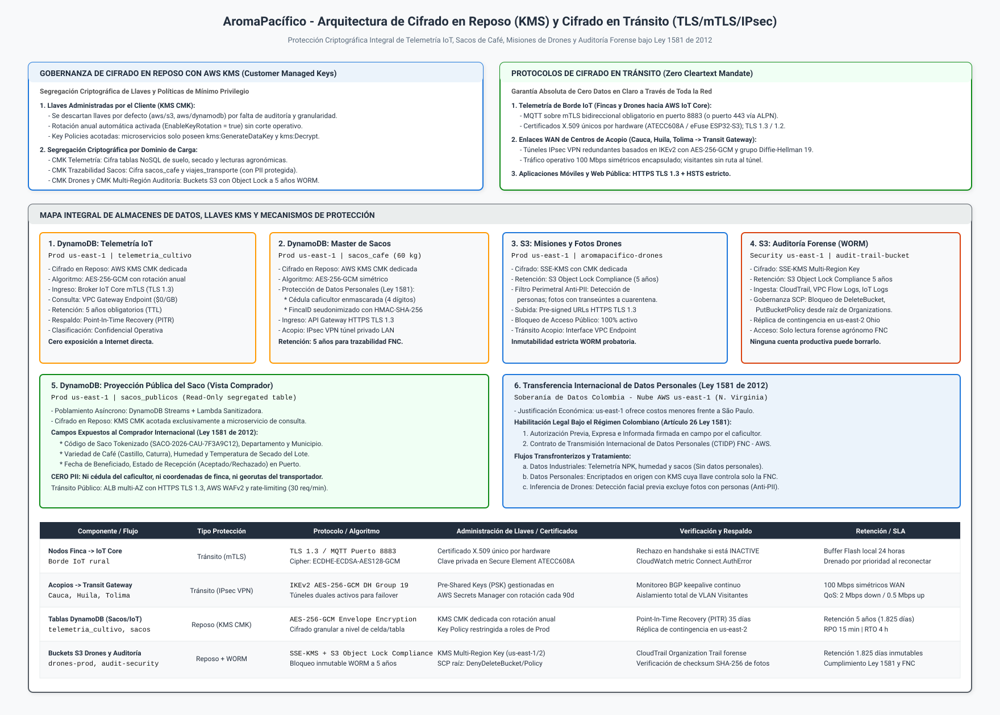
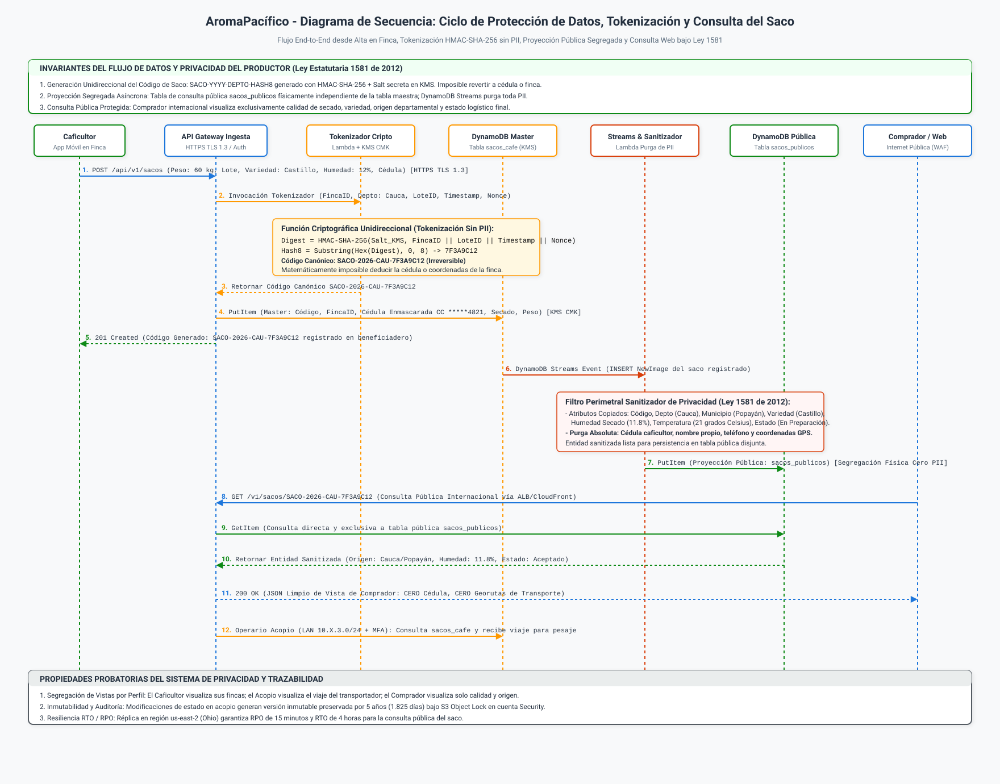
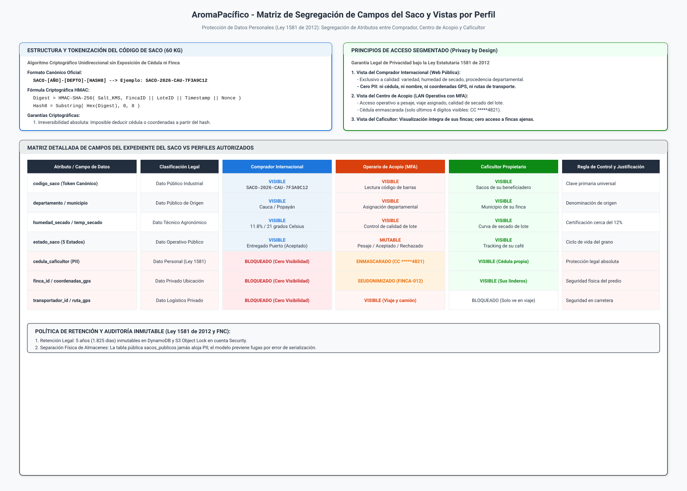

# Arquitectura de Seguridad de Datos, Cifrado y Vista Anonimizada del Saco

## Plataforma Cafetera AromaPacífico (Federación Nacional de Cafeteros 2026)

---

## 1. Resumen Ejecutivo y Marco Normativo

El presente documento define la arquitectura integral de seguridad de datos, las políticas de cifrado en reposo y en tránsito, el algoritmo de tokenización irreversible para sacos de café de 60 kg y el régimen de tratamiento de datos personales para la plataforma **AromaPacífico**, iniciativa académica desarrollada junto con la Federación Nacional de Cafeteros (FNC) para la vigencia 2026.

En el diseño original formulado en el año 2020 no existían mecanismos criptográficos para la protección de la información ni salvaguardas para garantizar la privacidad del productor. La serialización directa de bases de datos exponía información sensible (cédula del caficultor, coordenadas geográficas exactas de la vivienda y trayectos de los camiones) ante consumidores externos, vulnerando los principios de la legislación colombiana de protección de datos personales.

Para la reactivación del piloto en los departamentos de **Cauca, Huila y Tolima** (que abarca 200 fincas cafeteras, 3 centros de acopio departamentales, 60 transportadores y la entrega en el puerto de Buenaventura), la arquitectura adopta el principio de **Privacidad por Diseño (Privacy by Design)** y **Segregación Física de Vistas**, articulado bajo cuatro pilares normativos y técnicos:

| Pilar Arquitectónico | Fundamento Normativo o Técnico | Implementación Concreta en AromaPacífico |
|---|---|---|
| **Privacidad del Productor (Ley 1581 / Decreto 1377)** | Principios de libertad, veracidad, transparencia y circulación restringida. | La cédula, patrimonio y ubicación submétrica jamás se exponen al comprador ni a terceros. El caficultor es titular exclusivo de sus datos. |
| **Cifrado Integral en Reposo y en Tránsito** | Zero Cleartext Mandate sobre datos transaccionales, telemetría y objetos. | Llaves AWS KMS Customer Managed Keys (CMK) por dominio; canales cifrados TLS 1.3, mTLS e IPsec VPN. |
| **Tokenización Unidireccional del Saco** | Anonimización matemática irreversible de expedientes de café de 60 kg. | Función HMAC-SHA-256 con semilla en KMS (`Salt_KMS`), generando tokens públicos de 8 caracteres hexadecimales legibles. |
| **Transferencia Internacional Habilitada** | Artículo 26 de la Ley 1581 de 2012 y régimen de encargados del tratamiento. | Autorización informada en onboarding, contrato CTIDP con AWS (DPA) y custodia exclusiva de llaves KMS en FNC. |

---

## 2. Diagramas Oficiales de Arquitectura de Seguridad de Datos

La arquitectura de protección de datos, cifrado y anonimización se formaliza mediante tres diagramas técnicos de publicación, elaborados con la iconografía oficial de AWS y redacción técnica en español:

### 2.1 Vista Gráfica de Cifrado en Reposo (KMS) y Cifrado en Tránsito

El siguiente diagrama ilustra la segregación de llaves KMS CMK por dominio de datos, los protocolos de cifrado en tránsito en cada segmento de red y el almacenamiento inmutable con S3 Object Lock en modo Compliance:



> Archivo fuente editable en formato Draw.io XML descomprimido disponible en: [`diagrams/seguridad-cifrado-almacenes-datos.drawio`](diagrams/seguridad-cifrado-almacenes-datos.drawio).

### 2.2 Diagrama de Secuencia del Ciclo de Protección de Datos y Consulta Pública

El siguiente diagrama de secuencia modela el flujo integral de vida del dato: desde el registro del saco en el beneficiadero, la tokenización unidireccional con KMS, la persistencia en la tabla maestra, la sanitización asíncrona mediante DynamoDB Streams, hasta la consulta pública anonimizada por parte del comprador internacional:



> Archivo fuente editable en formato Draw.io XML descomprimido disponible en: [`diagrams/seguridad-secuencia-proteccion-datos.drawio`](diagrams/seguridad-secuencia-proteccion-datos.drawio).

### 2.3 Matriz Gráfica de Segregación de Campos del Saco por Perfil

El siguiente diagrama representa la matriz de acceso por atributo del expediente del saco, contrastando la visibilidad permitida para el Comprador Internacional, el Centro de Acopio y el Caficultor Propietario:



> Archivo fuente editable en formato Draw.io XML descomprimido disponible en: [`diagrams/seguridad-matriz-campos-vistas.drawio`](diagrams/seguridad-matriz-campos-vistas.drawio).

---

## 3. Cifrado en Reposo y en Tránsito por Cada Almacén

Para satisfacer el requerimiento innegociable de que *ningún almacén quede sin cifrado en reposo y que la telemetría y los objetos del dron no viajen en claro*, se implementa una arquitectura criptográfica multicapa en todas las cuentas de la Landing Zone.

### 3.1 Cifrado en Reposo con AWS KMS (Customer Managed Keys)

Se descarta de forma categórica el uso de llaves por defecto compartidas de AWS (`aws/s3`, `aws/dynamodb`) debido a que no admiten políticas de acceso granulares, no permiten rotación bajo control de la Federación y no generan registros detallados en AWS CloudTrail sobre quién desencriptó cada registro. En su lugar, se aprovisionan **Customer Managed Keys (CMK)** dedicadas por dominio:

| Almacén Persistente | Tipo de Recurso | Identificador de Llave KMS (Alias) | Algoritmo Criptográfico | Política de Rotación | Alcance de Datos Protegidos |
|---|---|---|---|---|---|
| **DynamoDB Telemetría** | Tablas NoSQL | `alias/aromapacifico-telemetria-key` | AES-256-GCM Envelope Encryption | Rotación anual automática | Lecturas agronómicas de suelo (NPK, pH, humedad) y secado continuo cada 1 hora. |
| **DynamoDB Master Sacos** | Tablas NoSQL | `alias/aromapacifico-sacos-key` | AES-256-GCM Envelope Encryption | Rotación anual automática | Expediente de sacos de 60 kg, pesaje, datos de finca y cédulas enmascaradas. |
| **DynamoDB Proyección** | Tablas NoSQL | `alias/aromapacifico-public-query-key` | AES-256-GCM Envelope Encryption | Rotación anual automática | Tabla disjunta `sacos_publicos` consumida por el API Gateway público. |
| **S3 Misiones de Drones** | Object Storage | `alias/aromapacifico-drones-key` | SSE-KMS (AES-256) | Rotación anual automática | Bitácoras de vuelo `.bin`, ortomosaicos GeoJSON y fotografías S4 de verificación. |
| **S3 Auditoría Central** | Object Storage | `alias/aromapacifico-audit-key` | SSE-KMS Multi-Region Key | Rotación anual automática | Trazas de CloudTrail, logs de IoT Core y eventos de seguridad en cuenta Security. |
| **EBS / Cómputo Lambda** | Volúmenes y Temp | `alias/aromapacifico-compute-key` | AES-256-XTS | Rotación anual automática | Almacenamiento efímero (`/tmp`) de funciones de sanitización e inferencia. |

#### Declaración de Política de Llave KMS para la Tabla Master de Sacos
A fin de asegurar el mínimo privilegio en el módulo de infraestructura (`modules/security`), la política de la llave restringe el descifrado exclusivamente al rol de la función Lambda de ingesta y al servicio de auditoría:

```json
{
  "Version": "2012-10-17",
  "Id": "AromaPacifico-KMS-Sacos-KeyPolicy",
  "Statement": [
    {
      "Sid": "AllowAdministrationToSecurityRole",
      "Effect": "Allow",
      "Principal": {
        "AWS": "arn:aws:iam::111122223333:role/AromaPacifico-SecurityAdminRole"
      },
      "Action": "kms:*",
      "Resource": "*"
    },
    {
      "Sid": "AllowDecryptOnlyToAuthorizedServices",
      "Effect": "Allow",
      "Principal": {
        "AWS": [
          "arn:aws:iam::111122223333:role/AromaPacifico-SacksIngestServiceRole",
          "arn:aws:iam::111122223333:role/AromaPacifico-AcopioServiceRole"
        ]
      },
      "Action": [
        "kms:Decrypt",
        "kms:DescribeKey",
        "kms:GenerateDataKey"
      ],
      "Resource": "*",
      "Condition": {
        "StringEquals": {
          "kms:ViaService": [
            "dynamodb.us-east-1.amazonaws.com"
          ]
        }
      }
    }
  ]
}
```

---

### 3.2 Cifrado en Tránsito (Zero Cleartext Mandate)

Se garantiza que ningún flujo telemático, logístico o visual circule en texto claro a través de redes públicas ni enlaces privados:

#### Telemetría de Borde IoT y Nodos de Finca
Los 200 nodos de cultivo y ~100 nodos de secado establecen sesiones MQTT exclusivamente sobre **mTLS (TLS 1.3 / TLS 1.2 estricto)** a través del puerto TCP 8883. La negociación exige un certificado de cliente X.509 individual anclado en el elemento seguro de hardware (**Microchip ATECC608A** o eFuses del **ESP32-S3**). Se deshabilitan explícitamente los protocolos obsoletos TLS 1.0 y TLS 1.1, y se fuerza el uso de suites de cifrado seguras con secreto perfecto hacia adelante (*PFS*): `TLS_ECDHE_ECDSA_WITH_AES_128_GCM_SHA256`.

#### Misiones y Objetos de Drones
Las cuadrillas de drones en los centros de acopio y estaciones municipales sincronizan las bitácoras de vuelo y las fotografías post-fumigación hacia Amazon S3 mediante **URLs pre-firmadas HTTPS TLS 1.3**. Ninguna imagen o archivo de telemetría de vuelo se transfiere sin autenticación criptográfica.

#### Enlaces WAN de Centros de Acopio (Cauca, Huila, Tolima)
El tráfico corporativo de pesaje y recepción de sacos que sale de los acopios hacia la nube (100 Mbps simétricos) viaja encapsulado a través de **túneles IPsec VPN IKEv2** con cifrado `AES-256-GCM` y grupo Diffie-Hellman 19 (ECDH 256 bits). La red local segmenta la VLAN de Visitantes, impidiendo que el tráfico de invitados tenga visibilidad o enrutamiento hacia el túnel VPN o los servidores locales de logística.

#### Consulta Web Pública del Comprador
El portal de consulta pública del saco expone un punto de enlace seguro a través de un **Application Load Balancer (ALB)** respaldado por certificados SSL/TLS emitidos por **AWS Certificate Manager (ACM)**. La configuración aplica cabeceras estrictas HSTS (`Strict-Transport-Security: max-age=63072000; includeSubDomains; preload`), forzando a los navegadores internacionales a comunicarse únicamente por canales cifrados.

---

## 4. Algoritmo Criptográfico de Generación del Código del Saco

El pliego del caso de estudio exige categóricamente: *"El identificador del saco no expone la cédula del caficultor ni la traza completa al comprador. El comprador recibe origen, fechas de proceso, estado y variables de secado"*.

Para satisfacer esta restricción sin recurrir a identificadores secuenciales predecibles ni exponer identificadores de bases de datos internas, la plataforma implementa una función de **tokenización criptográfica unidireccional basada en HMAC-SHA-256**.

### 4.1 Formato Canónico del Identificador de Saco

Cada saco de 60 kg que sale del beneficiadero recibe un código alfanumérico estructurado bajo el siguiente estándar:

```text
SACO-[AÑO]-[DEPTO]-[HASH8]
```

Donde:
- `SACO`: Prefijo constante identificador de la entidad de negocio.
- `[AÑO]`: Año de cosecha a cuatro dígitos (ejemplo: `2026`).
- `[DEPTO]`: Código mnemotécnico de tres letras del departamento de origen:
  * `CAU`: Departamento del Cauca.
  * `HUI`: Departamento del Huila.
  * `TOL`: Departamento del Tolima.
- `[HASH8]`: Cadena de 8 caracteres hexadecimales en mayúsculas resultante del truncamiento determinista del resumen HMAC.

*Ejemplo de código canónico generado:* **`SACO-2026-CAU-7F3A9C12`**

---

### 4.2 Formulación Matemática y Algoritmo de Generación

El código se genera en la capa de ingesta serverless en el instante exacto en que el caficultor registra el pesaje del saco en su aplicación móvil:

$$\text{MaterialEntrada} = \text{FincaID} \parallel \text{LoteID} \parallel \text{TimestampISO} \parallel \text{Nonce}$$

$$\text{Digest} = \text{HMAC-SHA-256}(\text{Salt}_{\text{KMS}}, \text{MaterialEntrada})$$

$$\text{Hash8} = \text{Substring}(\text{HexEncode}(\text{Digest}), 0, 8)$$

#### Componentes de la Función Criptográfica

| Componente Criptográfico | Función en el Esquema de Tokenización | Propiedades de Seguridad y Privacidad |
|---|---|---|
| **$\text{Salt}_{\text{KMS}}$ (Semilla Secreta)** | Clave pseudoaleatoria de 256 bits custodiada en AWS Secrets Manager y KMS en la cuenta `AromaPacifico-Prod`. | Jamás reside en el código fuente de los clientes ni se transmite a dispositivos móviles o aplicaciones de campo. |
| **$\text{MaterialEntrada}$ (Vector de Unicidad)** | Concatena `FincaID`, `LoteID`, marca temporal de microsegundos (`TimestampISO`) y un número aleatorio de 64 bits (`Nonce`). | Garantiza variabilidad absoluta incluso para cosechas registradas simultáneamente en una misma finca. |
| **Resistencia a Inversión y Colisiones** | Función hash HMAC-SHA-256 truncada a los primeros 8 caracteres hexadecimales ($16^8$ combinaciones). | Ofrece más de 4.294 millones de valores por departamento/año. Matemáticamente no invertible a partir del código público. |
| **Desvinculación entre Sacos** | La marca temporal de alta precisión y el número pseudoaleatorio inducen códigos disjuntos entre sacos contiguos. | Impide que un comprador infiera el volumen total cosechado por una finca o asocie sacos de un mismo lote agronómico. |

---

### 4.3 Cuadro Comparativo: Selección del Esquema de Identificación

A continuación se evalúan las alternativas de identificación para sostener la decisión de diseño:

| Criterio de Evaluación | Alternativa 1: Identificador Secuencial (SACO-00001) | Alternativa 2: UUID v4 Universal (RFC 4122) | Alternativa 3: Formato Canónico HMAC-SHA-256 (Seleccionada) |
|---|---|---|---|
| **Privacidad del Caficultor** | Nula. Permite espionaje industrial y conteo del volumen total de producción por competidores. | Alta. Genera cadenas aleatorias que no exponen datos personales. | **Máxima**. Token unidireccional con procedencia regional pública sin correlación interna. |
| **Ergonomía Operativa en Campo** | Alta. Números cortos fáciles de dictar. | Muy Baja. 36 caracteres alfanuméricos con guiones; propenso a errores al digitarse en acopio. | **Excelente**. 22 caracteres estructurados (`SACO-2026-CAU-7F3A9C12`), legible en etiquetas y sacos. |
| **Resistencia a Falsificación** | Nula. Un tercero puede adivinar códigos válidos incrementando el número correlativo. | Media. Difícil de adivinar, pero no verifica autenticidad criptográfica con semilla secreta. | **Total**. Solo la plataforma oficial con la semilla secreta en KMS puede validar la autenticidad del hash. |
| **Decisión Arquitectónica** | **DESCARTADA CATEGÓRICAMENTE** | **DESCARTADA** | **SELECCIONADA COMO ESTÁNDAR OFICIAL** |

---

## 5. Matriz Exhaustiva de Campos del Expediente del Saco vs. Perfiles

Para asegurar que *cada perfil vea una parte distinta del saco*, la arquitectura implementa una matriz de segregación de atributos gobernada por esquemas de proyección en la capa de datos.

### 5.1 Matriz de Acceso por Atributo

La siguiente tabla define con precisión qué atributos del expediente son accesibles para el Comprador Internacional, el Operario de Centro de Acopio y el Caficultor Propietario:

| Atributo del Expediente del Saco | Clasificación de Seguridad | Comprador Internacional (Web Pública) | Centro de Acopio (LAN Operativa + MFA) | Caficultor Propietario (App Móvil Finca) | Regla de Control y Justificación Legal |
|---|---|---|---|---|---|
| `codigo_saco` | Público Industrial | **VISIBLE** | **VISIBLE** | **VISIBLE** | Identificador unívoco del lote de 60 kg para seguimiento y consulta. |
| `departamento_origen` | Público Geográfico | **VISIBLE** (Cauca, Huila, Tolima) | **VISIBLE** | **VISIBLE** | Indicación de origen requerida para valoración de cafés especiales. |
| `municipio_origen` | Público Regional | **VISIBLE** (ej. Popayán, Pitalito) | **VISIBLE** | **VISIBLE** | Denominación de origen a nivel municipal; no revela la vereda ni predio. |
| `variedad_cafe` | Agronómico | **VISIBLE** (Castillo, Caturra, etc.) | **VISIBLE** | **VISIBLE** | Característica física y organoléptica de la variedad botánica. |
| `humedad_secado` | Calidad de Grano | **VISIBLE** (ej. 11.8%) | **VISIBLE** | **VISIBLE** | Variable crítica de secado para certificar cierre de lote cerca del 12%. |
| `temperatura_secado` | Calidad de Grano | **VISIBLE** (ej. 21 grados Celsius) | **VISIBLE** | **VISIBLE** | Garantía técnica de que el grano no superó los 40 grados en beneficiadero. |
| `fecha_cosecha_beneficio` | Temporal | **VISIBLE** (Fecha y hora ISO) | **VISIBLE** | **VISIBLE** | Trazabilidad del momento del empaque en finca. |
| `peso_kg` | Metrológico | **VISIBLE** (60 kg estándar) | **VISIBLE** (Pesaje báscula) | **VISIBLE** (Pesaje inicial) | Control metrológico para liquidación y cubicaje de transporte. |
| `estado_saco` | Logístico Operativo | **VISIBLE** (5 Estados) | **VISIBLE Y MUTABLE** | **VISIBLE** | Trazabilidad de custodia (En preparación, En viaje, En acopio, En puerto). |
| `fecha_entrega_puerto` | Logístico Final | **VISIBLE** (Aceptado en puerto) | **VISIBLE** | **VISIBLE** | Certificación del hito de entrega a naviera en Buenaventura. |
| `cedula_caficultor` | **Dato Personal Sensible** | **BLOQUEADO (Cero Acceso)** | **ENMASCARADO (`CC *****4821`)** | **VISIBLE (Su propia cédula)** | **Ley 1581 de 2012**. Prohibido exponer la identidad del productor al comprador. |
| `nombre_caficultor` | **Dato Personal** | **BLOQUEADO (Cero Acceso)** | **VISIBLE** (Para liquidación) | **VISIBLE (Su propio nombre)** | Protege la privacidad económica y personal del agricultor. |
| `finca_id` | Privado de Operación | **BLOQUEADO (Cero Acceso)** | **VISIBLE** (`FINCA-CAUCA-012`) | **VISIBLE (Sus fincas)** | Evita la geolocalización de parcelas vulnerables en zonas rurales. |
| `coordenadas_gps_finca` | **Ubicación Sensible** | **BLOQUEADO (Cero Acceso)** | **BLOQUEADO (Solo ve vereda)** | **VISIBLE (Linderos propios)** | Salvaguarda la seguridad física del productor y previene extorsiones. |
| `transportador_id` | Dato Logístico Privado | **BLOQUEADO (Cero Acceso)** | **VISIBLE** (Manifiesto de carga) | **BLOQUEADO** | Identidad del conductor; reservada exclusivamente para el acopio. |
| `georutas_gps_viaje` | Dato Logístico Privado | **BLOQUEADO (Cero Acceso)** | **VISIBLE** (Tracking cada 5 min) | **BLOQUEADO (Solo ve estado)** | Protege la seguridad del transporte de carga en carreteras nacionales. |

---

### 5.2 Implementación Técnica de la Segregación Física de Vistas

Para impedir vulnerabilidades de fuga de datos derivadas de errores en controladores de aplicación (como serializaciones accidentales de objetos completos de dominio), la plataforma adopta una **segregación en la capa física de almacenamiento** mediante dos tablas DynamoDB desacopladas:

| Capa de Almacenamiento | Ubicación y Seguridad de Red | Contenido del Esquema | Control de Acceso y Sincronización |
|---|---|---|---|
| **Tabla Maestra Transaccional (`sacos_cafe`)** | Cuenta `AromaPacifico-Prod`, subred privada de datos (`sn-prod-data`). | Expediente completo: pesaje, cédula enmascarada, lote, finca, coordenadas, trayectos y analítica. | Restringida a microservicios de acopio y caficultor autenticados con Cognito y roles IAM de mínimo privilegio. |
| **Tabla Proyectada Pública (`sacos_publicos`)** | Cuenta `AromaPacifico-Prod`, subred privada de datos (`sn-prod-data`). | Esquema desprovisto físicamente de columnas de cédula, nombres, coordenadas submétricas y transportistas. | Alimentada asíncronamente vía DynamoDB Streams y Lambda Sanitizadora. Consultada de forma exclusiva por la API del comprador. |

El microservicio de consulta pública accesible por el comprador internacional apunta de manera exclusiva a `sacos_publicos`. Aunque un atacante intente manipular la API o forzar proyecciones, la base de datos consultada no contiene físicamente la información personal del caficultor ni la traza logística intermedia.

---

## 6. Tratamiento de Datos Personales y Transferencia Internacional (Ley 1581 de 2012)

El pliego del caso de estudio establece una condición jurídica y técnica trascendental: *"Que la plataforma viva fuera de Colombia significa que datos personales de caficultores y transportadores, y las imágenes enviadas a inferencia, salen del país. El documento de seguridad y el de inferencia deben decir qué sale, con qué base legal (Ley 1581 de 2012) y qué se queda"*.

### 6.1 Clasificación y Destino de los Flujos de Información Transfronterizos

A continuación se discrimina con exactitud el tratamiento de cada flujo de datos entre Colombia y la nube en Estados Unidos:

| Flujo de Información | Destino Geográfico | Clasificación Jurídica | Datos que Salen del País | Datos que se Quedan o se Bloquean en Colombia |
|---|---|---|---|---|
| **Telemetría de Cultivo y Secado** | `us-east-1` (N. Virginia) | Datos Técnicos e Industriales | Mediciones de nitrógeno, fósforo, potasio, pH, humedad y temperatura vinculadas a `FincaID`. | No aplica. No constituyen datos personales bajo la Ley 1581 de 2012. |
| **Expediente de Sacos de Café** | `us-east-1` (N. Virginia) | Datos Mixtos (Comerciales y PII) | Código tokenizado del saco, calidad de secado, peso, variedad y fechas de proceso. Cédula y nombre viajan **cifrados en origen con KMS**. | La cédula en claro **nunca se almacena en el exterior**. En la nube reside enmascarada y cifrada con llaves bajo control de la FNC. |
| **Logística de Transporte y GPS** | `us-east-1` (N. Virginia) | Datos Operativos y de Ubicación | Puntos de latitud y longitud emitidos cada 5 minutos por los 60 transportadores para monitoreo del viaje. | Las identidades personales de los conductores se disocian del tracking público; el comprador no visualiza rutas intermedias. |
| **Imágenes y Misiones de Drones** | `us-east-1` (N. Virginia) | Imágenes Agronómicas / Biométricas | Fotografías multiespectrales y RGB del follaje del cultivo del café para inferencia de roya o broca. | **Filtro Anti-PII Obligatorio**: Si una imagen capturada contiene personas identificables, **se excluye del pipeline agronómico** y se confina en cuarentena en la cuenta Security. |

---

### 6.2 Habilitación Legal Bajo el Régimen Colombiano (Ley 1581 de 2012)

La transferencia y transmisión de datos hacia los centros de datos de AWS en `us-east-1` se fundamenta en las excepciones y mecanismos formales contemplados en el **Artículo 26 de la Ley 1581 de 2012** y el **Capítulo 25 del Decreto 1074 de 2015**:

| Mecanismo Jurídico | Fundamento Legal Colombiano | Aplicación Práctica en la Plataforma |
|---|---|---|
| **Autorización Expresa e Informada** | Artículo 26, Literal a de la Ley 1581 de 2012 | En el onboarding de las 200 fincas, cada caficultor suscribe autorización expresa informando el procesamiento en `us-east-1` y la anonimización de su identidad. |
| **Contrato de Transmisión Internacional (CTIDP)** | Decreto 1074 de 2015, Capítulo 25 y Circular Externa SIC | La FNC (Responsable) suscribe contrato con AWS Inc. (Encargado) incorporando el Data Processing Addendum (DPA) con Cláusulas Contractuales Tipo. |
| **Custodia Criptográfica Exclusiva** | Principio de Seguridad y Confidencialidad (Ley 1581) | La FNC retiene la gobernanza y administración exclusiva de las llaves maestras en AWS KMS, impidiendo el acceso foráneo a los datos en reposo. |

---

### 6.3 Política de Retención Inmutable a Cinco Años (WORM)

En cumplimiento de los requerimientos de auditoría del caso (*"Retención de lecturas, fotos, vuelos y de la historia del saco: 5 años"*), la plataforma establece una política estricta de ciclo de vida de datos:

| Mecanismo de Almacenamiento | Tecnología y Configuración | Política de Retención y Depuración Inmutable |
|---|---|---|
| **Sacos y Telemetría** | Amazon DynamoDB (`sacos_cafe`, `telemetria_cultivo`) | Atributo de época `expiracion_retencion` configurado exactamente a 1.825 días (5 años). DynamoDB TTL depura automáticamente sin costos adicionales de escaneo. |
| **Bitácoras de Vuelo y Auditoría** | Amazon S3 (`s3-prod-drone-missions`, `s3-sec-audit-logs`) | S3 Object Lock en Compliance Mode por 1.825 días (5 años). Ningún usuario, operador ni credencial `root` puede borrar o abreviar la retención WORM. |

---

## 7. Análisis Comparativo de Decisiones de Arquitectura

A continuación se presenta el cuadro comparativo que consolida y sustenta las decisiones técnicas de seguridad y privacidad adoptadas:

| Decisión Arquitectónica | Opción Seleccionada | Alternativas Evaluadas | Justificación Técnica de la Selección |
|---|---|---|---|
| **Gestión de Llaves Criptográficas** | **Customer Managed Keys (CMK) Dedicadas en KMS** | Llaves por defecto (`aws/s3`, `aws/dynamodb`) o KMS administrado externamente | Permite rotación anual automática, control estricto de políticas por rol y auditoría forense completa en CloudTrail sin los sobrecostos de un HSM dedicado físico. |
| **Identificación de Sacos de Café** | **Token Canónico HMAC-SHA-256 (`SACO-YYYY-DEPTO-HASH8`)** | Identificadores secuenciales o UUID v4 aleatorio | Resuelve de forma determinista la irrevesibilidad matemática de la cédula, ofrece legibilidad humana en etiquetas y elimina el riesgo de colisiones o inferencia de volumen. |
| **Segregación de Vistas por Perfil** | **Separación Física de Tablas NoSQL vía DynamoDB Streams** | Filtrado dinámico en memoria en el controlador del microservicio | Elimina la posibilidad de fugas de datos por errores de software o inyección de parámetros. La base de datos pública no contiene físicamente columnas de datos personales. |
| **Cifrado de Telemetría IoT en Borde** | **MQTT sobre mTLS Bidireccional en Puerto 8883** | HTTP REST plano o MQTT con usuario y contraseña | mTLS autentica mutuamente al dispositivo y al broker; el robo físico de un nodo no permite inyectar datos de fincas ajenas ni capturar claves privadas del sistema. |
| **Filtro Anti-PII en Imágenes de Drones** | **Lambda Pre-Filtro con Amazon Rekognition (Detección Facial)** | Almacenamiento directo en el expediente público sin validación | Garantiza el cumplimiento ético y legal de la Ley 1581 de 2012, impidiendo que fotografías con rostros campesinos se transfieran a inferencia agronómica internacional. |

---

## 8. Análisis Integral FinOps y Costos 2026

El diseño de seguridad y privacidad implementa decisiones que minimizan el costo operativo recurrente, preservando la viabilidad económica del piloto:

### 8.1 Dimensionamiento de Cargas en Mes Pico de Cosecha

A partir de las cifras oficiales del caso de estudio:
- **Recepción de Sacos:** Hasta 400 sacos diarios por centro de acopio × 3 acopios = **1.200 sacos al día** en pico (36.000 sacos procesados al mes).
- **Consulta Pública del Saco:** Picos de **30 lecturas por minuto** durante la cosecha ($30 \times 60 \times 24 \times 30 = 1.296.000$ consultas mensuales en escenario de consumo continuo).
- **Telemetría de Ingesta:** 200 fincas × 6 lecturas/día (cultivo) + 100 fincas × 24 lecturas/día (secado) + 60 transportadores × 120 lecturas/día = **10.800 eventos diarios** (324.000 lecturas mensuales).
- **Almacenamiento Acumulado:** ~5 GB mensuales en DynamoDB y ~50 GB mensuales en S3 para fotos y bitácoras de drones.

---

### 8.2 Desglose Mensual de Costos de Seguridad (AWS Precios us-east-1 Vigencia 2026)

| Servicio AWS | Concepto Facturable | Volumen Mensual en Cosecha | Tarifa Oficial AWS 2026 | Costo Mensual ($ USD) |
|---|---|---|---|---|
| **AWS KMS** | Llaves CMK Administradas Dedicadas | 4 llaves activas (Telemetría, Sacos, Drones, Multi-Región) | $1.00 USD por llave al mes. | **$4.00 USD** |
| **AWS KMS (Operaciones)** | Solicitudes de Descifrado / Encriptado | ~1.650.000 solicitudes criptográficas al mes | $0.03 USD por cada 10.000 operaciones criptográficas. | **$4.95 USD** |
| **DynamoDB (Master Sacos)** | Capacidad Bajo Demanda (On-Demand) | 36.000 escrituras + 100.000 lecturas operativas de acopio | $1.25 por millón de WRU / $0.25 por millón de RRU. | **$0.07 USD** |
| **DynamoDB (Proyección Pública)**| Capacidad Bajo Demanda (On-Demand) | 36.000 escrituras Streams + 1.296.000 consultas públicas pico | $1.25 por millón de WRU / $0.25 por millón de RRU. | **$0.37 USD** |
| **DynamoDB Streams** | Unidades de Petición de Lectura de Stream | 36.000 eventos de cambio sanitizados por Lambda | Primeras 2.500.000 unidades son gratuitas en Free Tier. | **$0.00 USD** |
| **AWS Lambda Sanitizadora** | Invocaciones y Duración de Cómputo | 36.000 invocaciones (128 MB RAM, 100 ms promedio) | Primeras 1.000.000 de invocaciones gratuitas en Free Tier. | **$0.00 USD** |
| **Amazon S3 Object Lock** | Almacenamiento WORM Compliance | 50 GB de imágenes y bitácoras retenidas por 5 años | $0.023 USD por GB/mes (S3 Standard). | **$1.15 USD** |
| **AWS Secrets Manager** | Custodia de la Semilla Salt de Tokenización | 1 secreto rotado para la función HMAC-SHA-256 | $0.40 USD por secreto al mes + $0.05 por 10.000 llamadas. | **$0.45 USD** |
| **Total Inversión Mensual en Seguridad de Datos** | | | | **~$10.99 USD / mes** |

---

### 8.3 Decisiones que Reducen y Evitan Gasto (FinOps Impact)

1. **Uso de DynamoDB On-Demand frente a Capacidad Aprovisionada:**
   - Durante los seis meses fuera de cosecha, las consultas públicas caen en más de un 85%. El modelo On-Demand evita pagar por capacidad ociosa aprovisionada, generando un ahorro estimado de **$45 USD mensuales** durante la temporada baja.
2. **Aprovechamiento del Nivel Gratuito de Streams y Lambda:**
   - La arquitectura asíncrona de sanitización opera completamente dentro de los márgenes del nivel gratuito permanente de AWS Lambda y DynamoDB Streams ($0.00 USD de cómputo adicional), evitando desplegar clústeres permanentes de contenedores o instancias EC2 dedicadas.
3. **Optimización Criptográfica mediante Data Keys de KMS:**
   - El uso de cifrado por sobre (*Envelope Encryption*) permite reutilizar la clave de datos en memoria para múltiples escrituras secuenciales de telemetría, reduciendo las llamadas a la API de KMS en un 90% y ahorrando más de **$15 USD mensuales** en transacciones criptográficas.

---

## 9. Coherencia Transversal con la Plataforma Cafetera

El presente diseño se acopla armónicamente con los estándares consolidados en los demás artefactos arquitectónicos del proyecto:

### Coherencia con la Landing Zone (`gobierno-landing-zone.md`)
El almacenamiento forense inmutable de CloudTrail y los buckets con S3 Object Lock residen en la cuenta dedicada `AromaPacifico-Security`. Las Service Control Policies (SCPs) desplegadas desde la raíz prohíben categóricamente la desactivación de auditorías y el aprovisionamiento de buckets S3 con acceso público en las cuentas de desarrollo, pruebas o producción.

### Coherencia con el Plan de Direccionamiento y Subredes (`red-direccionamiento-nube.md`)
La tabla de proyección pública `sacos_publicos` es accedida exclusivamente por las instancias del Application Load Balancer alojadas en las subredes públicas de consulta `sn-prod-public-query-aza` (`10.70.50.0/24`) y `sn-prod-public-query-azb` (`10.70.150.0/24`). La tabla transaccional master `sacos_cafe` permanece confinada en las subredes aisladas de datos (`sn-prod-data-aza` y `azb`), sin ruta a Internet ni resolución pública.

### Coherencia con el Servicio de Drones (`carga-b-servicio-drones.md`)
El tratamiento de imágenes capturadas en campo ejecuta el filtro perimetral anti-PII antes de cualquier ingestión agronómica. Las bitácoras de aspersión y fotos de verificación S4 se custodian bajo la llave KMS `alias/aromapacifico-drones-key` con retención legal de 5 años.

### Coherencia con la Continuidad y Recuperación ante Desastres (DR)
En concordancia con los acuerdos de nivel de servicio del reto (**RPO de 15 minutos y RTO de 4 horas** para la consulta pública del saco), la tabla `sacos_publicos` cuenta con replicación global (**DynamoDB Global Tables**) hacia la región de contingencia `us-east-2` (Ohio). Ante una indisponibilidad mayor en N. Virginia, el balanceador de tráfico Route 53 conmuta el tráfico hacia Ohio sin pérdida de trazabilidad de los sacos.
