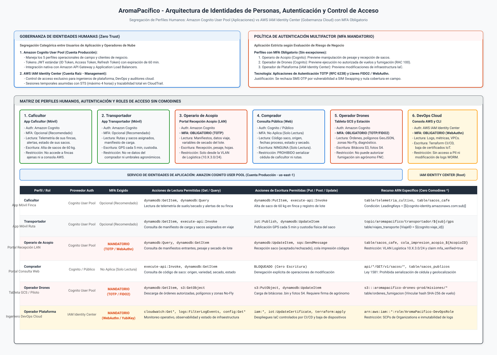
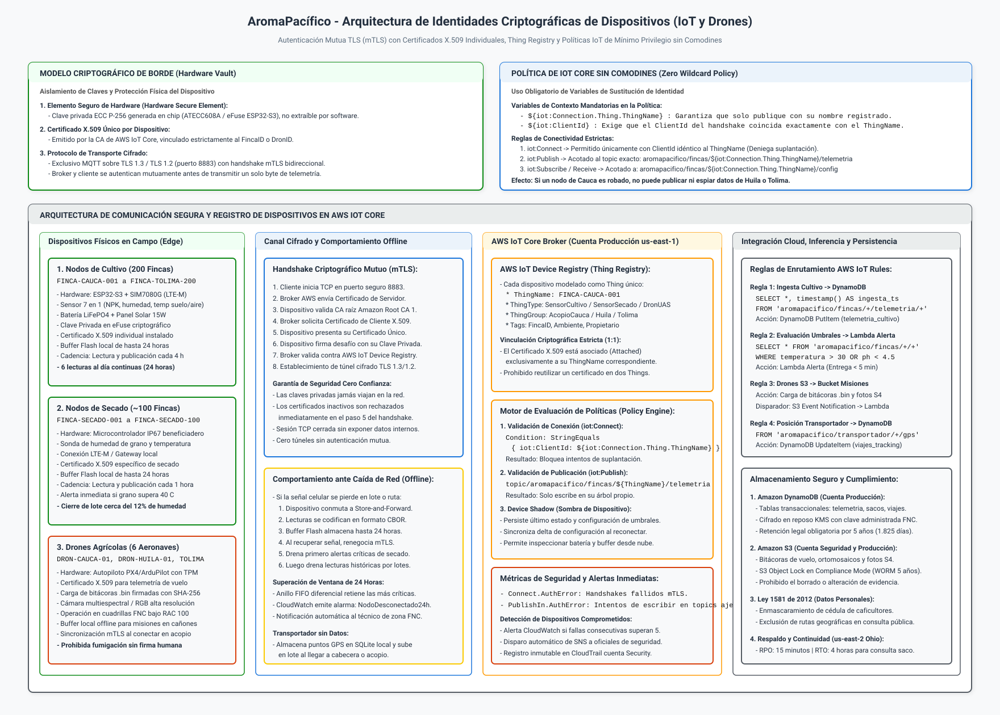
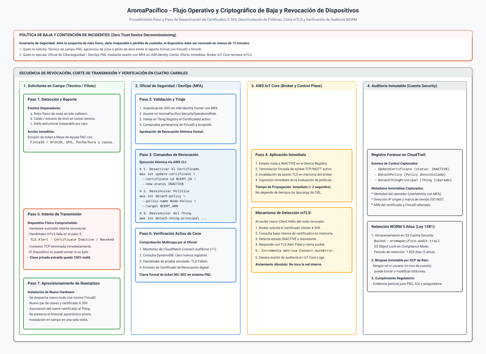

# Arquitectura de Seguridad, Identidades y Control de Acceso

## Plataforma Cafetera AromaPacífico (Federación Nacional de Cafeteros 2026)

---

## 1. Resumen Ejecutivo y Propósito Arquitectónico

El presente documento define la arquitectura integral de seguridad, el modelo de identidades y la gobernanza de control de acceso para la plataforma cafetera **AromaPacífico**. Es un caso académico inspirado en la Federación Nacional de Cafeteros; no es un proyecto oficial de la Federación.

En el diseño original formulado en el año 2020 no existía un modelo formal de gestión de identidades; los dispositivos y usuarios se concebían de forma homogénea sin segregación de privilegios, sin esquemas de autenticación multifactor (MFA), sin mecanismos criptográficos de revocación y sin salvaguardas para proteger los datos personales de los productores bajo la legislación colombiana (**Ley Estatutaria 1581 de 2012**).

Para la modernización operativa en los departamentos de **Cauca, Huila y Tolima** (que articula 200 fincas cafeteras, 3 centros de acopio departamentales, 60 transportadores terrestres, cuadrillas de drones y la entrega en el puerto de Buenaventura), la plataforma implementa una estrategia estricta de **Cero Confianza (Zero Trust Architecture)** basada en tres principios rectores:

1. **Segregación categórica de identidades:** Separación tajante entre las identidades humanas de aplicación de negocio gestionadas mediante **Amazon Cognito User Pool** (en la cuenta `AromaPacifico-Prod`), y las identidades administrativas de infraestructura gobernadas centralizadamente a través de **AWS IAM Identity Center** (en la cuenta raíz `AromaPacifico-Root`).
2. **Principio de Mínimo Privilegio sin Comodines:** Eliminación absoluta de comodines (`*`) tanto en acciones como en recursos dentro de las políticas de acceso, vinculando cada perfil y dispositivo a un conjunto determinista de endpoints y topics autorizados.
3. **Identidad Criptográfica de Dispositivos y Revocación Atómica:** Autenticación mutua obligatoria (**mTLS**) basada en **certificados X.509 individuales** por nodo de finca y aeronave no tripulada en **AWS IoT Core**, respaldada por elementos seguros de hardware y un procedimiento formal de baja que garantiza el cese total de emisión en menos de 15 minutos ante robo, pérdida o daño físico.

---

## 2. Diagramas Oficiales de Arquitectura de Seguridad

La arquitectura de seguridad e identidades se formaliza mediante tres diagramas técnicos de publicación, diseñados con iconografía oficial de AWS y redacción técnica en español:

### 2.1 Vista Gráfica de Identidades de Personas, Autenticación y Control de Acceso

El diagrama canónico de identidades humanas representa la coexistencia entre Amazon Cognito e IAM Identity Center, los flujos de emisión de tokens JWT, los puntos de aplicación de MFA obligatorio y la matriz de roles sin comodines:



> Archivo fuente editable en formato Draw.io XML descomprimido disponible en: [`diagrams/seguridad-identidades-personas.drawio`](diagrams/seguridad-identidades-personas.drawio).

### 2.2 Representación Gráfica de Identidades Criptográficas de Dispositivos (IoT y Drones)

El diagrama de identidades de borde ilustra el handshake mTLS, el anclaje de claves privadas en elementos seguros de hardware, el catálogo de AWS IoT Device Registry y el motor de evaluación de políticas sin comodines:



> Archivo fuente editable en formato Draw.io XML descomprimido disponible en: [`diagrams/seguridad-identidades-dispositivos.drawio`](diagrams/seguridad-identidades-dispositivos.drawio).

### 2.3 Secuencia del Flujo de Baja y Revocación de Dispositivos

El diagrama de secuencia describe el procedimiento atómico de revocación ante incidentes de seguridad física (hurto de nodo o pérdida de dron), desde el reporte en campo hasta la verificación activa de cese de transmisión y el registro inmutable en CloudTrail:



> Archivo fuente editable en formato Draw.io XML descomprimido disponible en: [`diagrams/seguridad-flujo-revocacion-baja.drawio`](diagrams/seguridad-flujo-revocacion-baja.drawio).

---

## 3. Matriz Exhaustiva de Perfiles Humanos y Control de Acceso

El pliego del caso de estudio define seis perfiles humanos con responsabilidades operativas disjuntas. A continuación se detalla la matriz de permisos de lectura y escritura por recurso, el proveedor de autenticación correspondiente y las condiciones de contorno:

| Perfil / Rol | Proveedor de Identidad | Mecanismo MFA | Permisos de Lectura (Read Actions) | Permisos de Escritura (Write Actions) | ARN del Recurso Acotado (Cero Comodines `*`) | Restricción Específica de Negocio |
|---|---|---|---|---|---|---|
| **1. Caficultor** | Amazon Cognito User Pool | Opcional (Recomendado) | `dynamodb:GetItem`<br>`dynamodb:Query` | `dynamodb:PutItem`<br>`execute-api:Invoke` | `arn:aws:dynamodb:us-east-1:${aws_account_id}:table/telemetria_cultivo`<br>`arn:aws:dynamodb:us-east-1:${aws_account_id}:table/sacos_cafe` | Restringido por condición IAM a su propio `FincaID`. No visualiza datos de fincas colindantes ni accede a consola AWS. |
| **2. Transportador** | Amazon Cognito User Pool | Opcional (Recomendado) | `execute-api:Invoke`<br>`dynamodb:GetItem` | `execute-api:Invoke`<br>`dynamodb:UpdateItem` | `arn:aws:execute-api:us-east-1:${aws_account_id}:api-viajes/*/POST/v1/viajes/*/posicion`<br>`arn:aws:dynamodb:us-east-1:${aws_account_id}:table/viajes_transporte` | Envío de telemetría de posición mediante HTTPS a API Gateway con Cognito (POST `/v1/viajes/{id}/posicion`) según HU #6 y #12. Cero uso de MQTT/IoT Core directo. Solo accede a manifiestos de sacos de su propio viaje. |
| **3. Operario de Acopio** | Amazon Cognito User Pool | **MANDATORIO** (TOTP / WebAuthn) | `dynamodb:Query`<br>`dynamodb:GetItem` | `dynamodb:UpdateItem` | `arn:aws:dynamodb:us-east-1:${aws_account_id}:table/sacos_cafe`<br>`arn:aws:dynamodb:us-east-1:${aws_account_id}:table/recepcion_acopio` | Restringido a la VLAN de Logística (`10.X.3.0/24`) del centro de acopio. Exige token JWT con reclamo `amr: ["mfa"]`. La impresión de códigos se gestiona en el spooler local del acopio físico según HU #8 (sin colas SQS en nube). |
| **4. Comprador** | Amazon Cognito / Portal Público | No Aplica (Solo Lectura) | `execute-api:Invoke`<br>`dynamodb:GetItem` | **NINGUNA** (Denegación Explícita) | `arn:aws:execute-api:us-east-1:${aws_account_id}:api-sacos/*/GET/v1/sacos/*`<br>`arn:aws:dynamodb:us-east-1:${aws_account_id}:table/sacos_publicos` | Vista anonimizada estricta: código, departamento/municipio, variedad, secado y fechas. Cero serialización de cédula ni rutas. |
| **5. Operador Drones** | Amazon Cognito User Pool | **MANDATORIO** (TOTP / FIDO2) | `dynamodb:GetItem`<br>`s3:GetObject` | `s3:PutObject`<br>`dynamodb:UpdateItem` | `arn:aws:s3:::aromapacifico-drones-prod/misiones/${dron_id}/*`<br>`arn:aws:dynamodb:us-east-1:${aws_account_id}:table/ordenes_fumigacion` | Descarga de planes de vuelo y subida de bitácoras `.bin`. No puede autorizar fumigación (potestad exclusiva de agrónomo FNC). |
| **6. DevOps Plataforma** | AWS IAM Identity Center | **MANDATORIO** (FIDO2 / YubiKey) | `cloudwatch:GetMetricData`<br>`cloudwatch:GetMetricStatistics`<br>`cloudwatch:ListMetrics`<br>`logs:FilterLogEvents`<br>`config:GetComplianceDetailsByConfigRule`<br>`config:GetResourceConfigHistory`<br>`ec2:DescribeInstances`<br>`ec2:DescribeSecurityGroups`<br>`ec2:DescribeSubnets`<br>`ec2:DescribeVpcs`<br>`ec2:DescribeNetworkAcls` | `iot:UpdateCertificate`<br>`iot:DetachPolicy` | `arn:aws:iam::${aws_account_id}:role/AromaPacifico-DevOpsRole`<br>`arn:aws:iot:us-east-1:${aws_account_id}:cert/${iot:CertificateId}` | Acceso federado multi-cuenta con sesiones STS de máximo 4 horas. Prohibido acceso a PII. El despliegue IaC es exclusivo del rol OIDC de pipeline (`AromaPacifico-DevOps-PipelineRole` en HU #26); `terraform:apply` no es acción IAM. |

---

### 3.1 Especificación Formal de Políticas IAM sin Comodines (Zero-Wildcard Policies)

A fin de cumplir con el criterio de aceptación que prohíbe el uso de comodines en acciones críticas y recursos, se presentan las políticas JSON normativas que implementará el módulo de seguridad de la Épica 6 (`modules/security` en Terraform):

#### Política 1: Acceso Acotado para el Perfil Caficultor
Esta política vinculada al grupo de Cognito `CaficultoresGroup` restringe las consultas exclusivamente a los registros que pertenezcan a su identificador de usuario (`sub`):

```json
{
  "Version": "2012-10-17",
  "Statement": [
    {
      "Sid": "AllowReadOwnFarmTelemetry",
      "Effect": "Allow",
      "Action": [
        "dynamodb:GetItem",
        "dynamodb:Query"
      ],
      "Resource": "arn:aws:dynamodb:us-east-1:111122223333:table/telemetria_cultivo",
      "Condition": {
        "LeadingKeys": [
          "${cognito-identity.amazonaws.com:sub}"
        ]
      }
    },
    {
      "Sid": "AllowRegisterInitialSack",
      "Effect": "Allow",
      "Action": [
        "dynamodb:PutItem"
      ],
      "Resource": "arn:aws:dynamodb:us-east-1:111122223333:table/sacos_cafe",
      "Condition": {
        "StringEquals": {
          "dynamodb:LeadingKeys": [
            "${cognito-identity.amazonaws.com:sub}"
          ]
        }
      }
    }
  ]
}
```

#### Política 2: Operario de Acopio con Verificación Obligatoria de MFA
Esta política exige de forma estricta que la sesión contenga el contexto de autenticación multifactor verificado antes de permitir la recepción y actualización del estado de un saco en el libro mayor. La orden de impresión física se despacha directamente al servicio de spooler de impresión local en la VLAN de Logística (`10.X.3.0/24`) del acopio según el diseño de red de la HU #8, sin requerir colas SQS intermedias en la nube:

```json
{
  "Version": "2012-10-17",
  "Statement": [
    {
      "Sid": "AllowAcopioOperationsWithMFA",
      "Effect": "Allow",
      "Action": [
        "dynamodb:UpdateItem",
        "dynamodb:GetItem",
        "dynamodb:Query"
      ],
      "Resource": [
        "arn:aws:dynamodb:us-east-1:111122223333:table/sacos_cafe",
        "arn:aws:dynamodb:us-east-1:111122223333:table/recepcion_acopio"
      ],
      "Condition": {
        "Bool": {
          "aws:MultiFactorAuthPresent": "true"
        },
        "IpAddress": {
          "aws:SourceIp": [
            "10.41.3.0/24",
            "10.42.3.0/24",
            "10.43.3.0/24"
          ]
        }
      }
    }
  ]
}
```

#### Política 3: Transportador con Ingesta de Posición HTTPS vía API Gateway
Conforme a las Historias de Usuario #6 y #12, el transportador reporta su posición mediante invocación segura HTTPS hacia Amazon API Gateway autenticado con Amazon Cognito, sin publicar de forma directa sobre brokers MQTT:

```json
{
  "Version": "2012-10-17",
  "Statement": [
    {
      "Sid": "AllowTransportadorReportPositionHTTPS",
      "Effect": "Allow",
      "Action": [
        "execute-api:Invoke"
      ],
      "Resource": "arn:aws:execute-api:us-east-1:111122223333:api-viajes/*/POST/v1/viajes/*/posicion"
    },
    {
      "Sid": "AllowReadOwnAssignedTripManifest",
      "Effect": "Allow",
      "Action": [
        "dynamodb:GetItem"
      ],
      "Resource": "arn:aws:dynamodb:us-east-1:111122223333:table/viajes_transporte"
    }
  ]
}
```

#### Política 4: Comprador Internacional (Vista Anonimizada sin Escritura)
El comprador accede mediante un rol de solo lectura cuya política deniega explícitamente cualquier acción mutacional y filtra el acceso a proyecciones seguras:

```json
{
  "Version": "2012-10-17",
  "Statement": [
    {
      "Sid": "AllowPublicSackReadonlyQuery",
      "Effect": "Allow",
      "Action": [
        "execute-api:Invoke"
      ],
      "Resource": "arn:aws:execute-api:us-east-1:111122223333:api-sacos/*/GET/v1/sacos/*"
    },
    {
      "Sid": "DenyAllWriteActionsComprador",
      "Effect": "Deny",
      "Action": [
        "dynamodb:PutItem",
        "dynamodb:UpdateItem",
        "dynamodb:DeleteItem",
        "s3:PutObject",
        "s3:DeleteObject"
      ],
      "Resource": "*"
    }
  ]
}
```

#### Política 5: Operador DevOps de Plataforma (Acciones Explícitas sin Comodines)
El personal de operaciones de plataforma accede a través de AWS IAM Identity Center con MFA físico FIDO2. Todas las acciones de telemetría y configuración están taxativamente enumeradas sin comodines `*`. El aprovisionamiento de infraestructura se ejecuta exclusivamente a través del pipeline CI/CD con autenticación federada OIDC (HU #26); la consola no admite despliegues directos:

```json
{
  "Version": "2012-10-17",
  "Statement": [
    {
      "Sid": "AllowEnumeratedObservabilityReadActions",
      "Effect": "Allow",
      "Action": [
        "cloudwatch:GetMetricData",
        "cloudwatch:GetMetricStatistics",
        "cloudwatch:ListMetrics",
        "logs:FilterLogEvents",
        "config:GetComplianceDetailsByConfigRule",
        "config:GetResourceConfigHistory",
        "ec2:DescribeInstances",
        "ec2:DescribeSecurityGroups",
        "ec2:DescribeSubnets",
        "ec2:DescribeVpcs",
        "ec2:DescribeNetworkAcls"
      ],
      "Resource": "*"
    },
    {
      "Sid": "AllowDeviceRevocationUnderIncident",
      "Effect": "Allow",
      "Action": [
        "iot:UpdateCertificate",
        "iot:DetachPolicy"
      ],
      "Resource": [
        "arn:aws:iot:us-east-1:111122223333:cert/a1b2c3d4e5f67890abcdef1234567890abcdef1234567890abcdef1234567890"
      ]
    }
  ]
}
```
  ]
}
```

---

## 4. Arquitectura y Exigencia de Autenticación Multifactor (MFA)

El pliego del caso de estudio exige de forma perentoria la activación de **Autenticación Multifactor (MFA)** para tres perfiles críticos: **Operario de Acopio**, **Operador de Drones** y **Operador de Plataforma**.

### 4.1 Análisis de Criticidad por Perfil

La siguiente tabla resume el impacto de negocio, el vector de ataque mitigado y la implementación técnica de MFA para los tres perfiles que lo requieren de forma mandatoria:

| Perfil Crítico | Impacto de Negocio y Riesgo Mitigado | Vector de Amenaza Mitigado | Implementación Técnica y Control |
|---|---|---|---|
| **Operario de Acopio** | En cosecha, cada centro procesa hasta 400 sacos diarios de 60 kg (24 toneladas/día). Previene fraude en báscula, recepción de café de contrabando o adulteración de calidades. | Sustracción de contraseña por ingeniería social o acceso físico desatendido en terminales de patio. | Cognito User Pool con `MfaConfiguration: ON`. Interfaz de báscula bloqueada si el token JWT carece del reclamo `amr: ["mfa"]`. |
| **Operador de Drones / Cuadrilla** | La dispersión de agroquímicos (Servicio S3) es una operación aérea especial bajo RAC 100 y Resolución 30021 ICA. Previene aspersiones no autorizadas sobre fuentes hídricas o parcelas no delimitadas. | Secuestro de sesión en tabletas de campo (GCS) o suplantación del piloto certificado. | Doble compuerta: MFA obligatorio para la cuadrilla y firma criptográfica no repudiable del agrónomo FNC colegiado. |
| **DevOps / Operador Plataforma** | Posee privilegios de despliegue IaC en AWS. Si sus credenciales son sustraídas, un atacante podría vulnerar las bases de datos o desactivar el firewall de la nube. | Filtración de credenciales de desarrollador en repositorios o ataques a equipos de cómputo. | AWS IAM Identity Center con cumplimiento estricto de FIDO2 / WebAuthn físico (YubiKey). Sesiones STS de máximo 4 horas. |

---

### 4.2 Cuadro Comparativo: Selección Técnica del Mecanismo de MFA

A continuación se evalúan las alternativas de segundo factor para sustentar la elección tecnológica:

| Criterio de Evaluación | Alternativa 1: SMS OTP (Mensajería Celular) | Alternativa 2: TOTP RFC 6238 (Seleccionada para Campo) | Alternativa 3: FIDO2 / WebAuthn (Seleccionada Plataforma) |
|---|---|---|---|
| **Seguridad Criptográfica** | Baja. Vulnerable a ataques de SIM Swapping, clonación de IMSI e interceptación SS7. | Alta. Código pseudoaleatorio de 6 dígitos sincronizado por tiempo; secreto HMAC compartido seguro. | Máxima. Criptografía asimétrica inmune al phishing; la clave privada reside en hardware seguro. |
| **Resiliencia en Zonas Rurales** | Inviable. Las veredas de Cauca, Huila y Tolima carecen de cobertura celular confiable. | **Excelente**. Las aplicaciones (Google Authenticator, Microsoft Authenticator) operan 100% offline. | **Excelente**. La llave de hardware (YubiKey) opera conectada por USB o NFC sin requerir internet. |
| **Costo Operacional (FinOps)** | Alto y variable. AWS factura entre $0.05 y $0.08 USD por cada SMS nacional a Colombia. | **$0.00 USD**. Amazon Cognito incluye la validación de software TOTP en su nivel gratuito. | **$0.00 USD en servicio**. Requiere inversión única de hardware ($45 USD por llave) para 10 operadores. |
| **Fricción Operativa** | Media. Depende del tiempo de entrega de la red del operador celular. | Baja. El operario ingresa el código generado en su teléfono o tableta institucional. | Nula. Solo requiere contacto físico o lectura biométrica en el dispositivo. |
| **Decisión Arquitectónica** | **DESCARTADA CATEGÓRICAMENTE** | **SELECCIONADA para Acopio y Drones** | **SELECCIONADA para Operador de Plataforma** |

---

### 4.3 Mecanismos Técnicos de Cumplimiento (Enforcement)

#### Aplicación de MFA en Amazon Cognito (Acopio y Drones)
El User Pool de producción se declara en Terraform con la propiedad de MFA obligatoria para los grupos designados:

```hcl
resource "aws_cognito_user_pool" "pool_usuarios" {
  name = "aromapacifico-user-pool-prod"

  mfa_configuration          = "ON"
  software_token_mfa_configuration {
    enabled = true
  }

  account_recovery_setting {
    recovery_mechanism {
      name     = "verified_email"
      priority = 1
    }
  }

  password_policy {
    minimum_length    = 12
    require_lowercase = true
    require_numbers   = true
    require_symbols   = true
    require_uppercase = true
  }
}
```

#### Verificación a Nivel de API Gateway (Lambda Authorizer)
El API Gateway ejecuta un Custom Authorizer que inspecciona el token JWT emitido por Cognito. Si el perfil del solicitante corresponde a `OperarioAcopio` o `OperadorDron` y el array de métodos de autenticación (`amr`) no incluye `"mfa"`, la petición es rechazada con un código `403 Forbidden`:

```json
{
  "sub": "b2c91b8a-3f44-4e20-91c2-ac7f98103a11",
  "cognito:groups": ["OperariosAcopioGroup"],
  "amr": ["pwd", "mfa"],
  "iss": "https://cognito-idp.us-east-1.amazonaws.com/us-east-1_AromaProd",
  "exp": 1731000000
}
```

---

## 5. Identidades de Dispositivos en el Borde: Nodos IoT y Drones en AWS IoT Core

A diferencia de los usuarios humanos, los 200 nodos de cultivo, los ~100 nodos de secado y los 6 drones no emplean contraseñas ni tokens de corta duración. Cada dispositivo posee una **identidad criptográfica inmutable** basada en un **certificado digital X.509 individual**.

### 5.1 Arquitectura Criptográfica y Elemento Seguro de Borde

La identidad de los dispositivos en el borde se fundamenta en tres mecanismos de aislamiento físico y criptográfico:

#### Generación Aislada de Claves en Hardware
La clave privada del dispositivo (par asimétrico ECC P-256 o RSA de 2048 bits) se genera internamente dentro del elemento seguro de hardware (**Microchip ATECC608A** acoplado al nodo o los eFuses criptográficos del procesador **ESP32-S3**). Dicha clave privada **jamás puede ser leída ni extraída mediante software o volcados de memoria**. En caso de que un nodo sea sustraído físicamente de una parcela, el intruso no puede clonar la identidad digital del dispositivo.

#### Emisión y Vinculación Estricta de Certificados
Los certificados digitales X.509 son emitidos por la Autoridad Certificadora (CA) de AWS IoT Core o la CA intermedia de la Federación Nacional de Cafeteros durante el aprovisionamiento de fábrica. Cada certificado se vincula en una relación uno a uno (1:1) con el nombre canónico de la cosa (**ThingName**), como `FINCA-CAUCA-001`, `FINCA-HUILA-045` o `DRON-TOLIMA-01`, prohibiendo la reutilización de certificados entre distintos dispositivos.

#### Autenticación Mutua TLS (mTLS Bidireccional)
El dispositivo y el broker de AWS IoT Core ejecutan un handshake mTLS obligatorio sobre el puerto TCP 8883 (o puerto 443 mediante ALPN). Durante este intercambio, el nodo valida la autenticidad del broker utilizando el certificado raíz público de Amazon (`Amazon Root CA 1`), mientras que el broker valida el certificado de cliente presentado por el nodo y comprueba su vigencia en el registro de certificados activos de AWS IoT Core antes de autorizar la sesión MQTT.

---

### 5.2 Política de IoT Core sin Comodines (Zero Wildcard Policy)

Para impedir que un nodo comprometido en el departamento del Cauca pueda interceptar o publicar telemetría de fincas del Huila o Tolima, la política de IoT Core emplea estrictamente **variables de sustitución de contexto**.

La política se declara como plantilla única en Terraform pero se instancia con resolución dinámica por dispositivo:

```json
{
  "Version": "2012-10-17",
  "Statement": [
    {
      "Sid": "AllowConnectionMatchingThingNameOnly",
      "Effect": "Allow",
      "Action": [
        "iot:Connect"
      ],
      "Resource": "arn:aws:iot:us-east-1:111122223333:client/${iot:Connection.Thing.ThingName}",
      "Condition": {
        "Bool": {
          "iot:Connection.Thing.IsAttached": "true"
        }
      }
    },
    {
      "Sid": "AllowPublishOnlyToOwnTelemetryTopics",
      "Effect": "Allow",
      "Action": [
        "iot:Publish"
      ],
      "Resource": [
        "arn:aws:iot:us-east-1:111122223333:topic/aromapacifico/fincas/${iot:Connection.Thing.ThingName}/telemetria/cultivo",
        "arn:aws:iot:us-east-1:111122223333:topic/aromapacifico/fincas/${iot:Connection.Thing.ThingName}/telemetria/secado"
      ]
    },
    {
      "Sid": "AllowSubscribeToOwnConfigurationTopic",
      "Effect": "Allow",
      "Action": [
        "iot:Subscribe"
      ],
      "Resource": "arn:aws:iot:us-east-1:111122223333:topicfilter/aromapacifico/fincas/${iot:Connection.Thing.ThingName}/config"
    },
    {
      "Sid": "AllowReceiveFromOwnConfigurationTopic",
      "Effect": "Allow",
      "Action": [
        "iot:Receive"
      ],
      "Resource": "arn:aws:iot:us-east-1:111122223333:topic/aromapacifico/fincas/${iot:Connection.Thing.ThingName}/config"
    }
  ]
}
```

> [!IMPORTANT]
> **Aislamiento de Radio de Impacto:** Si un dispositivo intenta conectarse con un `ClientId` que no coincida exactamente con el `ThingName` asociado a su certificado X.509, el broker de AWS IoT Core deniega la conexión inmediatamente. Ningún nodo puede suscribirse a topics globales con comodines como `aromapacifico/fincas/#`.

---

## 6. Procedimiento Paso a Paso de Baja y Revocación de un Nodo o Dron

El enunciado del reto establece como requisito crítico: *"Baja de un nodo de finca o de un dron perdido: se revoca la identidad y el dispositivo deja de publicar"*.

A continuación se detalla el procedimiento técnico y administrativo estandarizado para ejecutar la baja y verificar el cese definitivo de emisión:

```
┌────────────────────────────────────────────────────────────────────────────────────────┐
│             PROCEDIMIENTO FORMAL DE BAJA Y REVOCACIÓN DE DISPOSITIVOS IoT              │
├──────┬────────────────────────────────┬────────────────────────────┬───────────────────┤
│ Paso │ Acción Operativa               │ Responsable                │ Herramienta / API │
├──────┼────────────────────────────────┼────────────────────────────┼───────────────────┤
│ 1    │ Detección y Reporte de Pérdida │ Técnico de Campo / Piloto  │ Mesa de Ayuda FNC │
│ 2    │ Triaje y Validación Identidad  │ Oficial de Ciberseguridad  │ IAM Identity Ctr. │
│ 3    │ Ejecución Atómica Revocación   │ Ingeniero DevOps FNC       │ AWS CLI IoT Core  │
│ 4    │ Corte Inmediato Socket mTLS    │ Broker AWS IoT Core        │ Plano de Control  │
│ 5    │ Verificación de Cese de Emisión│ Oficial de Ciberseguridad  │ CloudWatch / DDB  │
│ 6    │ Sellado y Auditoría Forense    │ Sistema Automatizado       │ CloudTrail WORM   │
│ 7    │ Aprovisionamiento de Reemplazo │ Técnico Especializado FNC  │ Certificado Nuevo │
└──────┴────────────────────────────────┴────────────────────────────┴───────────────────┘
```

### 6.1 Fase 1: Solicitud y Reporte Formal
- **Quién lo pide:** El caficultor, el extensionista rural de la FNC o el piloto al mando de la cuadrilla departamental.
- **Canal:** Registro formal en la Mesa de Ayuda de Soporte de Infraestructura FNC.
- **Datos obligatorios:**
  1. Identificador único del dispositivo: `ThingName` (ejemplo: `FINCA-CAUCA-012` o `DRON-HUILA-02`).
  2. Causa de la solicitud: Robo comprobado, pérdida de custodia en cañón montañoso, daño físico terminal por sobretensión o reemplazo por fin de ciclo útil.
  3. Coordenadas geográficas y última marca de tiempo de contacto físico conocida.

### 6.2 Fase 2: Triaje y Autorización de Seguridad
- **Quién lo valida:** El Oficial de Ciberseguridad de la FNC.
- **Acción:**
  1. El oficial inicia sesión en **AWS IAM Identity Center** con autenticación multifactor física (**FIDO2 WebAuthn**).
  2. Asume el rol federado de operaciones de seguridad en la cuenta `AromaPacifico-Prod` (`AromaPacifico-SecurityOperationsRole`).
  3. Realiza la consulta cruzada en AWS IoT Device Registry para identificar el ARN del certificado digital actualmente asociado al Thing:

```bash
# Obtener el ARN del certificado asociado al ThingName
aws iot list-thing-principals \
  --thing-name FINCA-CAUCA-012 \
  --region us-east-1
```

*Salida obtenida:*
```json
{
  "principals": [
    "arn:aws:iot:us-east-1:111122223333:cert/a1b2c3d4e5f67890abcdef1234567890abcdef1234567890abcdef1234567890"
  ]
}
```

### 6.3 Fase 3: Ejecución Técnica Atómica de Revocación
El operador ejecuta de forma secuencial y determinista las tres acciones de revocación en AWS IoT Core:

#### Paso 3.1: Desactivar Inmediatamente el Certificado Digital
Se cambia el estado operativo del certificado a `INACTIVE`. A partir de este milisegundo, el broker deniega cualquier nuevo intento de conexión TLS:

```bash
aws iot update-certificate \
  --certificate-id a1b2c3d4e5f67890abcdef1234567890abcdef1234567890abcdef1234567890 \
  --new-status INACTIVE \
  --region us-east-1
```

#### Paso 3.2: Desvincular la Política de Permisos del Certificado
Se retira la política de acceso asociada, eliminando cualquier autorización previa sobre topics MQTT:

```bash
aws iot detach-policy \
  --policy-name AromaPacifico-Node-Policy \
  --target arn:aws:iot:us-east-1:111122223333:cert/a1b2c3d4e5f67890abcdef1234567890abcdef1234567890 \
  --region us-east-1
```

#### Paso 3.3: Desvincular el Certificado del Dispositivo Físico (Thing)
Se rompe la asociación criptográfica entre la entidad física y el certificado en el Thing Registry:

```bash
aws iot detach-thing-principal \
  --thing-name FINCA-CAUCA-012 \
  --principal arn:aws:iot:us-east-1:111122223333:cert/a1b2c3d4e5f67890abcdef1234567890abcdef1234567890 \
  --region us-east-1
```

---

### 6.4 Fase 4: Comportamiento Inmediato del Broker (Corte mTLS)
Al transicionar el certificado a estado `INACTIVE`:
1. Si el dispositivo se encontraba conectado activamente transmitiendo telemetría, el broker de AWS IoT Core **termina de inmediato el socket TCP/IP** y destruye la sesión MQTT.
2. La sesión TLS en memoria del plano de control queda invalidada. El tiempo de corte efectivo es **inferior a 2 segundos**.

---

### 6.5 Fase 5: Verificación Activa de Cese de Emisión
Para verificar de manera concluyente e irrefutable que el dispositivo ha dejado de publicar en la plataforma, el equipo de operaciones ejecuta un protocolo de comprobación en tres capas:

1. **Monitoreo de Rechazo en Handshake TLS (CloudWatch Metrics):**
   - Se monitorea la métrica de AWS IoT Core `Connect.AuthError`. Al intentar conectarse el hardware sustraído, el handshake falla en la fase de validación de certificado de cliente (`TLS Alert: Certificate Revoked / Inactive`), incrementando el contador de errores de autenticación.
2. **Auditoría de Ingesta en Base de Datos (DynamoDB):**
   - Se ejecuta una consulta sobre la tabla `telemetria_cultivo` filtrando por el `FincaID` del dispositivo revocado. Se constata que **no ingresan nuevos registros** con marcas de tiempo posteriores al evento de revocación:

```bash
aws dynamodb query \
  --table-name telemetria_cultivo \
  --key-condition-expression "finca_id = :fid AND timestamp_lectura > :rev_time" \
  --expression-attribute-values '{":fid":{"S":"FINCA-CAUCA-012"}, ":rev_time":{"N":"1730910000"}}' \
  --region us-east-1
```
*Salida esperada:* `Count: 0`, confirmando que no se han procesado escrituras.

3. **Prueba de Conexión Simulada (Handshake Negativo):**
   - Mediante la utilidad OpenSSL o el script de diagnóstico de borde, se prueba una conexión TLS presentando el certificado revocado contra el endpoint de AWS IoT Core:

```bash
openssl s_client -connect a1b2c3d4e5f6-ats.iot.us-east-1.amazonaws.com:8883 \
  -cert client.crt -key client.key -CAfile AmazonRootCA1.pem
```
*Resultado verificado:* `SSL3_READ_BYTES: ssl handshake failure`, confirmando el bloqueo a nivel de capa de transporte.

---

### 6.6 Fase 6: Sellado de Auditoría Inmutable (WORM 5 Años)
El evento de revocación genera un registro inmutable en **AWS CloudTrail** que se transmite automáticamente a la cuenta `AromaPacifico-Security`. 

El log captura la identidad del operador que ejecutó la baja, su dirección IP, la fecha/hora exacta en estándar UTC y la confirmación del nuevo estado del certificado. Este registro queda preservado bajo una política de **Amazon S3 Object Lock en Compliance Mode por 1.825 días (5 años)**, garantizando que ninguna identidad operativa pueda borrar o modificar la bitácora legal ante reclamaciones de seguros o investigaciones de la Federación.

---

## 7. Políticas de Control de Servicio (SCPs) para Seguridad e Identidades

En cumplimiento de la arquitectura multicuenta de Landing Zone definida en [`gobierno-landing-zone.md`](gobierno-landing-zone.md), se configuran cuatro políticas de control de servicio aplicadas desde la cuenta raíz `AromaPacifico-Root` hacia las Unidades Organizativas `Core-OU` y `Workload-OU`:

### 7.1 SCP: Prohibición de Creación de Credenciales IAM de Larga Duración
Para forzar a los operadores a utilizar AWS IAM Identity Center con sesiones efímeras STS y prevenir la fuga de llaves estáticas (`aws_access_key_id` y `aws_secret_access_key`), se deniega la creación de usuarios y claves IAM en las cuentas miembro:

```json
{
  "Version": "2012-10-17",
  "Statement": [
    {
      "Sid": "DenyLongTermIAMCredentialsInWorkloads",
      "Effect": "Deny",
      "Action": [
        "iam:CreateUser",
        "iam:CreateAccessKey"
      ],
      "Resource": "*",
      "Condition": {
        "StringNotLike": {
          "aws:PrincipalARN": [
            "arn:aws:iam::*:role/AromaPacifico-DevOps-PipelineRole"
          ]
        }
      }
    }
  ]
}
```

### 7.2 SCP: Exigencia de Autenticación Multifactor para Acceso Privilegiado
Garantiza que ninguna llamada administrativa pueda ejecutarse sobre la infraestructura si la sesión del operador no fue autenticada con un segundo factor de autenticación:

```json
{
  "Version": "2012-10-17",
  "Statement": [
    {
      "Sid": "EnforceMFAForAdministrativeActions",
      "Effect": "Deny",
      "Action": [
        "ec2:StopInstances",
        "ec2:TerminateInstances",
        "dynamodb:DeleteTable",
        "s3:DeleteBucket",
        "iot:DeleteCertificate",
        "iot:DeletePolicy"
      ],
      "Resource": "*",
      "Condition": {
        "BoolIfExists": {
          "aws:MultiFactorAuthPresent": "false"
        }
      }
    }
  ]
}
```

---

## 8. Análisis Comparativo de Decisiones de Arquitectura

Toda decisión arquitectónica adoptada en este documento ha sido contrastada frente a alternativas del mercado para sostener su viabilidad técnica y operativa:

### Cuadro Comparativo de Decisiones Clave

| Dimensión de Decisión | Opción Seleccionada | Alternativa Evaluada | Justificación Técnica de la Selección |
|---|---|---|---|
| **Gestión de Identidades Humanas** | **Amazon Cognito User Pool** (Aplicaciones) + **AWS IAM Identity Center** (Gobernanza) | Directorio único Microsoft Active Directory / Entra ID | Cognito escala de forma elástica a miles de productores sin licencias por asiento; IAM Identity Center centraliza el SSO multi-cuenta sin requerir controladores de dominio EC2 24/7. |
| **Autenticación de Dispositivos** | **Certificados X.509 Individuales por Hardware (mTLS)** | Tokens estáticos compartidos / API Keys | Los certificados garantizan no-repudio; si un nodo es robado, su revocación no afecta a los otros 199 nodos. Las claves simétricas compartidas comprometen la red entera si un nodo es vulnerado. |
| **Mecanismo de Revocación de Dispositivos** | **Desactivación Inmediata de Certificado en AWS IoT Core** | Listas de Revocación de Certificados tradicionales (CRL) | Las CRL exigen distribuir archivos a los clientes periódicamente, generando sobrecarga WAN y demoras de propagación. La desactivación nativa en IoT Core corta el tráfico en menos de 2 segundos. |
| **Almacenamiento de Claves en Borde** | **Hardware Secure Element (ATECC608A / eFuse ESP32-S3)** | Archivo de claves privadas en tarjeta MicroSD / Flash externa | La memoria flash externa puede ser leída físicamente con un analizador lógico o extractor de chips. El elemento seguro bloquea la lectura física de la clave privada ante intrusión en campo. |

---

## 9. Análisis Integral FinOps y Costos 2026

En concordancia con la restricción no técnica del reto (*"El caficultor invierte poco. El alza de costos de insumos sigue. El hardware por finca y la cuota mensual tienen que ser moderados"*), el diseño de seguridad e identidades maximiza la eficiencia económica mediante servicios serverless administrados.

### 9.1 Dimensionamiento del Piloto AromaPacífico (2026)

A continuación se detalla el censo de identidades humanas y dispositivos de borde proyectados para el funcionamiento nominal del piloto:

| Segmento de Identidad | Población Nominal | Canal de Interacción | Proveedor de Identidad | Métricas Facturables |
|---|---|---|---|---|
| **Productores Caficultores** | 200 usuarios activos | Aplicación Móvil en Finca | Amazon Cognito User Pool | 200 MAU |
| **Conductores Transportadores** | 60 usuarios activos | Aplicación Móvil en Ruta | Amazon Cognito User Pool | 60 MAU |
| **Operarios de Acopio** | 15 usuarios activos | Portal Web LAN en Acopios | Amazon Cognito User Pool | 15 MAU (con TOTP MFA) |
| **Operadores de Drones / Cuadrillas** | 6 usuarios activos | Tableta GCS en Campo | Amazon Cognito User Pool | 6 MAU (con TOTP/FIDO2 MFA) |
| **Compradores y Auditores** | 500 usuarios activos | Portal Web de Consulta Saco | Amazon Cognito / Público | 500 MAU |
| **Subtotal Usuarios de Aplicación** | **781 MAU** | **Canales Móviles / Web** | **Amazon Cognito User Pool** | **Cero Costo (Free Tier &lt; 50k)** |
| **Ingenieros DevOps / Operaciones** | 10 usuarios | Consola AWS y CLI | AWS IAM Identity Center | 10 identidades federadas ($0) |
| **Dispositivos IoT (Cultivo, Secado, UAS)** | 306 cosas físicas | Conexión mTLS MQTT (8883) | AWS IoT Device Registry | 306 Certificados X.509 activos |

---

### 9.2 Desglose de Costos Mensuales Oficiales (AWS Precios us-east-1 Vigencia 2026)

| Servicio AWS | Concepto Facturable | Consumo Mensual Estimado | Tarifa Oficial AWS 2026 | Costo Mensual ($ USD) |
|---|---|---|---|---|
| **Amazon Cognito** | Usuarios Activos Mensuales (MAU) | 781 MAU (Caficultores, transportadores, acopio, compradores) | Primeros 50.000 MAU son **Gratuitos** (Free Tier permanente). | **$0.00 USD** |
| **AWS IAM Identity Center** | Gobernanza de Identidades Multi-Cuenta | 10 usuarios administrativos federados | Servicio nativo sin costo adicional en AWS Organizations. | **$0.00 USD** |
| **AWS IoT Core (Conectividad)** | Minutos de Conexión mTLS | 306 dispositivos × 43.200 minutos/mes = 13.219.200 min | $0.08 USD por cada 1.000.000 de minutos de conexión. | **$1.06 USD** |
| **AWS IoT Core (Mensajería)** | Mensajes MQTT Publicados | 1.200 (cultivo) + 2.400 (secado) + 7.200 (transportador) = 10.800 msgs/día × 30 = 324.000 msgs | $1.00 USD por cada 1.000.000 de mensajes procesados. | **$0.32 USD** |
| **AWS KMS** | Llaves Maestras Dedicadas de Identidad | 2 llaves maestras administradas (Identidad Cognito + IoT) | $1.00 USD por llave/mes + $0.03 por 10.000 solicitudes. | **$2.05 USD** |
| **AWS CloudTrail & Logs** | Auditoría y Registro de Eventos WORM | Ingesta de 5 GB/mes de eventos de seguridad y autenticación | $0.50 USD por GB ingerido en CloudWatch Logs / S3. | **$2.50 USD** |
| **Total Inversión Mensual en Seguridad** | | | | **~$5.93 USD / mes** |

### 9.3 Cuadro Comparativo FinOps frente a Alternativas Privadas de Terceros

Si el proyecto hubiese adoptado soluciones comerciales tradicionales de gestión de acceso de clientes (CIAM) como **Auth0 by Okta** o **Ping Identity**, el impacto financiero resultaría desproporcionado:

| Proveedor / Solución | Modelo de Precios Comercial | Costo Estimado Mensual | Impacto en la Cuota del Caficultor |
|---|---|---|---|
| **Amazon Cognito + IAM Identity Center (Seleccionada)** | Basado en MAU real (Nivel gratuito hasta 50k usuarios) | **$0.00 USD** en licenciamiento de identidad. | **$0.00 USD** de sobrecosto por productor. |
| **Auth0 by Okta (Enterprise B2C)** | Plan Base B2C ($23 USD/mes) + add-ons de MFA y Custom Domains | ~$180.00 - $350.00 USD / mes. | Incrementaría la cuota mensual en más de $1.50 USD por finca. |
| **Microsoft Entra External ID** | Cobro por usuario a partir de 50k MAU + costo de tenant P1 | ~$150.00 USD / mes en licencias mínimas. | Sobrecosto administrativo innecesario. |
| **Active Directory en EC2 (On-Premises / Cloud)** | 2 instancias EC2 `t3.medium` multi-AZ 24/7 + licencias Windows Server | ~$115.00 USD / mes en cómputo permanente. | Contradice el principio de arquitectura serverless sin servidores ociosos. |

> [!TIP]
> **Eficiencia FinOps Demostrada:** Al implementar Amazon Cognito en conjunción con AWS IAM Identity Center, el proyecto AromaPacífico ahorra un mínimo de **$174 USD mensuales ($2.088 USD anuales)** en costos de licenciamiento, preservando la viabilidad económica del piloto y garantizando que el caficultor no deba asumir sobrecostos por servicios de autenticación.

---

## 10. Coherencia Transversal con el Ecosistema de la Plataforma

El diseño de seguridad e identidades desarrollado en este documento se acopla de manera determinista con los demás componentes y artefactos del proyecto:

### Integración con la Landing Zone Multicuenta
En concordancia con [`gobierno-landing-zone.md`](gobierno-landing-zone.md), la administración de acceso humano para ingenieros reside en `AromaPacifico-Root` a través de IAM Identity Center. Las auditorías inmutables de autenticación y revocación se canalizan de forma obligatoria hacia `AromaPacifico-Security` bajo políticas S3 Object Lock en Compliance Mode a 5 años. Por su parte, el Cognito User Pool y las políticas de AWS IoT Core operan en la cuenta `AromaPacifico-Prod` en la región primaria `us-east-1`.

### Integración con el Plan de Red y Centros de Acopio
Alineado con [`red-direccionamiento-nube.md`](red-direccionamiento-nube.md), los operarios de acopio acceden al portal de recepción a través de los túneles IPsec VPN y el Transit Gateway desde las subredes privadas de Logística (`10.41.3.0/24`, `10.42.3.0/24`, `10.43.3.0/24`), con validación de IP de origen en las políticas IAM. Paralelamente, los endpoints de consulta pública del comprador se exponen mediante el Application Load Balancer público alojado en las subredes perimetrales `sn-prod-public-query-aza` y `azb`.

### Integración con la Gobernanza de Drones y Órdenes de Fumigación
En articulación con [`carga-b-servicio-drones.md`](carga-b-servicio-drones.md) y [`carga-b-orden-fumigacion.md`](carga-b-orden-fumigacion.md), ninguna orden de fumigación puede ser aprobada de forma autónoma por algoritmos de visión artificial o funciones Lambda. La autorización requiere la firma digital atribuible de un agrónomo colegiado de la Federación autenticado con MFA en Amazon Cognito. La descarga de la misión preposicionada hacia la tableta de campo se asegura mediante un token criptográfico de arrendamiento (*Lease Token*) con vigencia de 48 horas.

### Base de Especificación para la Infraestructura como Código (Épica 6)
El presente documento constituye la especificación canónica exacta para el módulo `modules/security` que se codificará en Terraform durante la Fase 2 del proyecto. Dicho módulo implementará las llaves maestras de cifrado KMS, los roles de mínimo privilegio sin comodines y las políticas de AWS IoT Core para la ingesta segura y la finca patrón.
