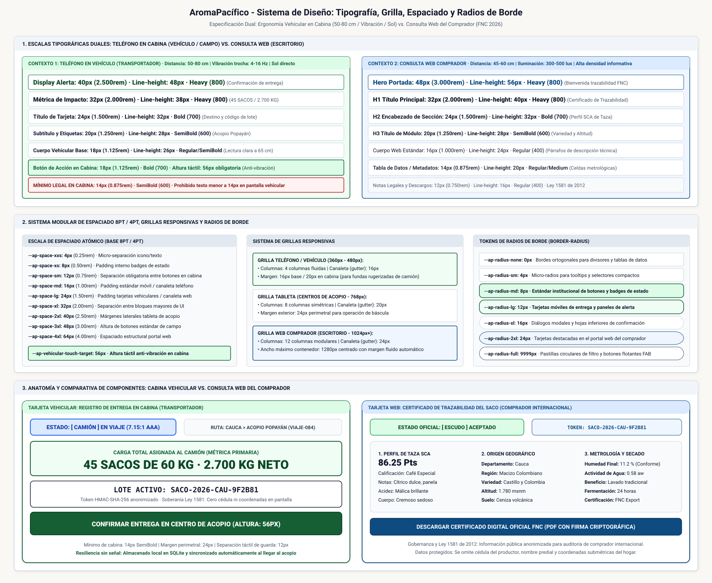

# Especificación Técnica de Tipografía, Grilla, Espaciado y Radios de Borde

## Sistema de Diseño AromaPacífico · Federación Nacional de Cafeteros (FNC 2026)

**Historia:** Como transportador, quiero leer la pantalla del teléfono en el vehículo sin acercarme, para registrar la entrega sin errores.  
**Issue:** #36 (Continuación y dependencia de #35)  
**Responsable:** Senior DevOps Engineer & Cloud Architect / UX Specialist AromaPacífico (FNC 2026)  
**Estado:** Especificado / Revisión estática; validación en campo pendiente
**Cajas de Arquitectura:** E6-05 (Saco, viaje y consulta), E6-07 (Sistema de diseño y costos)  
**Dependencia:** [F5-Diseno] Logo, isotipo y paleta con estados del saco y alerta de cultivo #35  
**Cobertura:** Punto 7 del Caso de Estudio (Sistema de Diseño de las Tres Aplicaciones)  

---

## 1. Resumen Ejecutivo y Marco Operativo

El presente documento formaliza el subsistema de escalas tipográficas, sistema modular de espaciado, grillas responsivas y radios de borde para la plataforma cafetera **AromaPacífico**, en el marco del piloto de modernización tecnológica 2026 para la Federación Nacional de Cafeteros (FNC).

El sistema propone dos escalas para contextos de uso distintos. **El transportador consulta y registra la entrega con el vehículo detenido en un lugar seguro; no se autoriza interacción durante la conducción ni las maniobras.**

Los rangos ambientales siguientes son supuestos de diseño, no mediciones del piloto:

1. **Teléfono del transportador en cabina y campo:**
   - Distancia supuesta de **50 cm a 80 cm**, con **65 cm** como referencia de evaluación.
   - El rango de vibración **4 Hz a 16 Hz** de la propuesta es una hipótesis no medida; no justifica usar la aplicación en marcha.
   - Iluminación supuesta de **5.000 a 15.000 lux en cabina**, con reflejos variables, pendiente de contraste con las condiciones reales.
   - Decisión táctil: altura mínima de acción principal de **56 px** y separación de **12 px**. Su efecto sobre los errores está pendiente de prueba.
2. **Consulta web del comprador internacional:**
   - Distancia supuesta de **45 cm a 60 cm** e iluminación interior de **300 a 500 lux**.
   - Consulta de origen a nivel municipal, variedad, humedad y temperatura de secado, peso y estado del saco mediante ratón o teclado. Los campos públicos se limitan a la matriz de seguridad citada en §8.2.

AromaPacífico define **dos escalas tipográficas diferenciadas**, un **sistema modular de espaciado de 8 px / 4 px**, grillas y radios reutilizables. Se conserva el formato JSON propio inspirado en DTCG, sin declarar conformidad (§10.2). Reducir errores es un objetivo de diseño, no un resultado medido.

---

## 2. Diagrama Oficial del Sistema de Diseño: Tipografía, Grilla y Espaciado

Las escalas comparativas, el sistema modular 8pt/4pt, las tres grillas, los radios y ejemplos ilustrativos de jerarquía se integran en el siguiente diagrama de referencia:



> Archivo fuente editable en formato Draw.io XML descomprimido disponible en: [`diagrams/diseno-tipografia-espaciado-grilla.drawio`](../architecture/diagrams/diseno-tipografia-espaciado-grilla.drawio).  
> Esquema ilustrativo, no una pantalla a escala ni evidencia de legibilidad. Los valores rotulados son la especificación; los tamaños de texto del lienzo son editoriales. La revisión estática se registra en §11.

---

## 3. Criterios de Legibilidad y Supuestos de Evaluación

### 3.1 Distancia de Cabina y Límites del Cálculo

El ángulo visual de un carácter depende de su altura física visible ($H$) y la distancia ($D$), en la misma unidad:

$$\theta = 2 \arctan\left(\frac{H}{2D}\right) \approx 3437.75 \times \frac{H}{D}\text{ arcmin}$$

Como ilustración matemática, para un ángulo supuesto de 20 arcmin y $D=650$ mm, $H=2D\tan(\theta/2)\approx3.78$ mm. Este ejemplo no establece un umbral normativo. No se equipara `font-size` con altura visible del glifo ni se fija una equivalencia física entre px CSS y milímetros: depende del dispositivo, escalado y fuente efectiva. Se retiran las atribuciones no verificadas a ISO 15008 / SAE J2364 y las estimaciones de ángulo por token. Los valores de **18 px** de cuerpo y **32 px** de métrica son decisiones a validar en campo con el vehículo detenido.

### 3.2 Mínimo Interno en Cabina (14 px)

Se establece como **decisión interna de diseño** un mínimo nominal de **14 px (`0.875rem`)**, con peso mínimo *SemiBold* (600) en cabina. No es un mínimo exigido por ley. El objetivo de contraste textual de 7:1 requiere comprobar cada combinación concreta y no certifica la legibilidad en campo.

Todas las conversiones de este documento y del CSS usan **1 rem = 16 px de referencia**: `rem = px / 16`. No se impone un tamaño raíz fijo; si el usuario cambia el tamaño base, cambian los píxeles efectivos. Los nombres 8pt/4pt son históricos: aquí significan **px CSS**, no puntos de impresión.

---

## 4. Especificación Técnica de las Escalas Tipográficas Duales

### 4.1 Pila de Fuentes Tipográficas (Font Family Stack)

Se decide usar fuentes disponibles localmente, sin `@import` ni `@font-face` remotos en estos artefactos:

1. **Familia Sans-Serif Principal (Interfaz General):**
   ```css
   --ap-font-sans: system-ui, -apple-system, 'Segoe UI', Roboto, Helvetica, Arial, sans-serif;
   ```
   - Utiliza la fuente nativa del sistema operativo (Roboto en Android, San Francisco en iOS, Segoe UI en Windows).
   - La fuente efectiva y la diferenciación de `1`, `I`, `l`, `0` y `O` dependen del sistema y deben verificarse en dispositivos reales.
2. **Familia Monoespaciada (Criptografía y Telemetría):**
   ```css
   --ap-font-mono: 'Fira Code', 'Roboto Mono', 'Cascadia Code', monospace;
   ```
   - Empleada exclusivamente para el identificador criptográfico del saco `SACO-2026-[DEPTO]-[HASH8]`, códigos de precinto de seguridad y matrices de pesaje en báscula.

### 4.2 Escala Tipográfica Vehicular / Campo (Teléfono del Transportador)

Escala discreta inspirada en **1.25 (Major Third)**, con ajustes manuales por rol; no es una progresión geométrica exacta. Los pesos robustos son una decisión de diseño pendiente de validación:

| Token de Escala | Tamaño (px / rem) | Altura de Línea (Line-Height) | Peso Tipográfico | Espaciado entre Letras (Tracking) | Rol y Aplicación en Cabina |
| --- | --- | --- | --- | --- | --- |
| `--ap-font-phone-display` | **40 px** / 2.500rem | 48 px (1.20) | Heavy (800) | -0.01em | Confirmación de entrega exitosa o aviso de alerta de detención en ruta. |
| `--ap-font-phone-metric` | **32 px** / 2.000rem | 38 px (1.19) | Heavy (800) | 0.00em | Métrica primaria: Número de sacos (`45 SACOS`) y peso bruto de báscula (`2.700 KG`). |
| `--ap-font-phone-title` | **24 px** / 1.500rem | 32 px (1.33) | Bold (700) | +0.01em | Identificador de lote, destino de viaje y título de tarjeta de despacho. |
| `--ap-font-phone-subtitle`| **20 px** / 1.250rem | 28 px (1.40) | SemiBold (600) | +0.01em | Subtítulos de módulo, nombre del acopio de destino y placa del camión. |
| `--ap-font-phone-body` | **18 px** / 1.125rem | 26 px (1.44) | SemiBold (600) | 0.00em | Cuerpo vehicular base: Instrucciones operativas y notas de entrega. |
| `--ap-font-phone-button` | **18 px** / 1.125rem | 24 px (1.33) | Bold (700) | +0.02em | Botones de acción en cabina (`REGISTRAR ENTREGA`, `CONFIRMAR CARGA`). |
| `--ap-font-phone-caption`| **14 px** / 0.875rem | 20 px (1.43) | SemiBold (600) | +0.02em | Mínimo interno en cabina: Marcas de tiempo UTC y sellos de trazabilidad. |

### 4.3 Escala Tipográfica Web (Consulta del Comprador Internacional)

Escala discreta inspirada en **1.20 (Minor Third)**, con ajustes manuales por rol; no es una progresión geométrica exacta. Los usos son orientativos y quedan sujetos a los permisos de §8:

| Token de Escala | Tamaño (px / rem) | Altura de Línea (Line-Height) | Peso Tipográfico | Espaciado entre Letras (Tracking) | Rol y Aplicación en Portal Web |
| --- | --- | --- | --- | --- | --- |
| `--ap-font-web-hero` | **48 px** / 3.000rem | 56 px (1.17) | Heavy (800) | -0.02em | Titular de bienvenida en portada del portal internacional de trazabilidad. |
| `--ap-font-web-h1` | **32 px** / 2.000rem | 40 px (1.25) | Heavy (800) | -0.01em | Título principal de certificado de lote y verificación de origen FNC. |
| `--ap-font-web-h2` | **24 px** / 1.500rem | 32 px (1.33) | Bold (700) | 0.00em | Encabezado de bloques de secado, origen y despacho. |
| `--ap-font-web-h3` | **20 px** / 1.250rem | 28 px (1.40) | SemiBold (600) | 0.00em | Títulos de tarjetas de variedad botánica (Castillo, Colombia) y municipio. |
| `--ap-font-web-h4` | **18 px** / 1.125rem | 24 px (1.33) | SemiBold (600) | 0.00em | Subtítulos de módulos de telemetría y metrología. |
| `--ap-font-web-body` | **16 px** / 1.000rem | 24 px (1.50) | Regular (400) | 0.00em | Cuerpo de texto base para descripciones de origen municipal y variedad. |
| `--ap-font-web-table` | **14 px** / 0.875rem | 20 px (1.43) | Regular (400) | 0.00em | Celdas de tabla de humedad, temperatura, peso y fechas. |
| `--ap-font-web-legal` | **12 px** / 0.750rem | 16 px (1.33) | Regular (400) | +0.01em | Descargos normativos de Ley 1581 de 2012 y marcas de certificación. |

---

## 5. Sistema Modular de Espaciado (Base 8pt / 4pt)

### 5.1 Racional del Sistema de Espaciado

El sistema de espaciado se estructura sobre un **módulo de 8 px (con submódulo de 4 px)** para mantener decisiones reutilizables de composición:

| Token de Espaciado | Valor en Píxeles | Valor en REM | Función y Propósito en el Sistema |
| --- | --- | --- | --- |
| `--ap-space-xxs` | **4 px** | 0.25rem | Micro-espaciado: Distancia interna entre iconos y texto en badges compactos. |
| `--ap-space-xs` | **8 px** | 0.50rem | Espaciado compacto: Relleno interno vertical de pastillas de estado y chips. |
| `--ap-space-sm` | **12 px** | 0.75rem | Zona de guarda obligatoria entre botones vehiculares para evitar toques falsos. |
| `--ap-space-md` | **16 px** | 1.00rem | Padding estándar de tarjetas móviles y canaleta (gutter) de grilla en teléfono. |
| `--ap-space-lg` | **24 px** | 1.50rem | Padding vehicular de tarjetas en cabina y canaleta de grilla de 12 columnas web. |
| `--ap-space-xl` | **32 px** | 2.00rem | Separación entre bloques temáticos mayores en aplicación móvil. |
| `--ap-space-2xl` | **40 px** | 2.50rem | Separación de paneles amplios; el margen de grilla de tableta es 24 px. |
| `--ap-space-3xl` | **48 px** | 3.00rem | Altura estándar de botones secundarios y separación de secciones web. |
| `--ap-space-4xl` | **64 px** | 4.00rem | Espaciado estructural entre módulos del portal internacional de consulta. |
| `--ap-space-5xl` | **80 px** | 5.00rem | Margen de pie de página institucional de la Federación. |

### 5.2 Tokens de Ergonomía Vehicular en Cabina

Decisiones para el registro con el vehículo detenido, sin porcentajes de éxito medidos:

1. **`--ap-vehicular-touch-target: 56px`:** Altura mínima del botón principal (`REGISTRAR ENTREGA`); se conserva el token general `--ap-touch-target-min: 48px` para otros contextos. Ambos son decisiones internas, no resultados de ensayo.
2. **`--ap-vehicular-touch-gap: 12px`:** Separación mínima entre acciones para reducir toques accidentales; efecto pendiente de prueba.
3. **`--ap-vehicular-card-padding: 24px`:** Relleno interior de tarjetas de despacho.
4. **`--ap-vehicular-screen-margin: 20px`:** Margen exterior para fundas y soportes; también corresponde a `--ap-grid-phone-vehicular-margin`.

---

## 6. Sistema de Grillas Responsivas

El sistema especifica tres grillas fluidas. Teléfono es la base hasta 767 px (incluido `sm`); tableta desde `md` (768 px) y web desde `lg` (1024 px). Los rangos citados son referencias, no límites de soporte. Los tokens de breakpoint documentan los umbrales; las variables CSS no se sustituyen directamente en condiciones `@media` nativas.

### 6.1 Grilla Teléfono / Vehículo (Referencia: 360 px a 480 px; hasta 767 px)

- **Número de columnas:** **4 columnas fluidas**.
- **Canaleta entre columnas (Gutter):** **16 px** (`--ap-space-md`).
- **Margen perimetral exterior:** **16 px** (en uso de mano) y **20 px** (en soporte vehicular de cabina).
- **Comportamiento estructural:** Los componentes vehiculares clave (tarjeta de entrega de sacos, métrica de peso y botón de acción) se distribuyen ocupando **el ancho completo de las 4 columnas (span 4)**, eliminando composiciones de dos columnas apretadas que confunden al conductor a 65 cm de distancia.

### 6.2 Grilla Tableta (Centros de Acopio en Báscula: 768 px a 1023 px)

- **Número de columnas:** **8 columnas simétricas**.
- **Canaleta entre columnas (Gutter):** **20 px**.
- **Margen perimetral exterior:** **24 px** (`--ap-space-lg`).
- **Comportamiento estructural:** Disposición de panel dual: **3 columnas** para la cola de camiones en espera de descarga y **5 columnas** para el detalle de pesaje y metrología del lote.

### 6.3 Grilla Web Comprador Internacional (Desktop: 1024 px a 1920 px)

- **Número de columnas:** **12 columnas modulares**.
- **Canaleta entre columnas (Gutter):** **24 px** (`--ap-space-lg`).
- **Ancho máximo de contenedor:** **1280 px** (`--ap-grid-web-max-width`), con centrado horizontal automático mediante `margin-inline: auto`.
- **Puntos de ruptura responsivos (Breakpoints):**
  - `sm`: **640 px** (Móvil horizontal).
  - `md`: **768 px** (Tableta de acopio).
  - `lg`: **1024 px** (Portátiles y pantallas medianas).
  - `xl`: **1280 px** (Escritorio estándar de alta resolución 1080p).
  - `2xl`: **1536 px** (Monitores ultra-anchos de comercializadoras portuarias).

---

## 7. Tokens de Radios de Borde (Border Radii)

AromaPacífico utiliza una estética sobria, industrial y funcional. Se evitan radios excesivamente redondeados que consumen espacio útil en pantallas vehiculares pequeñas:

| Token de Radio | Valor (px / rem) | Aplicación en la Interfaz | Racional Técnico |
| --- | --- | --- | --- |
| `--ap-radius-none` | **0 px** / 0rem | Divisores de fila, tablas de datos analíticos de catación y bordes de acople. | Ortogonalidad técnica para tablas tabulares densas. |
| `--ap-radius-sm` | **4 px** / 0.25rem | Tooltips informativos, selectores de fecha compactos y campos de tabla web. | Micro-redondeo que suaviza vértices sin perder rigidez visual. |
| `--ap-radius-md` | **8 px** / 0.50rem | **Estándar institucional:** Botones de cabina, campos de texto y badges de saco. | Preserva consistencia formal estricta con los componentes de #35. |
| `--ap-radius-lg` | **12 px** / 0.75rem | Tarjetas móviles de entrega, paneles de alerta fitosanitaria y fichas de viaje. | Enmarca visualmente el grupo de datos como unidad aislada. |
| `--ap-radius-xl` | **16 px** / 1.00rem | Diálogos modales y hojas inferiores (*bottom sheets*) de confirmación de despacho. | Acentúa la elevación sobre la superficie inferior. |
| `--ap-radius-2xl` | **24 px** / 1.50rem | Tarjetas destacadas en el portal web del comprador internacional. | Jerarquía visual moderna en pantallas de escritorio amplias. |
| `--ap-radius-full` | **9999 px** / 624.9375rem | Pastillas circulares de filtro, botones flotantes de acción (FAB) e indicadores. | Forma geométrica de píldora para elementos interactivos circulares. |

---

## 8. Gobernanza, Privacidad y Cumplimiento Normativo (Ley 1581 de 2012)

La tipografía y el espaciado no implementan autorización. Los ejemplos respetan la matriz de [seguridad de datos del saco, §5.1](../architecture/seguridad-datos-saco.md#51-matriz-de-acceso-por-atributo); la API debe aplicar sus permisos.

### 8.1 Pantalla del Transportador en Cabina (App Autenticada con Cognito)

- **Información del ejemplo operativo (18 px a 32 px):**
  - Identificador de viaje: `VIAJE-2026-CAU-084`.
  - Departamento y centro de acopio de destino: `Cauca > Acopio Popayán`.
  - Métrica de carga: `45 Sacos (2.700 kg)`.
  - Estado del lote: `EN VIAJE` (con doble codificación: azul `#1E40AF`, icono de camión).
  - Token del saco: `SACO-2026-CAU-7F3A9C12` (generado mediante `HMAC-SHA-256`).
- **Información terminantemente excluida de la interfaz de cabina:**
  - Cédula de ciudadanía o nombres del caficultor de origen.
  - Coordenadas GPS submétricas de la vivienda del productor.
  - Precio de liquidación o montos comerciales individuales.

### 8.2 Consulta Pública Web del Comprador

La lista pública autorizada se toma exclusivamente de `seguridad-datos-saco.md` §5.1: `codigo_saco`, `departamento_origen`, `municipio_origen`, `variedad_cafe`, `humedad_secado`, `temperatura_secado`, `fecha_cosecha_beneficio`, `peso_kg`, `estado_saco` y `fecha_entrega_puerto`.

Los diagramas usan solo un subconjunto de esos campos. No agregan puntajes SCA, altitud, suelo, actividad de agua, procesos de beneficio ni certificados descargables a la vista pública. Se excluyen identidad del productor y transportador, finca, coordenadas y georrutas. Los ejemplos son ilustrativos; no implementan las HU #37/#38.

### 8.3 Preferencia de Contraste

`@media (prefers-contrast: more)` expresa que **el usuario prefiere más contraste**; no detecta luz solar ni mide lux. Se conserva el bloque cromático de la HU #35 y se corrige únicamente su descripción. Referencia: [Media Queries Level 5, §12.3](https://www.w3.org/TR/mediaqueries-5/#prefers-contrast).

---

## 9. Análisis y Sustentación FinOps

### 9.1 Decisión de Costos

Se conserva la decisión de usar fuentes locales y tokens estáticos en el cliente. Así se evita introducir un servicio de renderizado o una licencia de fuentes como dependencia de este subsistema. No se ha medido tráfico, tamaño comprimido del bundle ni facturación de una aplicación desplegada. El uso sin conexión corresponde a la arquitectura de la aplicación y no queda implementado por estos tokens.

### 9.2 Alternativas Consideradas (Evaluación Cualitativa)

| Alternativa | Evaluación de diseño |
| --- | --- |
| Escala única para teléfono y web | Descartada: no diferencia jerarquías y densidad por contexto. |
| Servicio remoto de escalado / SaaS | Descartado: añade dependencia de red e integración; no hay proveedor ni cotización verificados. |
| Escalas duales y tokens locales | Adoptada: permite reutilizar decisiones sin depender de un servicio remoto de tipografía. |

### 9.3 Escenario Hipotético de Costo Evitado (No Medido)

Se conservan las cifras de la propuesta únicamente como **supuestos de simulación**, sin atribuir demoras o incidentes históricos al sistema de 2020:

| Concepto | Supuestos no verificados | Cálculo ilustrativo anual |
| --- | --- | --- |
| Ingeniería y licencias | Alternativa remota: 2.160 USD de licencias + 60 h × 40 USD/h = 4.560 USD. Tokens locales: 10 h × 45 USD/h = 450 USD. Las tarifas distintas son supuestas. | 4.560 − 450 = **4.110 USD** |
| Transporte | 60 camiones, 12 semanas, 1 h evitada por camión/semana, 22 USD/h. No hay mediciones de reducción de tiempos. | 60 × 12 × 1 × 22 = **15.840 USD** |
| Conciliaciones | 12 sacos equivalentes de pérdida evitable a 320 USD/saco. No hay evidencia de incidentes ni de que cada error equivalga a perder un saco. | 12 × 320 = **3.840 USD** |
| Total del escenario | Suma que supone beneficios independientes, sin doble conteo; no demuestra causalidad tipográfica. | 4.110 + 15.840 + 3.840 = **23.790 USD** |

No son ahorros realizados ni una previsión validada. Para evaluar beneficios hacen falta cotizaciones, costos laborales comparables, línea base y mediciones del piloto con el transportador detenido. Se retiran los tiempos de 15 minutos y menos de 20 segundos como resultados sin evidencia.


### 9.4 Tag Policy e Invariante de Budgets

Los artefactos y recursos asociados al sistema de diseño respetan estrictamente la política institucional:

- **Tag Policy de 7 etiquetas obligatorias:** `FincaID` (`GLOBAL`), `DronID` (`NO-APLICA`), `AcopioID` (`MULTICENTRO`), `ViajeID` (`NO-APLICA`), `Ambiente` (`desarrollo` / `pruebas` / `produccion`), `Propietario` (`devops-fnc`), `Proyecto` (`AromaPacifico`).
- **Invariante de AWS Budgets:** Las alertas de presupuesto emiten notificaciones vía Amazon SNS hacia el equipo de DevOps y arquitectura. Queda terminantemente prohibido que una alerta de presupuesto suspenda los servicios de ingesta, registro vehicular o consulta pública del saco.

---

## 10. Inventario de Entregables de Código y Tokens

Todos los artefactos cumplen con la nomenclatura del proyecto y se encuentran integrados en el repositorio:

1. **Especificación Técnica y Normativa:**
   - [`docs/design/tipografia-espaciado.md`](tipografia-espaciado.md) (El presente documento normativo).
2. **Diccionarios de Tokens en Formato Propio:**
   - [`docs/design/brand/tipografia.json`](brand/tipografia.json): Escalas duales completas (teléfono y web), pesos, alturas de línea y tracking.
   - [`docs/design/brand/espaciado-grilla.json`](brand/espaciado-grilla.json): Sistema modular 8pt/4pt, ergonomía vehicular (touch target 56px), grillas y radios.
   - [`docs/design/brand/tokens.json`](brand/tokens.json): Diccionario consolidado de la plataforma (colores, estados de saco, tipografía, espaciado, grillas y radios).
   - [`docs/design/brand/tokens.css`](brand/tokens.css): Hojas de variables CSS Custom Properties listas para consumo web y móvil híbrido.
3. **Diagramas Técnicos de Arquitectura:**
   - [`docs/architecture/diagrams/diseno-tipografia-espaciado-grilla.drawio`](../architecture/diagrams/diseno-tipografia-espaciado-grilla.drawio): Diagrama fuente editable XML UTF-8 descomprimido.
   - [`docs/architecture/diagrams/diseno-tipografia-espaciado-grilla.svg`](../architecture/diagrams/diseno-tipografia-espaciado-grilla.svg): Diagrama vectorial autónomo de publicación.


## 10.1 Fuente Principal y Correspondencia

Para la HU #36, **`brand/tipografia.json` y `brand/espaciado-grilla.json` son la fuente principal de valores**. Las tablas documentan su propósito; `tokens.json` y `tokens.css` son copias de consumo mantenidas manualmente. No hay generador ni sincronización automática. Ante una diferencia se revisa primero la fuente y luego se actualizan consolidado, CSS, tablas y ambos diagramas en el mismo cambio.

| Fuente específica (ruta JSON) | Ruta en `tokens.json` | Variable CSS |
| --- | --- | --- |
| `tipografia: fontFamily.<nombre>` | `typography.fontFamily.<nombre>` | `--ap-font-<nombre>` |
| `tipografia: fontWeight.<nombre>` | `typography.fontWeight.<nombre>` | `--ap-font-weight-<nombre>` |
| `tipografia: letterSpacing.<nombre>` | `typography.letterSpacing.<nombre>` | `--ap-letter-spacing-<nombre>` |
| `tipografia: <phone/web>.fontSize.<rol>` | `typography.<phone/web>.<rol>` | `--ap-font-<phone/web>-<rol>` |
| `tipografia: <phone/web>.lineHeight.<rol>` | `typography.lineHeight.<phone/web>.<rol>` | `--ap-line-<phone/web>-<rol>` |
| `tipografia: <phone/web>.fontWeight.<rol>` | `typography.weight.<phone/web>.<rol>` | `--ap-weight-<phone/web>-<rol>` |
| `tipografia: <phone/web>.letterSpacing.<rol>` | `typography.tracking.<phone/web>.<rol>` | `--ap-tracking-<phone/web>-<rol>` |
| `espaciado: spacing.base` | `spacing.base` | `--ap-space-base` |
| `espaciado: spacing.scale.<nombre>` | `spacing.<nombre>` | `--ap-space-<nombre>` |
| `espaciado: spacing.touch_target_min` | `spacing.touch_target_min` | `--ap-touch-target-min` |
| `espaciado: spacing.vehicular.touch_target_min` | `spacing.vehicular_touch` | `--ap-vehicular-touch-target` |
| `espaciado: spacing.vehicular.touch_gap_min` | `spacing.vehicular_gap` | `--ap-vehicular-touch-gap` |
| `espaciado: spacing.vehicular.card_padding/screen_margin` | `spacing.vehicular_card_padding/vehicular_screen_margin` | `--ap-vehicular-card-padding/screen-margin` |
| `espaciado: grid.<phone/tablet/web>.<propiedad>` | `grid.<phone/tablet/web>.<propiedad>` | `--ap-grid-<dispositivo>-<propiedad>` |
| `espaciado: grid.breakpoints.<nombre>` | `grid.breakpoints.<nombre>` | `--ap-breakpoint-<nombre>` |
| `espaciado: radius.<nombre>` | `radius.<nombre>` | `--ap-radius-<nombre>` |

En CSS, `maxWidth` se escribe `max-width` y `vehicular_margin`, `vehicular-margin`. Las familias conservan orden y nombres exactos (incluida `Cascadia Code`). Se conservan tamaños, alturas, espaciado, grilla y radios existentes. Se fija el cuerpo del teléfono en 600 y la tabla web en 400 para resolver las alternativas ambiguas de la propuesta. El peso genérico `medium` (500) sigue disponible. `heavy` es un nombre interno para 800, no un alias normativo DTCG.

El tracking por rol se copia explícitamente de las tablas; se añade `slight: 0.01em` al catálogo para título/subtítulo del teléfono y texto legal web. Las alturas de línea en px son el valor exacto; las razones entre paréntesis en las tablas son aproximaciones a dos decimales. Tamaños y alturas de línea se convierten a rem dividiendo por 16; espaciados de escala también. Grillas, ergonomía, breakpoints y radios conservan px en CSS; pesos y columnas no llevan unidad; tracking conserva em; margen web conserva `auto`. `40px` es un espaciado disponible, no el margen de tableta (24px). El margen exterior de cabina es 20px, distinto del padding de tarjeta de 24px y del gap de 12px.

## 10.2 Revisión del Formato frente a DTCG

Referencia consultada: [Design Tokens Format Module 2025.10](https://www.designtokens.org/tr/2025.10/format/), informe del Community Group; no es un estándar W3C. El formato de estos tres JSON **no es conforme a DTCG 2025.10**. Ser JSON válido no acredita conformidad ni interoperabilidad con importadores:

- §8.2 requiere dimensiones como objetos con número y unidad `px` o `rem`; aquí se conservan cadenas CSS como `14px` y `0.02em`. `em` no es una unidad de dimensión admitida en esa versión.
- §8.3 representa una familia como un nombre o un arreglo ordenado de nombres. Aquí las pilas son cadenas CSS separadas por comas.
- §8.4 requiere pesos numéricos o alias enumerados; aquí se conservan cadenas numéricas como `"600"`.
- `string` (usado para `auto`) no es un tipo definido por esa versión. Los metadatos propios tampoco siguen íntegramente la estructura de grupos del §6.1. Los colores heredados del consolidado mantienen su representación de la HU #35.

Se retira de estos tres archivos el `$schema` que apuntaba a una página de especificación, no a un JSON Schema. La migración a un formato DTCG requiere adaptación y validación de tipos y estructura; no se incluye en esta corrección mínima.

## 11. Alcance de la Verificación

La revisión estática comprueba JSON, correspondencia de valores entre fuentes/consolidado/CSS, conversiones con base 16, enlaces locales y coherencia de los rótulos de SVG/Draw.io. No equivale a ejecutar la aplicación ni a probar lectura o interacción bajo sol, vibración, zoom o fuentes de sustitución.

**Comprobaciones ejecutadas en esta revisión (2026-11-11):**

- Lectura con `json` de Python de los cinco JSON de `brand/`, con rechazo de claves duplicadas: válida. Esto no valida DTCG.
- Comparación de los 112 tokens de las fuentes de HU #36 con el consolidado y CSS: correspondencia completa de valores y tipos JSON, sin variables de ese ámbito sin correspondencia. Se compararon todos los valores de tokens previos contra `HEAD`: conservados.
- Verificación de los 15 roles tipográficos contra las tablas (tamaño, rem, altura de línea, razón aproximada, peso y tracking), más las conversiones de las tablas de espaciado y radios con base 16: correctas.
- Resolución de los 10 enlaces locales del documento, incluida el ancla de seguridad: destinos existentes. Las dos referencias externas se consultaron en las publicaciones oficiales DTCG y CSSWG citadas.
- Parseo XML de SVG y Draw.io; cotejo de los 15 roles, 10 espaciados, radios, conversiones px/rem y márgenes en ambos; revisión de límites y separación de filas en los paneles Draw.io afectados: consistente. Revisión de campos públicos y formato HASH8 de los ejemplos: consistente con seguridad §5.1.
- Comparación de colores y estados del consolidado y del bloque CSS `prefers-contrast` contra `HEAD`: intactos. Comprobación aritmética del escenario hipotético y del ejemplo angular: correcta, sin demostrar beneficios reales.
- `git diff --check`: sin errores de whitespace.

**Pendiente de validación real:** lectura de códigos y cantidades a 50–80 cm, reflejos y brillo en dispositivos del piloto, distinción de glifos, escalado de texto y errores de toque. Las sesiones deben realizarse con el vehículo detenido y registrar dispositivos, condiciones, participantes y resultados. No se afirma legibilidad garantizada, cero errores ni ahorros medidos.
