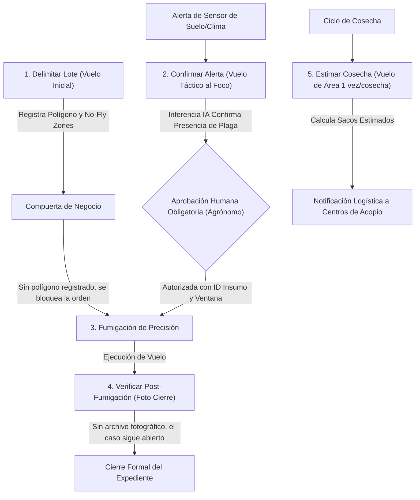

# Fuente de Verdad del Proyecto (Single Source of Truth)

## Reto FNC 2026: Actualización de la Plataforma Cafetera "AromaPacífico"

---

## 1. Visión General y Contexto Histórico

### 1.1 Antecedentes y Ruptura Tecnológica (2020 vs. 2026)

En el año 2020 se formuló un diseño inicial de trazabilidad del grano de café con cobertura geográfica en los departamentos de **Cauca, Huila y Tolima**, contemplando desde la finca hasta la entrega marítima en el **Puerto de Buenaventura**. Dicha arquitectura **nunca fue desplegada en producción** debido a fallas estructurales de concepción:

1. **Falacia de conectividad:** Se asumió erróneamente cobertura de red celular ubicua y continua en las fincas cafeteras, proponiendo un modelo de telemetría sincrónica directa al punto de ingesta.
2. **Silos en la cadena logística:** Los centros de acopio departamentales y el puerto de Buenaventura quedaron aislados sin diseño de red local (LAN) ni enlaces WAN hacia la nube.
3. **Obsolescencia espectral:** La industria de telecomunicaciones en Colombia inició el apagado gradual de las redes móviles de segunda y tercera generación (**2G y 3G**). El diseño 2020 dependía de infraestructura que hoy se encuentra apagada o en proceso terminal de retiro.
4. **Desactualización económica:** Los presupuestos de hardware, sensores, gateways y servicios de nube formulados en 2020 perdieron vigencia comercial.

En **2026**, la Federación Nacional de Cafeteros (FNC) reactiva el proyecto con un enfoque de ingeniería moderno:

- Se conservan intactos los requerimientos funcionales del negocio y el alcance geográfico.
- Se reemplazan los supuestos de conectividad por una arquitectura de **Cero Confianza en la Red (Offline-First / Store-and-Forward)**.
- Se adoptan tecnologías celulares vigentes de bajo consumo (LTE Cat-M1, NB-IoT) y enlaces de alta resiliencia.
- Se establece una disciplina rigurosa de **FinOps, Cero Confianza (Zero Trust) y DevOps** bajo un timebox estricto de implementación.

---

## 2. Capacidades Nucleares del Sistema

El piloto debe satisfacer cinco capacidades operativas fundamentales:

1. **Monitoreo Continuo de Cultivo y Secado:** Supervisión telemática de variables agronómicas y térmicas con generación y entrega de alertas al caficultor.
2. **Registro de Cosecha y Empaque:** Control digital de pesaje y trazabilidad de sacos estándar de **60 kg** desde la salida del beneficiadero.
3. **Seguimiento Logístico Multimodal:** Rastreabilidad satelital en carretera durante el tránsito Finca $\rightarrow$ Centro de Acopio Departamental $\rightarrow$ Puerto de Buenaventura.
4. **Consulta Unificada por Código de Saco:** Acceso segmentado y seguro para tres perfiles: caficultor, operario de acopio y comprador internacional.
5. **Servicio Integrado de Drones Agrícolas:** Plataforma de gestión de órdenes de vuelo para delimitación, confirmación de foco, fumigación de precisión, verificación post-aplicación y estimación de rendimiento de cosecha.

---

## 3. Aplicaciones Previstas y Consumidores del Software

> [!NOTE]
> **Delimitación de Alcance:** Quien presenta la infraestructura **no programa las aplicaciones móviles ni web**, pero debe aprovisionar y exponer la arquitectura de servicios, endpoints seguros, modelos de datos y mecanismos de autenticación donde vivirán:

| Aplicación                           | Usuario Principal                   | Canal / Dispositivo                          | Rol Arquitectónico                                                                                                                          |
| :----------------------------------- | :---------------------------------- | :------------------------------------------- | :------------------------------------------------------------------------------------------------------------------------------------------ |
| **App del Caficultor**               | Productor cafetero                  | Smartphone Android/iOS (datos intermitentes) | Visualización de alertas de cultivo/secado, registro de sacos de 60 kg en finca, interfaz simplificada de pocas pantallas y alto contraste. |
| **App del Transportador**            | Conductor de carga                  | Smartphone Android/iOS en vehículo           | Emisión telemática de geolocalización cada 5 min con persistencia local en ruta montañosa.                                                  |
| **Consulta Web y Lectura de Código** | Comprador internacional y auditores | Navegador Web Desktop / Móvil                | Portal de alta disponibilidad para auditoría del grano; aplica enmascaramiento estricto de PII y cédula del agricultor.                     |

---

## 4. Guía Visual de Arquitectura y Flujos

Para facilitar la comprensión visual de la ingeniería implementada, a continuación se presentan los diagramas de arquitectura de referencia y ciclo de vida de los datos generados para el proyecto:

### 4.1 Diagrama de Arquitectura Cloud & IoT


### 4.2 Diagrama de Flujo de Datos y Ciclos de Vida


---

## 5. Parámetros Métricos, Cifras de Carga y Frecuencias del Piloto

```
┌───────────────────────────────────────────────────────────────────────────────────────┐
│                             MÉTRICAS OFICIALES DE INGESTA                             │
├─────────────────────────┬────────────────────────────┬────────────────────────────────┤
│ Dimensión Operativa     │ Parámetros del Documento   │ Ingesta Diaria Resultante      │
├─────────────────────────┼────────────────────────────┼────────────────────────────────┤
│ Fincas del Piloto       │ 200 fincas (Cauca, Huila,  │ 1.200 transacciones/día        │
│ - Telemetría Cultivo    │ Tolima). Muestreo cada 4h  │ (6 lecturas/día × 200 fincas)  │
│                         │ (NPK, humedad, temp suelo) │                                │
├─────────────────────────┼────────────────────────────┼────────────────────────────────┤
│ Fincas en Secado Activo │ ~100 fincas en cosecha.    │ 2.400 transacciones/día        │
│ - Telemetría Secadero   │ Muestreo cada 1h           │ (24 lecturas/día × 100 fincas) │
│                         │ (Temp y humedad del grano) │                                │
├─────────────────────────┼────────────────────────────┼────────────────────────────────┤
│ Flota de Transporte     │ 60 transportadores.        │ 7.200 posiciones/día           │
│ - Telemetría en Ruta    │ Muestreo cada 5 minutos    │ (120 pings/día × 60 vehículos) │
│                         │ en jornadas de 10 horas    │                                │
├─────────────────────────┼────────────────────────────┼────────────────────────────────┤
│ Centros de Acopio       │ 3 centros (1 por dpto).    │ Hasta 1.200 sacos recibidos/día│
│ - Recepción de Sacos    │ Hasta 400 sacos/día/centro │ en pico de cosecha             │
├─────────────────────────┼────────────────────────────┼────────────────────────────────┤
│ Consulta Web Pública    │ Compradores y auditorías   │ Picos de 30 lecturas/minuto    │
│ - Carga Pico            │ en temporada alta          │ (0,5 TPS sostenido)            │
├─────────────────────────┼────────────────────────────┼────────────────────────────────┤
│ Retención Obligatoria   │ Historial de sacos, fotos, │ 5 años (1.825 días)            │
│ - Ciclo de Vida Datos   │ telemetría y vuelos        │ Encriptado en reposo           │
└─────────────────────────┴────────────────────────────┴────────────────────────────────┘
```

### 5.1 Umbrales Agronómicos y Criterios de Disparo

| Variable                              | Segmento | Rango Normal / Recomendado                    | Condición de Alerta Crítica                                    |
| :------------------------------------ | :------- | :-------------------------------------------- | :------------------------------------------------------------- |
| **pH Suelo**                          | Cultivo  | $4,9 - 5,6$ (Rango de seguridad: $4,5 - 6,0$) | Menor a $4,5$ o mayor a $6,0$                                  |
| **Humedad Suelo/Aire**                | Cultivo  | $50\% - 70\%$                                 | Fuera del intervalo $[40\% - 80\%]$                            |
| **Temperatura Suelo/Aire**            | Cultivo  | $17^\circ\text{C} - 23^\circ\text{C}$         | Menor a $14^\circ\text{C}$ o mayor a $30^\circ\text{C}$        |
| **NPK (Nitrógeno, Fósforo, Potasio)** | Cultivo  | Definido por la FNC según variedad de café    | Desviación fuera del rango federativo                          |
| **Humedad del Grano**                 | Secado   | Disminución progresiva                        | **Cierre formal del lote cerca del $12\%$**                    |
| **Temperatura del Grano**             | Secado   | Ambiente controlado                           | **Alerta inmediata si el grano supera los $40^\circ\text{C}$** |

- **SLA de Notificación de Alerta:** Menos de **5 minutos** desde la lectura anómala cuando el dispositivo cuenta con ruta de subida disponible. En fincas sin señal, la alerta se despacha inmediatamente al drenar el buffer local dentro de su ventana de **24 horas**.

---

## 6. Subsistema de Drones y Servicios Agrícolas

La plataforma gestiona un **servicio aeronáutico estructurado**, prohibiendo vuelos informales o recreativos. Se contemplan **cinco servicios mandatorios y no sustituibles**:



### 6.1 Reglas Críticas del Subsistema de Drones

- **Modo de Operación Arquitectónico:** Modo Combinado. _Agricultura de áreas_ para el polígono inicial y la estimación volumétrica; _agricultura de precisión_ para confirmación puntual del foco y aspersión.
- **Zonas de Exclusión Aérea (No-Fly Zones):** Casas, beneficiaderos, vías públicas y fuentes hídricas. Estas geometrías deben estar persistidas en la plataforma antes del despegue.
- **Preposicionamiento Offline de Misiones:** Las misiones de vuelo se cargan en la cabecera municipal o en el centro de acopio. Si se pierde el enlace en el lote, el dron ejecuta la misión almacenada y persiste los logs en su buffer interno.
- **Condición de Cierre:** El estado de la orden de fumigación no pasa a `Cerrado` hasta persistir el registro de vuelo y la evidencia fotográfica de verificación.
- **Principio Inquebrantable de Cero Confianza:** **Ningún disparador automatizado ni modelo de IA puede autorizar una orden de fumigación**. La autorización es atribuible exclusivamente a una identidad humana registrada con rol de operador/agrónomo.

---

## 7. Los Siete Pilares del Reto de Ingeniería

### Pilar 1: Gobierno y Landing Zone

- **Estructura Multicuenta:** Segregación formal de ambientes en cuentas/suscripciones aisladas: `Seguridad y Auditoría`, `Conectividad y Red`, `Producción`, `Pruebas / Staging`.
- **Taxonomía de Tags FinOps Obligatoria:** `FincaID`, `DronID`, `AcopioID`, `ViajeID`, `Ambiente`, `Propietario`. Políticas SCP/Azure Policy que deniegan aprovisionamiento de recursos sin etiquetado.
- **Trazabilidad y Auditoría Forense:** Registro inmutable (WORM) de:
  - Consulta de sacos por código.
  - Modificación de umbrales agronómicos federativos.
  - Eventos de ingesta de telemetría.
  - Carga de telemetría de drones y ortomosaicos.
- **Matriz de Baja Arquitectónica 2020:** Registro explícito en el documento de arquitectura de los componentes retirados y los modernizados.

### Pilar 2: Seguridad y Protección de Datos

- **Mínimo Privilegio (RBAC) para 6 Identidades:**
  1. _Caficultor:_ Solo lectura/escritura sobre sus fincas, lotes y sacos.
  2. _Transportador:_ Actualización de telemetría GPS y confirmación de custodia.
  3. _Operario de Acopio:_ Recepción, pesado, cambio de estado de sacos e impresión de etiquetas.
  4. _Operador de Drones:_ Descarga de órdenes pre-aprobadas y carga de logs/imágenes.
  5. _Comprador Internacional:_ Lectura pública anonimizada de atributos de calidad del saco.
  6. _Operador de Plataforma:_ Administración de infraestructura, despliegues y observabilidad.
- **MFA Obligatorio:** Operarios de Acopio, Operadores de Drones y Operadores de Plataforma.
- **Criptografía:** TLS 1.3 en tránsito y AES-256 (KMS) en reposo. Prohibida la ingesta en texto claro.
- **Anonimización del Saco y Cumplimiento Legal (Habeas Data):**
  - El identificador del saco **no expone la cédula del caficultor ni la traza logística completa al comprador**.
  - El comprador visualiza: origen geográfico, fechas de proceso, estado de recepción y variables térmicas de secado.
  - El centro de acopio solo visualiza el viaje en curso.
- **Revocación de Dispositivos (Decommissioning):** Ante la pérdida o sustracción de un nodo sensor o dron, se revoca inmediatamente su certificado X.509/credencial IAM, cortando de raíz la publicación de datos.

### Pilar 3: Red y Conectividad Híbrida

#### Centros de Acopio (Direccionamiento Privado On-Premises)

Se reserva el bloque de red privado con cambio en el segundo octeto:

- **Cauca:** `10.41.0.0/16`
- **Huila:** `10.42.0.0/16`
- **Tolima:** `10.43.0.0/16`

| Subred Reservada | Nombre de Zona / VLAN | Clientes Previstos  | Reglas de Enrutamiento y Seguridad                                            |
| :--------------- | :-------------------- | :------------------ | :---------------------------------------------------------------------------- |
| `10.X.1.0/24`    | Gerencia              | 2 PCs, 5 móviles    | Acceso WAN, acceso a servidores locales.                                      |
| `10.X.2.0/24`    | Soporte               | 2 PCs, 5 móviles    | Acceso WAN, gestión de red y soporte.                                         |
| `10.X.3.0/24`    | Logística             | 2 PCs, 20 móviles   | Recepción de sacos, escáneres e impresoras.                                   |
| `10.X.4.0/24`    | Transporte (Patio)    | 20 teléfonos        | Cobertura WiFi en patio de maniobras; acceso a API de entrega.                |
| `10.X.5.0/24`    | Visitantes            | 10 teléfonos        | **Aislada totalmente; prohibido el enrutamiento hacia Logística o Gerencia**. |
| `10.X.10.0/24`   | Servidores Locales    | Por diseñar         | Servidores de impresión de etiquetas, controlador de red y cache local.       |
| `10.X.20.0/24`   | Enlace / Borde        | Firewall del centro | Borde de conexión WAN y terminación de túnel IPsec VPN hacia la nube.         |

- **Políticas WiFi y QoS:** SSIDs diferenciados por zona. QoS de referencia: **2 Mbps de bajada y 0,5 Mbps de subida** por cliente activo, con filtrado perimetral de tráfico no operativo.
- **WAN de Centros:** 100 Mbps simétricos compartidos.
- **Direccionamiento Cloud (VPC/VNet):**
  - Debe evitar cualquier solapamiento con los rangos `10.41.0.0/16`, `10.42.0.0/16` y `10.43.0.0/16`.
  - Subredes mínimas en nube: Ingesta de Telemetría, Ingesta de Drones, Capa de Aplicación, Capa de Datos, Object Storage Endpoints, Subred de Administración y Consulta Pública.
  - Rangos CIDR no solapados entre Desarrollo, Pruebas y Producción.
- **Rutas de Datos (Data Paths) Desacopladas:** Rutas independientes para telemetría de finca, GPS de transportadores y paquetes multimedia de drones.

### Pilar 4: Automatización, CI/CD y Gestión del Cambio

- **Infraestructura como Código (IaC):** Modular, reproducible y declarativa. Estado remoto cifrado con bloqueo de concurrencia. Parámetros y secretos fuera del repositorio de Git y fuera del archivo de estado (`.tfstate`).
- **Módulo Patrón:** Se entrega el módulo parametrizado y reutilizable de **una finca patrón**, no las 200 instanciadas individualmente.
- **Ambientes Segregados:** Flujo de promoción controlada Dev $\rightarrow$ Test $\rightarrow$ Prod con gates de aprobación manual para el entorno productivo.
- **Change Freeze en Cosecha:** **Prohibido realizar cambios productivos entre las 05:00 y las 18:00 horas durante semanas de cosecha**, salvo gestión de incidentes graves.
- **Release Notes:** Documentación obligatoria mediante plantillas formales para aplicación e infraestructura (ventana, impacto, aprobación, notificación a la FNC y procedimiento de rollback).

### Pilar 5: Cargas de Trabajo e Inferencia Serverless / IA

- **Computación Serverless Orientada a Eventos:** Cero cómputo ocioso en espera de datos. Procesamiento mediante funciones efímeras (AWS Lambda, Azure Functions o GCP Cloud Functions).
- **Almacenamiento Políglota Especializado:**
  - _Base Transaccional / Series de Tiempo:_ Telemetría de cultivo, secado y GPS de transporte.
  - _Object Storage:_ Fotos, ortomosaicos, geometrías GeoJSON y bitácoras de vuelo.
  - _Base Transaccional ACID:_ Órdenes de fumigación y ciclo de vida de los sacos.
- **Los Cuatro Disparadores (Triggers) de Función:**
  1. _Objeto de Confirmación:_ Invoca visión artificial administrada y persiste si el foco de roya/plaga es positivo en el expediente. No autoriza fumigación.
  2. _Objeto de Verificación:_ Evalúa la imagen post-tratamiento; persiste si el caso puede cerrarse.
  3. _Objeto de Estimación:_ Procesa el vuelo de área y calcula el estimado de sacos esperados para el acopio. No genera empaque.
  4. _Lote de Telemetría:_ Evalúa lecturas contra umbrales dinámicos y marca desviaciones.
- **Resiliencia y Manejo de Errores:** Reintentos con retroceso exponencial, Dead-Letter Queues (DLQ) para eventos fallidos y alarmas de monitoreo. Si la función falla, el archivo original permanece intacto y el estado de negocio no muta.
- **Inferencia Administrada y Consideraciones Éticas:**
  - Sin entrenamiento de modelos propios; uso de servicios de visión gestionados (AWS Rekognition, Azure AI Vision, Google Cloud Vision).
  - **Tratamiento Ético de Imágenes:** Si una imagen contiene personas, **se bloquea de inmediato su envío al motor de inferencia agronómica** y se rige por el protocolo de protección de datos personales.

### Pilar 6: Observabilidad Integral y Confiabilidad (SRE)

- **Supervisión Multi-Capa:** Métricas, logs y trazas distribuidas para ingesta IoT, API Gateway, bases de datos, los tres enlaces WAN de acopios y el flujo de objetos de drones.
- **Alertas de Degradación:** Detección automática de:
  - Fincas sin telemetría por más de 24 horas.
  - Alertas agronómicas no entregadas.
  - Vuelos de drones sin bitácora persistida o fumigaciones sin verificación.
- **SLOs y SLIs Comprometidos:**
  - **SLO 1 (Alerta de Cultivo):** Entrega de la alerta en menos de **5 minutos** desde la lectura anómala cuando hay red disponible (o al drenar el buffer dentro de las 24 horas).
  - **SLO 2 (Consulta Pública del Saco):** **99,9% de disponibilidad mensual**, con **RPO de 15 minutos** para eventos de saco y **RTO de 4 horas** ante contingencia mayor.
- **Tableros de Mando:** Tablero Operativo de infraestructura y Tablero FinOps particionado por etiquetas de fincas, drones, acopios y ambientes.

### Pilar 7: Sistema de Diseño y Accesibilidad en Campo

- **Identidad Propia:** Guía de estilos exclusiva para la plataforma cafetera (isotipo, paleta funcional y tipografía).
- **Paleta Cromática Semántica:**
  - Primarios, secundarios y neutros.
  - Estados del Saco: _En preparación_, _En viaje al acopio_, _En acopio (aceptado/rechazado)_, _En viaje al puerto_, _Entregado en puerto (aceptado/rechazado)_.
  - Alerta de Cultivo: Contraste cromático de alta visibilidad.
- **Diseño para Campo:** Componentes de alto contraste optimizados para visibilidad bajo luz solar directa, iconografía descriptiva sin tecnicismos y vista de comprador limpia de datos irrelevantes.

---

## 8. Estructura de Épicas del Proyecto

| Épica | Nombre                          | Alcance y Frontera de Trabajo                                                                                          |  ¿Entra en las 100 Horas?   |
| :---: | :------------------------------ | :--------------------------------------------------------------------------------------------------------------------- | :-------------------------: |
| **1** | Base de la plataforma           | Diseño de Landing Zone, jerarquía de cuentas, etiquetas FinOps y matriz de retiro 2020.                                | **No** (Diseño conceptual)  |
| **2** | Red y firewall                  | Diseño de segmentación LAN en acopios (10.41/42/43), políticas de firewall y VPCs cloud.                               | **No** (Diseño conceptual)  |
| **3** | Ingesta del cultivo             | Especificación de telemetría, umbrales dinámicos y buffer Store-and-Forward de 24 horas.                               | **No** (Diseño conceptual)  |
| **4** | Drones                          | Diseño de los 5 servicios aeronáuticos, precarga de misiones y máquina de estados.                                     | **No** (Diseño conceptual)  |
| **5** | Saco, viaje y consulta          | Especificación de eventos del saco, RPO 15 min, RTO 4 horas y vista anonimizada.                                       | **No** (Diseño conceptual)  |
| **6** | **Infraestructura como código** | **Implementación en código (IaC): red, seguridad, módulo de ingesta O consulta, 1 función patrón, CI/CD y variables.** | **SÍ (ÚNICA ÉPICA MEDIDA)** |
| **7** | Costo y sistema de diseño       | Modelo FinOps detallado (normal vs cosecha, hardware finca, drones) y lámina del Design System.                        | **No** (Entrega documental) |

### 8.1 Frontera Estricta de la Épica 6 (Límite: 100 Horas / 2 Semanas)

La Épica 6 es la **única evaluada en el código fuente ejecutable**. Su alcance cubre exclusivamente:

1. Módulo de red del ambiente (subredes cloud, rutas y asociación lógica con el centro de acopio).
2. Módulo de seguridad (identidades de plataforma, cifrado KMS y reglas permanentes de firewall).
3. Módulo de ingesta **O** módulo de consulta de saco (se elige uno como patrón representativo).
4. Patrón de **una sola función serverless** (disparador, IAM de lectura de objeto, IAM de escritura en BD e IAM de invocación a la API de inferencia). Las restantes tres funciones se diseñan conceptualmente en la arquitectura pero **no se codifican**.
5. Variables de entorno para Dev/Prod y pipeline de CI/CD que genera el plan de ejecución y exige aprobación manual para desplegar en producción.

---

## 9. Tareas de la Entrega y Criterios de Evaluación

### Entregables del Reto

1. **Documento de Arquitectura:** Desarrollo detallado de los 7 puntos del reto y diagramas completos.
2. **Plan de 100 Horas:** Cronograma WBS detallado de la Épica 6 con dependencias, responsable y horas estimadas (suma máxima: 100 horas y 2 semanas).
3. **Repositorio de Infraestructura como Código:** Código modular en Terraform/OpenTofu validado y capaz de generar un plan de ejecución sin errores.
4. **Dossier de Costos FinOps y Sistema de Diseño:** Estimación presupuestal a precios 2026 y lámina visual de componentes.
5. **Sustentación Técnica:** Defensa de 20 minutos ante el arquitecto de la FNC sustentando la conectividad resiliente, la gobernanza de drones y la viabilidad del timebox de 100 horas.

### Ocho Criterios de Éxito de la FNC

1. **Estrategia coherente:** Fincas sin cable, inversión moderada y consulta pública limitada y segura.
2. **Conectividad cerrada:** Comportamiento ante desconexión resuelto para finca, dron, transportador, acopio y puerto.
3. **Viabilidad técnica y métrica:** Coherencia con las cifras del caso, modo de vuelo defendible y IaC estricto en $\le 100$ horas.
4. **Automatización y gestión del cambio:** Correspondencia código-diagrama y plantillas formales de release notes y rollback.
5. **Seguridad y Cero Confianza:** Identidades segregadas, cifrado de extremo a extremo, firewall perimetral y protección de PII.
6. **Costo actual (FinOps):** Supuestos transparentes, costos de hardware, drones, inferencia y al menos tres decisiones explícitas de optimización de gasto.
7. **Sistema de diseño adaptado:** Consistencia ergonómica y visual para caficultor, transportador y comprador web.
8. **Claridad en la sustentación oral:** Dominio técnico y defensa argumentada de los compromisos de ingeniería.
