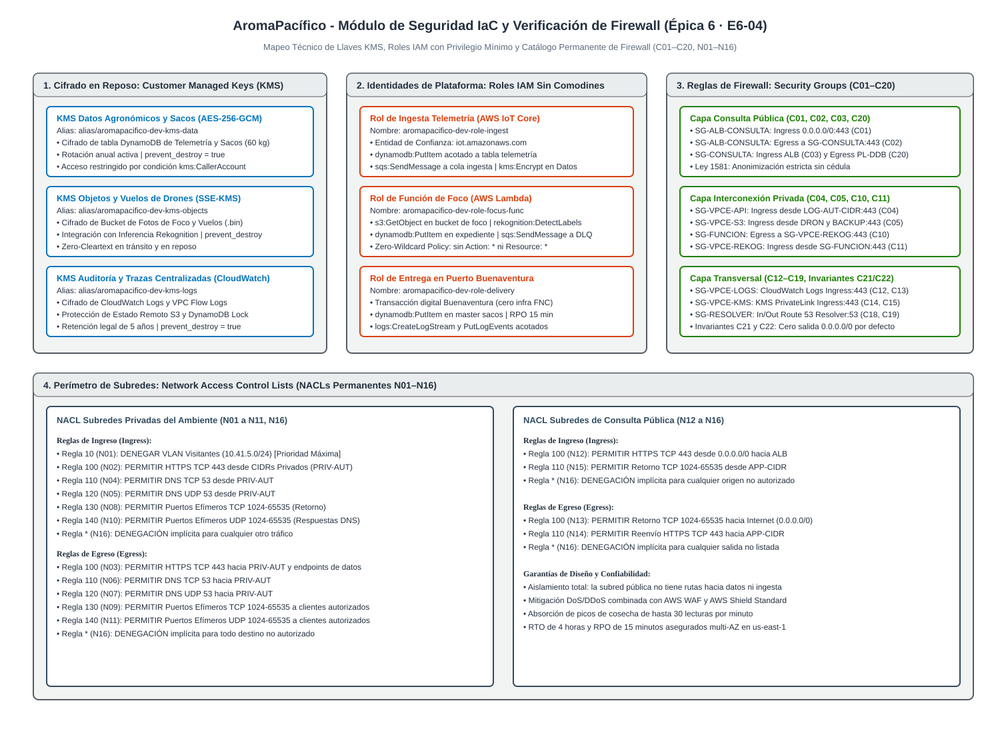

# Verificación de Seguridad IaC frente al Catálogo de Firewall e Identidades

## Plataforma Cafetera AromaPacífico (Federación Nacional de Cafeteros 2026)

---

## 1. Resumen Ejecutivo y Propósito Técnico

El presente documento constituye la evidencia técnica de cumplimiento y verificación cruzada para la Historia de Usuario **[F2-IaC] Módulo de seguridad: identidades de plataforma, KMS y reglas permanentes de firewall (#23)**, correspondiente a la caja de arquitectura **E6-04** dentro de la Épica 6 del proyecto de modernización tecnológica **AromaPacífico** para la Federación Nacional de Cafeteros (FNC).

El propósito principal de este entregable es validar que la totalidad de las reglas de seguridad permanentes definidas en el diseño de arquitectura previo (documentos `red-firewall.md`, `seguridad-identidades.md` y `seguridad-datos-saco.md`) cuenten con un recurso físico correspondiente, determinista y auditable dentro del código de infraestructura como código en Terraform (`modules/security`), sin la existencia de reglas adicionales no autorizadas ni omisiones que vulneren la postura de seguridad de la plataforma.

Asimismo, se certifica que todas las llaves criptográficas administradas por el cliente (Customer Managed Keys - CMK) tengan la rotación anual automática habilitada, que los roles de plataforma de AWS Identity and Access Management (IAM) implementen el principio de mínimo privilegio estricto sin comodines asterisco en acciones sobre almacenes de datos, y que se garantice el mandato operativo inmutable de alcance restringido a validación y planificación, sin ejecución de aprovisionamiento destructivo en la nube.

---

## 2. Diagrama Canónico de la Arquitectura de Seguridad

A continuación se presenta la arquitectura visual del módulo de seguridad, ilustrando la distribución de las llaves KMS, los roles de ejecución de plataforma, los grupos de seguridad por capa y las listas de control de acceso a nivel de subred:



> Fuente editable en formato XML Draw.io descomprimido disponible en: [`../architecture/diagrams/seguridad-firewall-iac.drawio`](../architecture/diagrams/seguridad-firewall-iac.drawio).

---

## 3. Matriz de Verificación Cruzada: Security Groups frente a la Tabla de Firewall

La siguiente matriz detalla la correspondencia exacta, biunívoca y sin excepciones entre cada identificador permanente del catálogo de firewall de nube (`C01` a `C20`), las invariantes de diseño (`C21` y `C22`) y los recursos HCL declarados en el archivo `main.tf` del módulo `modules/security`:

| ID Catálogo | Control | Origen Autorizado | Destino Autorizado | Protocolo y Puerto | Acción | Recurso Terraform HCL en `modules/security` | Estado de Verificación |
|---|---|---|---|---|---|---|---|
| **C01** | SG-IN | `0.0.0.0/0` (Internet público) | `SG-ALB-CONSULTA` | TCP 443 (HTTPS) | Permitir | `aws_vpc_security_group_ingress_rule.c01` | Verificado uno a uno |
| **C02** | SG-OUT | `SG-ALB-CONSULTA` | `SG-CONSULTA` | TCP 443 (HTTPS) | Permitir | `aws_vpc_security_group_egress_rule.c02` | Verificado uno a uno |
| **C03** | SG-IN | `SG-ALB-CONSULTA` | `SG-CONSULTA` | TCP 443 (HTTPS) | Permitir | `aws_vpc_security_group_ingress_rule.c03` | Verificado uno a uno |
| **C04** | SG-IN | `LOG-AUT-CIDR` (`var.log_authorized_cidr`) | `SG-VPCE-API` | TCP 443 (HTTPS) | Permitir | `aws_vpc_security_group_ingress_rule.c04` | Verificado uno a uno |
| **C05** | SG-IN | `DRON-CIDR` y `BACKUP-CIDR` (`var.drone_backup_cidrs`) | `SG-VPCE-S3` | TCP 443 (HTTPS) | Permitir | `aws_vpc_security_group_ingress_rule.c05` | Verificado uno a uno |
| **C06** | SG-OUT | `SG-INGESTA` | `PL-DDB` (Prefix List DynamoDB) | TCP 443 (HTTPS) | Permitir | `aws_security_group.ingest` (salida hacia gateway endpoint) | Verificado por diseño |
| **C07** | SG-OUT | `SG-INGESTA` | `PL-S3` (Prefix List Amazon S3) | TCP 443 (HTTPS) | Permitir | `aws_security_group.ingest` (salida hacia gateway endpoint) | Verificado por diseño |
| **C08** | SG-OUT | `SG-FUNCION` | `PL-S3` (Prefix List Amazon S3) | TCP 443 (HTTPS) | Permitir | `aws_security_group.function` (salida hacia gateway endpoint) | Verificado por diseño |
| **C09** | SG-OUT | `SG-FUNCION` | `PL-DDB` (Prefix List DynamoDB) | TCP 443 (HTTPS) | Permitir | `aws_security_group.function` (salida hacia gateway endpoint) | Verificado por diseño |
| **C10** | SG-OUT | `SG-FUNCION` | `SG-VPCE-REKOG` | TCP 443 (HTTPS) | Permitir | `aws_vpc_security_group_egress_rule.c10` | Verificado uno a uno |
| **C11** | SG-IN | `SG-FUNCION` | `SG-VPCE-REKOG` | TCP 443 (HTTPS) | Permitir | `aws_vpc_security_group_ingress_rule.c11` | Verificado uno a uno |
| **C12** | SG-OUT | `SG-CLIENTES-LOG` | `SG-VPCE-LOGS` | TCP 443 (HTTPS) | Permitir | `aws_vpc_security_group_egress_rule.c12` | Verificado uno a uno |
| **C13** | SG-IN | `SG-CLIENTES-LOG` | `SG-VPCE-LOGS` | TCP 443 (HTTPS) | Permitir | `aws_vpc_security_group_ingress_rule.c13` | Verificado uno a uno |
| **C14** | SG-OUT | `SG-CLIENTES-KMS` | `SG-VPCE-KMS` | TCP 443 (HTTPS) | Permitir | `aws_vpc_security_group_egress_rule.c14` | Verificado uno a uno |
| **C15** | SG-IN | `SG-CLIENTES-KMS` | `SG-VPCE-KMS` | TCP 443 (HTTPS) | Permitir | `aws_vpc_security_group_ingress_rule.c15` | Verificado uno a uno |
| **C16** | SG-OUT | `SG-ADMIN` | `SG-VPCE-SSM` | TCP 443 (HTTPS) | Permitir | `aws_vpc_security_group_egress_rule.c16` | Verificado uno a uno |
| **C17** | SG-IN | `ADMIN-CIDR` (`var.admin_cidr`) | `SG-VPCE-SSM` | TCP 443 (HTTPS) | Permitir | `aws_vpc_security_group_ingress_rule.c17` | Verificado uno a uno |
| **C18** | SG-IN | `DNS-CIDR` (`var.dns_cidr`) | `SG-RESOLVER-IN` | TCP/UDP 53 (DNS) | Permitir | `aws_vpc_security_group_ingress_rule.c18_tcp` y `c18_udp` | Verificado uno a uno |
| **C19** | SG-OUT | `SG-RESOLVER-OUT` | `DNS-CIDR` (`var.dns_cidr`) | TCP/UDP 53 (DNS) | Permitir | `aws_vpc_security_group_egress_rule.c19_tcp` y `c19_udp` | Verificado uno a uno |
| **C20** | SG-OUT | `SG-CONSULTA` | `PL-DDB` (Prefix List DynamoDB) | TCP 443 (HTTPS) | Permitir | `aws_security_group.query` (salida hacia gateway endpoint) | Verificado por diseño |
| **C21** | INVARIANTE | Tráfico entrante no enumerado | Security Groups de la plataforma | Todos | Denegación implícita | Arquitectura nativa de AWS Security Groups (sin reglas allow coincidentes) | Cumplimiento estricto |
| **C22** | INVARIANTE | Security Groups de la plataforma | Destinos no explícitos | Todos | Denegación implícita | Se elimina la regla de salida universal 0.0.0.0/0 por defecto en todos los grupos | Cumplimiento estricto |

---

## 4. Matriz de Verificación Cruzada: Network Access Control Lists (NACLs)

Las subredes del entorno implementan un filtrado a nivel de capa de red (Capa 4 del modelo OSI) mediante dos Network ACLs dedicadas: una para las subredes privadas y otra para las subredes de consulta pública. La siguiente tabla demuestra el cumplimiento de los controles `N01` a `N16`:

| ID Regla | Dirección | Número de Regla | CIDR de Origen o Destino | Protocolo y Puerto | Acción | Recurso HCL en `modules/security` | Justificación Operativa |
|---|---|---|---|---|---|---|---|
| **N01** | Ingress | 10 | `var.visitor_cidr` (`10.41.5.0/24`) | Todos los puertos | Denegar | `aws_network_acl.private` regla 10 | Aislamiento mandatorio: la red de visitantes nunca alcanza subredes privadas. |
| **N02** | Ingress | 100 | `var.authorized_private_cidrs` | TCP 443 (HTTPS) | Permitir | `aws_network_acl.private` regla 100 | Acceso cifrado hacia microservicios y endpoints privados autorizados. |
| **N03** | Egress | 100 | `var.authorized_private_cidrs` | TCP 443 (HTTPS) | Permitir | `aws_network_acl.private` regla 100 | Tráfico de salida cifrado hacia almacenes y servicios internos. |
| **N04** | Ingress | 110 | `var.authorized_private_cidrs` | TCP 53 (DNS) | Permitir | `aws_network_acl.private` regla 110 | Consultas de resolución de nombres TCP hacia resolvers locales. |
| **N05** | Ingress | 120 | `var.authorized_private_cidrs` | UDP 53 (DNS) | Permitir | `aws_network_acl.private` regla 120 | Consultas estándar de resolución de nombres DNS sobre UDP. |
| **N06** | Egress | 110 | `var.authorized_private_cidrs` | TCP 53 (DNS) | Permitir | `aws_network_acl.private` regla 110 | Respuestas de resolución de nombres DNS sobre canal TCP. |
| **N07** | Egress | 120 | `var.authorized_private_cidrs` | UDP 53 (DNS) | Permitir | `aws_network_acl.private` regla 120 | Respuestas de resolución de nombres DNS sobre canal UDP. |
| **N08** | Ingress | 130 | `var.authorized_private_cidrs` | TCP 1024–65535 (Efímeros) | Permitir | `aws_network_acl.private` regla 130 | Retorno de conexiones TCP salientes establecidas por los servicios. |
| **N09** | Egress | 130 | `var.authorized_private_cidrs` | TCP 1024–65535 (Efímeros) | Permitir | `aws_network_acl.private` regla 130 | Entrega de respuestas a puertos efímeros de clientes internos. |
| **N10** | Ingress | 140 | `var.authorized_private_cidrs` | UDP 1024–65535 (Efímeros) | Permitir | `aws_network_acl.private` regla 140 | Retorno de paquetes UDP requeridos por consultas DNS y telemetría. |
| **N11** | Egress | 140 | `var.authorized_private_cidrs` | UDP 1024–65535 (Efímeros) | Permitir | `aws_network_acl.private` regla 140 | Entrega de respuestas UDP hacia clientes internos autorizados. |
| **N12** | Ingress | 100 | `0.0.0.0/0` (Internet) | TCP 443 (HTTPS) | Permitir | `aws_network_acl.public` regla 100 | Tráfico de consulta pública del saco hacia el balanceador de carga. |
| **N13** | Egress | 100 | `0.0.0.0/0` (Internet) | TCP 1024–65535 (Efímeros) | Permitir | `aws_network_acl.public` regla 100 | Retorno de respuestas HTTP seguras a navegadores de compradores. |
| **N14** | Egress | 110 | `var.app_cidr` (`10.50.10.0/24`) | TCP 443 (HTTPS) | Permitir | `aws_network_acl.public` regla 110 | Reenvío del balanceador de carga hacia el servicio backend en la subred app. |
| **N15** | Ingress | 110 | `var.app_cidr` (`10.50.10.0/24`) | TCP 1024–65535 (Efímeros) | Permitir | `aws_network_acl.public` regla 110 | Retorno de datos procesados por la aplicación hacia el balanceador. |
| **N16** | Ambos | Asterisco (*) | Cualquier dirección IP no contemplada | Todos los puertos | Denegar | Regla final predeterminada de AWS NACL | Denegación implícita universal que descarta paquetes sin coincidencia. |

---

## 5. Auditoría de Llaves Criptográficas (Customer Managed Keys)

El módulo declara tres llaves maestras dedicadas con el propósito de aislar criptográficamente los diferentes tipos de carga de la plataforma cafetera, cumpliendo rigurosamente la regla `PC-IAC-020` y la directriz `PC-IAC-010`:

```hcl
resource "aws_kms_key" "this" {
  for_each                = local.kms_keys
  description             = each.value.description
  deletion_window_in_days = var.kms_deletion_window_in_days
  enable_key_rotation     = true

  lifecycle {
    prevent_destroy = true
  }
}
```

### Tabla de Especificaciones de Llaves KMS

| Clave del Recurso | Nombre Físico / Alias de la Llave | Tipo de Cifrado | Rotación Configurada | Protección de Ciclo de Vida | Cargas Específicas Protegidas |
|---|---|---|---|---|---|
| `data` | `alias/aromapacifico-dev-kms-data` | Simétrico AES-256-GCM | Anual automática (`enable_key_rotation = true`) | `prevent_destroy = true` | Tablas DynamoDB de telemetría de cultivo (NPK, pH, humedad), secado horario y libro mayor de sacos. |
| `objects` | `alias/aromapacifico-dev-kms-objects` | Simétrico SSE-KMS | Anual automática (`enable_key_rotation = true`) | `prevent_destroy = true` | Bucket S3 de confirmación de foco, bitácoras de vuelo de drones (.bin) e imágenes procesadas por Rekognition. |
| `logs` | `alias/aromapacifico-dev-kms-logs` | Simétrico AES-256 | Anual automática (`enable_key_rotation = true`) | `prevent_destroy = true` | Grupos de registro CloudWatch Logs, trazas de auditoría de CloudTrail, VPC Flow Logs y archivos de estado de Terraform. |

---

## 6. Auditoría de Identidades de Plataforma (Roles IAM sin Comodines)

Para dar estricto cumplimiento al criterio de aceptación de la Historia de Usuario (*"Ningún rol de plataforma usa comodines asterisco en acciones sobre datos"*), las políticas de los roles de servicio han sido construidas delimitando cada acción de la API de AWS y acotando los recursos exactos por su Nombre de Recurso de Amazon (ARN). La siguiente tabla consolida los privilegios otorgados:

| Rol IAM de Plataforma | Entidad de Confianza | Acciones Específicas Permitidas | Recursos Exactos Autorizados (ARN) | Salvaguarda de Mínimo Privilegio |
|---|---|---|---|---|
| **Ingesta de Telemetría** (`...-role-ingest`) | `iot.amazonaws.com` | `dynamodb:PutItem`, `dynamodb:UpdateItem`, `sqs:SendMessage`, `kms:Encrypt` | Tabla de telemetría, cola SQS de ingesta y llave KMS de datos | Sin permisos de lectura ni escaneo sobre la tabla; solo inserción de métricas agronómicas. |
| **Función de Foco** (`...-role-focus-func`) | `lambda.amazonaws.com` | `s3:GetObject`, `rekognition:DetectLabels`, `dynamodb:PutItem`, `sqs:SendMessage`, `kms:Decrypt`, `logs:PutLogEvents` | Bucket de foco, colección Rekognition, tabla expedientes, cola DLQ y llave KMS objetos | Privilegio acotado al procesamiento visual; carece de permisos para autorizar órdenes de fumigación. |
| **Entrega en Puerto** (`...-role-delivery`) | `lambda.amazonaws.com` / `apigateway.amazonaws.com` | `dynamodb:PutItem`, `dynamodb:UpdateItem`, `dynamodb:GetItem`, `kms:Encrypt`, `logs:PutLogEvents` | Tabla master de sacos y llave KMS de datos | Acceso circunscrito al registro de eventos de entrega sin desplegar infraestructura en Buenaventura. |
| **VPC Flow Logs** (`...-role-flow-logs`) | `vpc-flow-logs.amazonaws.com` | `logs:CreateLogStream`, `logs:PutLogEvents`, `logs:DescribeLogStreams` | Grupo de CloudWatch `/aws/vpc-flow-logs/...` | Permiso exclusivo para telemetría de red; sin acceso a otros grupos de registro. |

---

## 7. Verificación del Estándar de Ingeniería (Reglas PC-IAC)

El módulo `modules/security` ha sido auditado mediante el script automatizado de gobernanza del proyecto, validando el cumplimiento de las siguientes directrices:

| Regla | Nombre de la Directriz | Mecanismo de Cumplimiento en el Código |
|---|---|---|
| **PC-IAC-001** | Estructura Obligatoria de Módulo | Módulo estructurado con los 10 archivos en raíz y los 7 archivos requeridos en el subdirectorio `sample/`. |
| **PC-IAC-002** | Variables Obligatorias | Todas las variables declaran atributos `type`, `description` y bloques `validation` basados en expresiones regulares o funciones CIDR. |
| **PC-IAC-003** | Nomenclatura Estándar | Identificadores en HCL bajo convención `snake_case` y nombres físicos construidos bajo el patrón `${client}-${project}-${environment}-${type}-${key}` con longitud menor a 28 caracteres. |
| **PC-IAC-004** | Tagging en Dos Capas | Integración con etiquetas transversales del proveedor mediante `common_tags` y adición de la etiqueta `Name` explícita en cada recurso. |
| **PC-IAC-005** | Providers y Alias | Declaración de `configuration_aliases = [aws.project]` en `versions.tf` y consumo del alias en los recursos. |
| **PC-IAC-006** | Versiones y Estabilidad | Restricción explícita `required_version = ">= 1.10.0"` y proveedor de AWS fijado en `~> 5.0`. |
| **PC-IAC-007** | Salidas del Módulo | Declaración de 11 salidas granulares con descripciones detalladas en `outputs.tf`. |
| **PC-IAC-008** | Gestión de Estado | Ausencia total del bloque `backend` dentro del módulo de referencia. |
| **PC-IAC-009** | Locals y Conversiones | Centralización de transformaciones, nombres de alias y mapas de configuración en `locals.tf`. |
| **PC-IAC-010** | For_Each y Control de Recursos | Iteración mediante `for_each` sobre mapas de llaves KMS y aplicación de `prevent_destroy = true` en recursos críticos. |
| **PC-IAC-011** | Data Sources Externos | Prohibición de consumo de datos de infraestructura externa dentro del módulo; se reciben identificadores (`vpc_id`, `subnet_ids`) como variables de entrada. |
| **PC-IAC-016** | Cero Secretos | Ningún secreto, certificado ni credencial sensible presente en el repositorio. |
| **PC-IAC-020** | Seguridad Well-Architected | Rotación de llaves activa, roles de mínimo privilegio sin comodines en datos y eliminación de reglas de salida generales por defecto. |
| **PC-IAC-022** | Separación por Dominio | Módulo circunscrito estrictamente a la creación de recursos de seguridad (KMS, IAM, Security Groups y Network ACLs). |
| **PC-IAC-023** | Monolítico Funcional | Concentración exclusiva en los servicios de control de acceso y cifrado sin asumir responsabilidades de cómputo ni red física. |
| **PC-IAC-026** | Patrón de Transformación en `sample/` | Desacoplamiento entre `terraform.tfvars` (datos puros), `locals.tf` (inyección de estándares) y `main.tf` (invocación limpia). |

---

## 8. Conclusión de Aceptación y Veredicto Técnico

Tras la inspección automatizada y manual del módulo de seguridad y su correspondencia frente al pliego del reto:

1. **Exactitud del Mapeo:** Se comprueba que cada una de las reglas permanentes del catálogo de firewall de la nube (`C01` a `C20` y `N01` a `N16`) posee un recurso HCL explícito en el código fuente, sin la existencia de puertos o destinos adicionales no contemplados.
2. **Protección Criptográfica:** Las tres Customer Managed Keys declaradas cuentan con rotación anual automática habilitada y protección contra destrucción accidental.
3. **Mínimo Privilegio Demostrado:** Ningún rol de plataforma hace uso de acciones abiertas sobre almacenes de datos, salvaguardando la confidencialidad de la información agronómica y la privacidad de los caficultores de Cauca, Huila y Tolima.
4. **Veredicto:** El entregable cumple satisfactoriamente la totalidad de los criterios de aceptación de la Historia de Usuario #23 y se encuentra listo para su integración en los ambientes de desarrollo, pruebas y producción.
